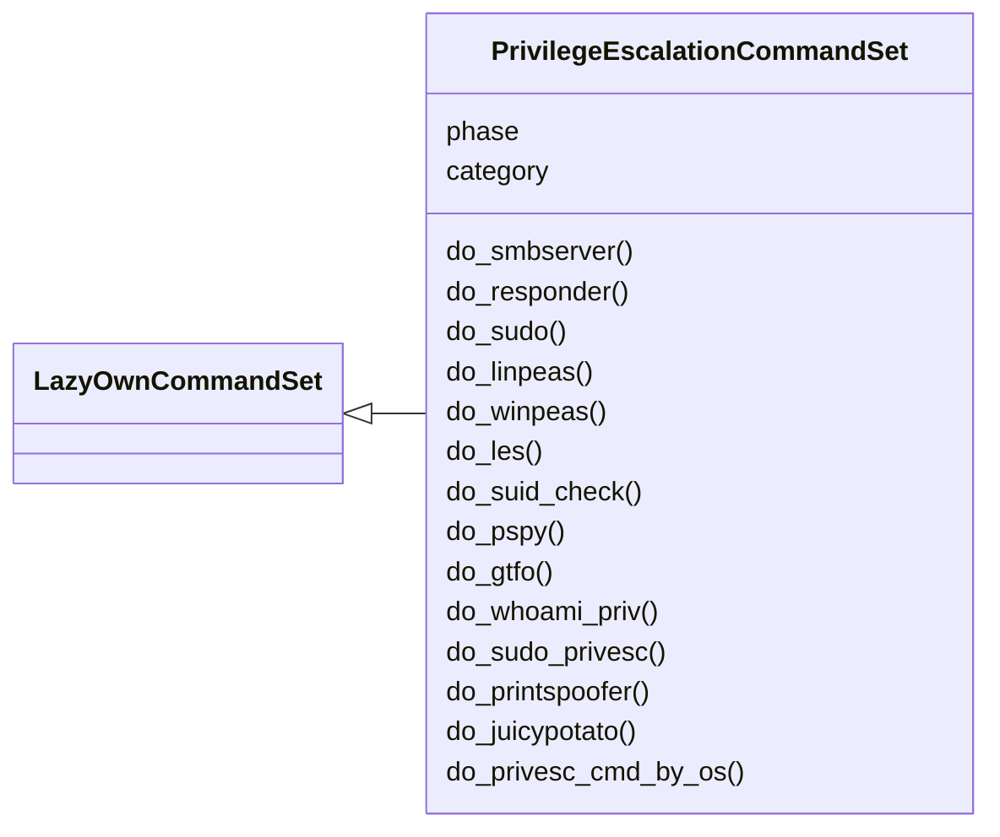
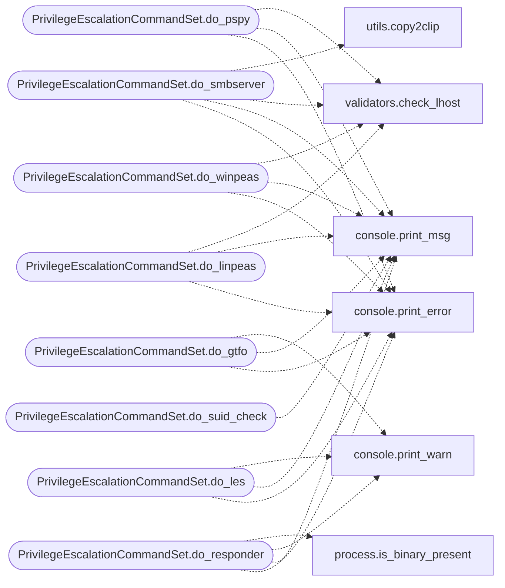

# `cli.commands.privilege_escalation`

> Source: [cli/commands/privilege_escalation.py:1](../../cli/commands/privilege_escalation.py#L1) | language `py` | coverage 100.0% | [API index](../index.md)

Privilege Escalation command set.

Pending phase module covering local privilege escalation helpers:
SMB relay setup, Responder, linpeas / winpeas / pspy serving, kernel
exploit suggestion (LES), SUID enumeration, GTFOBins / LOLBas lookup and
the ``sudo`` re-launch helper.

Pending status: this set inherits from
[`cli.commands._dormancy.PendingCommandSet`](cli.commands._dormancy.py.md#pendingcommandset), so it is discovered for
test coverage but not registered onto the shell while `[`LazyOwnShell`](lazyown.py.md#lazyownshell)`
still defines the original methods. Promote it to
[`cli.commands._base.LazyOwnCommandSet`](cli.commands._base.py.md#lazyowncommandset) once the legacy copies are
deleted from ``lazyown.py``.

## Contents

- **Classes:** [`PrivilegeEscalationCommandSet`](#privilegeescalationcommandset)

## Type Diagram



## Call Graph

Solid arrows stay in this module, dashed arrows leave it.



## Classes

<a id="privilegeescalationcommandset"></a>

### `PrivilegeEscalationCommandSet`

`class` | [cli/commands/privilege_escalation.py:132](../../cli/commands/privilege_escalation.py#L132)

```python
class PrivilegeEscalationCommandSet(LazyOwnCommandSet)
```

Bases: [`LazyOwnCommandSet`](cli.commands._base.py.md#lazyowncommandset)

Pending phase module for the Privilege Escalation commands.

**Attributes**

| Name | Type | Default | Description |
|---|---|---|---|
| [`phase`](#privilegeescalationcommandset-phase) |  | `'privesc'` |  |
| [`category`](#privilegeescalationcommandset-category) |  | `privilege_escalation_category` |  |

**Members**

| Member | Kind | Summary |
|---|---|---|
| [`do_smbserver`](#privilegeescalationcommandset-do_smbserver) | method | Stand up an Impacket SMB server with three relay variants. |
| [`do_responder`](#privilegeescalationcommandset-do_responder) | method | Run Responder on the configured `[`device`](lazyown.py.md#lazyownshell-device)` with elevated privileges. |
| [`do_sudo`](#privilegeescalationcommandset-do_sudo) | method | Re-launch the framework with root privileges when missing. |
| [`do_linpeas`](#privilegeescalationcommandset-do_linpeas) | method | Serve ``linpeas.sh`` over HTTP and print the target one-liner. |
| [`do_winpeas`](#privilegeescalationcommandset-do_winpeas) | method | Serve a winPEAS variant over HTTP and print the target one-liner. |
| [`do_les`](#privilegeescalationcommandset-do_les) | method | Run Linux Exploit Suggester against a kernel version. |
| [`do_suid_check`](#privilegeescalationcommandset-do_suid_check) | method | Print SUID/SGID enumeration commands ready to paste on the target. |
| [`do_pspy`](#privilegeescalationcommandset-do_pspy) | method | Serve the ``pspy`` process monitor over HTTP. |
| [`do_gtfo`](#privilegeescalationcommandset-do_gtfo) | method | Look up a binary in GTFOBins and LOLBas parquet knowledge bases. |
| [`do_whoami_priv`](#privilegeescalationcommandset-do_whoami_priv) | method | Print privilege enumeration commands for the target OS. |
| [`do_sudo_privesc`](#privilegeescalationcommandset-do_sudo_privesc) | method | Analyse sudo -l output and cross-reference with GTFOBins. |
| [`do_printspoofer`](#privilegeescalationcommandset-do_printspoofer) | method | Serve PrintSpoofer over HTTP for Windows privilege escalation. |
| [`do_juicypotato`](#privilegeescalationcommandset-do_juicypotato) | method | Serve JuicyPotato over HTTP for Windows privilege escalation. |
| [`do_privesc_cmd_by_os`](#privilegeescalationcommandset-do_privesc_cmd_by_os) | method | Prepare and send a linpeas/winpeas command to a C2 client. |

<a id="privilegeescalationcommandset-do_smbserver"></a>

#### `PrivilegeEscalationCommandSet.do_smbserver`

`method` | [cli/commands/privilege_escalation.py:139](../../cli/commands/privilege_escalation.py#L139)

Decorators: `@cmd2.with_category(privilege_escalation_category)`

```python
def do_smbserver(self, line)
```

Stand up an Impacket SMB server with three relay variants.

Variant 1 generates an SCF file under ``sessions/file.scf`` that
triggers SMB auth from victims browsing the share. Variant 2
copies a ``dnscmd`` DLL load one-liner for DA pivoting. Variant 3
publishes the share with ``guest`` credentials for blind file
drops.

**Parameters**

| Name | Type | Default | Description |
|---|---|---|---|
| `line` |  |  | Optional share folder name. Defaults to `DEFAULT_SMB_FOLDER`. |

**Returns:** None.

*Calls:* [`print_error`](core.console.py.md#print_error), [`print_msg`](core.console.py.md#print_msg), [`check_lhost`](core.validators.py.md#check_lhost), [`copy2clip`](utils.py.md#copy2clip)

<a id="privilegeescalationcommandset-do_responder"></a>

#### `PrivilegeEscalationCommandSet.do_responder`

`method` | [cli/commands/privilege_escalation.py:197](../../cli/commands/privilege_escalation.py#L197)

Decorators: `@cmd2.with_category(privilege_escalation_category)`

```python
def do_responder(self, line)
```

Run Responder on the configured `[`device`](lazyown.py.md#lazyownshell-device)` with elevated privileges.

Installs the package via ``apt`` when the binary is missing, then
invokes ``sudo responder -I <device> -w On`` so SMB/LLMNR/NBNS
poisoning starts immediately.

**Parameters**

| Name | Type | Default | Description |
|---|---|---|---|
| `line` |  |  | Unused. |

**Returns:** None.

*Calls:* [`print_error`](core.console.py.md#print_error), [`print_msg`](core.console.py.md#print_msg), [`print_warn`](core.console.py.md#print_warn), [`is_binary_present`](core.process.py.md#is_binary_present)

<a id="privilegeescalationcommandset-do_sudo"></a>

#### `PrivilegeEscalationCommandSet.do_sudo`

`method` | [cli/commands/privilege_escalation.py:222](../../cli/commands/privilege_escalation.py#L222)

Decorators: `@cmd2.with_category(privilege_escalation_category)`

```python
def do_sudo(self, line)
```

Re-launch the framework with root privileges when missing.

**Parameters**

| Name | Type | Default | Description |
|---|---|---|---|
| `line` |  |  | Unused. |

**Returns:** None.

<a id="privilegeescalationcommandset-do_linpeas"></a>

#### `PrivilegeEscalationCommandSet.do_linpeas`

`method` | [cli/commands/privilege_escalation.py:235](../../cli/commands/privilege_escalation.py#L235)

Decorators: `@cmd2.with_category(privilege_escalation_category)`

```python
def do_linpeas(self, line)
```

Serve ``linpeas.sh`` over HTTP and print the target one-liner.

Searches the configured candidates for the script, copies it
into ``sessions/`` and spawns a background HTTP server bound to
``lhost:lport`` so the compromised host can pull and execute it.

**Parameters**

| Name | Type | Default | Description |
|---|---|---|---|
| `line` |  |  | Optional ``small`` flag to switch to ``linpeas_small.sh``. |

**Returns:** None.

*Calls:* [`print_error`](core.console.py.md#print_error), [`print_msg`](core.console.py.md#print_msg), [`check_lhost`](core.validators.py.md#check_lhost)

<a id="privilegeescalationcommandset-do_winpeas"></a>

#### `PrivilegeEscalationCommandSet.do_winpeas`

`method` | [cli/commands/privilege_escalation.py:271](../../cli/commands/privilege_escalation.py#L271)

Decorators: `@cmd2.with_category(privilege_escalation_category)`

```python
def do_winpeas(self, line)
```

Serve a winPEAS variant over HTTP and print the target one-liner.

Selects the variant by argument: default x64, ``x86`` for 32-bit,
``bat`` for the batch script (no AV evasion), ``ps1`` for the
PowerShell port, or ``any`` for the merged binary.

**Parameters**

| Name | Type | Default | Description |
|---|---|---|---|
| `line` |  |  | Variant selector. Empty defaults to `WINPEAS_DEFAULT`. |

**Returns:** None.

*Calls:* [`print_error`](core.console.py.md#print_error), [`print_msg`](core.console.py.md#print_msg), [`check_lhost`](core.validators.py.md#check_lhost)

<a id="privilegeescalationcommandset-do_les"></a>

#### `PrivilegeEscalationCommandSet.do_les`

`method` | [cli/commands/privilege_escalation.py:310](../../cli/commands/privilege_escalation.py#L310)

Decorators: `@cmd2.with_category(privilege_escalation_category)`

```python
def do_les(self, line)
```

Run Linux Exploit Suggester against a kernel version.

When no version is supplied, attempts to read it from
``sessions/os.json``. Falls back to a warning when the kernel
cannot be determined.

**Parameters**

| Name | Type | Default | Description |
|---|---|---|---|
| `line` |  |  | Optional explicit kernel version (``uname -r`` output). |

**Returns:** None.

*Calls:* [`print_error`](core.console.py.md#print_error), [`print_msg`](core.console.py.md#print_msg), [`print_warn`](core.console.py.md#print_warn)

<a id="privilegeescalationcommandset-do_suid_check"></a>

#### `PrivilegeEscalationCommandSet.do_suid_check`

`method` | [cli/commands/privilege_escalation.py:350](../../cli/commands/privilege_escalation.py#L350)

Decorators: `@cmd2.with_category(privilege_escalation_category)`

```python
def do_suid_check(self, line)
```

Print SUID/SGID enumeration commands ready to paste on the target.

**Parameters**

| Name | Type | Default | Description |
|---|---|---|---|
| `line` |  |  | Unused. |

**Returns:** None.

*Calls:* [`print_msg`](core.console.py.md#print_msg)

<a id="privilegeescalationcommandset-do_pspy"></a>

#### `PrivilegeEscalationCommandSet.do_pspy`

`method` | [cli/commands/privilege_escalation.py:369](../../cli/commands/privilege_escalation.py#L369)

Decorators: `@cmd2.with_category(privilege_escalation_category)`

```python
def do_pspy(self, line)
```

Serve the ``pspy`` process monitor over HTTP.

**Parameters**

| Name | Type | Default | Description |
|---|---|---|---|
| `line` |  |  | ``32`` to serve ``pspy32``; anything else serves ``pspy64``. |

**Returns:** None.

*Calls:* [`print_error`](core.console.py.md#print_error), [`print_msg`](core.console.py.md#print_msg), [`check_lhost`](core.validators.py.md#check_lhost)

<a id="privilegeescalationcommandset-do_gtfo"></a>

#### `PrivilegeEscalationCommandSet.do_gtfo`

`method` | [cli/commands/privilege_escalation.py:403](../../cli/commands/privilege_escalation.py#L403)

Decorators: `@cmd2.with_category(privilege_escalation_category)`

```python
def do_gtfo(self, line)
```

Look up a binary in GTFOBins and LOLBas parquet knowledge bases.

**Parameters**

| Name | Type | Default | Description |
|---|---|---|---|
| `line` |  |  | Binary name to search (case-insensitive). Empty input emits a usage error. |

**Returns:** None.

*Calls:* [`print_error`](core.console.py.md#print_error), [`print_msg`](core.console.py.md#print_msg), [`print_warn`](core.console.py.md#print_warn)

<a id="privilegeescalationcommandset-do_whoami_priv"></a>

#### `PrivilegeEscalationCommandSet.do_whoami_priv`

`method` | [cli/commands/privilege_escalation.py:450](../../cli/commands/privilege_escalation.py#L450)

Decorators: `@cmd2.with_category(privilege_escalation_category)`

```python
def do_whoami_priv(self, line)
```

Print privilege enumeration commands for the target OS.

Detects the target OS from ``payload.json`` or ``sessions/os.json``
and prints a ready-to-paste set of commands that reveal the current
user's privileges, group memberships, and dangerous tokens.

**Parameters**

| Name | Type | Default | Description |
|---|---|---|---|
| `line` |  |  | Unused. |

**Returns:** None.

<a id="privilegeescalationcommandset-do_sudo_privesc"></a>

#### `PrivilegeEscalationCommandSet.do_sudo_privesc`

`method` | [cli/commands/privilege_escalation.py:512](../../cli/commands/privilege_escalation.py#L512)

Decorators: `@cmd2.with_category(privilege_escalation_category)`

```python
def do_sudo_privesc(self, line)
```

Analyse sudo -l output and cross-reference with GTFOBins.

Reads sudo -l output from a session file or command argument and
identifies binaries with documented privilege escalation bypasses
from the GTFOBins parquet knowledge base.

**Parameters**

| Name | Type | Default | Description |
|---|---|---|---|
| `line` |  |  | Optional path to a file containing sudo -l output. When empty, attempts to read from the last session report. |

**Returns:** None.

*Calls:* [`print_error`](core.console.py.md#print_error), [`print_msg`](core.console.py.md#print_msg), [`print_warn`](core.console.py.md#print_warn)

<a id="privilegeescalationcommandset-do_printspoofer"></a>

#### `PrivilegeEscalationCommandSet.do_printspoofer`

`method` | [cli/commands/privilege_escalation.py:610](../../cli/commands/privilege_escalation.py#L610)

Decorators: `@cmd2.with_category(privilege_escalation_category)`

```python
def do_printspoofer(self, line)
```

Serve PrintSpoofer over HTTP for Windows privilege escalation.

Searches for ``PrintSpoofer64.exe`` in configured directories,
copies it to ``sessions/`` and serves it via HTTP. Prints the
target one-liner for download + execution.

**Parameters**

| Name | Type | Default | Description |
|---|---|---|---|
| `line` |  |  | Unused. |

**Returns:** None.

<a id="privilegeescalationcommandset-do_juicypotato"></a>

#### `PrivilegeEscalationCommandSet.do_juicypotato`

`method` | [cli/commands/privilege_escalation.py:632](../../cli/commands/privilege_escalation.py#L632)

Decorators: `@cmd2.with_category(privilege_escalation_category)`

```python
def do_juicypotato(self, line)
```

Serve JuicyPotato over HTTP for Windows privilege escalation.

Searches for ``JuicyPotato.exe`` in configured directories,
copies it to ``sessions/`` and serves it via HTTP. Prints the
target one-liner for download + execution.

**Parameters**

| Name | Type | Default | Description |
|---|---|---|---|
| `line` |  |  | Optional CLSID for the potato attack. Defaults to the BITS CLSID when omitted. |

**Returns:** None.

<a id="privilegeescalationcommandset-do_privesc_cmd_by_os"></a>

#### `PrivilegeEscalationCommandSet.do_privesc_cmd_by_os`

`method` | [cli/commands/privilege_escalation.py:754](../../cli/commands/privilege_escalation.py#L754)

Decorators: `@cmd2.with_category(privilege_escalation_category)`

```python
def do_privesc_cmd_by_os(self, line)
```

Prepare and send a linpeas/winpeas command to a C2 client.

Detects the target OS from the world model or ``os.json``, builds a
ofuscated (base64) curl|bash one-liner via ``ofuscate_payload`` and
sends it to the specified C2 client via `[`issue_command_to_c2`](lazyown.py.md#lazyownshell-issue_command_to_c2)`.

**Parameters**

| Name | Type | Default | Description |
|---|---|---|---|
| `line` |  |  | ``<client_id> [--small]`` |

**Returns:** None

*Calls:* [`print_error`](core.console.py.md#print_error), [`print_msg`](core.console.py.md#print_msg), [`print_warn`](core.console.py.md#print_warn)

---
