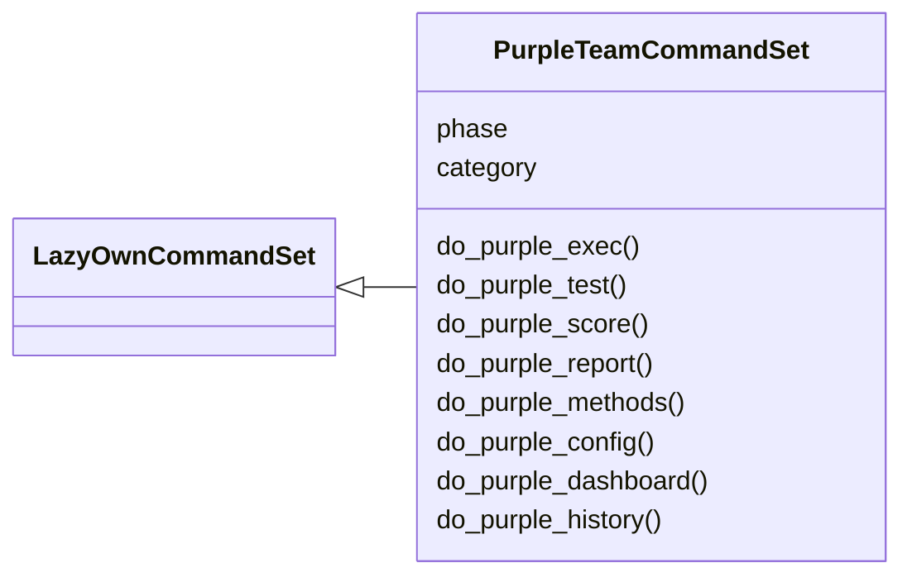
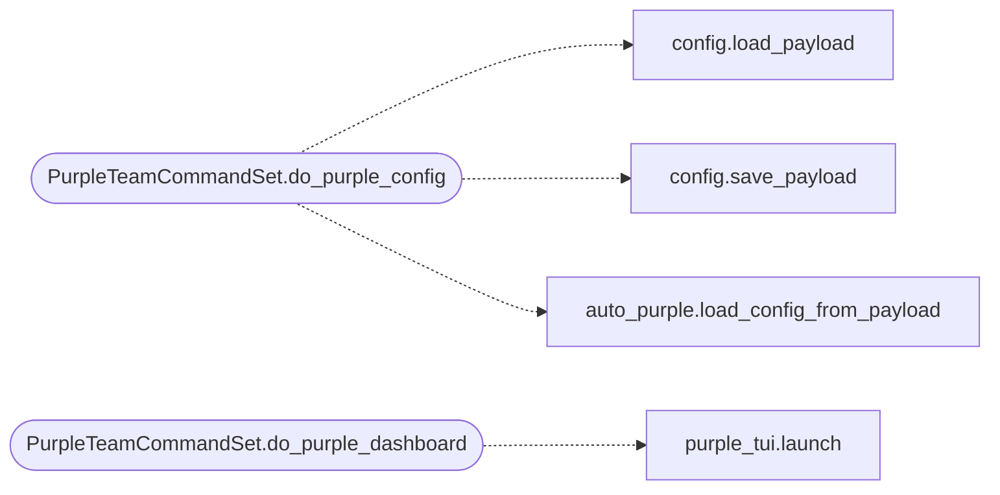

# `cli.commands.purple_team`

> Source: [cli/commands/purple_team.py:1](../../cli/commands/purple_team.py#L1) | language `py` | coverage 100.0% | [API index](../index.md)

Purple Team CommandSet: closed-loop offensive detection measurement.

Exposes commands that orchestrate the red->blue->purple cycle:

* ``purple_exec`` — execute a red action and measure detection via LazyOwnBT
* ``purple_test`` — measure without executing (dry-run, ai_test only)
* ``purple_score`` — show current engagement detection score
* ``purple_report`` — generate full engagement report with datasets
* ``purple_methods`` — list available detection methods
* ``purple_config`` — show/update purple team configuration
* ``purple_history`` — show recent purple team results

Each command generates CSV datasets for ML training and feedback for
the DetectionOracle calibration loop.

## Contents

- **Classes:** [`PurpleTeamCommandSet`](#purpleteamcommandset)

## Type Diagram



## Call Graph

Solid arrows stay in this module, dashed arrows leave it.



## Classes

<a id="purpleteamcommandset"></a>

### `PurpleTeamCommandSet`

`class` | [cli/commands/purple_team.py:124](../../cli/commands/purple_team.py#L124)

```python
class PurpleTeamCommandSet(LazyOwnCommandSet)
```

Bases: [`LazyOwnCommandSet`](cli.commands._base.py.md#lazyowncommandset)

Purple team orchestration commands for the LazyOwn shell.

**Attributes**

| Name | Type | Default | Description |
|---|---|---|---|
| [`phase`](#purpleteamcommandset-phase) |  | `'purple'` |  |
| [`category`](#purpleteamcommandset-category) |  | `_CATEGORY` |  |

**Members**

| Member | Kind | Summary |
|---|---|---|
| [`do_purple_exec`](#purpleteamcommandset-do_purple_exec) | method | Execute a red action and measure if LazyOwnBT detects it. |
| [`do_purple_test`](#purpleteamcommandset-do_purple_test) | method | Test if LazyOwnBT would detect a command (no execution). |
| [`do_purple_score`](#purpleteamcommandset-do_purple_score) | method | Show current engagement detection score. |
| [`do_purple_report`](#purpleteamcommandset-do_purple_report) | method | Generate full engagement report with datasets. |
| [`do_purple_methods`](#purpleteamcommandset-do_purple_methods) | method | List available LazyOwnBT detection methods. |
| [`do_purple_config`](#purpleteamcommandset-do_purple_config) | method | Show or update purple team configuration (payload.json). |
| [`do_purple_dashboard`](#purpleteamcommandset-do_purple_dashboard) | method | Launch the Purple Team TUI dashboard. |
| [`do_purple_history`](#purpleteamcommandset-do_purple_history) | method | Show recent purple team action results. |

<a id="purpleteamcommandset-do_purple_exec"></a>

#### `PurpleTeamCommandSet.do_purple_exec`

`method` | [cli/commands/purple_team.py:144](../../cli/commands/purple_team.py#L144)

Decorators: `@with_category(_CATEGORY)`

```python
def do_purple_exec(self, line: str) -> None
```

Execute a red action and measure if LazyOwnBT detects it.

Usage: purple_exec <command> [args...] [category]
The last word is category if it matches a known category.
Example: purple_exec nmap -sV 127.0.0.1 recon
Example: purple_exec lazynmap recon

**Parameters**

| Name | Type | Default | Description |
|---|---|---|---|
| `line` | `str` |  |  |

<a id="purpleteamcommandset-do_purple_test"></a>

#### `PurpleTeamCommandSet.do_purple_test`

`method` | [cli/commands/purple_team.py:203](../../cli/commands/purple_team.py#L203)

Decorators: `@with_argparser(_build_test_parser())`, `@with_category(_CATEGORY)`

```python
def do_purple_test(self, args: argparse.Namespace) -> None
```

Test if LazyOwnBT would detect a command (no execution).

Dry-run mode: queries BT detection methods without actually
executing the red action. Useful for pre-engagement assessment.

**Parameters**

| Name | Type | Default | Description |
|---|---|---|---|
| `args` | `argparse.Namespace` |  |  |

<a id="purpleteamcommandset-do_purple_score"></a>

#### `PurpleTeamCommandSet.do_purple_score`

`method` | [cli/commands/purple_team.py:223](../../cli/commands/purple_team.py#L223)

Decorators: `@with_category(_CATEGORY)`

```python
def do_purple_score(self, line: str) -> None
```

Show current engagement detection score.

Displays total actions, detection rate, per-category and per-method
breakdowns. Written to sessions/purple_score.json.

**Parameters**

| Name | Type | Default | Description |
|---|---|---|---|
| `line` | `str` |  |  |

<a id="purpleteamcommandset-do_purple_report"></a>

#### `PurpleTeamCommandSet.do_purple_report`

`method` | [cli/commands/purple_team.py:271](../../cli/commands/purple_team.py#L271)

Decorators: `@with_category(_CATEGORY)`

```python
def do_purple_report(self, line: str) -> None
```

Generate full engagement report with datasets.

Produces sessions/purple_report.json with score, oracle accuracy,
per-action results, and dataset paths for ML training.

**Parameters**

| Name | Type | Default | Description |
|---|---|---|---|
| `line` | `str` |  |  |

<a id="purpleteamcommandset-do_purple_methods"></a>

#### `PurpleTeamCommandSet.do_purple_methods`

`method` | [cli/commands/purple_team.py:285](../../cli/commands/purple_team.py#L285)

Decorators: `@with_category(_CATEGORY)`

```python
def do_purple_methods(self, line: str) -> None
```

List available LazyOwnBT detection methods.

**Parameters**

| Name | Type | Default | Description |
|---|---|---|---|
| `line` | `str` |  |  |

<a id="purpleteamcommandset-do_purple_config"></a>

#### `PurpleTeamCommandSet.do_purple_config`

`method` | [cli/commands/purple_team.py:297](../../cli/commands/purple_team.py#L297)

Decorators: `@with_argparser(_build_config_parser())`, `@with_category(_CATEGORY)`

```python
def do_purple_config(self, args: argparse.Namespace) -> None
```

Show or update purple team configuration (payload.json).

**Parameters**

| Name | Type | Default | Description |
|---|---|---|---|
| `args` | `argparse.Namespace` |  |  |

*Calls:* [`load_payload`](core.config.py.md#load_payload), [`save_payload`](core.config.py.md#save_payload), [`load_config_from_payload`](modules.auto_purple.py.md#load_config_from_payload)

<a id="purpleteamcommandset-do_purple_dashboard"></a>

#### `PurpleTeamCommandSet.do_purple_dashboard`

`method` | [cli/commands/purple_team.py:350](../../cli/commands/purple_team.py#L350)

Decorators: `@with_category(_CATEGORY)`

```python
def do_purple_dashboard(self, line: str) -> None
```

Launch the Purple Team TUI dashboard.

Full-screen Textual interface showing engagement score,
detection rates, recent actions, and ML dataset stats.
Press Q to return to the shell.

**Parameters**

| Name | Type | Default | Description |
|---|---|---|---|
| `line` | `str` |  |  |

*Calls:* [`launch`](cli.purple_tui.py.md#launch)

<a id="purpleteamcommandset-do_purple_history"></a>

#### `PurpleTeamCommandSet.do_purple_history`

`method` | [cli/commands/purple_team.py:367](../../cli/commands/purple_team.py#L367)

Decorators: `@with_argparser(_build_history_parser())`, `@with_category(_CATEGORY)`

```python
def do_purple_history(self, args: argparse.Namespace) -> None
```

Show recent purple team action results.

**Parameters**

| Name | Type | Default | Description |
|---|---|---|---|
| `args` | `argparse.Namespace` |  |  |

---
