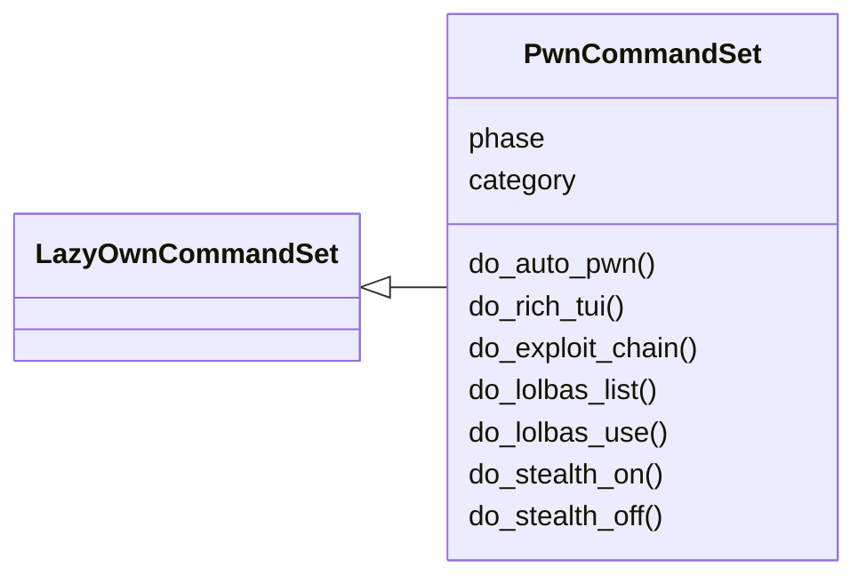

# `cli.commands.pwn`

> Source: [cli/commands/pwn.py:1](../../cli/commands/pwn.py#L1) | language `py` | coverage 100.0% | [API index](../index.md)

Autonomous exploitation and LOLBAS command set.

New chingon commands: auto_pwn, rich_tui, lolbas_list, lolbas_use,
exploit_chain, stealth.

## Contents

- **Classes:** [`PwnCommandSet`](#pwncommandset)

## Type Diagram



## Call Graph

Solid arrows stay in this module, dashed arrows leave it.

```mermaid
flowchart LR
    n_cli_commands_pwn_py__PwnCommandSet_do_auto_pwn(["PwnCommandSet.do_auto_pwn"])
    n_core_console_py__print_error["console.print_error"]
    n_core_console_py__print_msg["console.print_msg"]
    n_core_console_py__print_warn["console.print_warn"]
    n_modules_autonomous_exploit_engine_py__AutonomousExploitEngine___init__["autonomous_exploit_engine.AutonomousExploitEngine.__init__"]
    n_modules_autonomous_exploit_engine_py__AutonomousExploitEngine_enable_stealth["autonomous_exploit_engine.AutonomousExploitEngine.enable_stealth"]
    n_modules_autonomous_exploit_engine_py__AutonomousExploitEngine_full_auto_pwn["autonomous_exploit_engine.AutonomousExploitEngine.full_auto_pwn"]
    n_modules_autonomous_exploit_engine_py__AutonomousExploitEngine_profile["autonomous_exploit_engine.AutonomousExploitEngine.profile"]
    n_cli_commands_pwn_py__PwnCommandSet_do_rich_tui(["PwnCommandSet.do_rich_tui"])
    n_modules_dashboard_engine_py__DashboardEngine___init__["dashboard_engine.DashboardEngine.__init__"]
    n_modules_dashboard_engine_py__DashboardEngine_set_exploit_recommender["dashboard_engine.DashboardEngine.set_exploit_recommender"]
    n_modules_exploit_recommender_py__ExploitRecommender___init__["exploit_recommender.ExploitRecommender.__init__"]
    n_modules_rich_tui_py__RichDashboard___init__["rich_tui.RichDashboard.__init__"]
    n_modules_rich_tui_py__RichDashboard_run["rich_tui.RichDashboard.run"]
    n_modules_world_model_py__WorldModel___init__["world_model.WorldModel.__init__"]
    n_cli_commands_pwn_py__PwnCommandSet_do_exploit_chain(["PwnCommandSet.do_exploit_chain"])
    n_modules_ai_exploit_chain_py__AIExploitChainer___init__["ai_exploit_chain.AIExploitChainer.__init__"]
    n_modules_ai_exploit_chain_py__AIExploitChainer_adapt_chain["ai_exploit_chain.AIExploitChainer.adapt_chain"]
    n_modules_ai_exploit_chain_py__AIExploitChainer_build_chain_plan["ai_exploit_chain.AIExploitChainer.build_chain_plan"]
    n_modules_ai_exploit_chain_py__AIExploitChainer_evaluate_failure["ai_exploit_chain.AIExploitChainer.evaluate_failure"]
    n_modules_ai_exploit_chain_py__AIExploitChainer_reason["ai_exploit_chain.AIExploitChainer.reason"]
    n_modules_ai_exploit_chain_py__ExploitChainContext["ai_exploit_chain.ExploitChainContext"]
    n_cli_commands_pwn_py__PwnCommandSet_do_auto_pwn -.-> n_core_console_py__print_error
    n_cli_commands_pwn_py__PwnCommandSet_do_auto_pwn -.-> n_core_console_py__print_msg
    n_cli_commands_pwn_py__PwnCommandSet_do_auto_pwn -.-> n_core_console_py__print_warn
    n_cli_commands_pwn_py__PwnCommandSet_do_auto_pwn -.-> n_modules_autonomous_exploit_engine_py__AutonomousExploitEngine___init__
    n_cli_commands_pwn_py__PwnCommandSet_do_auto_pwn -.-> n_modules_autonomous_exploit_engine_py__AutonomousExploitEngine_enable_stealth
    n_cli_commands_pwn_py__PwnCommandSet_do_auto_pwn -.-> n_modules_autonomous_exploit_engine_py__AutonomousExploitEngine_full_auto_pwn
    n_cli_commands_pwn_py__PwnCommandSet_do_auto_pwn -.-> n_modules_autonomous_exploit_engine_py__AutonomousExploitEngine_profile
    n_cli_commands_pwn_py__PwnCommandSet_do_rich_tui -.-> n_core_console_py__print_error
    n_cli_commands_pwn_py__PwnCommandSet_do_rich_tui -.-> n_modules_dashboard_engine_py__DashboardEngine___init__
    n_cli_commands_pwn_py__PwnCommandSet_do_rich_tui -.-> n_modules_dashboard_engine_py__DashboardEngine_set_exploit_recommender
    n_cli_commands_pwn_py__PwnCommandSet_do_rich_tui -.-> n_modules_exploit_recommender_py__ExploitRecommender___init__
    n_cli_commands_pwn_py__PwnCommandSet_do_rich_tui -.-> n_modules_rich_tui_py__RichDashboard___init__
    n_cli_commands_pwn_py__PwnCommandSet_do_rich_tui -.-> n_modules_rich_tui_py__RichDashboard_run
    n_cli_commands_pwn_py__PwnCommandSet_do_rich_tui -.-> n_modules_world_model_py__WorldModel___init__
    n_cli_commands_pwn_py__PwnCommandSet_do_exploit_chain -.-> n_core_console_py__print_error
    n_cli_commands_pwn_py__PwnCommandSet_do_exploit_chain -.-> n_core_console_py__print_msg
    n_cli_commands_pwn_py__PwnCommandSet_do_exploit_chain -.-> n_core_console_py__print_warn
    n_cli_commands_pwn_py__PwnCommandSet_do_exploit_chain -.-> n_modules_ai_exploit_chain_py__AIExploitChainer___init__
    n_cli_commands_pwn_py__PwnCommandSet_do_exploit_chain -.-> n_modules_ai_exploit_chain_py__AIExploitChainer_adapt_chain
    n_cli_commands_pwn_py__PwnCommandSet_do_exploit_chain -.-> n_modules_ai_exploit_chain_py__AIExploitChainer_build_chain_plan
    n_cli_commands_pwn_py__PwnCommandSet_do_exploit_chain -.-> n_modules_ai_exploit_chain_py__AIExploitChainer_evaluate_failure
    n_cli_commands_pwn_py__PwnCommandSet_do_exploit_chain -.-> n_modules_ai_exploit_chain_py__AIExploitChainer_reason
    n_cli_commands_pwn_py__PwnCommandSet_do_exploit_chain -.-> n_modules_ai_exploit_chain_py__ExploitChainContext
    n_cli_commands_pwn_py__PwnCommandSet_do_exploit_chain -.-> n_modules_autonomous_exploit_engine_py__AutonomousExploitEngine___init__
```



## Classes

<a id="pwncommandset"></a>

### `PwnCommandSet`

`class` | [cli/commands/pwn.py:28](../../cli/commands/pwn.py#L28)

```python
class PwnCommandSet(LazyOwnCommandSet)
```

Bases: [`LazyOwnCommandSet`](cli.commands._base.py.md#lazyowncommandset)

Autonomous exploitation, LOLBAS, and advanced attack commands.

**Attributes**

| Name | Type | Default | Description |
|---|---|---|---|
| [`phase`](#pwncommandset-phase) |  | `'exploit'` |  |
| [`category`](#pwncommandset-category) |  | `'03. Exploitation'` |  |

**Members**

| Member | Kind | Summary |
|---|---|---|
| [`do_auto_pwn`](#pwncommandset-do_auto_pwn) | method | Run the full autonomous exploitation chain against the target. |
| [`do_rich_tui`](#pwncommandset-do_rich_tui) | method | Launch the Rich-based live dashboard TUI. |
| [`do_exploit_chain`](#pwncommandset-do_exploit_chain) | method | AI-driven multi-step exploit chaining with fallback strategies. |
| [`do_lolbas_list`](#pwncommandset-do_lolbas_list) | method | List available LOLBAS (Living Off The Land) techniques from plugins. |
| [`do_lolbas_use`](#pwncommandset-do_lolbas_use) | method | Execute a specific LOLBAS technique. |
| [`do_stealth_on`](#pwncommandset-do_stealth_on) | method | Enable stealth mode for subsequent operations. |
| [`do_stealth_off`](#pwncommandset-do_stealth_off) | method | Disable stealth mode. |

<a id="pwncommandset-do_auto_pwn"></a>

#### `PwnCommandSet.do_auto_pwn`

`method` | [cli/commands/pwn.py:35](../../cli/commands/pwn.py#L35)

Decorators: `@cmd2.with_category(exploitation_category)`

```python
def do_auto_pwn(self, line)
```

Run the full autonomous exploitation chain against the target.

Usage:
    auto_pwn [--pivot] [--privesc] [--stealth low|medium|high|paranoid]

Executes recon, vulnerability scanning, exploit selection,
exploitation, optional privilege escalation and auto-pivoting.

**Parameters**

| Name | Type | Default | Description |
|---|---|---|---|
| `line` |  |  |  |

*Calls:* [`print_error`](core.console.py.md#print_error), [`print_msg`](core.console.py.md#print_msg), [`print_warn`](core.console.py.md#print_warn), [`AutonomousExploitEngine.__init__`](modules.autonomous_exploit_engine.py.md#autonomousexploitengine-__init__), [`AutonomousExploitEngine.enable_stealth`](modules.autonomous_exploit_engine.py.md#autonomousexploitengine-enable_stealth), [`AutonomousExploitEngine.full_auto_pwn`](modules.autonomous_exploit_engine.py.md#autonomousexploitengine-full_auto_pwn), [`AutonomousExploitEngine.profile`](modules.autonomous_exploit_engine.py.md#autonomousexploitengine-profile)

<a id="pwncommandset-do_rich_tui"></a>

#### `PwnCommandSet.do_rich_tui`

`method` | [cli/commands/pwn.py:109](../../cli/commands/pwn.py#L109)

Decorators: `@cmd2.with_category(miscellaneous_category)`

```python
def do_rich_tui(self, line)
```

Launch the Rich-based live dashboard TUI.

Usage:
    rich_tui [--interval 3]

Opens a real-time htop-style terminal dashboard showing host
topology, service status, exploit recommendations, active
pivots and beacons. Press 'q' to quit.

**Parameters**

| Name | Type | Default | Description |
|---|---|---|---|
| `line` |  |  |  |

*Calls:* [`print_error`](core.console.py.md#print_error), [`DashboardEngine.__init__`](modules.dashboard_engine.py.md#dashboardengine-__init__), [`DashboardEngine.set_exploit_recommender`](modules.dashboard_engine.py.md#dashboardengine-set_exploit_recommender), [`ExploitRecommender.__init__`](modules.exploit_recommender.py.md#exploitrecommender-__init__), [`RichDashboard.__init__`](modules.rich_tui.py.md#richdashboard-__init__), [`RichDashboard.run`](modules.rich_tui.py.md#richdashboard-run), [`WorldModel.__init__`](modules.world_model.py.md#worldmodel-__init__)

<a id="pwncommandset-do_exploit_chain"></a>

#### `PwnCommandSet.do_exploit_chain`

`method` | [cli/commands/pwn.py:158](../../cli/commands/pwn.py#L158)

Decorators: `@cmd2.with_category(exploitation_category)`

```python
def do_exploit_chain(self, line)
```

AI-driven multi-step exploit chaining with fallback strategies.

Usage:
    exploit_chain <target_ip>

Uses heuristic reasoning to chain exploits: if one fails,
the engine analyzes the failure and pivots to an alternative
strategy automatically.

**Parameters**

| Name | Type | Default | Description |
|---|---|---|---|
| `line` |  |  |  |

*Calls:* [`print_error`](core.console.py.md#print_error), [`print_msg`](core.console.py.md#print_msg), [`print_warn`](core.console.py.md#print_warn), [`AIExploitChainer.__init__`](modules.ai_exploit_chain.py.md#aiexploitchainer-__init__), [`AIExploitChainer.adapt_chain`](modules.ai_exploit_chain.py.md#aiexploitchainer-adapt_chain), [`AIExploitChainer.build_chain_plan`](modules.ai_exploit_chain.py.md#aiexploitchainer-build_chain_plan), [`AIExploitChainer.evaluate_failure`](modules.ai_exploit_chain.py.md#aiexploitchainer-evaluate_failure), [`AIExploitChainer.reason`](modules.ai_exploit_chain.py.md#aiexploitchainer-reason), [`ExploitChainContext`](modules.ai_exploit_chain.py.md#exploitchaincontext), [`AutonomousExploitEngine.__init__`](modules.autonomous_exploit_engine.py.md#autonomousexploitengine-__init__), [`AutonomousExploitEngine.execute_candidate`](modules.autonomous_exploit_engine.py.md#autonomousexploitengine-execute_candidate), [`AutonomousExploitEngine.profile`](modules.autonomous_exploit_engine.py.md#autonomousexploitengine-profile)

<a id="pwncommandset-do_lolbas_list"></a>

#### `PwnCommandSet.do_lolbas_list`

`method` | [cli/commands/pwn.py:245](../../cli/commands/pwn.py#L245)

Decorators: `@cmd2.with_category(miscellaneous_category)`

```python
def do_lolbas_list(self, line)
```

List available LOLBAS (Living Off The Land) techniques from plugins.

Usage:
    lolbas_list [amsi|etw|powershell|dotnet|all]

Displays evasion and execution techniques that use native OS
binaries and scripts to bypass security controls.

**Parameters**

| Name | Type | Default | Description |
|---|---|---|---|
| `line` |  |  |  |

*Calls:* [`print_error`](core.console.py.md#print_error), [`print_msg`](core.console.py.md#print_msg), [`print_warn`](core.console.py.md#print_warn)

<a id="pwncommandset-do_lolbas_use"></a>

#### `PwnCommandSet.do_lolbas_use`

`method` | [cli/commands/pwn.py:302](../../cli/commands/pwn.py#L302)

Decorators: `@cmd2.with_category(exploitation_category)`

```python
def do_lolbas_use(self, line)
```

Execute a specific LOLBAS technique.

Usage:
    lolbas_use <plugin>/<technique_name>

Example: lolbas_use amsi_bypass/amsiInitFailed

**Parameters**

| Name | Type | Default | Description |
|---|---|---|---|
| `line` |  |  |  |

*Calls:* [`print_error`](core.console.py.md#print_error), [`print_msg`](core.console.py.md#print_msg), [`print_warn`](core.console.py.md#print_warn), [`safe_run_shell`](core.safe_exec.py.md#safe_run_shell), [`check_lport`](core.validators.py.md#check_lport)

<a id="pwncommandset-do_stealth_on"></a>

#### `PwnCommandSet.do_stealth_on`

`method` | [cli/commands/pwn.py:394](../../cli/commands/pwn.py#L394)

Decorators: `@cmd2.with_category(exploitation_category)`

```python
def do_stealth_on(self, line)
```

Enable stealth mode for subsequent operations.

Usage:
    stealth_on [low|medium|high|paranoid]

Adds delays between operations, limits concurrency, and applies
traffic shaping to avoid detection.

**Parameters**

| Name | Type | Default | Description |
|---|---|---|---|
| `line` |  |  |  |

*Calls:* [`print_error`](core.console.py.md#print_error), [`print_msg`](core.console.py.md#print_msg), [`AutonomousExploitEngine.get_instance`](modules.autonomous_exploit_engine.py.md#autonomousexploitengine-get_instance)

<a id="pwncommandset-do_stealth_off"></a>

#### `PwnCommandSet.do_stealth_off`

`method` | [cli/commands/pwn.py:422](../../cli/commands/pwn.py#L422)

Decorators: `@cmd2.with_category(miscellaneous_category)`

```python
def do_stealth_off(self, line)
```

Disable stealth mode.

**Parameters**

| Name | Type | Default | Description |
|---|---|---|---|
| `line` |  |  |  |

*Calls:* [`print_msg`](core.console.py.md#print_msg), [`AutonomousExploitEngine.get_instance`](modules.autonomous_exploit_engine.py.md#autonomousexploitengine-get_instance)

---
