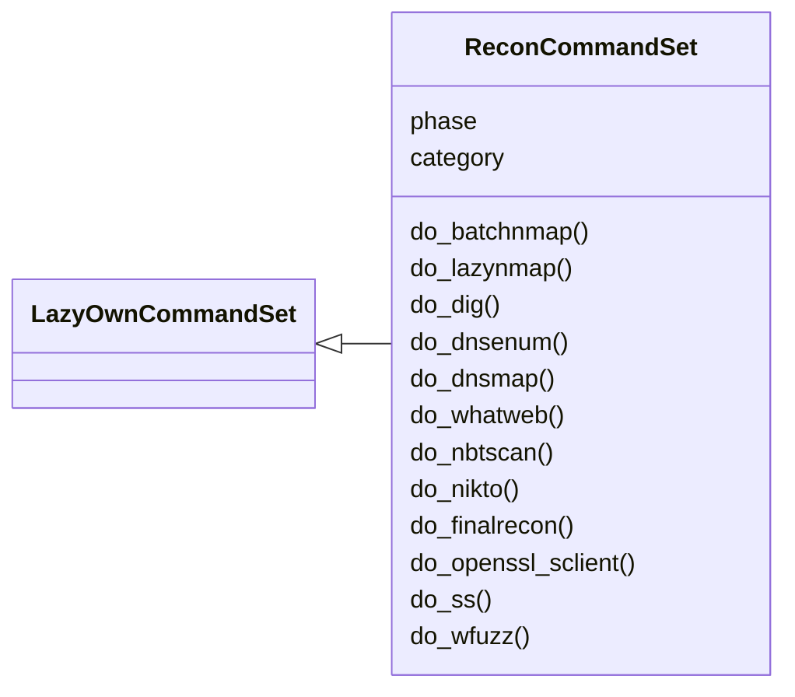
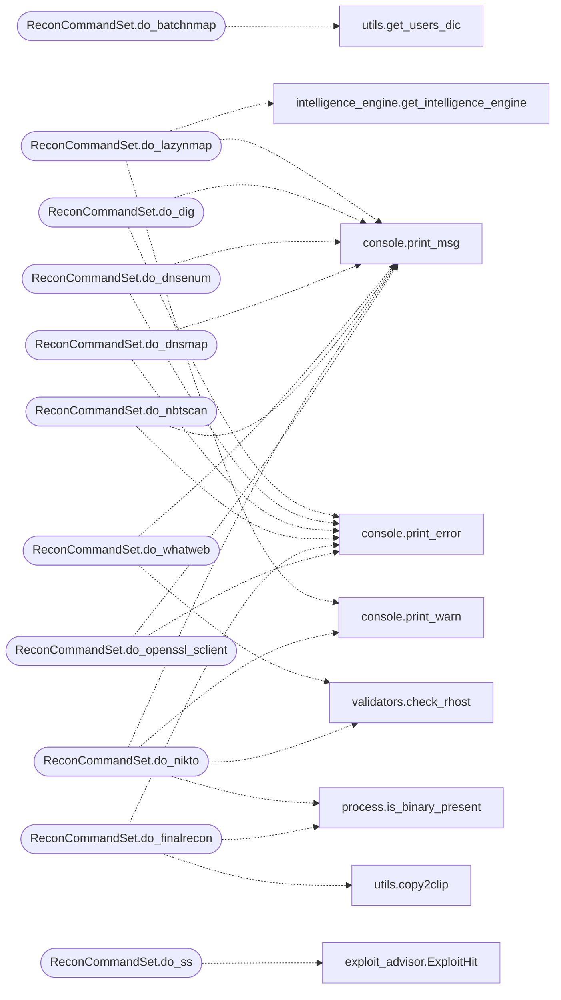

# `cli.commands.recon`

> Source: [cli/commands/recon.py:1](../../cli/commands/recon.py#L1) | language `py` | coverage 100.0% | [API index](../index.md)

Reconnaissance command set.

Network reconnaissance commands: nmap variants, DNS tools, web fingerprinting,
and quick recon scripts.

## Contents

- **Classes:** [`ReconCommandSet`](#reconcommandset)

## Type Diagram



## Call Graph

Solid arrows stay in this module, dashed arrows leave it.



## Classes

<a id="reconcommandset"></a>

### `ReconCommandSet`

`class` | [cli/commands/recon.py:40](../../cli/commands/recon.py#L40)

```python
class ReconCommandSet(LazyOwnCommandSet)
```

Bases: [`LazyOwnCommandSet`](cli.commands._base.py.md#lazyowncommandset)

Reconnaissance phase commands.

**Attributes**

| Name | Type | Default | Description |
|---|---|---|---|
| [`phase`](#reconcommandset-phase) |  | `'recon'` |  |
| [`category`](#reconcommandset-category) |  | `'01. Reconnaissance'` |  |

**Members**

| Member | Kind | Summary |
|---|---|---|
| [`do_batchnmap`](#reconcommandset-do_batchnmap) | method | Runs the internal module `modules/lazynmap.sh` for multiple Nmap scans. |
| [`do_lazynmap`](#reconcommandset-do_lazynmap) | method | Runs the internal module `modules/lazynmap.sh` with target mode. |
| [`do_dig`](#reconcommandset-do_dig) | method | Executes the `dig` command to query DNS information. |
| [`do_dnsenum`](#reconcommandset-do_dnsenum) | method | Performs DNS enumeration using `dnsenum` to identify subdomains for a given domain. |
| [`do_dnsmap`](#reconcommandset-do_dnsmap) | method | Performs DNS enumeration using `dnsmap` to discover subdomains for a specified domain. |
| [`do_whatweb`](#reconcommandset-do_whatweb) | method | Performs a web technology fingerprinting scan using `whatweb`. |
| [`do_nbtscan`](#reconcommandset-do_nbtscan) | method | Performs network scanning using `nbtscan` to discover NetBIOS names and addresses in a specified range. |
| [`do_nikto`](#reconcommandset-do_nikto) | method | Runs the `nikto` tool to perform a web server vulnerability scan against the specified target host. |
| [`do_finalrecon`](#reconcommandset-do_finalrecon) | method | Runs the `finalrecon` tool to perform a web server vulnerability scan against the specified target host. |
| [`do_openssl_sclient`](#reconcommandset-do_openssl_sclient) | method | Uses `openssl s_client` to connect to a specified host and port, allowing for testing and debugging of SSL/TLS connections. |
| [`do_ss`](#reconcommandset-do_ss) | method | Search all exploit sources and map findings to the next LazyOwn command. |
| [`do_wfuzz`](#reconcommandset-do_wfuzz) | method | Uses `wfuzz` to perform fuzzing based on provided parameters. |

<a id="reconcommandset-do_batchnmap"></a>

#### `ReconCommandSet.do_batchnmap`

`method` | [cli/commands/recon.py:47](../../cli/commands/recon.py#L47)

Decorators: `@cmd2.with_category(scanning_category)`

```python
def do_batchnmap(self, line)
```

Runs the internal module `modules/lazynmap.sh` for multiple Nmap scans.

This method executes the `lazynmap` script, using the current working directory
and the `rhost` parameter from the `self.params` dictionary as the target IP.
If `rhost` is not set, it prints an error message.

**Parameters**

| Name | Type | Default | Description |
|---|---|---|---|
| `line` |  |  |  |

**Returns:** None

*Calls:* [`get_users_dic`](utils.py.md#get_users_dic)

<a id="reconcommandset-do_lazynmap"></a>

#### `ReconCommandSet.do_lazynmap`

`method` | [cli/commands/recon.py:74](../../cli/commands/recon.py#L74)

Decorators: `@cmd2.with_category(scanning_category)`

```python
def do_lazynmap(self, line)
```

Runs the internal module `modules/lazynmap.sh` with target mode.

OS detection (via ping TTL) is performed automatically before scanning
when the target OS is not yet known, so that tool selectors downstream
have a valid platform context.

**Parameters**

| Name | Type | Default | Description |
|---|---|---|---|
| `line` | `str` |  | The network IP to scan. Defaults to rhost from params. |

**Returns:** None

*Calls:* [`print_msg`](core.console.py.md#print_msg), [`print_warn`](core.console.py.md#print_warn), [`get_intelligence_engine`](modules.intelligence_engine.py.md#get_intelligence_engine)

<a id="reconcommandset-do_dig"></a>

#### `ReconCommandSet.do_dig`

`method` | [cli/commands/recon.py:154](../../cli/commands/recon.py#L154)

Decorators: `@cmd2.with_category(recon_category)`

```python
def do_dig(self, line)
```

Executes the `dig` command to query DNS information.

1. Retrieves the DNS server IP from the `line` parameter and the target host from the `rhost` parameter.
2. If either the DNS server or `rhost` is not provided, an error message is printed.
3. Executes the `dig` command to query the version of the DNS server and additional records.


Manual execution:
To manually run these commands, use the following syntax:
    dig version.bind CHAOS TXT @<dns_server>
    dig any <domain> @<rhost>

Replace `<dns_server>` with the IP address or hostname of the DNS server, `<domain>` with the target domain, and `<rhost>` with the IP address or hostname of the target machine.

**Parameters**

| Name | Type | Default | Description |
|---|---|---|---|
| `line` |  |  | DNS server IP or hostname. Must be provided for the `dig` command. |

**Returns:** None

*Calls:* [`print_error`](core.console.py.md#print_error), [`print_msg`](core.console.py.md#print_msg)

<a id="reconcommandset-do_dnsenum"></a>

#### `ReconCommandSet.do_dnsenum`

`method` | [cli/commands/recon.py:186](../../cli/commands/recon.py#L186)

Decorators: `@cmd2.with_category(recon_category)`

```python
def do_dnsenum(self, line)
```

Performs DNS enumeration using `dnsenum` to identify subdomains for a given domain.

1. Executes the `dnsenum` command with parameters to specify the DNS server, output file, and wordlist for enumeration.


Manual execution:
To manually perform DNS enumeration, use the following command:
    dnsenum --dnsserver <dns_server> --enum -p 0 -s 0 -o <output_file> -f <dns_wordlist> <target_domain>

Replace `<dns_server>` with the DNS server IP, `<output_file>` with the file path to save the results, `<dns_wordlist>` with the path to your DNS wordlist file, and `<target_domain>` with the domain to be enumerated.

For example:
    dnsenum --dnsserver 10.10.11.24 --enum -p 0 -s 0 -o sessions/subdomains.txt -f /path/to/dnswordlist.txt ghost.htb

**Parameters**

| Name | Type | Default | Description |
|---|---|---|---|
| `line` |  |  | The target domain to perform DNS enumeration on, e.g., `ghost.htb`. |

**Returns:** None

*Calls:* [`print_error`](core.console.py.md#print_error), [`print_msg`](core.console.py.md#print_msg)

<a id="reconcommandset-do_dnsmap"></a>

#### `ReconCommandSet.do_dnsmap`

`method` | [cli/commands/recon.py:222](../../cli/commands/recon.py#L222)

Decorators: `@cmd2.with_category(recon_category)`

```python
def do_dnsmap(self, line)
```

Performs DNS enumeration using `dnsmap` to discover subdomains for a specified domain.

1. Executes the `dnsmap` command to scan the given domain with a specified wordlist.


Manual execution:
To manually perform DNS enumeration, use the following command:
    dnsmap <target_domain> -w <dns_wordlist>

Replace `<target_domain>` with the domain you want to scan and `<dns_wordlist>` with the path to your DNS wordlist file.

For example:
    dnsmap ghost.htb -w /path/to/dnswordlist.txt

**Parameters**

| Name | Type | Default | Description |
|---|---|---|---|
| `line` |  |  | The target domain to perform DNS enumeration on, e.g., `ghost.htb`. |

**Returns:** None

*Calls:* [`print_error`](core.console.py.md#print_error), [`print_msg`](core.console.py.md#print_msg)

<a id="reconcommandset-do_whatweb"></a>

#### `ReconCommandSet.do_whatweb`

`method` | [cli/commands/recon.py:255](../../cli/commands/recon.py#L255)

Decorators: `@cmd2.with_category(recon_category)`

```python
def do_whatweb(self, line)
```

Performs a web technology fingerprinting scan using `whatweb`.

1. Executes the `whatweb` command to identify technologies used by the target web application.


Manual execution:
To manually perform web technology fingerprinting, use the following command:
    whatweb <target_host>

Replace `<target_host>` with the URL or IP address of the web application you want to scan.

For example:
    whatweb example.com

**Parameters**

| Name | Type | Default | Description |
|---|---|---|---|
| `line` |  |  | This parameter is not used in the current implementation but could be used to pass additional options or arguments if needed. |

**Returns:** None

*Calls:* [`print_msg`](core.console.py.md#print_msg), [`check_rhost`](core.validators.py.md#check_rhost)

<a id="reconcommandset-do_nbtscan"></a>

#### `ReconCommandSet.do_nbtscan`

`method` | [cli/commands/recon.py:292](../../cli/commands/recon.py#L292)

Decorators: `@cmd2.with_category(scanning_category)`

```python
def do_nbtscan(self, line)
```

Performs network scanning using `nbtscan` to discover NetBIOS names and addresses in a specified range.

1. Executes the `nbtscan` command with the `-r` option to scan the specified range of IP addresses for NetBIOS information.


Manual execution:
To manually perform a NetBIOS scan across a network range, use the following command:
    sudo nbtscan -r <network_range>

Replace `<network_range>` with the IP address range you want to scan. For example:
    sudo nbtscan -r 192.168.1.0/24

**Parameters**

| Name | Type | Default | Description |
|---|---|---|---|
| `line` |  |  | This parameter is not used in the current implementation but could be used to specify additional options or arguments if needed. |

**Returns:** None

*Calls:* [`print_error`](core.console.py.md#print_error), [`print_msg`](core.console.py.md#print_msg)

<a id="reconcommandset-do_nikto"></a>

#### `ReconCommandSet.do_nikto`

`method` | [cli/commands/recon.py:320](../../cli/commands/recon.py#L320)

Decorators: `@cmd2.with_category(scanning_category)`

```python
def do_nikto(self, line)
```

Runs the `nikto` tool to perform a web server vulnerability scan against the specified target host.

1. Executes `nikto` with the `-h` option to specify the target host IP address.
2. Installs `nikto` if it is not already installed.


Manual execution:
To manually perform a web server vulnerability scan using `nikto`, use the following command:
    nikto -h <target_ip>

Replace `<target_ip>` with the IP address of the target web server. For example:
    nikto -h 10.10.10.10

**Parameters**

| Name | Type | Default | Description |
|---|---|---|---|
| `line` |  |  | This parameter is not used in the current implementation but could be used to specify additional options or arguments if needed. |

**Returns:** None

*Calls:* [`print_msg`](core.console.py.md#print_msg), [`print_warn`](core.console.py.md#print_warn), [`is_binary_present`](core.process.py.md#is_binary_present), [`check_rhost`](core.validators.py.md#check_rhost)

<a id="reconcommandset-do_finalrecon"></a>

#### `ReconCommandSet.do_finalrecon`

`method` | [cli/commands/recon.py:429](../../cli/commands/recon.py#L429)

Decorators: `@cmd2.with_category(recon_category)`

```python
def do_finalrecon(self, line)
```

Runs the `finalrecon` tool to perform a web server vulnerability scan against the specified target host.

1. Executes `finalrecon` with the `-h` option to specify the target host IP address.


Manual execution:
To manually perform a web server vulnerability scan using `finalrecon`, use the following command:
    finalrecon --url=http://<target_ip> --full -o txt -cd <directory_reports>

Replace `<target_ip>` with the IP address of the target web server. For example:
    finalrecon --url=http://192.168.1.92 --full -o txt -cd /home/gris/finalrecon

**Parameters**

| Name | Type | Default | Description |
|---|---|---|---|
| `line` |  |  | This parameter is not used in the current implementation but could be used to specify additional options or arguments if needed. |

**Returns:** None

*Calls:* [`print_error`](core.console.py.md#print_error), [`is_binary_present`](core.process.py.md#is_binary_present), [`copy2clip`](utils.py.md#copy2clip)

<a id="reconcommandset-do_openssl_sclient"></a>

#### `ReconCommandSet.do_openssl_sclient`

`method` | [cli/commands/recon.py:461](../../cli/commands/recon.py#L461)

Decorators: `@cmd2.with_category(recon_category)`

```python
def do_openssl_sclient(self, line)
```

Uses `openssl s_client` to connect to a specified host and port, allowing for testing and debugging of SSL/TLS connections.

Manual execution:
To manually connect to a server using `openssl s_client` and test SSL/TLS, use the following command:
    openssl s_client -connect <target_ip>:<port>

Replace `<target_ip>` with the IP address or hostname of the target server and `<port>` with the port number. For example:
    openssl s_client -connect 10.10.10.10:443

**Parameters**

| Name | Type | Default | Description |
|---|---|---|---|
| `line` |  |  | The port number to connect to on the target host. This must be provided as an argument. |

**Returns:** None

*Calls:* [`print_error`](core.console.py.md#print_error), [`print_msg`](core.console.py.md#print_msg)

<a id="reconcommandset-do_ss"></a>

#### `ReconCommandSet.do_ss`

`method` | [cli/commands/recon.py:491](../../cli/commands/recon.py#L491)

Decorators: `@cmd2.with_category(exploitation_category)`

```python
def do_ss(self, line)
```

Search all exploit sources and map findings to the next LazyOwn command.

Without arguments: reads the nmap XML for the current rhost, extracts
every open service+version, searches all sources for each one, saves
structured results to sessions/ss_results_<rhost>.json, creates tasks
for services with hits, and prints a 'what to try next' table.

With a manual query: runs the full multi-source search (searchsploit,
NVD, ExploitAlert, PacketStorm, MSF, Sploitus) for that term and shows
recommended commands for the matching service.

Usage:
    ``ss``                  — auto-scan from nmap XML for current rhost
    ``ss apache 2.4.49``    — manual query
    ``ss OpenSSH 8.4``      — manual query

**Parameters**

| Name | Type | Default | Description |
|---|---|---|---|
| `line` |  |  |  |

*Calls:* [`ExploitHit`](cli.exploit_advisor.py.md#exploithit), [`ServiceInfo`](cli.exploit_advisor.py.md#serviceinfo), [`ServiceResult`](cli.exploit_advisor.py.md#serviceresult), [`find_nmap_xml`](cli.exploit_advisor.py.md#find_nmap_xml), [`inject_exploit_tasks`](cli.exploit_advisor.py.md#inject_exploit_tasks), [`parse_nmap_xml`](cli.exploit_advisor.py.md#parse_nmap_xml), [`print_exploit_summary`](cli.exploit_advisor.py.md#print_exploit_summary), [`save_ss_results`](cli.exploit_advisor.py.md#save_ss_results), [`print_error`](core.console.py.md#print_error), [`print_msg`](core.console.py.md#print_msg), [`print_warn`](core.console.py.md#print_warn), [`is_binary_present`](core.process.py.md#is_binary_present) and 7 more

<a id="reconcommandset-do_wfuzz"></a>

#### `ReconCommandSet.do_wfuzz`

`method` | [cli/commands/recon.py:654](../../cli/commands/recon.py#L654)

Decorators: `@cmd2.with_category(scanning_category)`

```python
def do_wfuzz(self, line)
```

Uses `wfuzz` to perform fuzzing based on provided parameters.

This function supports various options for directory and file fuzzing.

Manual execution:
To manually use `wfuzz` for directory and file fuzzing, use the following commands:

1. For fuzzing DNS subdomains:
    wfuzz -c <extra_options> -t <threads> -w <wordlist> -H 'Host: FUZZ.<domain>' <domain>

Example:
    wfuzz -c --hl=7 -t 200 -w /path/to/dnswordlist -H 'Host: FUZZ.example.com' example.com

2. For fuzzing IIS directories:
    wfuzz -c <extra_options> -t <threads> -w /path/to/iiswordlist http://<rhost>/FUZZ

Example:
    wfuzz -c --hl=7 -t 200 -w /usr/share/wordlists/SecLists-master/Discovery/Web-Content/IIS.fuzz.txt http://10.10.10.10/FUZZ

3. For general directory and file fuzzing:
    wfuzz -c <extra_options> -t <threads> -w <wordlist> http://<rhost>/FUZZ

Example:
    wfuzz -c --hl=7 -t 200 -w /path/to/dirwordlist http://10.10.10.10/FUZZ

**Parameters**

| Name | Type | Default | Description |
|---|---|---|---|
| `line` |  |  | The options and arguments for `wfuzz`. The `line` parameter can include the following: - `sub <domain>`: Fuzz DNS subdomains. Requires `dnswordlist` to be assign. - `iis`: Fuzz IIS directories. Uses a default wordlist if `iiswordlist` is not assign. - Any other argument: General directory and file fuzzing. |

**Returns:** None

*Calls:* [`print_error`](core.console.py.md#print_error), [`print_msg`](core.console.py.md#print_msg), [`get_domain`](utils.py.md#get_domain)

---
