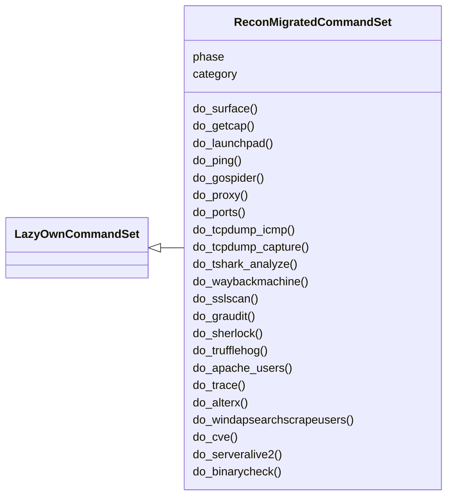
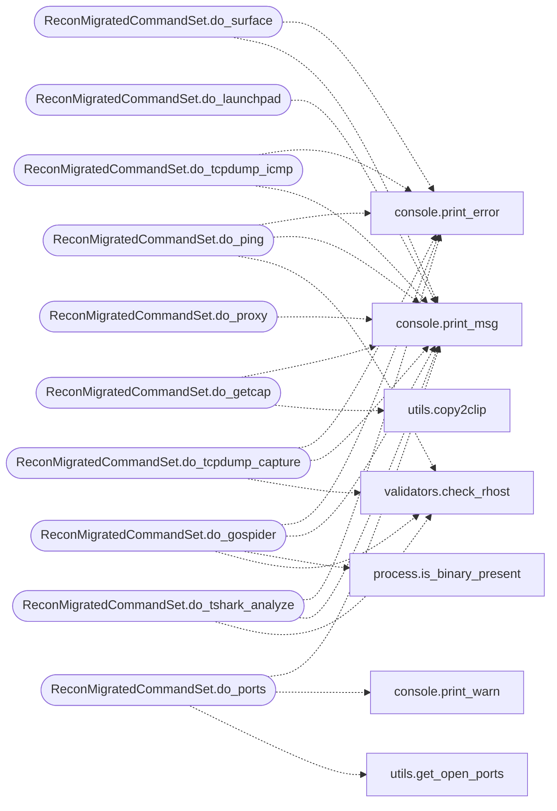

# `cli.commands.recon_migrated`

> Source: [cli/commands/recon_migrated.py:1](../../cli/commands/recon_migrated.py#L1) | language `py` | coverage 96.7% | [API index](../index.md)

recon commands migrated from lazyown.py.

Auto-generated by scripts/migrate_lazyown.py.

## Contents

- **Classes:** [`ReconMigratedCommandSet`](#reconmigratedcommandset)

## Type Diagram



## Call Graph

Solid arrows stay in this module, dashed arrows leave it.



## Classes

<a id="reconmigratedcommandset"></a>

### `ReconMigratedCommandSet`

`class` | [cli/commands/recon_migrated.py:38](../../cli/commands/recon_migrated.py#L38)

```python
class ReconMigratedCommandSet(LazyOwnCommandSet)
```

Bases: [`LazyOwnCommandSet`](cli.commands._base.py.md#lazyowncommandset)

**Attributes**

| Name | Type | Default | Description |
|---|---|---|---|
| [`phase`](#reconmigratedcommandset-phase) |  | `'recon'` |  |
| [`category`](#reconmigratedcommandset-category) |  | `'01. Reconnaissance'` |  |

**Members**

| Member | Kind | Summary |
|---|---|---|
| [`do_surface`](#reconmigratedcommandset-do_surface) | method | Render the network surface graph in the terminal. |
| [`do_getcap`](#reconmigratedcommandset-do_getcap) | method | Retrieve and display file capabilities on the system. |
| [`do_launchpad`](#reconmigratedcommandset-do_launchpad) | method | Searches for packages on Launchpad based on the provided search term and extracts codenames from the results. |
| [`do_ping`](#reconmigratedcommandset-do_ping) | method | Perform a ping to check host availability and infer the operating system based on TTL values. |
| [`do_gospider`](#reconmigratedcommandset-do_gospider) | method | Try gospider for web spidering. |
| [`do_proxy`](#reconmigratedcommandset-do_proxy) | method | Runs a small proxy server to modify HTTP requests on the fly. |
| [`do_ports`](#reconmigratedcommandset-do_ports) | method | Lists all open TCP and UDP ports on the local system. |
| [`do_tcpdump_icmp`](#reconmigratedcommandset-do_tcpdump_icmp) | method | Starts `tcpdump` to capture ICMP traffic on the specified interface. |
| [`do_tcpdump_capture`](#reconmigratedcommandset-do_tcpdump_capture) | method | Starts packet capture using `tcpdump` on the specified interface. |
| [`do_tshark_analyze`](#reconmigratedcommandset-do_tshark_analyze) | method | Analyzes a packet capture file using `tshark` based on the provided remote host IP. |
| [`do_waybackmachine`](#reconmigratedcommandset-do_waybackmachine) | method | Fetch URLs from the Wayback Machine for a given website. |
| [`do_sslscan`](#reconmigratedcommandset-do_sslscan) | method | Run an SSL scan on the specified remote host. |
| [`do_graudit`](#reconmigratedcommandset-do_graudit) | method | Executes the graudit command to perform a static code analysis with the specified options. |
| [`do_sherlock`](#reconmigratedcommandset-do_sherlock) | method | Executes the Sherlock tool to find usernames across social networks. |
| [`do_trufflehog`](#reconmigratedcommandset-do_trufflehog) | method | Executes trufflehog to search for secrets in a given Git repository URL. |
| [`do_apache_users`](#reconmigratedcommandset-do_apache_users) | method | Performs enumeration of users from a target system using `apache-users`. |
| [`do_trace`](#reconmigratedcommandset-do_trace) | method | Traces the DNS information for a given self.params['domain'] using the FreeDNS service. |
| [`do_alterx`](#reconmigratedcommandset-do_alterx) | method | Executes the 'alterx' command for subdomain enumeration on the provided self.params['domain']. |
| [`do_windapsearchscrapeusers`](#reconmigratedcommandset-do_windapsearchscrapeusers) | method | Extracts usernames from a JSON output generated by go-windapsearch and appends them to the file sessions/users.txt. |
| [`do_cve`](#reconmigratedcommandset-do_cve) | method | Search for a CVE using the CIRCL API. |
| [`do_serveralive2`](#reconmigratedcommandset-do_serveralive2) | method | Command serveralive2: Uses Impacket to connect to a remote MSRPC interface and retrieves the server bindings. |
| [`do_binarycheck`](#reconmigratedcommandset-do_binarycheck) | method | Performs various checks on a selected binary to gather information and protections. |
| [`do_dnstool_py`](#reconmigratedcommandset-do_dnstool_py) | method | Executes the dnstool.py tool to modify Active Directory-integrated DNS records. |
| [`do_metabigor`](#reconmigratedcommandset-do_metabigor) | method | Executes Metabigor commands for OSINT and scanning tasks with guided input or predefined arguments. |
| [`do_httprobe`](#reconmigratedcommandset-do_httprobe) | method | Executes the httprobe tool to probe domains for working HTTP and HTTPS servers. |
| [`do_recon`](#reconmigratedcommandset-do_recon) | method | Performs reconnaissance on a specified self.params['domain'] using crt.sh (the target must be visible on internet), pup, httprobe, and EyeWitness. |
| [`do_dnschef`](#reconmigratedcommandset-do_dnschef) | method | Executes the DNSChef tool to monitor DNS queries and intercept responses. |
| [`do_ipinfo`](#reconmigratedcommandset-do_ipinfo) | method | Retrieves detailed information about an IP address using the ARIN API. |

<a id="reconmigratedcommandset-do_surface"></a>

#### `ReconMigratedCommandSet.do_surface`

`method` | [cli/commands/recon_migrated.py:43](../../cli/commands/recon_migrated.py#L43)

Decorators: `@cmd2.with_category('01. Reconnaissance')`

```python
def do_surface(self, line)
```

Render the network surface graph in the terminal.

Mirrors the ``vis.js`` graph at ``http://<lhost>:<c2_port>/`` but
works entirely from the filesystem: it reads the same artefacts
``lazyc2.py`` consumes (``sessions/hostsdiscovery.txt``,
``sessions/scan_discovery*.csv``, per-implant ``sessions/<id>.log``,
``payload.json``) so the operator can inspect the picture from a
cmd2 shell with no Flask server attached.

Usage:
    `[`surface`](lazyc2.py.md#surface)`         — print a static Rich tree + stats table.
    ``surface --tui``   — open the full-screen Textual explorer.
    ``surface --json``  — emit the graph as JSON.
    ``surface --help``  — show this message.

**Parameters**

| Name | Type | Default | Description |
|---|---|---|---|
| `line` | `str` |  | optional flags ``--tui``, ``--json`` or ``--help``. |

**Returns:** None

*Calls:* [`print_error`](core.console.py.md#print_error), [`print_msg`](core.console.py.md#print_msg)

<a id="reconmigratedcommandset-do_getcap"></a>

#### `ReconMigratedCommandSet.do_getcap`

`method` | [cli/commands/recon_migrated.py:97](../../cli/commands/recon_migrated.py#L97)

Decorators: `@cmd2.with_category('01. Reconnaissance')`

```python
def do_getcap(self, line)
```

Retrieve and display file capabilities on the system.

This function uses the `getcap` command to recursively list capabilities for files starting from the root directory (`/`). The output is filtered to suppress error messages.

Usage:
    getcap


Manual execution:
1. Run the `getcap -r /` command to list file capabilities recursively from the root directory.
2. Redirect standard error to `/dev/null` to suppress error messages.
3. Copy to clipboard the command to appy in the victim machine.
Dependencies:
- `getcap` must be installed on the system.

Example:
    To execute the function, simply call [`do_getcap`](#reconmigratedcommandset-do_getcap).

Note:
    - The command may require elevated permissions to access certain directories and files.

**Parameters**

| Name | Type | Default | Description |
|---|---|---|---|
| `line` | `str` |  | This parameter is not used in this function. |

**Returns:** None

*Calls:* [`print_msg`](core.console.py.md#print_msg), [`copy2clip`](utils.py.md#copy2clip)

<a id="reconmigratedcommandset-do_launchpad"></a>

#### `ReconMigratedCommandSet.do_launchpad`

`method` | [cli/commands/recon_migrated.py:131](../../cli/commands/recon_migrated.py#L131)

Decorators: `@cmd2.with_category('01. Reconnaissance')`

```python
def do_launchpad(self, line)
```

Searches for packages on Launchpad based on the provided search term and extracts codenames from the results.

The distribution is extracted from the search term.

Manual execution:
To manually execute the equivalent command, use the following steps:

1. Extract the distribution from the search term:
- This function assumes the distribution name is part of the search term and is used to build the URL.

2. URL encode the search term:
- Replace spaces with `%20` to form the encoded search query.

3. Use `curl` to perform the search and filter results:
curl -s "https://launchpad.net/+search?field.text=<encoded_search_term>" | grep 'href' | grep '<distribution>' | grep -oP '(?<=href="https://launchpad.net/<distribution>/)[^/"]+' | sort -u

Example:
    If the search term is "8.2p1 Ubuntu 4ubuntu0.11", the command would be:
    curl -s "https://launchpad.net/+search?field.text=8.2p1%20Ubuntu%204ubuntu0.11" | grep 'href' | grep 'ubuntu' | grep -oP '(?<=href="https://launchpad.net/ubuntu/)[^/"]+' | sort -u

Notes:
    - Ensure that `curl` is installed and accessible in your environment.
    - The extracted codenames are printed to the console.

**Parameters**

| Name | Type | Default | Description |
|---|---|---|---|
| `line` |  |  | The search term to be used for querying Launchpad. The [`line`](modules.defense_eval.py.md#evaluation-line) parameter should be a string containing the search term, e.g., "8.2p1 Ubuntu 4ubuntu0.11". |

**Returns:** None

*Calls:* [`print_msg`](core.console.py.md#print_msg)

<a id="reconmigratedcommandset-do_ping"></a>

#### `ReconMigratedCommandSet.do_ping`

`method` | [cli/commands/recon_migrated.py:177](../../cli/commands/recon_migrated.py#L177)

Decorators: `@cmd2.with_category('01. Reconnaissance')`

```python
def do_ping(self, line)
```

Perform a ping to check host availability and infer the operating system based on TTL values.

Manual execution:
To manually ping a host and determine its operating system, use the following command:

    ping -c 1 <target>

Example:
    ping -c 1 10.10.10.10

The TTL (Time To Live) value is used to infer the operating system:
- TTL values around 64 typically indicate a Linux system.
- TTL values around 128 typically indicate a Windows system.

Ensure you have assign `self.params['rhost']` to the target host for the command to work.

**Parameters**

| Name | Type | Default | Description |
|---|---|---|---|
| `line` |  |  | This parameter is not used in the function but could be used for additional options or settings. |

**Returns:** None

*Calls:* [`print_error`](core.console.py.md#print_error), [`print_msg`](core.console.py.md#print_msg), [`check_rhost`](core.validators.py.md#check_rhost)

<a id="reconmigratedcommandset-do_gospider"></a>

#### `ReconMigratedCommandSet.do_gospider`

`method` | [cli/commands/recon_migrated.py:285](../../cli/commands/recon_migrated.py#L285)

Decorators: `@cmd2.with_category('01. Reconnaissance')`

```python
def do_gospider(self, line)
```

Try gospider for web spidering.

This function executes the `gospider` tool to perform web spidering. It can either use a URL provided as a parameter or the remote host defined in `self.params`.

Usage:
    gospider url
    gospider


- If [`line`](modules.defense_eval.py.md#evaluation-line) is "url", the method uses the URL specified in `self.params['url']`.
- If [`line`](modules.defense_eval.py.md#evaluation-line) is not "url", the method uses the remote host specified in `self.params['rhost']`.


Manual execution:
1. Ensure that the `gospider` tool is installed on the system.
2. assign the [`url`](modules.lazy_oob.py.md#url) parameter if using the "url" mode.
3. Run the method to perform the spidering operation.

Dependencies:
- `gospider` must be installed on the system.
- The `sudo` command must be available for installing `gospider`.

Examples:
    1. To scan a specific URL: `gospider url`
    2. To scan the remote host: `gospider`

Note:
    - If `gospider` is not installed, the method will attempt to install it.
    - Ensure that the network and tools are configured correctly for successful execution.

**Parameters**

| Name | Type | Default | Description |
|---|---|---|---|
| `line` | `str` |  | Command parameter that determines the execution mode. Use "url" to specify a URL, or leave empty to use the remote host. |

**Returns:** None

*Calls:* [`print_error`](core.console.py.md#print_error), [`print_msg`](core.console.py.md#print_msg), [`is_binary_present`](core.process.py.md#is_binary_present), [`check_rhost`](core.validators.py.md#check_rhost)

<a id="reconmigratedcommandset-do_proxy"></a>

#### `ReconMigratedCommandSet.do_proxy`

`method` | [cli/commands/recon_migrated.py:373](../../cli/commands/recon_migrated.py#L373)

Decorators: `@cmd2.with_category('01. Reconnaissance')`

```python
def do_proxy(self, line)
```

Runs a small proxy server to modify HTTP requests on the fly.

This function starts the `lazyproxy.py` script, which acts as a proxy server for intercepting and modifying HTTP requests. The server listens on port 8888.

Usage:
    proxy


Manual execution:
1. Executes the `lazyproxy.py` script to start the proxy server.
2. The proxy server will run and modify requests as configured in the script.

Dependencies:
- The `lazyproxy.py` script must be available in the [`modules`](modules.__init__.py.md) directory.

Example:
    proxy

Note:
    - Ensure that the `lazyproxy.py` script is correctly configured before running.
    - The proxy server will be accessible at `http://localhost:8888`.
    - To stop the proxy server, terminate the running process manually.

**Parameters**

| Name | Type | Default | Description |
|---|---|---|---|
| `line` | `str` |  | This parameter is not used in the current implementation. |

**Returns:** None

*Calls:* [`print_msg`](core.console.py.md#print_msg)

<a id="reconmigratedcommandset-do_ports"></a>

#### `ReconMigratedCommandSet.do_ports`

`method` | [cli/commands/recon_migrated.py:411](../../cli/commands/recon_migrated.py#L411)

Decorators: `@cmd2.with_category('01. Reconnaissance')`

```python
def do_ports(self, line)
```

Lists all open TCP and UDP ports on the local system.

This function performs the following actions:
1. Calls the `get_open_ports` function to retrieve lists of open TCP and UDP ports.
2. Prints a header for open TCP ports.
3. Iterates over the list of open TCP ports, printing each IP address and port number.
4. Prints a header for open UDP ports.
5. Iterates over the list of open UDP ports, printing each IP address and port number.

Usage:
    ports


Manual execution:
To manually use this function:
1. Ensure the `get_open_ports` function is defined and properly implemented to return lists of open TCP and UDP ports.
2. Run the function to display open TCP and UDP ports on the local system.

Note: The `get_open_ports` function should return two lists of tuples: one for TCP ports and one for UDP ports. Each tuple should contain an IP address and a port number.

**Parameters**

| Name | Type | Default | Description |
|---|---|---|---|
| `line` | `str` |  | This parameter is not used in the function. |

**Returns:** None

*Calls:* [`print_msg`](core.console.py.md#print_msg), [`print_warn`](core.console.py.md#print_warn), [`get_open_ports`](utils.py.md#get_open_ports)

<a id="reconmigratedcommandset-do_tcpdump_icmp"></a>

#### `ReconMigratedCommandSet.do_tcpdump_icmp`

`method` | [cli/commands/recon_migrated.py:453](../../cli/commands/recon_migrated.py#L453)

Decorators: `@cmd2.with_category('01. Reconnaissance')`

```python
def do_tcpdump_icmp(self, line)
```

Starts `tcpdump` to capture ICMP traffic on the specified interface.

1. Checks if the [`line`](modules.defense_eval.py.md#evaluation-line) argument (interface) is provided:
- Displays an error message and exits if the interface is missing.

2. If the interface is provided:
- Displays the `tcpdump` command that will be executed.
- Runs the `tcpdump` command to capture ICMP traffic on the specified interface.


Manual execution:
To manually run these tasks, you would need to:
- Provide a valid network interface for capturing ICMP traffic.
- Execute the `tcpdump` command manually to capture ICMP traffic on the specified interface.

Note: Ensure that you have sufficient permissions to run `tcpdump` on the specified interface.

**Parameters**

| Name | Type | Default | Description |
|---|---|---|---|
| `line` | `str` |  | The network interface on which to capture ICMP traffic (e.g., `tun0`). |

**Returns:** None

*Calls:* [`print_error`](core.console.py.md#print_error), [`print_msg`](core.console.py.md#print_msg)

<a id="reconmigratedcommandset-do_tcpdump_capture"></a>

#### `ReconMigratedCommandSet.do_tcpdump_capture`

`method` | [cli/commands/recon_migrated.py:486](../../cli/commands/recon_migrated.py#L486)

Decorators: `@cmd2.with_category('01. Reconnaissance')`

```python
def do_tcpdump_capture(self, line)
```

Starts packet capture using `tcpdump` on the specified interface.

1. Checks if the [`line`](modules.defense_eval.py.md#evaluation-line) argument (interface) is provided:
- Displays an error message and exits if the interface is missing.

2. Validates the `self.params['rhost']` (remote host IP):
- Exits the function if the `self.params['rhost']` is not valid.

3. If the interface and `self.params['rhost']` are valid:
- Displays the `tcpdump` command that will be executed.
- Runs the `tcpdump` command to capture packets on the specified interface and save the capture file to `pcaps/capture_<self.params['rhost']>.pcap`.


Manual execution:
To manually run these tasks, you would need to:
- Provide a valid network interface for capturing packets.
- Ensure the remote host IP is assign correctly.
- Execute the `tcpdump` command manually to capture packets on the specified interface.

Note: Ensure that the `pcaps` directory exists and is writable for saving the capture file.

**Parameters**

| Name | Type | Default | Description |
|---|---|---|---|
| `line` | `str` |  | The network interface on which to capture packets (e.g., `tun0`). |

**Returns:** None

*Calls:* [`print_error`](core.console.py.md#print_error), [`print_msg`](core.console.py.md#print_msg), [`check_rhost`](core.validators.py.md#check_rhost)

<a id="reconmigratedcommandset-do_tshark_analyze"></a>

#### `ReconMigratedCommandSet.do_tshark_analyze`

`method` | [cli/commands/recon_migrated.py:527](../../cli/commands/recon_migrated.py#L527)

Decorators: `@cmd2.with_category('01. Reconnaissance')`

```python
def do_tshark_analyze(self, line)
```

Analyzes a packet capture file using `tshark` based on the provided remote host IP.

1. Checks if the `self.params['rhost']` (remote host IP) is valid:
- Displays an error message and exits if the `self.params['rhost']` is not valid.

2. Verifies the existence of the packet capture file:
- Displays an error message and exits if the capture file is missing.
- Prompts the user to run the [`do_tcpdump_capture`](#reconmigratedcommandset-do_tcpdump_capture) command first.

3. If the capture file exists:
- Displays the `tshark` command that will be executed.
- Runs the `tshark` command to analyze the packet capture file and print out IP destination and frame time fields.


Manual execution:
To manually run these tasks, you would need to:
- Ensure the remote host IP is valid.
- Run the [`do_tcpdump_capture`](#reconmigratedcommandset-do_tcpdump_capture) command to capture packets.
- Execute the `tshark` command manually to analyze the packet capture file.

Note: Ensure that the capture file `pcaps/capture_<self.params['rhost']>.pcap` is available in the `pcaps` directory.

**Parameters**

| Name | Type | Default | Description |
|---|---|---|---|
| `line` | `str` |  | The command line input specifying the interface for capturing packets. |

**Returns:** None

*Calls:* [`print_error`](core.console.py.md#print_error), [`print_msg`](core.console.py.md#print_msg), [`check_rhost`](core.validators.py.md#check_rhost)

<a id="reconmigratedcommandset-do_waybackmachine"></a>

#### `ReconMigratedCommandSet.do_waybackmachine`

`method` | [cli/commands/recon_migrated.py:593](../../cli/commands/recon_migrated.py#L593)

Decorators: `@cmd2.with_category('01. Reconnaissance')`

```python
def do_waybackmachine(self, line)
```

Fetch URLs from the Wayback Machine for a given website.

The URL is taken from line. If the URL is not provided, an error is printed. The limit of results is taken from self.params['limit'] if provided; otherwise, defaults to 10. Results are printed directly to the console.

**Parameters**

| Name | Type | Default | Description |
|---|---|---|---|
| `line` |  |  |  |

*Calls:* [`print_error`](core.console.py.md#print_error), [`print_msg`](core.console.py.md#print_msg), [`print_warn`](core.console.py.md#print_warn)

<a id="reconmigratedcommandset-do_sslscan"></a>

#### `ReconMigratedCommandSet.do_sslscan`

`method` | [cli/commands/recon_migrated.py:633](../../cli/commands/recon_migrated.py#L633)

Decorators: `@cmd2.with_category('01. Reconnaissance')`

```python
def do_sslscan(self, line)
```

Run an SSL scan on the specified remote host.

This function initiates an SSL scan on a specified remote host (`self.params['rhost']`)
using the `sslscan-singleip.sh` script. If a specific port is provided in the
[`line`](modules.defense_eval.py.md#evaluation-line) argument, the scan will target that port; otherwise, it will scan
all available ports.

line (str): The port number to scan (optional). If omitted, the scan will target all ports.

Internal Variables:
self.params['rhost'] (str): The remote host IP address or hostname extracted from the `params` attribute.

None

Example Usage:
- To scan all ports on the specified `self.params['rhost']`: `sslscan`
- To scan a specific port (e.g., port 443) on `self.params['rhost']`: `sslscan 443`

- The [`check_rhost`](core.validators.py.md#check_rhost) function is used to validate the `self.params['rhost']` before running the scan.
- The `sslscan-singleip.sh` script must be present in the `sessions` directory.

**Parameters**

| Name | Type | Default | Description |
|---|---|---|---|
| `line` |  |  |  |

*Calls:* [`print_msg`](core.console.py.md#print_msg), [`check_rhost`](core.validators.py.md#check_rhost)

<a id="reconmigratedcommandset-do_graudit"></a>

#### `ReconMigratedCommandSet.do_graudit`

`method` | [cli/commands/recon_migrated.py:674](../../cli/commands/recon_migrated.py#L674)

Decorators: `@cmd2.with_category('01. Reconnaissance')`

```python
def do_graudit(self, line)
```

Executes the graudit command to perform a static code analysis with the specified options.

This function runs the 'graudit' tool with the '-A' option for an advanced scan and
the '-i sessions' option to include session files. The results will be displayed
directly in the terminal.

**Parameters**

| Name | Type | Default | Description |
|---|---|---|---|
| `line` | `str` |  | Input line from the command interface. This argument is currently not used within the function but is required for the command interface structure. |

**Example**

```python
To run this function from the command interface, simply type 'graudit' and press enter.
The function will execute the 'graudit -A -i sessions' command.
```

> **Note:** Ensure that 'graudit' is installed and properly configured in your system's PATH
> for this function to work correctly.

*Calls:* [`print_warn`](core.console.py.md#print_warn), [`is_binary_present`](core.process.py.md#is_binary_present)

<a id="reconmigratedcommandset-do_sherlock"></a>

#### `ReconMigratedCommandSet.do_sherlock`

`method` | [cli/commands/recon_migrated.py:705](../../cli/commands/recon_migrated.py#L705)

Decorators: `@cmd2.with_category('01. Reconnaissance')`

```python
def do_sherlock(self, line)
```

Executes the Sherlock tool to find usernames across social networks.

This function takes a username as an argument and runs the Sherlock tool
to check for the username's presence on various social networks. The
results are saved in CSV format in the `sessions` directory.

line (str): The username to be checked by Sherlock. If not provided, an
            error message is printed and the function returns.

None

None

**Parameters**

| Name | Type | Default | Description |
|---|---|---|---|
| `line` |  |  |  |

**Example**

```pycon
>>> do_sherlock("example_user")
Running command: sherlock example_user --local -v --csv --print-found

Additional Notes:
- The Sherlock tool must be installed and available in the system path.
- The results are saved in the `sessions` directory as a CSV file.
- The `--local` flag forces the use of a local `data.json` file,
which should be present in the appropriate directory.
```

*Calls:* [`print_error`](core.console.py.md#print_error), [`print_msg`](core.console.py.md#print_msg), [`print_warn`](core.console.py.md#print_warn), [`is_binary_present`](core.process.py.md#is_binary_present)

<a id="reconmigratedcommandset-do_trufflehog"></a>

#### `ReconMigratedCommandSet.do_trufflehog`

`method` | [cli/commands/recon_migrated.py:746](../../cli/commands/recon_migrated.py#L746)

Decorators: `@cmd2.with_category('01. Reconnaissance')`

```python
def do_trufflehog(self, line)
```

Executes trufflehog to search for secrets in a given Git repository URL.

If trufflehog is not installed, it installs the tool automatically. This function navigates to the 'sessions' directory and runs trufflehog with the provided Git URL, outputting the results in JSON format.

**Parameters**

| Name | Type | Default | Description |
|---|---|---|---|
| `line` | `str` |  | The Git repository URL to scan for secrets. |

**Returns:** None

**Raises**

- `None`

**Example**

```python
trufflehog https://github.com/user/repo.git
```

> **Note:** - Ensure that trufflehog is installed or it will be installed automatically.
> - The output of the trufflehog scan is printed and executed in the 'sessions' directory.

*Calls:* [`print_error`](core.console.py.md#print_error), [`print_msg`](core.console.py.md#print_msg), [`print_warn`](core.console.py.md#print_warn), [`is_binary_present`](core.process.py.md#is_binary_present)

<a id="reconmigratedcommandset-do_apache_users"></a>

#### `ReconMigratedCommandSet.do_apache_users`

`method` | [cli/commands/recon_migrated.py:784](../../cli/commands/recon_migrated.py#L784)

Decorators: `@cmd2.with_category('01. Reconnaissance')`

```python
def do_apache_users(self, line)
```

Performs enumeration of users from a target system using `apache-users`.

1. Executes the `apache-users` command with the `-h` option to specified target.


Manual execution:
To manually enumerate information from a system, use the following command:
    apache-users -h <target_host> -l <wordlist> -p <apache_port> -s 0 -e 403 -t 10

Replace `<target_host>` with the IP address or hostname of the target system.

For example:
    apache-users -h 192.168.1.202 -l /usr/share/wordlists/metasploit/unix_users.txt -p 80 -s 0 -e 403 -t 10

**Parameters**

| Name | Type | Default | Description |
|---|---|---|---|
| `line` |  |  | This parameter is not used in the current implementation but could be used to pass additional options or arguments if needed. |

**Returns:** None

*Calls:* [`print_error`](core.console.py.md#print_error), [`print_msg`](core.console.py.md#print_msg), [`print_warn`](core.console.py.md#print_warn), [`is_binary_present`](core.process.py.md#is_binary_present), [`check_rhost`](core.validators.py.md#check_rhost), [`get_users_dic`](utils.py.md#get_users_dic)

<a id="reconmigratedcommandset-do_trace"></a>

#### `ReconMigratedCommandSet.do_trace`

`method` | [cli/commands/recon_migrated.py:831](../../cli/commands/recon_migrated.py#L831)

Decorators: `@cmd2.with_category('01. Reconnaissance')`

```python
def do_trace(self, line)
```

Traces the DNS information for a given self.params['domain'] using the FreeDNS service.

(using freedns IP Not your IP)

This method performs a DNS trace lookup for the specified self.params['domain'] by
sending an HTTP GET request to the FreeDNS service. If no self.params['domain'] is provided
in the input parameter [`line`](modules.defense_eval.py.md#evaluation-line), it defaults to using the URL specified in the
instance's parameters.

line (str): The self.params['domain'] name to trace. If not provided, the method uses the
            self.params['domain'] extracted from `self.params['url']`.

None: This method executes a system command and does not return a value.

- Ensure that the `self.params['url']` is set with a valid URL if no self.params['domain']
is provided.
- The method uses `os.system` to execute the trace command, which may not
be the most secure or efficient method for production code. Consider using
a library like `requests` for HTTP operations if security and efficiency
are concerns.

**Parameters**

| Name | Type | Default | Description |
|---|---|---|---|
| `line` |  |  |  |

**Example**

```pycon
>>> self.do_trace("example.com")
Executes a DNS trace for "example.com".
```

*Calls:* [`print_msg`](core.console.py.md#print_msg), [`print_warn`](core.console.py.md#print_warn), [`is_binary_present`](core.process.py.md#is_binary_present), [`get_domain`](utils.py.md#get_domain)

<a id="reconmigratedcommandset-do_alterx"></a>

#### `ReconMigratedCommandSet.do_alterx`

`method` | [cli/commands/recon_migrated.py:874](../../cli/commands/recon_migrated.py#L874)

Decorators: `@cmd2.with_category('01. Reconnaissance')`

```python
def do_alterx(self, line)
```

Executes the 'alterx' command for subdomain enumeration on the provided self.params['domain'].

If 'alterx' is not installed, the function automatically downloads, installs, and configures it. The result of the subdomain enumeration is saved in a session-specific text file.

Steps performed by the function:

1. **Check if 'alterx' is installed:**
- Uses `is_binary_present("alterx")` to verify if the 'alterx' binary is available in the system.
- If the binary is not found, the function prints a warning and proceeds to download and install 'alterx'.

2. **Installation of 'alterx':**
- Executes a system command to create a directory named 'alterx' in the user's home directory.
- Downloads the 'alterx' version 0.0.4 (Linux 64-bit) from GitHub and extracts it into the 'alterx' directory.

3. **Add 'alterx' to system PATH:**
- Depending on the user's shell (`bash` or `zsh`), it appends the 'alterx' directory to the system PATH
    by modifying the appropriate shell configuration file (`~/.bashrc` or `~/.zshrc`). This ensures 'alterx'
    can be executed from any directory.

4. **Obtain the self.params['domain']:**
- Retrieves the URL from the class parameter `self.params['url']`.
- Extracts the self.params['domain'] from the URL using `get_domain(url)`.
- If no self.params['domain'] is provided as an argument in [`line`](modules.defense_eval.py.md#evaluation-line), prompts the user to input a self.params['domain'], defaulting to
    the previously extracted self.params['domain'].

5. **Execute 'alterx' on the self.params['domain']:**
- Executes the 'alterx' tool on the specified self.params['domain'] via a system command.
- The subdomain enumeration results are saved to a file in the 'sessions' directory, with the filename
    `subdomain_dic_<self.params['domain']>.txt`.

- line (str): The self.params['domain'] on which to run 'alterx'. If empty, the function prompts the user for input.

- None: The function performs its operations but does not return any value.

Dependencies:
- The function relies on the external tool 'alterx' and assumes the presence of the [`is_binary_present`](core.process.py.md#is_binary_present)
and [`get_domain`](utils.py.md#get_domain) helper functions.

**Parameters**

| Name | Type | Default | Description |
|---|---|---|---|
| `line` |  |  |  |

*Calls:* [`print_msg`](core.console.py.md#print_msg), [`print_warn`](core.console.py.md#print_warn), [`is_binary_present`](core.process.py.md#is_binary_present), [`get_domain`](utils.py.md#get_domain)

<a id="reconmigratedcommandset-do_windapsearchscrapeusers"></a>

#### `ReconMigratedCommandSet.do_windapsearchscrapeusers`

`method` | [cli/commands/recon_migrated.py:951](../../cli/commands/recon_migrated.py#L951)

Decorators: `@cmd2.with_category('01. Reconnaissance')`

```python
def do_windapsearchscrapeusers(self, line)
```

Extracts usernames from a JSON output generated by go-windapsearch and appends them to the file sessions/users.txt.

The function loads the JSON file, parses the `sAMAccountName` attribute for each user, and appends
the username to the sessions/users.txt file.

**Parameters**

| Name | Type | Default | Description |
|---|---|---|---|
| `line` |  |  | Path to the JSON file (e.g., 'sessions/<dc_ip>_windap.json'). |

**Returns:** None

*Calls:* [`print_error`](core.console.py.md#print_error), [`print_msg`](core.console.py.md#print_msg)

<a id="reconmigratedcommandset-do_cve"></a>

#### `ReconMigratedCommandSet.do_cve`

`method` | [cli/commands/recon_migrated.py:987](../../cli/commands/recon_migrated.py#L987)

Decorators: `@cmd2.with_category('01. Reconnaissance')`

```python
def do_cve(self, line)
```

Search for a CVE using the CIRCL API.

This function sends a GET request to the CIRCL API to retrieve CVE details
and prints relevant information to the screen.

**Parameters**

| Name | Type | Default | Description |
|---|---|---|---|
| `line` |  |  | A string containing the CVE ID (optional). |

**Returns:** None

*Calls:* [`print_error`](core.console.py.md#print_error), [`print_msg`](core.console.py.md#print_msg), [`generate_random_cve_id`](utils.py.md#generate_random_cve_id)

<a id="reconmigratedcommandset-do_serveralive2"></a>

#### `ReconMigratedCommandSet.do_serveralive2`

`method` | [cli/commands/recon_migrated.py:1036](../../cli/commands/recon_migrated.py#L1036)

Decorators: `@cmd2.with_category('01. Reconnaissance')`

```python
def do_serveralive2(self, line)
```

Command serveralive2: Uses Impacket to connect to a remote MSRPC interface and retrieves the server bindings.

This function allows the user to:
1. Establish a connection to a remote MSRPC interface using a specified target from self.params['rhost'].
2. Set the authentication level to none.
3. Retrieve and print the network addresses from the server bindings using the IObjectExporter.

**Parameters**

| Name | Type | Default | Description |
|---|---|---|---|
| `line` | `str` |  | Unused in this context. The target is derived from self.params['rhost']. |

**Returns:** None

**Example**

```python
serveralive2
```

*Calls:* [`print_msg`](core.console.py.md#print_msg)

<a id="reconmigratedcommandset-do_binarycheck"></a>

#### `ReconMigratedCommandSet.do_binarycheck`

`method` | [cli/commands/recon_migrated.py:1070](../../cli/commands/recon_migrated.py#L1070)

Decorators: `@cmd2.with_category('01. Reconnaissance')`

```python
def do_binarycheck(self, line)
```

Performs various checks on a selected binary to gather information and protections.

This function executes the following checks:
1. Checks program protections using checksec.
2. Displays information about the ELF binary using readelf.
3. Retrieves the address of the system() function using objdump.
4. Searches for a known string within the binary using objdump.
5. Generates a cyclic pattern for padding using pwntools.
6. Lists gadgets in the binary using ROPgadget.

line (str): Command argument not used in this function.

None

**Parameters**

| Name | Type | Default | Description |
|---|---|---|---|
| `line` |  |  |  |

*Calls:* [`print_error`](core.console.py.md#print_error), [`print_msg`](core.console.py.md#print_msg), [`list_binaries`](utils.py.md#list_binaries), [`select_binary`](utils.py.md#select_binary)

<a id="reconmigratedcommandset-do_dnstool_py"></a>

#### `ReconMigratedCommandSet.do_dnstool_py`

`method` | [cli/commands/recon_migrated.py:1115](../../cli/commands/recon_migrated.py#L1115)

Decorators: `@cmd2.with_category('01. Reconnaissance')`

```python
def do_dnstool_py(self, line)
```

Executes the dnstool.py tool to modify Active Directory-integrated DNS records.

This function performs the following actions:
1. Checks if Krbrelayx is installed; if not, it clones the repository and installs dependencies.
2. Modifies DNS records by adding, removing, or querying based on the specified options.

line (str): Command arguments specifying the DNS action, target record, and data.
            Expected format:
                - hostname user password record action -options
                - Options include:
                - -a to add a record
                - -r to remove a record
                - --forest to target ForestDnsZones

None

**Parameters**

| Name | Type | Default | Description |
|---|---|---|---|
| `line` |  |  |  |

*Calls:* [`print_error`](core.console.py.md#print_error), [`print_msg`](core.console.py.md#print_msg), [`get_credentials`](utils.py.md#get_credentials)

<a id="reconmigratedcommandset-do_metabigor"></a>

#### `ReconMigratedCommandSet.do_metabigor`

`method` | [cli/commands/recon_migrated.py:1161](../../cli/commands/recon_migrated.py#L1161)

Decorators: `@cmd2.with_category('01. Reconnaissance')`

```python
def do_metabigor(self, line)
```

Executes Metabigor commands for OSINT and scanning tasks with guided input or predefined arguments.

This function performs the following actions:
1. Verifies the presence of Metabigor; if not installed, it clones the repository and installs the required dependencies.
2. Guides the user through selecting the type of task (IP discovery, related domains, scan, etc.), target, and additional parameters.
3. Constructs and executes the appropriate Metabigor command based on the user's input or the provided argument.

line (str): Command-line arguments for Metabigor. If not provided, interactive input will be used.

None

**Parameters**

| Name | Type | Default | Description |
|---|---|---|---|
| `line` |  |  |  |

*Calls:* [`print_msg`](core.console.py.md#print_msg), [`print_warn`](core.console.py.md#print_warn)

<a id="reconmigratedcommandset-do_httprobe"></a>

#### `ReconMigratedCommandSet.do_httprobe`

`method` | [cli/commands/recon_migrated.py:1237](../../cli/commands/recon_migrated.py#L1237)

Decorators: `@cmd2.with_category('01. Reconnaissance')`

```python
def do_httprobe(self, line)
```

Executes the httprobe tool to probe domains for working HTTP and HTTPS servers.

This function performs the following actions:
1. Verifies if httprobe is installed; if not, it installs the tool automatically.
2. Probes domains from the input file or standard input.
3. Simplifies the user experience by minimizing required commands and leveraging self.params for defaults.

line (str): Optional command arguments specifying the self.params['domain'] or just httprobe.
            Example usage:
            just provide the self.params['domain']: httprobe example.com

None

**Parameters**

| Name | Type | Default | Description |
|---|---|---|---|
| `line` |  |  |  |

*Calls:* [`print_msg`](core.console.py.md#print_msg), [`get_users_dic`](utils.py.md#get_users_dic)

<a id="reconmigratedcommandset-do_recon"></a>

#### `ReconMigratedCommandSet.do_recon`

`method` | [cli/commands/recon_migrated.py:1280](../../cli/commands/recon_migrated.py#L1280)

Decorators: `@cmd2.with_category('01. Reconnaissance')`

```python
def do_recon(self, line)
```

Performs reconnaissance on a specified self.params['domain'] using crt.sh (the target must be visible on internet), pup, httprobe, and EyeWitness.

This function automates the process of gathering subdomains for a given self.params['domain'], verifying
their reachability, and generating a report using the EyeWitness tool.

Workflow:
    1. Determines the target self.params['domain'] from the [`line`](modules.defense_eval.py.md#evaluation-line) argument or defaults to `self.params['domain']`.
    2. Queries the crt.sh certificate transparency logs for subdomains using `curl`.
    3. Filters and extracts self.params['domain']-related text data using `pup`.
    4. Sorts and removes duplicate entries, then validates subdomains with `httprobe`.
    5. Saves the results to a temporary file.
    6. Executes EyeWitness to generate a web-based reconnaissance report for the subdomains.

Requirements:
    - `pup`: A command-line HTML parser.
    - `httprobe`: A tool to check live HTTP/HTTPS endpoints.
    - EyeWitness: A tool for generating web reconnaissance reports.

**Parameters**

| Name | Type | Default | Description |
|---|---|---|---|
| `line` | `str` |  | The self.params['domain'] to target for reconnaissance. If omitted, the self.params['domain'] defaults to `self.params['domain']`. |

**Raises**

- `None. Errors in execution will be logged or printed as part of the command output.`

**Example**

```python
1. Specify a self.params['domain'] directly:
    >>> recon self.params['domain'].com

2. Use the default self.params['domain'] from self.params:
    >>> recon
```

*Calls:* [`print_msg`](core.console.py.md#print_msg)

<a id="reconmigratedcommandset-do_dnschef"></a>

#### `ReconMigratedCommandSet.do_dnschef`

`method` | [cli/commands/recon_migrated.py:1334](../../cli/commands/recon_migrated.py#L1334)

Decorators: `@cmd2.with_category('01. Reconnaissance')`

```python
def do_dnschef(self, line)
```

Executes the DNSChef tool to monitor DNS queries and intercept responses.

This function:
    - Installs DNSChef if not already installed.
    - Executes the DNSChef command with the provided parameters.
    - Displays the result in the terminal.

Behavior:
    - Requires `python3`, `python3-pip`, and `git` to be installed.
    - Uses parameters from `self.params` for self.params['domain'], username, password, and target.

Usage:
    dnschef

**Parameters**

| Name | Type | Default | Description |
|---|---|---|---|
| `line` |  |  |  |

*Calls:* [`print_error`](core.console.py.md#print_error), [`print_msg`](core.console.py.md#print_msg)

<a id="reconmigratedcommandset-do_ipinfo"></a>

#### `ReconMigratedCommandSet.do_ipinfo`

`method` | [cli/commands/recon_migrated.py:1369](../../cli/commands/recon_migrated.py#L1369)

Decorators: `@cmd2.with_category('01. Reconnaissance')`

```python
def do_ipinfo(self, line)
```

Retrieves detailed information about an IP address using the ARIN API.

This function takes an IP address as input, queries the ARIN API to get detailed
information about the IP, and then displays the organization name and the network
range associated with the IP.

**Parameters**

| Name | Type | Default | Description |
|---|---|---|---|
| `line` | `str` |  | The command line input containing the IP address to query. |

**Returns:** None

**Raises**

- `None`

**Example**

```pycon
>>> ipinfo 1.1.1.1
```

*Calls:* [`print_error`](core.console.py.md#print_error), [`print_msg`](core.console.py.md#print_msg), [`print_warn`](core.console.py.md#print_warn), [`get_org`](utils.py.md#get_org), [`query_arin_ip`](utils.py.md#query_arin_ip)

---
