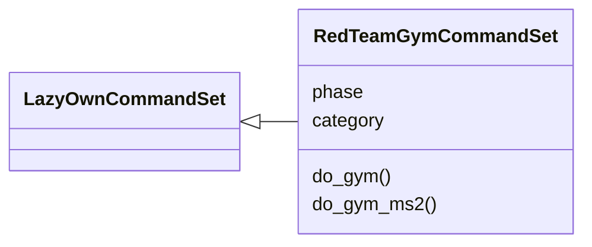
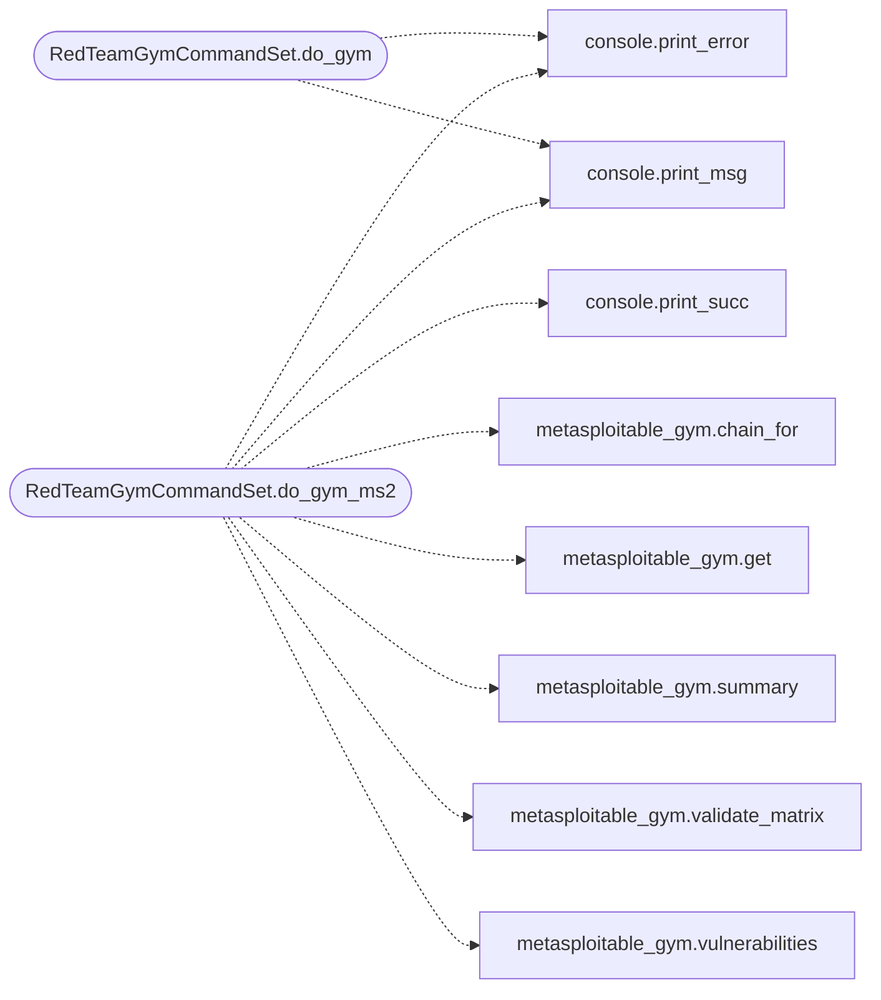

# `cli.commands.redteam_gym`

> Source: [cli/commands/redteam_gym.py:1](../../cli/commands/redteam_gym.py#L1) | language `py` | coverage 100.0% | [API index](../index.md)

Red Team Gym CLI command set - gamified pentest training.

Integrates with the ELO/karma system and Docker lab scenarios to provide
scored challenges with leaderboards, technique tracking and skill
progression. Definitions live in ``gyms/*.yaml``; active runs persist in
the world model and can be started, inspected and stopped by run id.

## Contents

- **Classes:** [`RedTeamGymCommandSet`](#redteamgymcommandset)

## Type Diagram



## Call Graph

Solid arrows stay in this module, dashed arrows leave it.



## Classes

<a id="redteamgymcommandset"></a>

### `RedTeamGymCommandSet`

`class` | [cli/commands/redteam_gym.py:33](../../cli/commands/redteam_gym.py#L33)

```python
class RedTeamGymCommandSet(LazyOwnCommandSet)
```

Bases: [`LazyOwnCommandSet`](cli.commands._base.py.md#lazyowncommandset)

Red Team Gym — scored pentest challenges with leaderboards.

**Attributes**

| Name | Type | Default | Description |
|---|---|---|---|
| [`phase`](#redteamgymcommandset-phase) |  | `'lab'` |  |
| [`category`](#redteamgymcommandset-category) |  | `miscellaneous_category` |  |

**Members**

| Member | Kind | Summary |
|---|---|---|
| [`do_gym`](#redteamgymcommandset-do_gym) | method | Red Team Gym — gamified pentest training with ELO scoring. |
| [`do_gym_ms2`](#redteamgymcommandset-do_gym_ms2) | method | Metasploitable 2 gym catalogue: list\|chains\|validate\|info <vuln>\|chain <vuln>. |

<a id="redteamgymcommandset-do_gym"></a>

#### `RedTeamGymCommandSet.do_gym`

`method` | [cli/commands/redteam_gym.py:40](../../cli/commands/redteam_gym.py#L40)

Decorators: `@cmd2.with_category(miscellaneous_category)`

```python
def do_gym(self, line)
```

Red Team Gym — gamified pentest training with ELO scoring.

Usage:
    gym list                              - show available challenges
    gym start <challenge_id> [--target IP] - begin a challenge
    gym status [run_id]                   - list active gyms or inspect one
    gym stop [run_id|gym_id|name]         - stop one gym; no argument stops all
    gym submit [run_id] [--failed] [--techniques t1,t2,...]
    gym leaderboard|top [top_n]           - show top players
    gym hint [run_id]                     - hint for an active gym

Challenges award ELO that feeds into the existing karma system
(Noob -> Rookie -> Skidy -> Hacker -> Pro -> Elite -> Godlike).
Active runs persist in the world model and survive new sessions.

**Parameters**

| Name | Type | Default | Description |
|---|---|---|---|
| `line` |  |  |  |

**Example**

```python
gym list
gym start first_blood_web --target 172.17.0.2
gym status
gym status gym0001
gym stop
gym submit gym0001 --techniques sqli_manual,csrf_bypass
gym leaderboard 10
```

*Calls:* [`print_error`](core.console.py.md#print_error), [`print_msg`](core.console.py.md#print_msg)

<a id="redteamgymcommandset-do_gym_ms2"></a>

#### `RedTeamGymCommandSet.do_gym_ms2`

`method` | [cli/commands/redteam_gym.py:92](../../cli/commands/redteam_gym.py#L92)

Decorators: `@cmd2.with_category(miscellaneous_category)`

```python
def do_gym_ms2(self, line)
```

Metasploitable 2 gym catalogue: list|chains|validate|info <vuln>|chain <vuln>.

Usage:
    gym_ms2 list
    gym_ms2 chains
    gym_ms2 validate
    gym_ms2 info vsftpd_backdoor
    gym_ms2 chain ms2_distcc_exec

**Parameters**

| Name | Type | Default | Description |
|---|---|---|---|
| `line` |  |  |  |

*Calls:* [`print_error`](core.console.py.md#print_error), [`print_msg`](core.console.py.md#print_msg), [`print_succ`](core.console.py.md#print_succ), [`chain_for`](modules.metasploitable_gym.py.md#chain_for), [`get`](modules.metasploitable_gym.py.md#get), [`summary`](modules.metasploitable_gym.py.md#summary), [`validate_matrix`](modules.metasploitable_gym.py.md#validate_matrix), [`vulnerabilities`](modules.metasploitable_gym.py.md#vulnerabilities)

---
