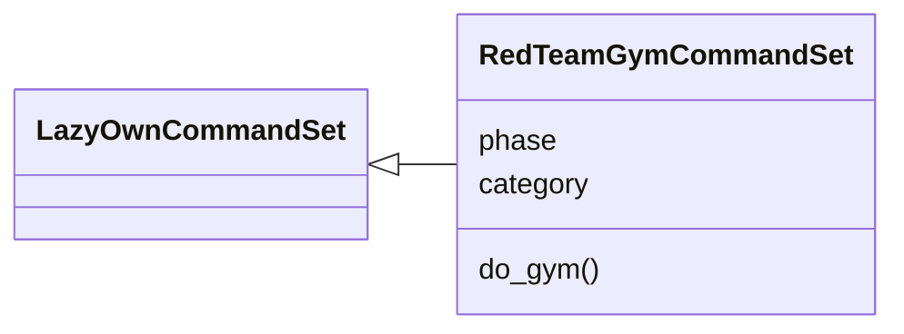
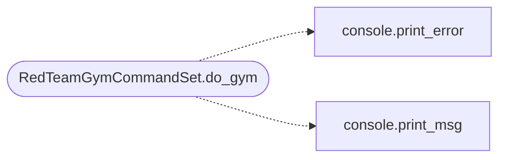

# `cli.commands.redteam_gym`

> Source: [cli/commands/redteam_gym.py:1](../../cli/commands/redteam_gym.py#L1) | language `py` | coverage 100.0% | [API index](../index.md)

Red Team Gym CLI command set — gamified pentest training.

Integrates with the ELO/karma system and Docker lab scenarios to
provide scored challenges with leaderboards, technique tracking,
and skill progression.

## Contents

- **Classes:** [`RedTeamGymCommandSet`](#redteamgymcommandset)

## Type Diagram



## Call Graph

Solid arrows stay in this module, dashed arrows leave it.



## Classes

<a id="redteamgymcommandset"></a>

### `RedTeamGymCommandSet`

`class` | [cli/commands/redteam_gym.py:32](../../cli/commands/redteam_gym.py#L32)

```python
class RedTeamGymCommandSet(LazyOwnCommandSet)
```

Bases: [`LazyOwnCommandSet`](cli.commands._base.py.md#lazyowncommandset)

Red Team Gym — scored pentest challenges with leaderboards.

**Attributes**

| Name | Type | Default | Description |
|---|---|---|---|
| [`phase`](#redteamgymcommandset-phase) |  | `'lab'` |  |
| [`category`](#redteamgymcommandset-category) |  | `miscellaneous_category` |  |

**Members**

| Member | Kind | Summary |
|---|---|---|
| [`do_gym`](#redteamgymcommandset-do_gym) | method | Red Team Gym — gamified pentest training with ELO scoring. |

<a id="redteamgymcommandset-do_gym"></a>

#### `RedTeamGymCommandSet.do_gym`

`method` | [cli/commands/redteam_gym.py:39](../../cli/commands/redteam_gym.py#L39)

Decorators: `@cmd2.with_category(miscellaneous_category)`

```python
def do_gym(self, line)
```

Red Team Gym — gamified pentest training with ELO scoring.

Usage:
    gym list                    — show available challenges
    gym start <challenge_id>    — begin a challenge
    gym submit [--failed] [--techniques t1,t2,...]  — submit completed challenge
    gym status                  — show active challenge
    gym leaderboard [top_n]     — show top players
    gym hint                    — get a hint for the active challenge

Challenges award ELO that feeds into the existing karma system
(Noob -> Rookie -> Skidy -> Hacker -> Pro -> Elite -> Godlike).

**Parameters**

| Name | Type | Default | Description |
|---|---|---|---|
| `line` |  |  |  |

**Example**

```python
gym list
gym start first_blood_web
gym submit --techniques sqli_manual,csrf_bypass
gym leaderboard 10
```

*Calls:* [`print_error`](core.console.py.md#print_error), [`print_msg`](core.console.py.md#print_msg)

---
