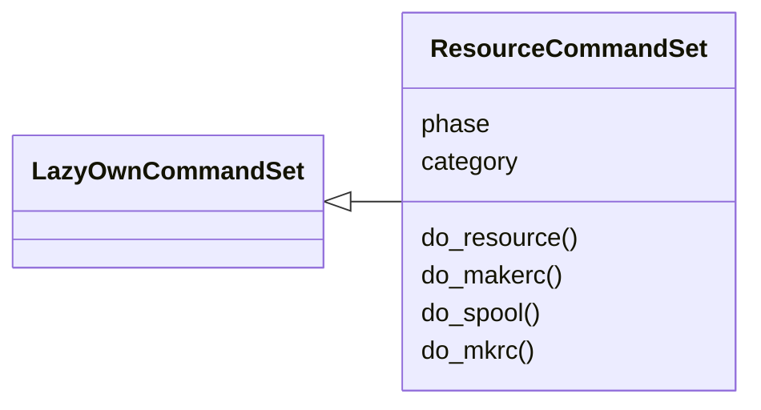
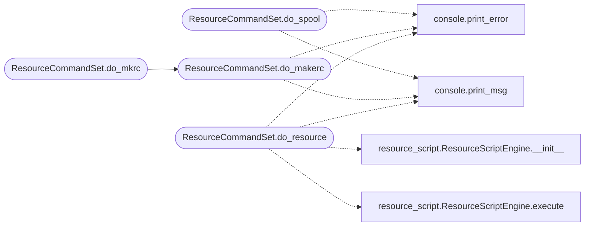

# `cli.commands.resource_scripting`

> Source: [cli/commands/resource_scripting.py:1](../../cli/commands/resource_scripting.py#L1) | language `py` | coverage 100.0% | [API index](../index.md)

Resource script commands — run .ls scripts, record macros, spool output.

Provides:
    resource <file>    — run an enhanced resource script
    makerc <file>      — record commands to a script (alias)
    spool <file|off>   — log output to file

## Contents

- **Classes:** [`ResourceCommandSet`](#resourcecommandset)

## Type Diagram



## Call Graph

Solid arrows stay in this module, dashed arrows leave it.



## Classes

<a id="resourcecommandset"></a>

### `ResourceCommandSet`

`class` | [cli/commands/resource_scripting.py:25](../../cli/commands/resource_scripting.py#L25)

```python
class ResourceCommandSet(LazyOwnCommandSet)
```

Bases: [`LazyOwnCommandSet`](cli.commands._base.py.md#lazyowncommandset)

Enhanced resource script execution and spooling.

**Attributes**

| Name | Type | Default | Description |
|---|---|---|---|
| [`phase`](#resourcecommandset-phase) |  | `'resource'` |  |
| [`category`](#resourcecommandset-category) |  | `'12. Miscellaneous'` |  |

**Members**

| Member | Kind | Summary |
|---|---|---|
| [`do_resource`](#resourcecommandset-do_resource) | method | Run an enhanced resource script. |
| [`do_makerc`](#resourcecommandset-do_makerc) | method | Record session commands to a resource script. |
| [`do_spool`](#resourcecommandset-do_spool) | method | Log session output to a file. |
| [`do_mkrc`](#resourcecommandset-do_mkrc) | method | Alias for makerc — record commands to a script. |

<a id="resourcecommandset-do_resource"></a>

#### `ResourceCommandSet.do_resource`

`method` | [cli/commands/resource_scripting.py:49](../../cli/commands/resource_scripting.py#L49)

Decorators: `@cmd2.with_category(miscellaneous_category)`

```python
def do_resource(self, line)
```

Run an enhanced resource script.

Usage: resource <script.ls> [--dry-run]

Supports variables ($var), conditionals (if/else/endif with real
expressions: ==, !=, =~, >, contains, defined), loops
(while/endwhile, for/endfor with break/continue), macros
(macro/endmacro/call), spool, sleep, echo, and comments (#).

**Parameters**

| Name | Type | Default | Description |
|---|---|---|---|
| `line` |  |  |  |

**Example**

```python
resource scripts/auto_recon.ls
resource scripts/auto_recon.ls --dry-run
```

*Calls:* [`print_error`](core.console.py.md#print_error), [`print_msg`](core.console.py.md#print_msg), [`ResourceScriptEngine.__init__`](modules.resource_script.py.md#resourcescriptengine-__init__), [`ResourceScriptEngine.execute`](modules.resource_script.py.md#resourcescriptengine-execute)

<a id="resourcecommandset-do_makerc"></a>

#### `ResourceCommandSet.do_makerc`

`method` | [cli/commands/resource_scripting.py:88](../../cli/commands/resource_scripting.py#L88)

Decorators: `@cmd2.with_category(miscellaneous_category)`

```python
def do_makerc(self, line)
```

Record session commands to a resource script.

Usage:
    makerc <script.ls>  — start recording commands into the script
    makerc off          — stop recording

**Parameters**

| Name | Type | Default | Description |
|---|---|---|---|
| `line` |  |  |  |

*Calls:* [`print_error`](core.console.py.md#print_error), [`print_msg`](core.console.py.md#print_msg)

*Called by:* [`ResourceCommandSet.do_mkrc`](#resourcecommandset-do_mkrc)

<a id="resourcecommandset-do_spool"></a>

#### `ResourceCommandSet.do_spool`

`method` | [cli/commands/resource_scripting.py:122](../../cli/commands/resource_scripting.py#L122)

Decorators: `@cmd2.with_category(miscellaneous_category)`

```python
def do_spool(self, line)
```

Log session output to a file.

Usage:
    spool <file>   — start logging to file
    spool off      — stop logging

**Parameters**

| Name | Type | Default | Description |
|---|---|---|---|
| `line` |  |  |  |

*Calls:* [`print_error`](core.console.py.md#print_error), [`print_msg`](core.console.py.md#print_msg)

<a id="resourcecommandset-do_mkrc"></a>

#### `ResourceCommandSet.do_mkrc`

`method` | [cli/commands/resource_scripting.py:152](../../cli/commands/resource_scripting.py#L152)

Decorators: `@cmd2.with_category(miscellaneous_category)`

```python
def do_mkrc(self, line)
```

Alias for makerc — record commands to a script.

**Parameters**

| Name | Type | Default | Description |
|---|---|---|---|
| `line` |  |  |  |

*Calls:* [`ResourceCommandSet.do_makerc`](#resourcecommandset-do_makerc)

---
