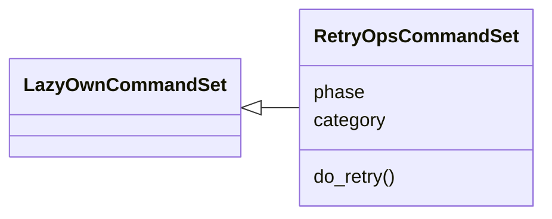
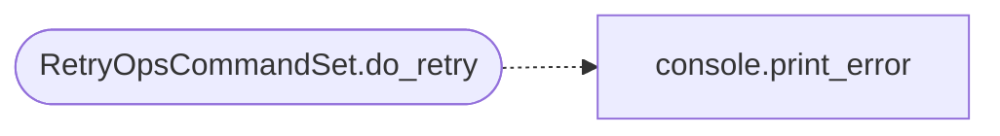

# `cli.commands.retry_ops`

> Source: [cli/commands/retry_ops.py:1](../../cli/commands/retry_ops.py#L1) | language `py` | coverage 100.0% | [API index](../index.md)

``retry`` - relaunch a failed chain or failed loop from where it stopped.

Three operator actions after a failure:

- ``retry status`` shows the freshest failed chain checkpoint, the last
  non-complete loop task and the elevated-retry state.
- ``retry chain <chain_name|run_id> [--var key=value ...] [--sudo]``
  resumes the stored checkpoint under the same run id; every ``--var``
  overrides a recorded variable, so the relaunch runs with the
  user-varied configuration.
- ``retry loop [task_id] [auto_loop flags] [--sudo]`` re-enters the
  orchestrator for the last (or given) task id; flags are the ordinary
  ``auto_loop`` flags, so the operator can also vary them.

Elevated mode: when a failure was caused by a missing sudo password,
``--sudo`` arms an askpass session after a warned, explicit
confirmation. Destructive steps configured by you (destructive chains,
playbooks and gym scenarios) may execute with root privileges once the
mode is armed; see [`modules.retry_session.SUDO_WARNING`](modules.retry_session.py.md#sudo_warning). The
secret stays inside this process and its children only: a 0600 file
under ``sessions/retry/`` with a 0700 askpass helper, both removed on
shell exit or immediately on abort. Nothing reaches logs, history or
transcripts.

## Contents

- **Classes:** [`RetryOpsCommandSet`](#retryopscommandset)
- **Constants:** [`RETRY_CATEGORY`](#retry_category)

## Type Diagram



## Call Graph

Solid arrows stay in this module, dashed arrows leave it.



## Classes

<a id="retryopscommandset"></a>

### `RetryOpsCommandSet`

`class` | [cli/commands/retry_ops.py:61](../../cli/commands/retry_ops.py#L61)

```python
class RetryOpsCommandSet(LazyOwnCommandSet)
```

Bases: [`LazyOwnCommandSet`](cli.commands._base.py.md#lazyowncommandset)

Operator-facing retry surface for chains and the orchestrator.

**Attributes**

| Name | Type | Default | Description |
|---|---|---|---|
| [`phase`](#retryopscommandset-phase) |  | `'command_and_control'` |  |
| [`category`](#retryopscommandset-category) |  | `RETRY_CATEGORY` |  |

**Members**

| Member | Kind | Summary |
|---|---|---|
| [`do_retry`](#retryopscommandset-do_retry) | method | Relaunch failed work: retry status \| chain \| loop. |

<a id="retryopscommandset-do_retry"></a>

#### `RetryOpsCommandSet.do_retry`

`method` | [cli/commands/retry_ops.py:68](../../cli/commands/retry_ops.py#L68)

Decorators: `@with_category(RETRY_CATEGORY)`

```python
def do_retry(self, line: str) -> None
```

Relaunch failed work: retry status | chain | loop.

Usage:
    retry status [limit]
    retry chain [chain_name|run_id] [--var key=value ...] [--sudo]
    retry loop [task_id] [auto_loop flags] [--sudo]

``retry status`` prints the newest failed chain checkpoint and
the last interrupted loop task so no failure stays hidden after
a run. ``retry chain`` continues the recorded checkpoint (same
run id, resumes past the failed step) while ``--var`` entries
override recorded variables for the relaunch - that is the
user-varied configuration path, e.g. fixing a port, tool path
or wordlist that failed last time. Pass a run id (from
``retry status``) instead of a chain name to retry an older
attempt. ``retry loop`` re-enters the orchestrator for the last
failed/paused/exhausted task; any ``auto_loop`` flag is
accepted and a task id pins the selection.

``--sudo`` arms an askpass-assisted elevated retry after a
warned confirmation: commands may run with root privileges and
destructive steps configured by you can now actually execute;
the sudo password never enters a command line, history or log -
it is held in a session-internal file revoked on shell exit.

**Parameters**

| Name | Type | Default | Description |
|---|---|---|---|
| `line` | `str` |  |  |

*Calls:* [`print_error`](core.console.py.md#print_error)

---

## Constants

<a id="retry_category"></a>

### `RETRY_CATEGORY`

`constant` | [cli/commands/retry_ops.py:40](../../cli/commands/retry_ops.py#L40)

```python
RETRY_CATEGORY = '11. Orchestration'
```

---
