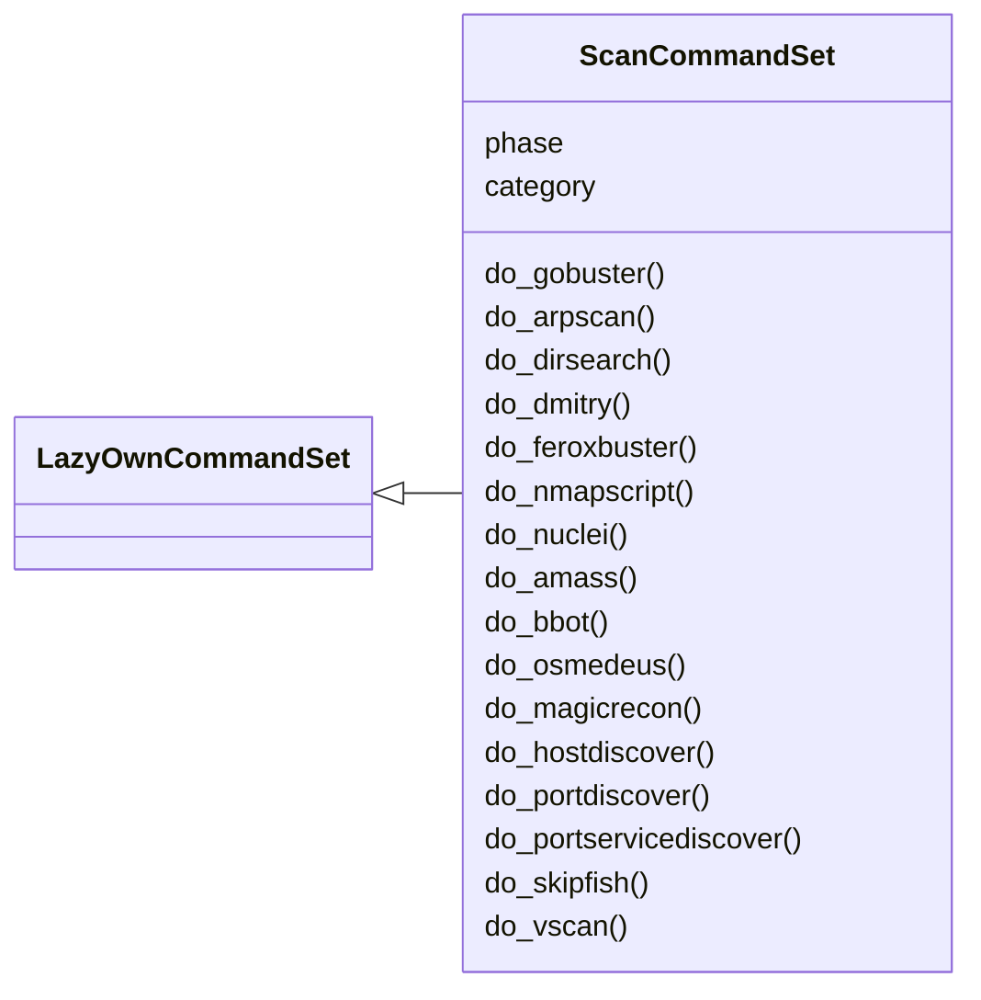
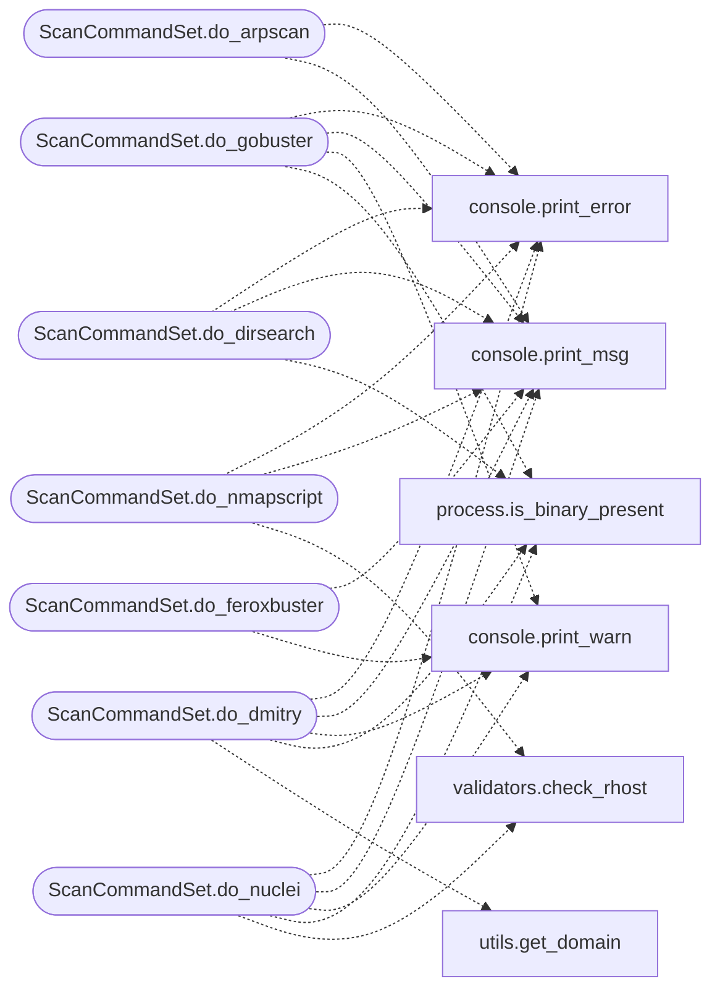

# `cli.commands.scan`

> Source: [cli/commands/scan.py:1](../../cli/commands/scan.py#L1) | language `py` | coverage 100.0% | [API index](../index.md)

Scanning command set.

Phase-scoped home for the scanning operator commands (category
``02. Scanning & Enumeration``, kill-chain phase ``scan``). This module is an
empty, active ``CommandSet`` scaffold: migrate one ``do_*`` method at a time
out of ``lazyown.py`` into this class.

This set is a sibling of [`cli.commands.enum.EnumCommandSet`](cli.commands.enum.py.md#enumcommandset); both share
the ``02. Scanning & Enumeration`` cmd2 category but differ by kill-chain
phase (``scan`` vs ``enum``). Put broad host/service discovery and network
scanners here; put targeted service enumeration in ``enum.py``.

Migration rule
--------------
When you paste a ``do_<name>`` method here you MUST delete the original copy
from ``lazyown.py`` in the same change. Registering the same command name on
both the shell and an active ``CommandSet`` raises a duplicate-command error
at startup. Decorate migrated methods with
``@cmd2.with_category(scanning_category)`` so they keep their help grouping,
and rely on [`cli.commands._base.LazyOwnCommandSet`](cli.commands._base.py.md#lazyowncommandset) to forward
``self.params`` / ``self.cmd`` / other shell state once registered.

Discovery is automatic: [`cli.registry.register_command_sets`](cli.registry.py.md#register_command_sets) finds this
class at startup, so no wiring change is needed as commands are added.

## Contents

- **Classes:** [`ScanCommandSet`](#scancommandset)

## Type Diagram



## Call Graph

Solid arrows stay in this module, dashed arrows leave it.



## Classes

<a id="scancommandset"></a>

### `ScanCommandSet`

`class` | [cli/commands/scan.py:49](../../cli/commands/scan.py#L49)

```python
class ScanCommandSet(LazyOwnCommandSet)
```

Bases: [`LazyOwnCommandSet`](cli.commands._base.py.md#lazyowncommandset)

Scanning phase commands (migrate ``do_*`` here one at a time).

**Attributes**

| Name | Type | Default | Description |
|---|---|---|---|
| [`phase`](#scancommandset-phase) |  | `'scan'` |  |
| [`category`](#scancommandset-category) |  | `scanning_category` |  |

**Members**

| Member | Kind | Summary |
|---|---|---|
| [`do_gobuster`](#scancommandset-do_gobuster) | method | Uses `gobuster` for directory and virtual host fuzzing based on provided parameters. |
| [`do_arpscan`](#scancommandset-do_arpscan) | method | Executes an ARP scan using `arp-scan`. |
| [`do_dirsearch`](#scancommandset-do_dirsearch) | method | Runs the `dirsearch` tool to perform directory and file enumeration on a specified URL. |
| [`do_dmitry`](#scancommandset-do_dmitry) | method | This function constructs and executes a command for the 'dmitry' tool. |
| [`do_feroxbuster`](#scancommandset-do_feroxbuster) | method | Command feroxbuster: Installs and runs Feroxbuster for performing forced browsing and directory brute-forcing. |
| [`do_nmapscript`](#scancommandset-do_nmapscript) | method | Perform an Nmap scan using a specified script and port. |
| [`do_nuclei`](#scancommandset-do_nuclei) | method | Executes a Nuclei scan on a specified target URL or host. |
| [`do_amass`](#scancommandset-do_amass) | method | Executes Amass to perform a passive enumeration on a given domain. |
| [`do_bbot`](#scancommandset-do_bbot) | method | Executes a BBOT scan to perform various reconnaissance tasks. |
| [`do_osmedeus`](#scancommandset-do_osmedeus) | method | Executes Osmedeus scans with guided input for various scanning scenarios. |
| [`do_magicrecon`](#scancommandset-do_magicrecon) | method | Command magicrecon: Automates the setup and usage of MagicRecon to perform various types of reconnaissance and vulnerability scanning on specified targets. |
| [`do_hostdiscover`](#scancommandset-do_hostdiscover) | method | Discover active hosts in a subnet by performing a ping sweep. |
| [`do_portdiscover`](#scancommandset-do_portdiscover) | method | Scan all ports on a specified host to identify open ports. |
| [`do_portservicediscover`](#scancommandset-do_portservicediscover) | method | Scan all ports on a specified host to identify open ports and associated services. |
| [`do_skipfish`](#scancommandset-do_skipfish) | method | This function executes the web security scanning tool Skipfish using the provided configuration and parameters. |
| [`do_vscan`](#scancommandset-do_vscan) | method | Perform port scanning using vscan with the provided parameters. |

<a id="scancommandset-do_gobuster"></a>

#### `ScanCommandSet.do_gobuster`

`method` | [cli/commands/scan.py:56](../../cli/commands/scan.py#L56)

Decorators: `@cmd2.with_category(scanning_category)`

```python
def do_gobuster(self, line)
```

Uses `gobuster` for directory and virtual host fuzzing based on provided parameters.

Supports directory enumeration and virtual host discovery.

Manual execution:
To manually use `gobuster`, use the following commands:

1. For directory fuzzing:
    gobuster dir --url <url>/ --wordlist <wordlist>

Example:
    gobuster dir --url http://example.com/ --wordlist /path/to/dirwordlist

2. For virtual host discovery:
    gobuster vhost --append-domain -u <url> -w <wordlist> --random-agent -t 600

Example:
    gobuster vhost --append-domain -u http://example.com -w /path/to/dirwordlist --random-agent -t 600

3. For general directory fuzzing with additional parameters:
    gobuster dir --url http://<rhost>/ --wordlist <wordlist> <additional_parameters>

Example:
    gobuster dir --url http://10.10.10.10/ --wordlist /path/to/dirwordlist -x .php,.html

**Parameters**

| Name | Type | Default | Description |
|---|---|---|---|
| `line` |  |  | The options and arguments for `gobuster`. The [`line`](modules.defense_eval.py.md#evaluation-line) parameter can include the following: - [`url`](modules.lazy_oob.py.md#url): Perform directory fuzzing on a specified URL. Requires [`url`](modules.lazy_oob.py.md#url) and `dirwordlist` to be assign. - `vhost`: Perform virtual host discovery on a specified URL. Requires [`url`](modules.lazy_oob.py.md#url) and `dirwordlist` to be assign. - Any other argument: General directory fuzzing with additional parameters. |

**Returns:** None

*Calls:* [`print_error`](core.console.py.md#print_error), [`print_msg`](core.console.py.md#print_msg), [`print_warn`](core.console.py.md#print_warn), [`is_binary_present`](core.process.py.md#is_binary_present)

<a id="scancommandset-do_arpscan"></a>

#### `ScanCommandSet.do_arpscan`

`method` | [cli/commands/scan.py:129](../../cli/commands/scan.py#L129)

Decorators: `@cmd2.with_category(scanning_category)`

```python
def do_arpscan(self, line)
```

Executes an ARP scan using `arp-scan`.

This function performs an ARP scan on the local network using the `arp-scan` tool. The network device to be used for scanning must be specified.

Usage:
    arpscan


- Executes the `arp-scan` command with the specified network device.


Manual execution:
1. Ensure that the network device is assign using the appropriate parameter.
2. Run the method to perform an ARP scan.

Dependencies:
- `arp-scan` must be installed on the system.
- The `sudo` command must be available for executing `arp-scan`.

Examples:
    1. assign the device parameter using `assign device <network_device>`.
    2. Run `arpscan` to perform the ARP scan.

Note:
    - The network device must be configured and available on the system for the scan to work.
    - Ensure that `arp-scan` is installed and accessible from the command line.

**Parameters**

| Name | Type | Default | Description |
|---|---|---|---|
| `line` | `str` |  | Command parameters (not used in this function). |

**Returns:** None

*Calls:* [`print_error`](core.console.py.md#print_error), [`print_msg`](core.console.py.md#print_msg)

<a id="scancommandset-do_dirsearch"></a>

#### `ScanCommandSet.do_dirsearch`

`method` | [cli/commands/scan.py:170](../../cli/commands/scan.py#L170)

Decorators: `@cmd2.with_category(scanning_category)`

```python
def do_dirsearch(self, line)
```

Runs the `dirsearch` tool to perform directory and file enumeration on a specified URL.

This function executes `dirsearch` to scan a given URL for directories and files, while excluding specific HTTP status codes from the results. If `dirsearch` is not installed, the function will attempt to install it before running the scan.

Usage:
    dirsearch <url>


Manual execution:
1. If `dirsearch` is present, the command `dirsearch -u <url> -x 403,404,400` is executed.
2. If `dirsearch` is not present, the function installs `dirsearch` using `sudo apt install dirsearch -y` and then runs the command.

Dependencies:
- `dirsearch` must be installed. If not present, it will be installed using `sudo apt`.
- Ensure the URL is assign via the [`url`](modules.lazy_oob.py.md#url) parameter before calling this function.

Example:
    dirsearch http://example.com/

Note:
    - Ensure that the [`url`](modules.lazy_oob.py.md#url) parameter is assign before calling this function.
    - The `-x` option specifies HTTP status codes to exclude from the results (e.g., 403, 404, 400).
    - The function will attempt to install `dirsearch` if it is not already installed.

**Parameters**

| Name | Type | Default | Description |
|---|---|---|---|
| `line` | `str` |  | Not used in this function. The URL is provided via the [`url`](modules.lazy_oob.py.md#url) parameter. |

**Returns:** None

*Calls:* [`print_error`](core.console.py.md#print_error), [`print_msg`](core.console.py.md#print_msg), [`is_binary_present`](core.process.py.md#is_binary_present)

<a id="scancommandset-do_dmitry"></a>

#### `ScanCommandSet.do_dmitry`

`method` | [cli/commands/scan.py:213](../../cli/commands/scan.py#L213)

Decorators: `@cmd2.with_category(scanning_category)`

```python
def do_dmitry(self, line)
```

This function constructs and executes a command for the 'dmitry' tool.

It first checks if the 'url' parameter is set. If not, it prints an error message. If the 'url' is set, it extracts the domain from the URL using the get_domain function. Then, it constructs a 'dmitry' command with the specified parameters and prepares it for execution.

Run a domain whois lookup (w), an IP whois lookup (i), retrieve Netcraft info (n), search for subdomains (s), search for email addresses (e), do a TCP port scan (p), and save the output to example.txt (o) for the domain example.com:

line (str): The command line input for this function.

Expected self.params keys:
- url (str): The URL to be used for the 'dmitry' command.

Example usage:
- assign url http://example.com
- do_dmitry

**Parameters**

| Name | Type | Default | Description |
|---|---|---|---|
| `line` |  |  |  |

*Calls:* [`print_error`](core.console.py.md#print_error), [`print_msg`](core.console.py.md#print_msg), [`print_warn`](core.console.py.md#print_warn), [`is_binary_present`](core.process.py.md#is_binary_present), [`get_domain`](utils.py.md#get_domain)

<a id="scancommandset-do_feroxbuster"></a>

#### `ScanCommandSet.do_feroxbuster`

`method` | [cli/commands/scan.py:248](../../cli/commands/scan.py#L248)

Decorators: `@cmd2.with_category(scanning_category)`

```python
def do_feroxbuster(self, line)
```

Command feroxbuster: Installs and runs Feroxbuster for performing forced browsing and directory brute-forcing.

This function performs the following tasks:
1. Installs Feroxbuster using a `curl` command if it's not already installed.
2. Prompts the user for required inputs like the target URL, wordlist, file extensions, and additional options.
3. Executes Feroxbuster for directory enumeration and brute-force attacks.

**Parameters**

| Name | Type | Default | Description |
|---|---|---|---|
| `line` | `str` |  | Optional argument for specifying the target URL, wordlist, and other Feroxbuster options. |

**Returns:** None

**Example**

```python
feroxbuster -u http://example.com -w wordlist.txt -x php,html
```

*Calls:* [`print_msg`](core.console.py.md#print_msg), [`print_warn`](core.console.py.md#print_warn)

<a id="scancommandset-do_nmapscript"></a>

#### `ScanCommandSet.do_nmapscript`

`method` | [cli/commands/scan.py:316](../../cli/commands/scan.py#L316)

Decorators: `@cmd2.with_category(scanning_category)`

```python
def do_nmapscript(self, line)
```

Perform an Nmap scan using a specified script and port.

Manual execution:
To manually run an Nmap scan with a script and port, use the following command format:

    nmap --script <script> -p <port> <target> -oN <output-file>

Example:
If you want to use the script `http-enum` on port `80` for the target `10.10.10.10`, you would run:

    nmap --script http-enum -p 80 10.10.10.10 -oN sessions/webScan_10.10.10.10

Ensure you have the target host (`rhost`) assign in the parameters and provide the script and port as arguments. The results will be saved in the file `sessions/webScan_<rhost>`.

**Parameters**

| Name | Type | Default | Description |
|---|---|---|---|
| `line` |  |  | A string containing the Nmap script and port, separated by a space. Example: "http-enum 80". |

**Returns:** None

*Calls:* [`print_error`](core.console.py.md#print_error), [`print_msg`](core.console.py.md#print_msg), [`check_rhost`](core.validators.py.md#check_rhost)

<a id="scancommandset-do_nuclei"></a>

#### `ScanCommandSet.do_nuclei`

`method` | [cli/commands/scan.py:350](../../cli/commands/scan.py#L350)

Decorators: `@cmd2.with_category(scanning_category)`

```python
def do_nuclei(self, line)
```

Executes a Nuclei scan on a specified target URL or host.

Usage:
    nuclei -u <URL> [-o <output file>] [other options]

If a URL is provided as an argument, it will be used as the target for the scan.
Otherwise, it will use the target specified in self.params["rhost"].

**Parameters**

| Name | Type | Default | Description |
|---|---|---|---|
| `line` |  |  |  |

*Calls:* [`print_error`](core.console.py.md#print_error), [`print_msg`](core.console.py.md#print_msg), [`print_warn`](core.console.py.md#print_warn), [`is_binary_present`](core.process.py.md#is_binary_present), [`check_rhost`](core.validators.py.md#check_rhost), [`get_domain`](utils.py.md#get_domain)

<a id="scancommandset-do_amass"></a>

#### `ScanCommandSet.do_amass`

`method` | [cli/commands/scan.py:392](../../cli/commands/scan.py#L392)

Decorators: `@cmd2.with_category(scanning_category)`

```python
def do_amass(self, line)
```

Executes Amass to perform a passive enumeration on a given domain.

This function performs the following steps:
1. Executes the Amass tool with the provided domain for passive enumeration.
2. Saves the results to a file named 'results.txt' in the current directory.

line (str): The domain to be enumerated, e.g., 'example.com'.

None

**Parameters**

| Name | Type | Default | Description |
|---|---|---|---|
| `line` |  |  |  |

*Calls:* [`print_error`](core.console.py.md#print_error), [`print_msg`](core.console.py.md#print_msg)

<a id="scancommandset-do_bbot"></a>

#### `ScanCommandSet.do_bbot`

`method` | [cli/commands/scan.py:422](../../cli/commands/scan.py#L422)

Decorators: `@cmd2.with_category(scanning_category)`

```python
def do_bbot(self, line)
```

Executes a BBOT scan to perform various reconnaissance tasks.

This function leverages BBOT, a reconnaissance tool, to perform tasks such as subdomain enumeration,
email gathering, web scanning, and more. It dynamically determines the operation based on user input
and executes the appropriate BBOT commands.

Usage:
    bbot -t <target> -p <preset>

**Parameters**

| Name | Type | Default | Description |
|---|---|---|---|
| `line` | `str` |  | User input specifying the target and optional presets or configurations. |

**Example**

```python
bbot -t evilcorp.com -p subdomain-enum
bbot -t evilcorp.com -p email-enum spider web-basic
```

*Calls:* [`print_error`](core.console.py.md#print_error), [`print_msg`](core.console.py.md#print_msg), [`print_warn`](core.console.py.md#print_warn)

<a id="scancommandset-do_osmedeus"></a>

#### `ScanCommandSet.do_osmedeus`

`method` | [cli/commands/scan.py:473](../../cli/commands/scan.py#L473)

Decorators: `@cmd2.with_category(scanning_category)`

```python
def do_osmedeus(self, line)
```

Executes Osmedeus scans with guided input for various scanning scenarios.

This function performs the following actions:
1. Verifies the presence of Osmedeus; if not installed, it clones the repository
and installs the required dependencies.
2. Guides the user through selecting the type of scan, target, and any additional
parameters needed for the scan.
3. Constructs and executes the appropriate Osmedeus command.

line (str): Command-line arguments for the tool. If not provided, interactive
            input will be used.

None

**Parameters**

| Name | Type | Default | Description |
|---|---|---|---|
| `line` |  |  |  |

*Calls:* [`print_msg`](core.console.py.md#print_msg), [`print_warn`](core.console.py.md#print_warn)

<a id="scancommandset-do_magicrecon"></a>

#### `ScanCommandSet.do_magicrecon`

`method` | [cli/commands/scan.py:548](../../cli/commands/scan.py#L548)

Decorators: `@cmd2.with_category(scanning_category)`

```python
def do_magicrecon(self, line)
```

Command magicrecon: Automates the setup and usage of MagicRecon to perform various types of reconnaissance and vulnerability scanning on specified targets.

This function performs the following tasks:
1. Clones and installs MagicRecon if not already installed.
2. Prompts the user to input the target domain, list, or wildcard if not provided.
3. Executes MagicRecon with the specified options for target reconnaissance and vulnerability analysis.
4. Supports notifications through Discord, Telegram, or Slack if configured.

**Parameters**

| Name | Type | Default | Description |
|---|---|---|---|
| `line` | `str` |  | Command-line arguments specifying the target and recon mode. If not provided, the function prompts the user for required inputs. |

**Returns:** None

**Example**

```python
magicrecon -d example.com -a
```

*Calls:* [`print_msg`](core.console.py.md#print_msg), [`get_domain`](utils.py.md#get_domain)

<a id="scancommandset-do_hostdiscover"></a>

#### `ScanCommandSet.do_hostdiscover`

`method` | [cli/commands/scan.py:606](../../cli/commands/scan.py#L606)

Decorators: `@cmd2.with_category(scanning_category)`

```python
def do_hostdiscover(self, line)
```

Discover active hosts in a subnet by performing a ping sweep.

This method constructs and executes a bash script that performs a
ping sweep on the specified subnet to identify active hosts. The
subnet is determined from the 'rhost' parameter. For each host in
the subnet, a ping request is sent, and active hosts are reported.

- line (str): The input line argument is not used in this function.

Behavior:
- Extracts the first three octets of the 'rhost' parameter to form
the base IP pattern.
- Constructs a bash script to ping each IP address in the subnet
(from .1 to .254) and reports active hosts.
- The generated bash script is displayed to the user.
- Prompts the user to confirm whether they want to execute the
generated command.
- If the user confirms, executes the command using `self.cmd()`.
- If the user declines, copies the command to the clipboard using
`copy2clip()`.

Side Effects:
- Executes system commands and may affect the system environment.
- May modify the clipboard content if the user chooses not to execute.

- Ensure that the 'rhost' parameter is a valid IP address and that
the [`check_rhost`](core.validators.py.md#check_rhost) function is implemented to validate the IP.
- [`print_msg`](core.console.py.md#print_msg) is used to display the constructed command to the
user.
- `copy2clip()` is used to copy the command to the clipboard if
not executed.

**Parameters**

| Name | Type | Default | Description |
|---|---|---|---|
| `line` |  |  |  |

**Example**

```pycon
>>> do_hostdiscover("example_input")
```

*Calls:* [`print_msg`](core.console.py.md#print_msg), [`check_rhost`](core.validators.py.md#check_rhost), [`copy2clip`](utils.py.md#copy2clip)

<a id="scancommandset-do_portdiscover"></a>

#### `ScanCommandSet.do_portdiscover`

`method` | [cli/commands/scan.py:664](../../cli/commands/scan.py#L664)

Decorators: `@cmd2.with_category(scanning_category)`

```python
def do_portdiscover(self, line)
```

Scan all ports on a specified host to identify open ports.

This method constructs and executes a bash script that performs a
port scan on the specified host to determine which ports are open.
It scans all ports from 0 to 65535 and reports any that are open.

- line (str): The input line argument is not used in this function.

Behavior:
- Extracts the 'rhost' parameter to determine the target IP address.
- Constructs a bash script to scan all ports on the target IP address
and report open ports.
- The generated bash script is displayed to the user.
- Prompts the user to confirm whether they want to execute the
generated command.
- If the user confirms, executes the command using `self.cmd()`.
- If the user declines, copies the command to the clipboard using
`copy2clip()`.

Side Effects:
- Executes system commands and may affect the system environment.
- May modify the clipboard content if the user chooses not to execute.

- Ensure that the 'rhost' parameter is a valid IP address and that
the [`check_rhost`](core.validators.py.md#check_rhost) function is implemented to validate the IP.
- [`print_msg`](core.console.py.md#print_msg) is used to display the constructed command to the
user.
- `copy2clip()` is used to copy the command to the clipboard if
not executed.

**Parameters**

| Name | Type | Default | Description |
|---|---|---|---|
| `line` |  |  |  |

**Example**

```pycon
>>> do_portdiscover("example_input")
```

*Calls:* [`print_msg`](core.console.py.md#print_msg), [`check_rhost`](core.validators.py.md#check_rhost), [`copy2clip`](utils.py.md#copy2clip)

<a id="scancommandset-do_portservicediscover"></a>

#### `ScanCommandSet.do_portservicediscover`

`method` | [cli/commands/scan.py:724](../../cli/commands/scan.py#L724)

Decorators: `@cmd2.with_category(scanning_category)`

```python
def do_portservicediscover(self, line)
```

Scan all ports on a specified host to identify open ports and associated services.

This method constructs and executes a bash script that performs a
port scan on the specified host to determine which ports are open
and identifies any services running on those open ports. It scans
all ports from 0 to 65535.

- line (str): The input line argument is not used in this function.

Behavior:
- Extracts the 'rhost' parameter to determine the target IP address.
- Constructs a bash script to scan all ports on the target IP address
and report open ports along with any associated services.
- The generated bash script is displayed to the user.
- Prompts the user to confirm whether they want to execute the
generated command.
- If the user confirms, executes the command using `self.cmd()`.
- If the user declines, copies the command to the clipboard using
`copy2clip()`.

Side Effects:
- Executes system commands and may affect the system environment.
- Requires `sudo` privileges to use `lsof` for identifying services.
- May modify the clipboard content if the user chooses not to execute.

- Ensure that the 'rhost' parameter is a valid IP address and that
the [`check_rhost`](core.validators.py.md#check_rhost) function is implemented to validate the IP.
- [`print_msg`](core.console.py.md#print_msg) is used to display the constructed command to the
user.
- `copy2clip()` is used to copy the command to the clipboard if
not executed.

**Parameters**

| Name | Type | Default | Description |
|---|---|---|---|
| `line` |  |  |  |

**Example**

```pycon
>>> do_portservicediscover("example_input")
```

*Calls:* [`print_msg`](core.console.py.md#print_msg), [`check_rhost`](core.validators.py.md#check_rhost), [`copy2clip`](utils.py.md#copy2clip)

<a id="scancommandset-do_skipfish"></a>

#### `ScanCommandSet.do_skipfish`

`method` | [cli/commands/scan.py:789](../../cli/commands/scan.py#L789)

Decorators: `@cmd2.with_category(scanning_category)`

```python
def do_skipfish(self, line)
```

This function executes the web security scanning tool Skipfish using the provided configuration and parameters.

It allows scanning a specified target (rhost) and saves the results in a designated output directory.

- self: Refers to the instance of the class in which this function is defined.
- line: A string that may contain additional options to modify the scanning behavior.

Function Flow:
1. Default values are set for the target IP (rhost), port (port), and output directory (outputdir).
2. The validity of the target (rhost) is checked using the [`check_rhost`](core.validators.py.md#check_rhost) function.
3. If no argument is provided in [`line`](modules.defense_eval.py.md#evaluation-line), a `skipfish` command is constructed using the default values.
4. If [`line`](modules.defense_eval.py.md#evaluation-line) starts with 'url', the URL configured in `self.params['url']` is retrieved and used to construct the `skipfish` command.
5. If the URL is not configured and an attempt is made to use the 'url' option, an error message is printed, and the function exits.
6. The constructed `skipfish` command is displayed on the console and executed using `os.system`.

- The function assumes that the `skipfish` tool is installed on the system.
- The output of the scan is saved in the directory `sessions/{rhost}/skipfish/`.
- The wordlist used by Skipfish is specified in `wordlist`.

**Parameters**

| Name | Type | Default | Description |
|---|---|---|---|
| `line` |  |  |  |

*Calls:* [`print_error`](core.console.py.md#print_error), [`print_msg`](core.console.py.md#print_msg), [`check_rhost`](core.validators.py.md#check_rhost)

<a id="scancommandset-do_vscan"></a>

#### `ScanCommandSet.do_vscan`

`method` | [cli/commands/scan.py:839](../../cli/commands/scan.py#L839)

Decorators: `@cmd2.with_category(scanning_category)`

```python
def do_vscan(self, line)
```

Perform port scanning using vscan with the provided parameters.

Manual execution:
To manually run `vscan` for port scanning, use the following command:

    ./vscan -host <hosts> -p <ports>

This function prompts the user for the target hosts and ports, and executes the vscan command accordingly.

**Parameters**

| Name | Type | Default | Description |
|---|---|---|---|
| `line` |  |  | This parameter is not used in the function but can be reserved for future use. |

**Returns:** None

*Calls:* [`print_error`](core.console.py.md#print_error), [`print_msg`](core.console.py.md#print_msg), [`print_warn`](core.console.py.md#print_warn), [`is_binary_present`](core.process.py.md#is_binary_present)

---
