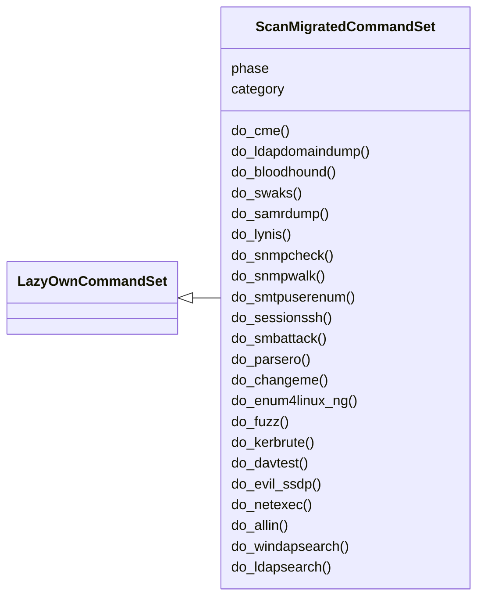
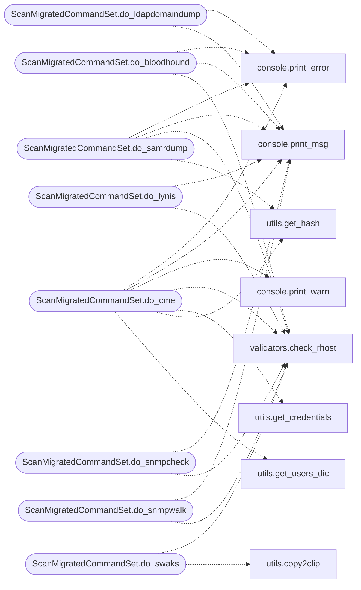

# `cli.commands.scan_migrated`

> Source: [cli/commands/scan_migrated.py:1](../../cli/commands/scan_migrated.py#L1) | language `py` | coverage 97.9% | [API index](../index.md)

scan commands migrated from lazyown.py.

Auto-generated by scripts/migrate_lazyown.py.

## Contents

- **Classes:** [`ScanMigratedCommandSet`](#scanmigratedcommandset)

## Type Diagram



## Call Graph

Solid arrows stay in this module, dashed arrows leave it.



## Classes

<a id="scanmigratedcommandset"></a>

### `ScanMigratedCommandSet`

`class` | [cli/commands/scan_migrated.py:32](../../cli/commands/scan_migrated.py#L32)

```python
class ScanMigratedCommandSet(LazyOwnCommandSet)
```

Bases: [`LazyOwnCommandSet`](cli.commands._base.py.md#lazyowncommandset)

**Attributes**

| Name | Type | Default | Description |
|---|---|---|---|
| [`phase`](#scanmigratedcommandset-phase) |  | `'scan'` |  |
| [`category`](#scanmigratedcommandset-category) |  | `'02. Scanning & Enumeration'` |  |

**Members**

| Member | Kind | Summary |
|---|---|---|
| [`do_cme`](#scanmigratedcommandset-do_cme) | method | Execute CrackMapExec (CME) for SMB enumeration and authentication attempts against a target. |
| [`do_ldapdomaindump`](#scanmigratedcommandset-do_ldapdomaindump) | method | Dumps LDAP information using `ldapdomaindump` with credentials from a file. |
| [`do_bloodhound`](#scanmigratedcommandset-do_bloodhound) | method | Perform LDAP enumeration using bloodhound-python with credentials from a file. |
| [`do_swaks`](#scanmigratedcommandset-do_swaks) | method | Sends an email using `swaks` (Swiss Army Knife for SMTP). |
| [`do_samrdump`](#scanmigratedcommandset-do_samrdump) | method | Run `impacket-samrdump` to dump SAM data from specified ports. |
| [`do_lynis`](#scanmigratedcommandset-do_lynis) | method | Performs a Lynis audit on the specified remote system. |
| [`do_snmpcheck`](#scanmigratedcommandset-do_snmpcheck) | method | Performs an SNMP check on the specified target host. |
| [`do_snmpwalk`](#scanmigratedcommandset-do_snmpwalk) | method | Performs an SNMP check on the specified target host. |
| [`do_smtpuserenum`](#scanmigratedcommandset-do_smtpuserenum) | method | Enumerates SMTP users using the `smtp-user-enum` tool with the VRFY method. |
| [`do_sessionssh`](#scanmigratedcommandset-do_sessionssh) | method | Execute a command to list active SSH connections. |
| [`do_smbattack`](#scanmigratedcommandset-do_smbattack) | method | Scans for hosts with SMB service open on port 445 in the specified target network. |
| [`do_parsero`](#scanmigratedcommandset-do_parsero) | method | Executes a parsero scan on a specified target URL or host. |
| [`do_changeme`](#scanmigratedcommandset-do_changeme) | method | Executes a changeme scan on a specified target URL or host. |
| [`do_enum4linux_ng`](#scanmigratedcommandset-do_enum4linux_ng) | method | Performs enumeration of information from a target system using `enum4linux-ng`. |
| [`do_fuzz`](#scanmigratedcommandset-do_fuzz) | method | Executes a web server fuzzing script with user-provided parameters. |
| [`do_kerbrute`](#scanmigratedcommandset-do_kerbrute) | method | Executes the Kerbrute tool to enumerate user accounts against a specified target self.params['domain'] controller. |
| [`do_davtest`](#scanmigratedcommandset-do_davtest) | method | Tests WebDAV server configurations using `davtest`. |
| [`do_evil_ssdp`](#scanmigratedcommandset-do_evil_ssdp) | method | Runs evil-ssdp with various options and user-selected templates. |
| [`do_netexec`](#scanmigratedcommandset-do_netexec) | method | Executes netexec with various options for network protocol operations. |
| [`do_allin`](#scanmigratedcommandset-do_allin) | method | Execute the AlliN.py tool with various scan modes and parameters. |
| [`do_windapsearch`](#scanmigratedcommandset-do_windapsearch) | method | Execute the windapsearch tool to perform Active Directory Domain enumeration through LDAP queries. |
| [`do_ldapsearch`](#scanmigratedcommandset-do_ldapsearch) | method | Executes an LDAP search against a target remote host (self.params['rhost']) and saves the results. |
| [`do_arjun`](#scanmigratedcommandset-do_arjun) | method | Executes an Arjun scan on the specified URL for parameter discovery. |
| [`do_finger_user_enum`](#scanmigratedcommandset-do_finger_user_enum) | method | Executes the `finger-user-enum` tool for enumerating users on the target host. |
| [`do_wpscan`](#scanmigratedcommandset-do_wpscan) | method | Command wpscan: Installs and runs WPScan to perform WordPress vulnerability scanning. |
| [`do_loxs`](#scanmigratedcommandset-do_loxs) | method | Command loxs: Installs and runs Loxs for multi-vulnerability web application scanning. |
| [`do_blazy`](#scanmigratedcommandset-do_blazy) | method | Command blazy: Installs and runs blazy for multi-vulnerability web application scanning. |
| [`do_parth`](#scanmigratedcommandset-do_parth) | method | Command parth: Installs and runs Parth for discovering vulnerable URLs and parameters. |
| [`do_breacher`](#scanmigratedcommandset-do_breacher) | method | Command breacher: Installs and runs Breacher for finding admin login pages and EAR vulnerabilities. |
| [`do_openredirex`](#scanmigratedcommandset-do_openredirex) | method | Command openredirex: Clones, installs, and runs OpenRedirex for testing open redirection vulnerabilities. |
| [`do_odat`](#scanmigratedcommandset-do_odat) | method | Command odat: Runs the ODAT sidguesser module to guess Oracle SIDs on a target Oracle database. |
| [`do_rpcmap_py`](#scanmigratedcommandset-do_rpcmap_py) | method | Command rpcmap_py: Executes rpcmap.py commands to enumerate MSRPC interfaces. |
| [`do_pykerbrute`](#scanmigratedcommandset-do_pykerbrute) | method | Command pykerbrute: Automates the installation and execution of PyKerbrute for bruteforcing Active Directory accounts using Kerberos pre-authentication. |
| [`do_netview`](#scanmigratedcommandset-do_netview) | method | Executes the Impacket netview tool to list network shares on a specified target. |
| [`do_rdp_check_py`](#scanmigratedcommandset-do_rdp_check_py) | method | Executes the RDP check tool to verify credentials or hash-based authentication on a target system. |
| [`do_mqtt_check_py`](#scanmigratedcommandset-do_mqtt_check_py) | method | Executes the MQTT check tool to verify credentials on a target system with optional SSL. |
| [`do_lookupsid_py`](#scanmigratedcommandset-do_lookupsid_py) | method | Executes the LookupSID tool to perform SID enumeration on a target system. |
| [`do_lookupsid`](#scanmigratedcommandset-do_lookupsid) | method | Executes the Impacket lookupsid tool to enumerate SIDs on a target system. |
| [`do_certipy_ad`](#scanmigratedcommandset-do_certipy_ad) | method | Run certipy-ad against Active Directory Certificate Services. |
| [`do_certipy`](#scanmigratedcommandset-do_certipy) | method | Executes the Certipy tool to interact with Active Directory Certificate Services. |
| [`do_sawks`](#scanmigratedcommandset-do_sawks) | method | Executes the Swaks (Swiss Army Knife for SMTP) tool to send test emails for phishing simulations. |
| [`do_ad_ldap_enum`](#scanmigratedcommandset-do_ad_ldap_enum) | method | Executes ad-ldap-enum to enumerate Active Directory objects (users, groups, computers) through LDAP, collecting extended information on group memberships and... |
| [`do_net_rpc_addmem`](#scanmigratedcommandset-do_net_rpc_addmem) | method | Executes the net rpc group addmem command to add a user to a specified group in Active Directory. |
| [`do_pre2k`](#scanmigratedcommandset-do_pre2k) | method | Executes the pre2k tool to query the self.params['domain'] for pre-Windows 2000 machine accounts or to pass a list of hostnames to test authentication. |
| [`do_hound`](#scanmigratedcommandset-do_hound) | method | Executes the hound tool for Hound is a simple and light tool for information gathering and capture exact GPS coordinates |

<a id="scanmigratedcommandset-do_cme"></a>

#### `ScanMigratedCommandSet.do_cme`

`method` | [cli/commands/scan_migrated.py:37](../../cli/commands/scan_migrated.py#L37)

Decorators: `@cmd2.with_category('02. Scanning & Enumeration')`

```python
def do_cme(self, line)
```

Execute CrackMapExec (CME) for SMB enumeration and authentication attempts against a target.

This function provides a range of SMB operations using CME, including:
1. RID brute-forcing, which attempts to enumerate users via RID cycling.
2. Share enumeration to list SMB shares on the target.
3. User authentication to verify credentials against the target.
4. Brute-force authentication using username and password lists.
5. Hash-based authentication to attempt access using an NTLM hash.

line (str): Specifies the action to perform, which can be one of the following:
            - "rid": Enumerates users by attempting RID brute-force.
            - "shares": Lists SMB shares on the target.
            - "user": Verifies credentials from a stored credential file or prompts for a username and password.
            - "brute": Attempts brute-force authentication using a user and password dictionary.
            - "hash": Attempts authentication using an NTLM hash file.
            If no valid option is provided, the function defaults to performing basic SMB enumeration.

None

Manual Execution Example:
To manually run CrackMapExec for SMB enumeration, use:

    crackmapexec smb <target>

**Parameters**

| Name | Type | Default | Description |
|---|---|---|---|
| `line` |  |  |  |

**Example**

```python
crackmapexec smb 10.10.11.24

This command performs basic SMB enumeration and checks against the specified target IP address.
```

*Calls:* [`print_error`](core.console.py.md#print_error), [`print_msg`](core.console.py.md#print_msg), [`print_warn`](core.console.py.md#print_warn), [`check_rhost`](core.validators.py.md#check_rhost), [`get_credentials`](utils.py.md#get_credentials), [`get_hash`](utils.py.md#get_hash), [`get_users_dic`](utils.py.md#get_users_dic)

<a id="scanmigratedcommandset-do_ldapdomaindump"></a>

#### `ScanMigratedCommandSet.do_ldapdomaindump`

`method` | [cli/commands/scan_migrated.py:176](../../cli/commands/scan_migrated.py#L176)

Decorators: `@cmd2.with_category('02. Scanning & Enumeration')`

```python
def do_ldapdomaindump(self, line)
```

Dumps LDAP information using `ldapdomaindump` with credentials from a file.

Manual execution:
To manually run `ldapdomaindump` for LDAP enumeration, use the following command:

    ldapdomaindump -u '<self.params['domain']>\<username>' -p '<password>' <target>

Example:
    ldapdomaindump -u 'self.params['domain'].local\Administrator' -p 'passadmin123' 10.10.11.23

Ensure you have a file `sessions/credentials.txt` in the format `user:password`, where each line contains credentials for the LDAP enumeration.

**Parameters**

| Name | Type | Default | Description |
|---|---|---|---|
| `line` |  |  | The self.params['domain'] to use for authentication (e.g., 'self.params['domain'].local'). |

**Returns:** None

*Calls:* [`print_error`](core.console.py.md#print_error), [`print_msg`](core.console.py.md#print_msg)

<a id="scanmigratedcommandset-do_bloodhound"></a>

#### `ScanMigratedCommandSet.do_bloodhound`

`method` | [cli/commands/scan_migrated.py:218](../../cli/commands/scan_migrated.py#L218)

Decorators: `@cmd2.with_category('02. Scanning & Enumeration')`

```python
def do_bloodhound(self, line)
```

Perform LDAP enumeration using bloodhound-python with credentials from a file.

Manual execution:
To manually run `bloodhound-python` for LDAP enumeration, use the following command:

    bloodhound-python -c All -u '<username>' -p '<password>' -ns <target>

Example:
    bloodhound-python -c All -u 'usuario' -p 'password' -ns 10.10.10.10

Ensure you have a file `sessions/credentials.txt` with the format `user:password`, where each line contains credentials for enumeration.

**Parameters**

| Name | Type | Default | Description |
|---|---|---|---|
| `line` |  |  | This parameter is not used in the function but could be used for additional options or self.params['domain'] information. |

**Returns:** None

*Calls:* [`print_error`](core.console.py.md#print_error), [`print_msg`](core.console.py.md#print_msg), [`check_rhost`](core.validators.py.md#check_rhost)

<a id="scanmigratedcommandset-do_swaks"></a>

#### `ScanMigratedCommandSet.do_swaks`

`method` | [cli/commands/scan_migrated.py:267](../../cli/commands/scan_migrated.py#L267)

Decorators: `@cmd2.with_category('02. Scanning & Enumeration')`

```python
def do_swaks(self, line)
```

Sends an email using `swaks` (Swiss Army Knife for SMTP).

This method constructs and executes a `swaks` command to send an email from an attacker’s address
to a victim’s address, with a specified message body. The command is executed using the SMTP server
address provided in the parameters.

- `line`: (str) Input line that is not used in this function.

Functionality:
1. Retrieves the SMTP server address (`self.params['rhost']`) from the object's parameters.
2. Checks if the server address is valid using [`check_rhost`](core.validators.py.md#check_rhost).
3. Prompts the user for the sender's email address (`from_attacker`).
4. Prompts the user for the recipient's email address (`to_victim`).
5. Prompts the user for the message body (`body`).
6. Constructs the `swaks` command with the provided options.
7. Executes the command using `self.cmd()`.
8. Copies the command to the clipboard using `copy2clip()`.

Example usage:

swaks --from attacker@hell.com --to victim@heaven.com,victim2@heaven.com,victim3@heaven.com   --body "testing" --server 127.0.0.1

**Parameters**

| Name | Type | Default | Description |
|---|---|---|---|
| `line` |  |  |  |

**Example**

```pycon
>>> do_swaks("line")
```

*Calls:* [`check_rhost`](core.validators.py.md#check_rhost), [`copy2clip`](utils.py.md#copy2clip)

<a id="scanmigratedcommandset-do_samrdump"></a>

#### `ScanMigratedCommandSet.do_samrdump`

`method` | [cli/commands/scan_migrated.py:306](../../cli/commands/scan_migrated.py#L306)

Decorators: `@cmd2.with_category('02. Scanning & Enumeration')`

```python
def do_samrdump(self, line)
```

Run `impacket-samrdump` to dump SAM data from specified ports.

This function executes `impacket-samrdump` to retrieve SAM data from the target host on ports 139 and 445. It first checks if the `self.params['rhost']` parameter is valid, and if so, it runs the command for both ports.

Usage:
    samrdump <target_host>


Manual execution:
To manually run this task, specify the target host. The function will attempt to dump SAM data from the host on ports 139 and 445.
impacket-samrdump -port 445 10.10.10.10
Note: Ensure that `impacket-samrdump` is installed and properly configured on your system.

**Parameters**

| Name | Type | Default | Description |
|---|---|---|---|
| `line` | `str` |  | The target host to dump SAM data from. |

**Returns:** None

*Calls:* [`print_error`](core.console.py.md#print_error), [`print_msg`](core.console.py.md#print_msg), [`check_rhost`](core.validators.py.md#check_rhost), [`get_hash`](utils.py.md#get_hash)

<a id="scanmigratedcommandset-do_lynis"></a>

#### `ScanMigratedCommandSet.do_lynis`

`method` | [cli/commands/scan_migrated.py:361](../../cli/commands/scan_migrated.py#L361)

Decorators: `@cmd2.with_category('02. Scanning & Enumeration')`

```python
def do_lynis(self, line)
```

Performs a Lynis audit on the specified remote system.

This function executes the `modules/lazylynis.sh` script with the target host defined in the `self.params['rhost']` parameter. It is used to perform a security audit of the remote system using Lynis.

Usage:
    lynis


Manual execution:
To manually run this task, ensure that the `modules/lazylynis.sh` script is available and executable. Provide the target host in the format `lynis`.
sudo lynis audit system remote 10.10.10.10 more info check modules/lazylynis.sh
Note: The function assumes that `self.params['rhost']` is a valid host address. If `self.params['rhost']` is not valid, it will print an error message. For more details, check `modules/lazylynis.sh`.

**Parameters**

| Name | Type | Default | Description |
|---|---|---|---|
| `line` | `str` |  | This parameter is not used in the current implementation. |

**Returns:** None

*Calls:* [`print_msg`](core.console.py.md#print_msg), [`check_rhost`](core.validators.py.md#check_rhost)

<a id="scanmigratedcommandset-do_snmpcheck"></a>

#### `ScanMigratedCommandSet.do_snmpcheck`

`method` | [cli/commands/scan_migrated.py:390](../../cli/commands/scan_migrated.py#L390)

Decorators: `@cmd2.with_category('02. Scanning & Enumeration')`

```python
def do_snmpcheck(self, line)
```

Performs an SNMP check on the specified target host.

This function executes the `snmp-check` command against the target host defined in the `self.params['rhost']` parameter.

Usage:
    snmpcheck


Manual execution:
To manually run this task, ensure that `snmp-check` is installed and provide a target host in the format `snmpcheck`.
snmp-check 10.10.10.10
Note: The function assumes that `self.params['rhost']` is a valid host address. If `self.params['rhost']` is not valid, it will print an error message.

**Parameters**

| Name | Type | Default | Description |
|---|---|---|---|
| `line` | `str` |  | This parameter is not used in the current implementation. |

**Returns:** None

*Calls:* [`print_msg`](core.console.py.md#print_msg), [`check_rhost`](core.validators.py.md#check_rhost)

<a id="scanmigratedcommandset-do_snmpwalk"></a>

#### `ScanMigratedCommandSet.do_snmpwalk`

`method` | [cli/commands/scan_migrated.py:417](../../cli/commands/scan_migrated.py#L417)

Decorators: `@cmd2.with_category('02. Scanning & Enumeration')`

```python
def do_snmpwalk(self, line)
```

Performs an SNMP check on the specified target host.

This function executes the `snmp-check` command against the target host defined in the `self.params['rhost']` parameter.

Usage:
    snmpwalk


Manual execution:
To manually run this task, ensure that `snmpwalk -v 2c -c public` is installed and provide a target host in the format `snmpcheck`.
snmpwalk -v 2c -c public 10.10.10.10
Note: The function assumes that `self.params['rhost']` is a valid host address. If `self.params['rhost']` is not valid, it will print an error message.

**Parameters**

| Name | Type | Default | Description |
|---|---|---|---|
| `line` | `str` |  | This parameter is not used in the current implementation. |

**Returns:** None

*Calls:* [`print_msg`](core.console.py.md#print_msg), [`check_rhost`](core.validators.py.md#check_rhost)

<a id="scanmigratedcommandset-do_smtpuserenum"></a>

#### `ScanMigratedCommandSet.do_smtpuserenum`

`method` | [cli/commands/scan_migrated.py:444](../../cli/commands/scan_migrated.py#L444)

Decorators: `@cmd2.with_category('02. Scanning & Enumeration')`

```python
def do_smtpuserenum(self, line)
```

Enumerates SMTP users using the `smtp-user-enum` tool with the VRFY method.

1. Checks if the `self.params['rhost']` (remote host) parameter is set:
- If not set, displays an error message and exits the function.

2. Checks if the `usrwordlist` (user wordlist) parameter is provided:
- If not provided, displays an error message indicating that the `p` or `payload` parameter should be used to load payloads.

3. If both parameters are provided:
- Displays the command that will be executed for user enumeration.
- Runs `sudo smtp-user-enum -M VRFY -U <usrwordlist> -t <self.params['rhost']>` to perform user enumeration.


Manual execution:
To manually run these tasks, you would need to:
- Ensure that the `self.params['rhost']` parameter is assign with the target IP address using `set self.params['rhost'] <IP>`.
- Load the user wordlist using the `assign usrwordlist <path>` command.
- Execute the command `sudo smtp-user-enum -M VRFY -U <usrwordlist> -t <self.params['rhost']>`.
- Ex: sudo smtp-user-enum -M VRFY -U /usr/share/wordlists/SecLists-master/Usernames/xato-net-10-million-usernames.txt -t 10.10.10.10
Note: Ensure that you have the necessary permissions to run `smtp-user-enum` with `sudo` and that the wordlist file exists at the specified path.

**Parameters**

| Name | Type | Default | Description |
|---|---|---|---|
| `line` | `str` |  | Not used in this function. |

**Returns:** None

*Calls:* [`print_error`](core.console.py.md#print_error), [`print_msg`](core.console.py.md#print_msg), [`check_rhost`](core.validators.py.md#check_rhost)

<a id="scanmigratedcommandset-do_sessionssh"></a>

#### `ScanMigratedCommandSet.do_sessionssh`

`method` | [cli/commands/scan_migrated.py:483](../../cli/commands/scan_migrated.py#L483)

Decorators: `@cmd2.with_category('02. Scanning & Enumeration')`

```python
def do_sessionssh(self, line)
```

Execute a command to list active SSH connections.

This method uses `netstat` to display established (`ESTAB`) connections and filters the results to show only SSH connections.

- line: Unused parameter in this function.

- None

**Parameters**

| Name | Type | Default | Description |
|---|---|---|---|
| `line` |  |  |  |

**Example**

```pycon
>>> do_sessionssh("")
(Displays active SSH connections in the console)
```

*Calls:* [`print_msg`](core.console.py.md#print_msg), [`copy2clip`](utils.py.md#copy2clip)

<a id="scanmigratedcommandset-do_smbattack"></a>

#### `ScanMigratedCommandSet.do_smbattack`

`method` | [cli/commands/scan_migrated.py:507](../../cli/commands/scan_migrated.py#L507)

Decorators: `@cmd2.with_category('02. Scanning & Enumeration')`

```python
def do_smbattack(self, line)
```

Scans for hosts with SMB service open on port 445 in the specified target network.

This function performs the following actions:
1. Scans the specified subnet for hosts with an open SMB port (445).
2. Sets up a Metasploit handler to listen for reverse connections.
3. Attempts to exploit the Conficker vulnerability on each identified host.
4. Optionally conducts a brute-force attack on SMB using the provided password file.

line (str): The command line input for the smbattack function,
            though not used directly in this implementation.

None

**Parameters**

| Name | Type | Default | Description |
|---|---|---|---|
| `line` |  |  |  |

*Calls:* [`print_msg`](core.console.py.md#print_msg), [`check_lport`](core.validators.py.md#check_lport), [`check_rhost`](core.validators.py.md#check_rhost), [`copy2clip`](utils.py.md#copy2clip)

<a id="scanmigratedcommandset-do_parsero"></a>

#### `ScanMigratedCommandSet.do_parsero`

`method` | [cli/commands/scan_migrated.py:667](../../cli/commands/scan_migrated.py#L667)

Decorators: `@cmd2.with_category('02. Scanning & Enumeration')`

```python
def do_parsero(self, line)
```

Executes a parsero scan on a specified target URL or host.

Usage:
    parsero -u <URL> [-o <output file>] [other options]

If a URL is provided as an argument, it will be used as the target for the scan.
Otherwise, it will use the target specified in self.params['rhost'].

**Parameters**

| Name | Type | Default | Description |
|---|---|---|---|
| `line` |  |  |  |

*Calls:* [`print_error`](core.console.py.md#print_error), [`print_warn`](core.console.py.md#print_warn), [`is_binary_present`](core.process.py.md#is_binary_present), [`check_rhost`](core.validators.py.md#check_rhost)

<a id="scanmigratedcommandset-do_changeme"></a>

#### `ScanMigratedCommandSet.do_changeme`

`method` | [cli/commands/scan_migrated.py:699](../../cli/commands/scan_migrated.py#L699)

Decorators: `@cmd2.with_category('02. Scanning & Enumeration')`

```python
def do_changeme(self, line)
```

Executes a changeme scan on a specified target URL or host.

Usage:
    changeme [-o <output file>] --oa -t 20 self.params['rhost']

If a URL is provided as an argument, it will be used as the target for the scan.
Otherwise, it will use the target specified in self.params['rhost'].

**Parameters**

| Name | Type | Default | Description |
|---|---|---|---|
| `line` |  |  |  |

*Calls:* [`print_error`](core.console.py.md#print_error), [`print_warn`](core.console.py.md#print_warn), [`is_binary_present`](core.process.py.md#is_binary_present), [`check_rhost`](core.validators.py.md#check_rhost)

<a id="scanmigratedcommandset-do_enum4linux_ng"></a>

#### `ScanMigratedCommandSet.do_enum4linux_ng`

`method` | [cli/commands/scan_migrated.py:730](../../cli/commands/scan_migrated.py#L730)

Decorators: `@cmd2.with_category('02. Scanning & Enumeration')`

```python
def do_enum4linux_ng(self, line)
```

Performs enumeration of information from a target system using `enum4linux-ng`.

1. Executes the `enum4linux-ng` command with the `-A` option to gather extensive information from the specified target.


Manual execution:
To manually enumerate information from a system, use the following command:
    enum4linu-ng -A <target_host>

Replace `<target_host>` with the IP address or hostname of the target system.

For example:
    enum4linux-ng -A 192.168.1.10

**Parameters**

| Name | Type | Default | Description |
|---|---|---|---|
| `line` |  |  | This parameter is not used in the current implementation but could be used to pass additional options or arguments if needed. |

**Returns:** None

*Calls:* [`print_msg`](core.console.py.md#print_msg), [`print_warn`](core.console.py.md#print_warn), [`is_binary_present`](core.process.py.md#is_binary_present), [`check_rhost`](core.validators.py.md#check_rhost)

<a id="scanmigratedcommandset-do_fuzz"></a>

#### `ScanMigratedCommandSet.do_fuzz`

`method` | [cli/commands/scan_migrated.py:770](../../cli/commands/scan_migrated.py#L770)

Decorators: `@cmd2.with_category('02. Scanning & Enumeration')`

```python
def do_fuzz(self, line)
```

Executes a web server fuzzing script with user-provided parameters.

This function prompts the user for the necessary parameters to run the fuzzing script,
including the target IP, port, HTTP method, directory, file extension, and expected status codes.

Usage:
    fuzzing

**Parameters**

| Name | Type | Default | Description |
|---|---|---|---|
| `line` | `str` |  | The command line input for the function (not used directly in the current implementation). |

**Returns:** None

**Example**

```python
To run the fuzzing script, enter the required parameters when prompted by the function.
```

*Calls:* [`print_msg`](core.console.py.md#print_msg), [`print_warn`](core.console.py.md#print_warn), [`is_binary_present`](core.process.py.md#is_binary_present), [`check_rhost`](core.validators.py.md#check_rhost)

<a id="scanmigratedcommandset-do_kerbrute"></a>

#### `ScanMigratedCommandSet.do_kerbrute`

`method` | [cli/commands/scan_migrated.py:815](../../cli/commands/scan_migrated.py#L815)

Decorators: `@cmd2.with_category('02. Scanning & Enumeration')`

```python
def do_kerbrute(self, line)
```

Executes the Kerbrute tool to enumerate user accounts against a specified target self.params['domain'] controller.

This function performs the following actions:
1. Retrieves necessary parameters such as the target URL and remote host (self.params['rhost']).
2. Determines the self.params['domain'] based on the provided URL.
3. Validates the remote host address.
4. Constructs and executes the Kerbrute command to enumerate user accounts, saving the results in the sessions/users.txt file.

line (str): Specify 'pass' to use credentials from 'credentials.txt' for password spraying, 'brute' to brute force using 'users.txt' and the RockYou wordlist, or leave empty for default behavior.

None

- The function assumes that the Kerbrute binary (kerbrute_linux_amd64) is present in the system's PATH.
- The file sessions/users.txt should exist and contain the list of usernames to enumerate.

**Parameters**

| Name | Type | Default | Description |
|---|---|---|---|
| `line` |  |  |  |

**Example**

```python
To enumerate user accounts using Kerbrute, ensure Kerbrute is in your path,
then run this function to perform the enumeration.
```

*Calls:* [`print_error`](core.console.py.md#print_error), [`print_msg`](core.console.py.md#print_msg), [`print_warn`](core.console.py.md#print_warn), [`is_binary_present`](core.process.py.md#is_binary_present), [`check_rhost`](core.validators.py.md#check_rhost), [`get_users_dic`](utils.py.md#get_users_dic)

<a id="scanmigratedcommandset-do_davtest"></a>

#### `ScanMigratedCommandSet.do_davtest`

`method` | [cli/commands/scan_migrated.py:901](../../cli/commands/scan_migrated.py#L901)

Decorators: `@cmd2.with_category('02. Scanning & Enumeration')`

```python
def do_davtest(self, line)
```

Tests WebDAV server configurations using `davtest`.

This function checks if `davtest` is installed and installs it if necessary. It then runs `davtest`
to perform a WebDAV server test against a specified URL or the default URL configured in `self.params`.


Manual execution:
To manually test a WebDAV server, use the following command:
    davtest --url <url>

Replace `<url>` with the URL of the WebDAV server you want to test.

For example:
    davtest --url http://example.com/webdav

**Parameters**

| Name | Type | Default | Description |
|---|---|---|---|
| `line` |  |  | The URL of the WebDAV server to test. If provided, it overrides the default URL. If not provided, the function uses the URL specified in `self.params['rhost']`. |

**Returns:** None

*Calls:* [`print_msg`](core.console.py.md#print_msg), [`print_warn`](core.console.py.md#print_warn), [`is_binary_present`](core.process.py.md#is_binary_present), [`check_rhost`](core.validators.py.md#check_rhost)

<a id="scanmigratedcommandset-do_evil_ssdp"></a>

#### `ScanMigratedCommandSet.do_evil_ssdp`

`method` | [cli/commands/scan_migrated.py:942](../../cli/commands/scan_migrated.py#L942)

Decorators: `@cmd2.with_category('02. Scanning & Enumeration')`

```python
def do_evil_ssdp(self, line)
```

Runs evil-ssdp with various options and user-selected templates.

**Parameters**

| Name | Type | Default | Description |
|---|---|---|---|
| `line` |  |  | Not used in this implementation but reserved for future use. |

**Returns:** None

*Calls:* [`print_error`](core.console.py.md#print_error), [`print_msg`](core.console.py.md#print_msg), [`print_warn`](core.console.py.md#print_warn), [`is_binary_present`](core.process.py.md#is_binary_present)

<a id="scanmigratedcommandset-do_netexec"></a>

#### `ScanMigratedCommandSet.do_netexec`

`method` | [cli/commands/scan_migrated.py:988](../../cli/commands/scan_migrated.py#L988)

Decorators: `@cmd2.with_category('02. Scanning & Enumeration')`

```python
def do_netexec(self, line)
```

Executes netexec with various options for network protocol operations.

This function handles the installation of netexec and allows the user to execute various network protocol operations with minimal input.
It reads credentials from a specified file and constructs the necessary commands to interact with the target system.


The function performs the following steps:
1. Checks if netexec is installed. If not, it installs it.
2. Reads credentials from a file.
3. Constructs and executes the netexec command based on user input.
4. Enumerates available protocols and actions for each protocol, allowing the user to select them interactively.
5. Enumerates available options for each action, allowing the user to select them interactively.

Example usage:
```
do_netexec("smb target -u username -p password --shares")
```

This will execute the SMB protocol with the specified action and options.

If no specific command is provided, the function will prompt the user to select a protocol and action interactively.

**Parameters**

| Name | Type | Default | Description |
|---|---|---|---|
| `line` |  |  | Command line input from the user. This input is used to determine the protocol and action to be executed. |

**Returns:** None

*Calls:* [`print_error`](core.console.py.md#print_error), [`print_msg`](core.console.py.md#print_msg), [`print_warn`](core.console.py.md#print_warn), [`is_binary_present`](core.process.py.md#is_binary_present), [`get_credentials`](utils.py.md#get_credentials)

<a id="scanmigratedcommandset-do_allin"></a>

#### `ScanMigratedCommandSet.do_allin`

`method` | [cli/commands/scan_migrated.py:1241](../../cli/commands/scan_migrated.py#L1241)

Decorators: `@cmd2.with_category('02. Scanning & Enumeration')`

```python
def do_allin(self, line)
```

Execute the AlliN.py tool with various scan modes and parameters.

This function prompts the user to choose a scan type (e.g., pscan, sfscan, bakscan),
and then asks for the necessary parameters (host, ports, project name, etc.).
Based on the user's input, it generates the corresponding command and executes it.

**Parameters**

| Name | Type | Default | Description |
|---|---|---|---|
| `line` |  |  | Not used in this implementation. |

**Returns:** None

*Calls:* [`print_error`](core.console.py.md#print_error), [`print_msg`](core.console.py.md#print_msg), [`print_warn`](core.console.py.md#print_warn), [`is_binary_present`](core.process.py.md#is_binary_present)

<a id="scanmigratedcommandset-do_windapsearch"></a>

#### `ScanMigratedCommandSet.do_windapsearch`

`method` | [cli/commands/scan_migrated.py:1312](../../cli/commands/scan_migrated.py#L1312)

Decorators: `@cmd2.with_category('02. Scanning & Enumeration')`

```python
def do_windapsearch(self, line)
```

Execute the windapsearch tool to perform Active Directory Domain enumeration through LDAP queries.

This function allows the user to specify various parameters for executing different LDAP query modules
using windapsearch. It handles user input for self.params['domain'], username, password, and other options, constructs
the command, and executes it.

**Parameters**

| Name | Type | Default | Description |
|---|---|---|---|
| `line` |  |  | Not used in this implementation. |

**Returns:** None

*Calls:* [`print_error`](core.console.py.md#print_error), [`print_msg`](core.console.py.md#print_msg), [`print_warn`](core.console.py.md#print_warn), [`is_binary_present`](core.process.py.md#is_binary_present), [`get_domain`](utils.py.md#get_domain)

<a id="scanmigratedcommandset-do_ldapsearch"></a>

#### `ScanMigratedCommandSet.do_ldapsearch`

`method` | [cli/commands/scan_migrated.py:1440](../../cli/commands/scan_migrated.py#L1440)

Decorators: `@cmd2.with_category('02. Scanning & Enumeration')`

```python
def do_ldapsearch(self, line)
```

Executes an LDAP search against a target remote host (self.params['rhost']) and saves the results.

This function performs the following tasks:
1. Extracts the target remote host (self.params['rhost']) from the class parameters.
2. Verifies if the self.params['rhost'] is valid using a custom [`check_rhost`](core.validators.py.md#check_rhost) function.
3. Retrieves the self.params['domain'] information from the parameters.
4. Ensures that the 'ldapsearch' binary is available on the system. If it's missing, the function attempts to install it using the system's package manager (`apt`).
5. Constructs the LDAP search query based on the self.params['domain'] information, splitting the self.params['domain'] into components to form the correct base DN (Distinguished Name).
6. Runs the LDAP search with the following options:
    - `-x`: Simple authentication (anonymous bind).
    - `-H`: Specifies the LDAP server URL (using the self.params['rhost']).
    - `-b`: Specifies the search base (constructed from the self.params['domain']).
    - `-s sub`: Indicates the search scope, where 'sub' performs a subtree search.
7. Saves the result of the search to a log file under the 'sessions' directory, named based on the self.params['rhost'].
8. Displays the log file content and checks for any 'lock' entries, which could indicate locked accounts or security incidents.
9. Extracts `userPrincipalName` attributes from the log, parses them, and appends the usernames (without self.params['domain']) to a users.txt file for further analysis.

This function is useful in penetration testing engagements where LDAP enumeration is part of the reconnaissance phase. It automates LDAP queries and extracts useful user information, which could assist in credential harvesting, password spraying, or other user-based attacks.

**Parameters**

| Name | Type | Default | Description |
|---|---|---|---|
| `line` |  |  |  |

*Calls:* [`print_warn`](core.console.py.md#print_warn), [`is_binary_present`](core.process.py.md#is_binary_present), [`check_rhost`](core.validators.py.md#check_rhost), [`get_credentials`](utils.py.md#get_credentials)

<a id="scanmigratedcommandset-do_arjun"></a>

#### `ScanMigratedCommandSet.do_arjun`

`method` | [cli/commands/scan_migrated.py:1501](../../cli/commands/scan_migrated.py#L1501)

Decorators: `@cmd2.with_category('02. Scanning & Enumeration')`

```python
def do_arjun(self, line)
```

Executes an Arjun scan on the specified URL for parameter discovery.

This function checks if Arjun is installed on the system, installs it if necessary, and then constructs
a command to run Arjun against the provided URL with user-defined options.

**Parameters**

| Name | Type | Default | Description |
|---|---|---|---|
| `line` | `str` |  | Input line, not currently used. |

*Calls:* [`print_msg`](core.console.py.md#print_msg), [`print_warn`](core.console.py.md#print_warn), [`is_binary_present`](core.process.py.md#is_binary_present), [`get_domain`](utils.py.md#get_domain), [`prompt`](utils.py.md#prompt)

<a id="scanmigratedcommandset-do_finger_user_enum"></a>

#### `ScanMigratedCommandSet.do_finger_user_enum`

`method` | [cli/commands/scan_migrated.py:1569](../../cli/commands/scan_migrated.py#L1569)

Decorators: `@cmd2.with_category('02. Scanning & Enumeration')`

```python
def do_finger_user_enum(self, line)
```

Executes the `finger-user-enum` tool for enumerating users on the target host.

This function checks if the `finger-user-enum` script is available locally; if not, it clones
it from GitHub. It then constructs a command to run the tool with the provided wordlist of
usernames and target host, and executes the command in the system.

**Parameters**

| Name | Type | Default | Description |
|---|---|---|---|
| `line` | `str` |  | Input line, not currently used. |

**Returns:** `None` - Outputs the command executed and any messages during execution.

*Calls:* [`print_msg`](core.console.py.md#print_msg), [`print_warn`](core.console.py.md#print_warn), [`get_users_dic`](utils.py.md#get_users_dic)

<a id="scanmigratedcommandset-do_wpscan"></a>

#### `ScanMigratedCommandSet.do_wpscan`

`method` | [cli/commands/scan_migrated.py:1615](../../cli/commands/scan_migrated.py#L1615)

Decorators: `@cmd2.with_category('02. Scanning & Enumeration')`

```python
def do_wpscan(self, line)
```

Command wpscan: Installs and runs WPScan to perform WordPress vulnerability scanning.

This function performs the following tasks:
1. Checks if WPScan is installed.
2. Installs WPScan using gem if not already installed.
3. Prompts the user for a URL to scan.
4. Allows the user to choose additional WPScan options such as --stealthy or --enumerate.
5. Executes the WPScan command with the chosen options.

**Parameters**

| Name | Type | Default | Description |
|---|---|---|---|
| `line` | `str` |  | Optional argument to specify the URL or additional WPScan options. |

**Returns:** None

**Example**

```python
wpscan --url blog.tld
```

*Calls:* [`print_msg`](core.console.py.md#print_msg), [`print_warn`](core.console.py.md#print_warn), [`is_binary_present`](core.process.py.md#is_binary_present)

<a id="scanmigratedcommandset-do_loxs"></a>

#### `ScanMigratedCommandSet.do_loxs`

`method` | [cli/commands/scan_migrated.py:1678](../../cli/commands/scan_migrated.py#L1678)

Decorators: `@cmd2.with_category('02. Scanning & Enumeration')`

```python
def do_loxs(self, line)
```

Command loxs: Installs and runs Loxs for multi-vulnerability web application scanning.

This function performs the following tasks:
1. Checks if Loxs is already cloned in the external/.exploit directory.
2. Clones the Loxs repository if not present.
3. Installs required dependencies.
4. Prompts the user for a URL or file input, custom payload file, success criteria, and thread count.
5. Executes Loxs for scanning vulnerabilities like LFI, OR, XSS, and SQLi.
6. Displays real-time results and optionally saves vulnerable URLs.

**Parameters**

| Name | Type | Default | Description |
|---|---|---|---|
| `line` | `str` |  | Optional argument for specifying the input URL or file, custom payload, and additional options. |

**Returns:** None

**Example**

```python
loxs --url target.com
```

*Calls:* [`print_msg`](core.console.py.md#print_msg)

<a id="scanmigratedcommandset-do_blazy"></a>

#### `ScanMigratedCommandSet.do_blazy`

`method` | [cli/commands/scan_migrated.py:1722](../../cli/commands/scan_migrated.py#L1722)

Decorators: `@cmd2.with_category('02. Scanning & Enumeration')`

```python
def do_blazy(self, line)
```

Command blazy: Installs and runs blazy for multi-vulnerability web application scanning.

This function performs the following tasks:
1. Checks if blazy is already cloned in the external/.exploit directory.
2. Clones the blazy repository if not present.
3. Installs required dependencies.
4. Prompts the user for a URL or file input, custom payload file, success criteria, and thread count.
5. Executes blazy for Bruteforce Login.
6. Displays real-time results and optionally saves vulnerable URLs.

**Parameters**

| Name | Type | Default | Description |
|---|---|---|---|
| `line` | `str` |  | Optional argument for specifying the input URL. |

**Returns:** None

**Example**

```python
python3 main.py -i target.com
```

*Calls:* [`print_msg`](core.console.py.md#print_msg)

<a id="scanmigratedcommandset-do_parth"></a>

#### `ScanMigratedCommandSet.do_parth`

`method` | [cli/commands/scan_migrated.py:1771](../../cli/commands/scan_migrated.py#L1771)

Decorators: `@cmd2.with_category('02. Scanning & Enumeration')`

```python
def do_parth(self, line)
```

Command parth: Installs and runs Parth for discovering vulnerable URLs and parameters.

This function performs the following tasks:
1. Checks if Parth is already cloned in the external/.exploit directory.
2. Clones the Parth repository if not present.
3. Installs required dependencies using pip3.
4. Prompts the user for a URL, file input, or import option and allows for custom output such as JSON or saving parameter names.
5. Executes Parth for scanning vulnerabilities like LFI, SSRF, SQLi, XSS, and open redirects.
6. Displays real-time results and optionally saves output in a file.

**Parameters**

| Name | Type | Default | Description |
|---|---|---|---|
| `line` | `str` |  | Optional argument for specifying the target self.params['domain'], import file, or additional Parth options. |

**Returns:** None

**Example**

```python
parth -t example.com
```

*Calls:* [`print_msg`](core.console.py.md#print_msg), [`print_warn`](core.console.py.md#print_warn)

<a id="scanmigratedcommandset-do_breacher"></a>

#### `ScanMigratedCommandSet.do_breacher`

`method` | [cli/commands/scan_migrated.py:1840](../../cli/commands/scan_migrated.py#L1840)

Decorators: `@cmd2.with_category('02. Scanning & Enumeration')`

```python
def do_breacher(self, line)
```

Command breacher: Installs and runs Breacher for finding admin login pages and EAR vulnerabilities.

This function performs the following tasks:
1. Checks if Breacher is already cloned in the external/.exploit directory.
2. Clones the Breacher repository if not present.
3. Installs required dependencies.
4. Prompts the user for a target URL, file type (php, asp, html), custom paths, and thread options.
5. Executes Breacher for scanning admin login pages and potential EAR vulnerabilities.
6. Supports multi-threading and custom paths for enhanced scanning.

**Parameters**

| Name | Type | Default | Description |
|---|---|---|---|
| `line` | `str` |  | Optional argument for specifying the target URL, file type, and additional Breacher options. |

**Returns:** None

**Example**

```python
breacher -u example.com --type php
```

*Calls:* [`print_msg`](core.console.py.md#print_msg), [`print_warn`](core.console.py.md#print_warn)

<a id="scanmigratedcommandset-do_openredirex"></a>

#### `ScanMigratedCommandSet.do_openredirex`

`method` | [cli/commands/scan_migrated.py:1902](../../cli/commands/scan_migrated.py#L1902)

Decorators: `@cmd2.with_category('02. Scanning & Enumeration')`

```python
def do_openredirex(self, line)
```

Command openredirex: Clones, installs, and runs OpenRedirex for testing open redirection vulnerabilities.

This function performs the following tasks:
1. Clones the OpenRedirex repository if not already cloned.
2. Installs the required dependencies using the setup script.
3. Prompts the user for required inputs like the URL list, payloads file, keyword, and concurrency level.
4. Executes OpenRedirex to scan the provided URLs for open redirection vulnerabilities.

**Parameters**

| Name | Type | Default | Description |
|---|---|---|---|
| `line` | `str` |  | Optional argument for specifying the URL list, payload file, keyword, and concurrency level. |

**Returns:** None

**Example**

```python
openredirex list_of_urls.txt payloads.txt FUZZ 50
```

*Calls:* [`print_msg`](core.console.py.md#print_msg), [`print_warn`](core.console.py.md#print_warn)

<a id="scanmigratedcommandset-do_odat"></a>

#### `ScanMigratedCommandSet.do_odat`

`method` | [cli/commands/scan_migrated.py:1970](../../cli/commands/scan_migrated.py#L1970)

Decorators: `@cmd2.with_category('02. Scanning & Enumeration')`

```python
def do_odat(self, line)
```

Command odat: Runs the ODAT sidguesser module to guess Oracle SIDs on a target Oracle database.

This function performs the following tasks:
1. Ensures that ODAT is installed (checks if 'odat.py' exists).
2. Allows the user to specify the RHOST and port.
3. Runs ODAT's 'sidguesser' module with the specified parameters.

**Parameters**

| Name | Type | Default | Description |
|---|---|---|---|
| `line` | `str` |  | Optional argument for specifying additional ODAT options. |

**Returns:** None

**Example**

```python
odat
```

*Calls:* [`print_error`](core.console.py.md#print_error), [`print_msg`](core.console.py.md#print_msg), [`print_warn`](core.console.py.md#print_warn), [`get_credentials`](utils.py.md#get_credentials)

<a id="scanmigratedcommandset-do_rpcmap_py"></a>

#### `ScanMigratedCommandSet.do_rpcmap_py`

`method` | [cli/commands/scan_migrated.py:2088](../../cli/commands/scan_migrated.py#L2088)

Decorators: `@cmd2.with_category('02. Scanning & Enumeration')`

```python
def do_rpcmap_py(self, line)
```

Command rpcmap_py: Executes rpcmap.py commands to enumerate MSRPC interfaces.

This function allows the user to:
1. Run rpcmap.py with a specified string binding to discover MSRPC interfaces.
2. Filter the output using grep for specific DCOM-related interfaces.
3. Optionally run rpcmap.py with additional flags for brute-forcing opnums and adjusting the authentication level.

**Parameters**

| Name | Type | Default | Description |
|---|---|---|---|
| `line` | `str` |  | Optional argument specifying the string binding or additional flags for rpcmap.py. |

**Returns:** None

**Example**

```python
rpcmap_py 'ncacn_ip_tcp:10.10.10.213'
rpcmap_py 'ncacn_ip_tcp:10.10.10.213' -brute-opnums -auth-level 1 -opnum-max 5
```

*Calls:* [`print_msg`](core.console.py.md#print_msg), [`print_warn`](core.console.py.md#print_warn), [`is_binary_present`](core.process.py.md#is_binary_present)

<a id="scanmigratedcommandset-do_pykerbrute"></a>

#### `ScanMigratedCommandSet.do_pykerbrute`

`method` | [cli/commands/scan_migrated.py:2131](../../cli/commands/scan_migrated.py#L2131)

Decorators: `@cmd2.with_category('02. Scanning & Enumeration')`

```python
def do_pykerbrute(self, line)
```

Command pykerbrute: Automates the installation and execution of PyKerbrute for bruteforcing Active Directory accounts using Kerberos pre-authentication.

This function performs the following tasks:
1. Clones and installs PyKerbrute if not already installed.
2. Allows the user to choose between the EnumADUser.py and ADPwdSpray.py scripts.
3. Executes the selected script with user-defined parameters, including self.params['domain'], mode (TCP/UDP), and selected hash or password.

**Parameters**

| Name | Type | Default | Description |
|---|---|---|---|
| `line` | `str` |  | Optional argument for specifying additional parameters for execution, such as self.params['domain'] controller, self.params['domain'], and attack mode. |

**Returns:** None

*Calls:* [`print_error`](core.console.py.md#print_error), [`print_msg`](core.console.py.md#print_msg), [`print_warn`](core.console.py.md#print_warn), [`get_hash`](utils.py.md#get_hash), [`get_users_dic`](utils.py.md#get_users_dic)

<a id="scanmigratedcommandset-do_netview"></a>

#### `ScanMigratedCommandSet.do_netview`

`method` | [cli/commands/scan_migrated.py:2201](../../cli/commands/scan_migrated.py#L2201)

Decorators: `@cmd2.with_category('02. Scanning & Enumeration')`

```python
def do_netview(self, line)
```

Executes the Impacket netview tool to list network shares on a specified target.

This function performs the following actions:
1. Checks if the target host is valid.
2. If the line argument is "pass", it searches for credential files with the pattern `credentials*.txt`
and allows the user to select which file to use for executing the command.
3. If line is "hash", it searches for a hash file and prompts the user for a username, then constructs
and executes the command with the hash.
4. If line does not match "pass" or "hash", it displays an error message with usage instructions.

line (str): A command argument to determine the authentication mode.
            If "pass", the function searches for credential files and authenticates using the selected file.
            If "hash", it uses a hash file for authentication.
            If neither, it prints an error message with usage instructions.

None

**Parameters**

| Name | Type | Default | Description |
|---|---|---|---|
| `line` |  |  |  |

*Calls:* [`print_error`](core.console.py.md#print_error), [`print_msg`](core.console.py.md#print_msg), [`check_rhost`](core.validators.py.md#check_rhost), [`get_credentials`](utils.py.md#get_credentials), [`get_hash`](utils.py.md#get_hash)

<a id="scanmigratedcommandset-do_rdp_check_py"></a>

#### `ScanMigratedCommandSet.do_rdp_check_py`

`method` | [cli/commands/scan_migrated.py:2265](../../cli/commands/scan_migrated.py#L2265)

Decorators: `@cmd2.with_category('02. Scanning & Enumeration')`

```python
def do_rdp_check_py(self, line)
```

Executes the RDP check tool to verify credentials or hash-based authentication on a target system.

This function performs the following actions:
1. Validates the target IP (self.params['rhost']).
2. If the line argument is "pass", it searches for credential files with the pattern `credentials*.txt`
and prompts the user to select one to execute the RDP check.
3. If line is "hash", it searches for a hash file, prompts the user for a username, and constructs the command
using the hash for authentication.
4. If line does not match "pass" or "hash", it displays an error message with usage instructions.

line (str): Command argument specifying the authentication mode.
            If "pass", the function authenticates using credentials from a selected file.
            If "hash", it uses a hash file for authentication.
            If neither, it displays an error message with usage instructions.

None

**Parameters**

| Name | Type | Default | Description |
|---|---|---|---|
| `line` |  |  |  |

*Calls:* [`print_error`](core.console.py.md#print_error), [`print_msg`](core.console.py.md#print_msg), [`check_rhost`](core.validators.py.md#check_rhost), [`get_credentials`](utils.py.md#get_credentials), [`get_hash`](utils.py.md#get_hash)

<a id="scanmigratedcommandset-do_mqtt_check_py"></a>

#### `ScanMigratedCommandSet.do_mqtt_check_py`

`method` | [cli/commands/scan_migrated.py:2330](../../cli/commands/scan_migrated.py#L2330)

Decorators: `@cmd2.with_category('02. Scanning & Enumeration')`

```python
def do_mqtt_check_py(self, line)
```

Executes the MQTT check tool to verify credentials on a target system with optional SSL.

This function performs the following actions:
1. Validates the target IP (self.params['rhost']).
2. If the line argument is "pass", it searches for credential files matching the pattern `credentials*.txt`
and prompts the user to select one to execute the MQTT check.
3. If line is "ssl", it performs the MQTT check with SSL enabled using the selected credentials.
4. If line does not match "pass" or "ssl", it displays an error message with usage instructions.

line (str): Command argument specifying the authentication mode.
            If "pass", the function authenticates using credentials from a selected file.
            If "ssl", it authenticates using SSL.
            If neither, it displays an error message with usage instructions.

None

**Parameters**

| Name | Type | Default | Description |
|---|---|---|---|
| `line` |  |  |  |

*Calls:* [`print_error`](core.console.py.md#print_error), [`print_msg`](core.console.py.md#print_msg), [`check_rhost`](core.validators.py.md#check_rhost), [`get_credentials`](utils.py.md#get_credentials)

<a id="scanmigratedcommandset-do_lookupsid_py"></a>

#### `ScanMigratedCommandSet.do_lookupsid_py`

`method` | [cli/commands/scan_migrated.py:2385](../../cli/commands/scan_migrated.py#L2385)

Decorators: `@cmd2.with_category('02. Scanning & Enumeration')`

```python
def do_lookupsid_py(self, line)
```

Executes the LookupSID tool to perform SID enumeration on a target system.

This function performs the following actions:
1. Validates the target IP (self.params['rhost']).
2. If the line argument is "basic", it searches for credential files with the pattern `credentials*.txt`
and prompts the user to select one to execute the SID lookup.
3. If line is "dc-target", it performs the SID lookup specifying self.params['domain'] controller and target IPs,
using the selected credentials.
4. If line does not match "basic" or "dc-target", it displays an error message with usage instructions.

line (str): Command argument specifying the lookup mode.
            If "basic", the function performs a standard SID lookup.
            If "dc-target", it includes `-dc-ip` and `-target-ip` arguments.
            If "nopass", We run lookupsid.py , using an arbitrary username prepended to the target's IP address
            If neither, it displays an error message with usage instructions.

None

**Parameters**

| Name | Type | Default | Description |
|---|---|---|---|
| `line` |  |  |  |

*Calls:* [`print_error`](core.console.py.md#print_error), [`print_msg`](core.console.py.md#print_msg), [`check_rhost`](core.validators.py.md#check_rhost), [`get_credentials`](utils.py.md#get_credentials)

<a id="scanmigratedcommandset-do_lookupsid"></a>

#### `ScanMigratedCommandSet.do_lookupsid`

`method` | [cli/commands/scan_migrated.py:2458](../../cli/commands/scan_migrated.py#L2458)

Decorators: `@cmd2.with_category('02. Scanning & Enumeration')`

```python
def do_lookupsid(self, line)
```

Executes the Impacket lookupsid tool to enumerate SIDs on a target system.

This function performs the following actions:
1. Validates the target IP (or hostname) specified in the line argument.
2. If the line argument is "pass", it searches for credential files with the pattern credentials*.txt
and prompts the user to select one to execute the lookupsid command.
3. If line is "hash", it prompts the user for a username and constructs the command using the hash for authentication.
4. If line does not match "pass" or "hash", it displays an error message with usage instructions.

line (str): Command argument specifying the authentication mode.
            If "pass", the function authenticates using credentials from a selected file.
            If "hash", it uses a hash file for authentication.
            If neither, it displays an error message with usage instructions.

None

**Parameters**

| Name | Type | Default | Description |
|---|---|---|---|
| `line` |  |  |  |

*Calls:* [`print_error`](core.console.py.md#print_error), [`print_msg`](core.console.py.md#print_msg), [`get_credentials`](utils.py.md#get_credentials), [`get_hash`](utils.py.md#get_hash)

<a id="scanmigratedcommandset-do_certipy_ad"></a>

#### `ScanMigratedCommandSet.do_certipy_ad`

`method` | [cli/commands/scan_migrated.py:2520](../../cli/commands/scan_migrated.py#L2520)

Decorators: `@cmd2.with_category('02. Scanning & Enumeration')`

```python
def do_certipy_ad(self, line)
```

Run certipy-ad against Active Directory Certificate Services.

Supports shadow, vuln, find, account, and auth subcommands.
Requires self.params['rhost'], self.params['domain'], and credentials in payload.json.

**Parameters**

| Name | Type | Default | Description |
|---|---|---|---|
| `line` | `str` |  | Subcommand to run (shadow \| vuln \| find \| account \| auth). |

**Returns:** None

*Calls:* [`print_error`](core.console.py.md#print_error), [`get_credentials`](utils.py.md#get_credentials), [`get_hash`](utils.py.md#get_hash), [`get_users_dic`](utils.py.md#get_users_dic)

<a id="scanmigratedcommandset-do_certipy"></a>

#### `ScanMigratedCommandSet.do_certipy`

`method` | [cli/commands/scan_migrated.py:2584](../../cli/commands/scan_migrated.py#L2584)

Decorators: `@cmd2.with_category('02. Scanning & Enumeration')`

```python
def do_certipy(self, line)
```

Executes the Certipy tool to interact with Active Directory Certificate Services.

This function performs the following actions:
1. Validates the target IP or hostname specified in the line argument.
2. If line is "find", it executes the certipy find command to enumerate AD CS.
3. If line is "shadow", it prompts for an account and executes the certipy shadow command.
4. If line is "req", it prompts for user details and executes the certipy req command to request a certificate.
5. If line is "auth", it prompts for PFX details and executes the certipy auth command for authentication.
6. If line is "update", it prompts for user details and executes the certipy account update command.
7. If line does not match any valid actions, it displays an error message with usage instructions.

line (str): Command argument specifying the action mode.
            If "find", it enumerates AD CS.
            If "shadow", it abuses shadow credentials for account takeover.
            If "req", it requests a certificate.
            If "auth", it authenticates using a PFX file.
            If "update", it updates user information.
            If none of these, it displays an error message with usage instructions.

None

**Parameters**

| Name | Type | Default | Description |
|---|---|---|---|
| `line` |  |  |  |

*Calls:* [`print_error`](core.console.py.md#print_error), [`print_msg`](core.console.py.md#print_msg), [`get_users_dic`](utils.py.md#get_users_dic)

<a id="scanmigratedcommandset-do_sawks"></a>

#### `ScanMigratedCommandSet.do_sawks`

`method` | [cli/commands/scan_migrated.py:2678](../../cli/commands/scan_migrated.py#L2678)

Decorators: `@cmd2.with_category('02. Scanning & Enumeration')`

```python
def do_sawks(self, line)
```

Executes the Swaks (Swiss Army Knife for SMTP) tool to send test emails for phishing simulations.

This function performs the following actions:
1. Checks if Swaks is available; if not, it clones the repository to the appropriate directory.
2. Constructs the Swaks command with the specified 'to' and 'from' emails, server, and message body.
3. Runs the command using Swaks to simulate email delivery.

line (str): Command argument specifying additional options or the message body.
            - If not provided, defaults to a basic test message.

None

**Parameters**

| Name | Type | Default | Description |
|---|---|---|---|
| `line` |  |  |  |

*Calls:* [`print_msg`](core.console.py.md#print_msg)

<a id="scanmigratedcommandset-do_ad_ldap_enum"></a>

#### `ScanMigratedCommandSet.do_ad_ldap_enum`

`method` | [cli/commands/scan_migrated.py:2715](../../cli/commands/scan_migrated.py#L2715)

Decorators: `@cmd2.with_category('02. Scanning & Enumeration')`

```python
def do_ad_ldap_enum(self, line)
```

Executes ad-ldap-enum to enumerate Active Directory objects (users, groups, computers) through LDAP, collecting extended information on group memberships and additional AD details.

This function enables the enumeration of Active Directory users, groups, and computers
by executing LDAP queries on a specified self.params['domain'] controller. The command constructed allows
password or Pass-the-Hash authentication, supports SSL/TLS, and IPv4/IPv6 connections,
and outputs data into CSV files detailing self.params['domain'] group memberships and extended user/computer
information.

Functionalities include:
1. Checking for credential availability and prompting for them if not found.
2. Constructing an LDAP enumeration command with customizable authentication and server details.
3. Executing `ad-ldap-enum.py` to output detailed information in CSV format.

The output files are saved in the current working directory with a prepend if specified.

Example command the function can build:
- `python3 ad-ldap-enum.py -d scrm.local -l 10.10.11.168 -u ksimpson -p ksimpson -v`

Usage:
    - Run `dp_ad_ldap_enum` to initiate AD object enumeration using ad-ldap-enum.

**Parameters**

| Name | Type | Default | Description |
|---|---|---|---|
| `line` |  |  | String containing initial command-line arguments or options. |

*Calls:* [`print_msg`](core.console.py.md#print_msg), [`print_warn`](core.console.py.md#print_warn), [`get_credentials`](utils.py.md#get_credentials)

<a id="scanmigratedcommandset-do_net_rpc_addmem"></a>

#### `ScanMigratedCommandSet.do_net_rpc_addmem`

`method` | [cli/commands/scan_migrated.py:2769](../../cli/commands/scan_migrated.py#L2769)

Decorators: `@cmd2.with_category('02. Scanning & Enumeration')`

```python
def do_net_rpc_addmem(self, line)
```

Executes the net rpc group addmem command to add a user to a specified group in Active Directory.

This function performs the following actions:
1. Prompts the user for necessary parameters if not provided.
2. Executes the command to add a user to a specified group in Active Directory.

The command accepts the following parameters:
- Group name to which the user will be added.
- User to be added to the group.
- Domain credentials for authentication.
- DC IP address for the self.params['domain'] controller.

line (str): Command argument specifying the user and group options.
            Expected format:
                - "GROUP_NAME" for the group name
                - "$USER" for the user to add
                - Required flags for authentication and connection

None

**Parameters**

| Name | Type | Default | Description |
|---|---|---|---|
| `line` |  |  |  |

*Calls:* [`print_error`](core.console.py.md#print_error), [`print_msg`](core.console.py.md#print_msg), [`get_credentials`](utils.py.md#get_credentials)

<a id="scanmigratedcommandset-do_pre2k"></a>

#### `ScanMigratedCommandSet.do_pre2k`

`method` | [cli/commands/scan_migrated.py:2815](../../cli/commands/scan_migrated.py#L2815)

Decorators: `@cmd2.with_category('02. Scanning & Enumeration')`

```python
def do_pre2k(self, line)
```

Executes the pre2k tool to query the self.params['domain'] for pre-Windows 2000 machine accounts or to pass a list of hostnames to test authentication.

This function:
    - Installs pre2k if not already installed.
    - Executes the pre2k command with the provided parameters.
    - Displays the result in the terminal.

Behavior:
    - Requires `python3`, `python3-pip`, and `git` to be installed.
    - Uses parameters from `self.params` for self.params['domain'], username, password, and target.

Usage:
    pre2k auth -u <username> -p <password> -d <self.params['domain']> -dc-ip <dc_ip>
    pre2k unauth -d <self.params['domain']> -dc-ip <dc_ip> -inputfile <inputfile>

**Parameters**

| Name | Type | Default | Description |
|---|---|---|---|
| `line` |  |  |  |

*Calls:* [`print_error`](core.console.py.md#print_error), [`print_msg`](core.console.py.md#print_msg), [`get_users_dic`](utils.py.md#get_users_dic)

<a id="scanmigratedcommandset-do_hound"></a>

#### `ScanMigratedCommandSet.do_hound`

`method` | [cli/commands/scan_migrated.py:2908](../../cli/commands/scan_migrated.py#L2908)

Decorators: `@cmd2.with_category('02. Scanning & Enumeration')`

```python
def do_hound(self, line)
```

Executes the hound tool for Hound is a simple and light tool for information gathering and capture exact GPS coordinates

This function:
    - Installs hound if not already installed.
    - Executes the hound command with the provided parameters.
    - Displays the result in the terminal.

Behavior:
    - Requires `git` and `php` to be installed.
    - Uses a one-liner installation method for simplicity.

Usage:
    hound

**Parameters**

| Name | Type | Default | Description |
|---|---|---|---|
| `line` |  |  |  |

*Calls:* [`print_error`](core.console.py.md#print_error), [`print_msg`](core.console.py.md#print_msg)

---
