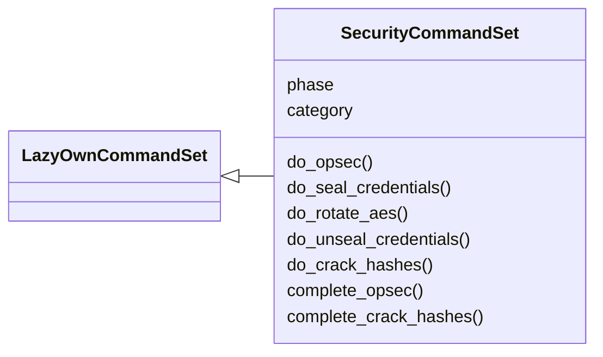
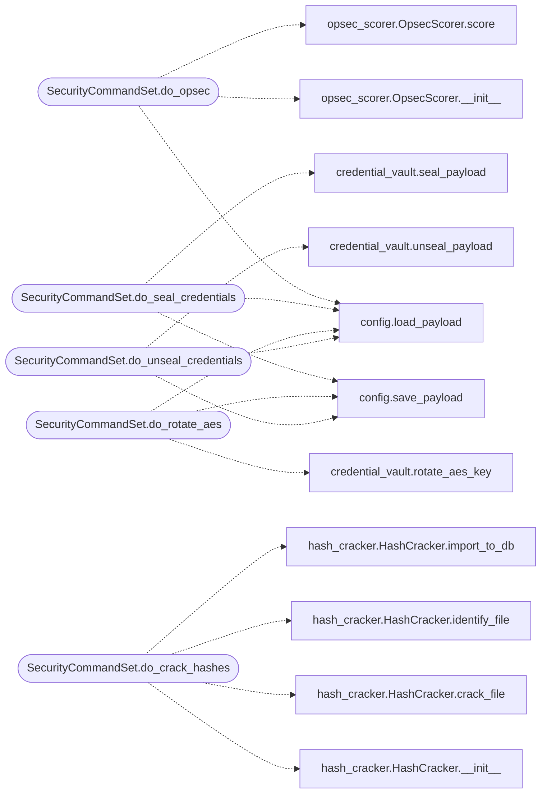

# `cli.commands.security`

> Source: [cli/commands/security.py:1](../../cli/commands/security.py#L1) | language `py` | coverage 77.8% | [API index](../index.md)

OPSEC and security commands — risk scoring, credential sealing, rotation.

Integrates modules/opsec_scorer.py, core/credential_vault.py, and
modules/hash_cracker.py into the CLI.

Provides commands:
    opsec <command>        — Score OPSEC risk for a command
    seal_credentials       — Encrypt sensitive payload values at rest
    rotate_aes             — Generate new AES key and re-encrypt
    crack_hashes <file>    — Crack hashes from secretsdump output

## Contents

- **Classes:** [`SecurityCommandSet`](#securitycommandset)

## Type Diagram



## Call Graph

Solid arrows stay in this module, dashed arrows leave it.



## Classes

<a id="securitycommandset"></a>

### `SecurityCommandSet`

`class` | [cli/commands/security.py:20](../../cli/commands/security.py#L20)

```python
class SecurityCommandSet(LazyOwnCommandSet)
```

Bases: [`LazyOwnCommandSet`](cli.commands._base.py.md#lazyowncommandset)

OPSEC scoring, credential vault, and hash cracking commands.

**Attributes**

| Name | Type | Default | Description |
|---|---|---|---|
| [`phase`](#securitycommandset-phase) |  | `'security'` |  |
| [`category`](#securitycommandset-category) |  | `'09. Security / OPSEC'` |  |

**Members**

| Member | Kind | Summary |
|---|---|---|
| [`do_opsec`](#securitycommandset-do_opsec) | method | Score OPSEC risk for a LazyOwn command before execution. |
| [`do_seal_credentials`](#securitycommandset-do_seal_credentials) | method | Encrypt all sensitive values in payload.json using AES-256-GCM. |
| [`do_rotate_aes`](#securitycommandset-do_rotate_aes) | method | Generate a new AES key and re-encrypt all sealed credentials. |
| [`do_unseal_credentials`](#securitycommandset-do_unseal_credentials) | method | Decrypt sealed credential values in payload.json for inspection. |
| [`do_crack_hashes`](#securitycommandset-do_crack_hashes) | method | Crack password hashes from a file using John the Ripper or Hashcat. |
| [`complete_opsec`](#securitycommandset-complete_opsec) | method |  |
| [`complete_crack_hashes`](#securitycommandset-complete_crack_hashes) | method |  |

<a id="securitycommandset-do_opsec"></a>

#### `SecurityCommandSet.do_opsec`

`method` | [cli/commands/security.py:26](../../cli/commands/security.py#L26)

```python
def do_opsec(self, line: str) -> None
```

Score OPSEC risk for a LazyOwn command before execution.

Usage: opsec <command>

**Parameters**

| Name | Type | Default | Description |
|---|---|---|---|
| `line` | `str` |  |  |

**Example**

```python
opsec secretsdump
opsec psexec
opsec lazynmap
```

*Calls:* [`load_payload`](core.config.py.md#load_payload), [`OpsecScorer.__init__`](modules.opsec_scorer.py.md#opsecscorer-__init__), [`OpsecScorer.score`](modules.opsec_scorer.py.md#opsecscorer-score)

<a id="securitycommandset-do_seal_credentials"></a>

#### `SecurityCommandSet.do_seal_credentials`

`method` | [cli/commands/security.py:106](../../cli/commands/security.py#L106)

```python
def do_seal_credentials(self, _line: str) -> None
```

Encrypt all sensitive values in payload.json using AES-256-GCM.

Usage: seal_credentials

After sealing, payload.json will contain encrypted values for passwords,
API keys, and other secrets. They are transparently decrypted at runtime.

**Parameters**

| Name | Type | Default | Description |
|---|---|---|---|
| `_line` | `str` |  |  |

*Calls:* [`load_payload`](core.config.py.md#load_payload), [`save_payload`](core.config.py.md#save_payload), [`seal_payload`](core.credential_vault.py.md#seal_payload)

<a id="securitycommandset-do_rotate_aes"></a>

#### `SecurityCommandSet.do_rotate_aes`

`method` | [cli/commands/security.py:127](../../cli/commands/security.py#L127)

```python
def do_rotate_aes(self, _line: str) -> None
```

Generate a new AES key and re-encrypt all sealed credentials.

Usage: rotate_aes

Use this when you need to rotate the encryption key for operational security.
All existing sealed values are decrypted with the old key and re-encrypted
with a fresh key.

**Parameters**

| Name | Type | Default | Description |
|---|---|---|---|
| `_line` | `str` |  |  |

*Calls:* [`load_payload`](core.config.py.md#load_payload), [`save_payload`](core.config.py.md#save_payload), [`rotate_aes_key`](core.credential_vault.py.md#rotate_aes_key)

<a id="securitycommandset-do_unseal_credentials"></a>

#### `SecurityCommandSet.do_unseal_credentials`

`method` | [cli/commands/security.py:150](../../cli/commands/security.py#L150)

```python
def do_unseal_credentials(self, _line: str) -> None
```

Decrypt sealed credential values in payload.json for inspection.

Usage: unseal_credentials

Warning: this writes plaintext credentials back to payload.json.
Use seal_credentials to re-encrypt them.

**Parameters**

| Name | Type | Default | Description |
|---|---|---|---|
| `_line` | `str` |  |  |

*Calls:* [`load_payload`](core.config.py.md#load_payload), [`save_payload`](core.config.py.md#save_payload), [`unseal_payload`](core.credential_vault.py.md#unseal_payload)

<a id="securitycommandset-do_crack_hashes"></a>

#### `SecurityCommandSet.do_crack_hashes`

`method` | [cli/commands/security.py:170](../../cli/commands/security.py#L170)

```python
def do_crack_hashes(self, line: str) -> None
```

Crack password hashes from a file using John the Ripper or Hashcat.

Usage: crack_hashes <filepath> [--wordlist <path>]

Parses hashes from the file (e.g., secretsdump output), identifies hash types,
and runs John or Hashcat. Cracked passwords are imported into the DB.

**Parameters**

| Name | Type | Default | Description |
|---|---|---|---|
| `line` | `str` |  |  |

**Example**

```python
crack_hashes sessions/hashes_10.10.11.5.txt
crack_hashes sessions/ntds.dit --wordlist /usr/share/wordlists/rockyou.txt
```

*Calls:* [`HashCracker.__init__`](modules.hash_cracker.py.md#hashcracker-__init__), [`HashCracker.crack_file`](modules.hash_cracker.py.md#hashcracker-crack_file), [`HashCracker.identify_file`](modules.hash_cracker.py.md#hashcracker-identify_file), [`HashCracker.import_to_db`](modules.hash_cracker.py.md#hashcracker-import_to_db)

<a id="securitycommandset-complete_opsec"></a>

#### `SecurityCommandSet.complete_opsec`

`method` | [cli/commands/security.py:267](../../cli/commands/security.py#L267)

```python
def complete_opsec(self, text: str, line: str, begidx: int, endidx: int) -> list[str]
```

**Parameters**

| Name | Type | Default | Description |
|---|---|---|---|
| `text` | `str` |  |  |
| `line` | `str` |  |  |
| `begidx` | `int` |  |  |
| `endidx` | `int` |  |  |

**Returns:** `list[str]`

<a id="securitycommandset-complete_crack_hashes"></a>

#### `SecurityCommandSet.complete_crack_hashes`

`method` | [cli/commands/security.py:276](../../cli/commands/security.py#L276)

```python
def complete_crack_hashes(self, text: str, line: str, begidx: int, endidx: int) -> list[str]
```

**Parameters**

| Name | Type | Default | Description |
|---|---|---|---|
| `text` | `str` |  |  |
| `line` | `str` |  |  |
| `begidx` | `int` |  |  |
| `endidx` | `int` |  |  |

**Returns:** `list[str]`

---
