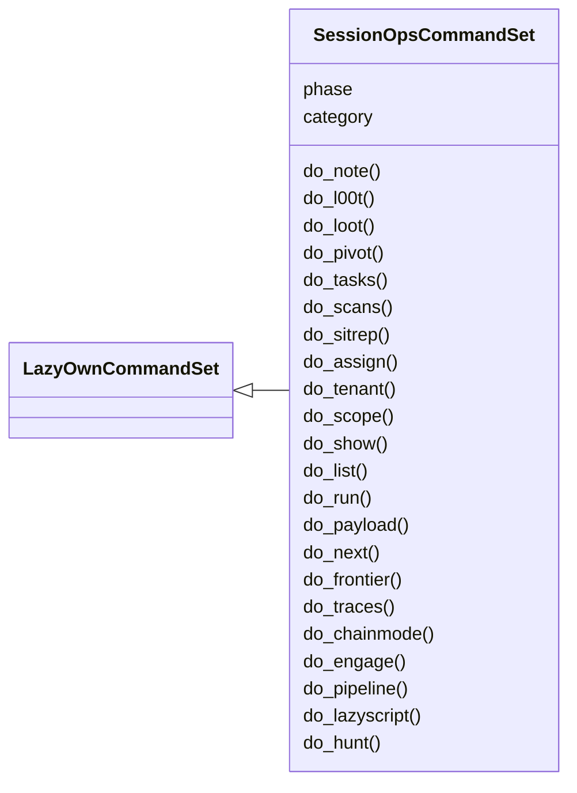
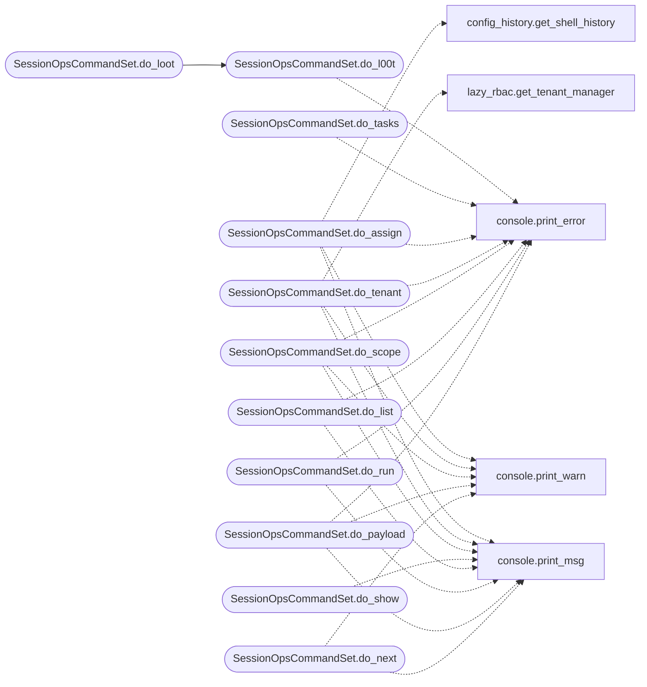

# `cli.commands.session_ops`

> Source: [cli/commands/session_ops.py:1](../../cli/commands/session_ops.py#L1) | language `py` | coverage 100.0% | [API index](../index.md)

Session and campaign operations extracted from the miscellaneous cluster.

Pending status: originals deleted from ``cli/commands/misc_migrated.py``;
this set is registered by `[`cli.registry`](cli.registry.py.md)`.

## Contents

- **Classes:** [`SessionOpsCommandSet`](#sessionopscommandset)

## Type Diagram



## Call Graph

Solid arrows stay in this module, dashed arrows leave it.



## Classes

<a id="sessionopscommandset"></a>

### `SessionOpsCommandSet`

`class` | [cli/commands/session_ops.py:86](../../cli/commands/session_ops.py#L86)

```python
class SessionOpsCommandSet(LazyOwnCommandSet)
```

Bases: [`LazyOwnCommandSet`](cli.commands._base.py.md#lazyowncommandset)

Session and campaign operations.

**Attributes**

| Name | Type | Default | Description |
|---|---|---|---|
| [`phase`](#sessionopscommandset-phase) |  | `'misc'` |  |
| [`category`](#sessionopscommandset-category) |  | `'12. Miscellaneous'` |  |

**Members**

| Member | Kind | Summary |
|---|---|---|
| [`do_note`](#sessionopscommandset-do_note) | method | Capture a quick operator note attached to the current target and phase. |
| [`do_l00t`](#sessionopscommandset-do_l00t) | method | Unified loot: show, search, reuse, graph, and mark credentials. |
| [`do_loot`](#sessionopscommandset-do_loot) | method | Alias for ``l00t`` — unified loot (show/search/reuse/graph/mark). |
| [`do_pivot`](#sessionopscommandset-do_pivot) | method | Record a newly discovered pivot target or show the pivot chain. |
| [`do_tasks`](#sessionopscommandset-do_tasks) | method | View and manage the task queue from sessions/tasks.json. |
| [`do_scans`](#sessionopscommandset-do_scans) | method | List nmap scan files in sessions/ with age, size, and open ports. |
| [`do_sitrep`](#sessionopscommandset-do_sitrep) | method | Print a unified operational situation report. |
| [`do_assign`](#sessionopscommandset-do_assign) | method | assign a parameter value, persist to payload.json and refresh aliases. |
| [`do_tenant`](#sessionopscommandset-do_tenant) | method | Manage multi-tenancy: list, switch, or create engagement tenants. |
| [`do_scope`](#sessionopscommandset-do_scope) | method | Manage the authorized engagement scope and the scope-guard posture. |
| [`do_show`](#sessionopscommandset-do_show) | method | Show params, modules, payloads, or active module options. |
| [`do_list`](#sessionopscommandset-do_list) | method | Lists all available scripts in the modules directory. |
| [`do_run`](#sessionopscommandset-do_run) | method | Runs a specific LazyOwn script or active module. |
| [`do_payload`](#sessionopscommandset-do_payload) | method | Load parameters from a specified payload JSON file. |
| [`do_next`](#sessionopscommandset-do_next) | method | Show next-step recommendations or execute the active autosuggest. |
| [`do_frontier`](#sessionopscommandset-do_frontier) | method | Preview the planner intents the autonomous loops would run next. |
| [`do_traces`](#sessionopscommandset-do_traces) | method | Show recent autonomous step traces with evidence and traffic ids. |
| [`do_chainmode`](#sessionopscommandset-do_chainmode) | method | Toggle interactive kill-chain chaining after every command. |
| [`do_engage`](#sessionopscommandset-do_engage) | method | Drive a single target through the full kill-chain in one command. |
| [`do_pipeline`](#sessionopscommandset-do_pipeline) | method | Declarative composition layer: run a YAML pipeline of LazyOwn commands. |
| [`do_lazyscript`](#sessionopscommandset-do_lazyscript) | method | Executes commands defined in a lazyscript file. |
| [`do_hunt`](#sessionopscommandset-do_hunt) | method | Run an autonomous exploitation chain against a target. |
| [`do_resume`](#sessionopscommandset-do_resume) | method | Browse previous sessions and load a target from a past engagement. |
| [`do_getseclist`](#sessionopscommandset-do_getseclist) | method | Get the SecLists wordlist from GitHub. |
| [`do_download_resources`](#sessionopscommandset-do_download_resources) | method | Downloads resources into the `sessions` directory. |
| [`do_collab_join`](#sessionopscommandset-do_collab_join) | method | Print the multi-operator collaboration join URL and SSE endpoint. |
| [`do_kick`](#sessionopscommandset-do_kick) | method | Handles the process of sending a spoofed ARP packet to a specified IP address with a given MAC address. |
| [`do_qa`](#sessionopscommandset-do_qa) | method | Exits the application quickly without confirmation. |
| [`do_clock`](#sessionopscommandset-do_clock) | method | Displays the current date and time, and runs a custom shell script. |
| [`do_gencert`](#sessionopscommandset-do_gencert) | method | Generates a certificate authority (CA), client certificate, and client key. |
| [`do_load_session`](#sessionopscommandset-do_load_session) | method | Load the session from the sessionLazyOwn.json file and display the status of various parameters. |
| [`do_clone_site`](#sessionopscommandset-do_clone_site) | method | Clone a website and serve the files in sessions/{url_cloned}. |
| [`do_msfshellcoder`](#sessionopscommandset-do_msfshellcoder) | method | Generate shellcode in C format using msfvenom for either a custom command or a reverse shell payload. |

<a id="sessionopscommandset-do_note"></a>

#### `SessionOpsCommandSet.do_note`

`method` | [cli/commands/session_ops.py:93](../../cli/commands/session_ops.py#L93)

Decorators: `@cmd2.with_category('12. Miscellaneous')`

```python
def do_note(self, line)
```

Capture a quick operator note attached to the current target and phase.

Notes land in sessions/notes.jsonl with timestamp, self.params['rhost'], and phase
so they survive session restarts and show up in reports.

Usage:
    `[`note`](modules.emulation_runner.py.md#emulationresult-note)`                    — list recent notes for current self.params['rhost']
    ``note <text>``             — save a note for current self.params['rhost']/phase
    ``note -a``                 — list all notes (all targets)
    ``note Found admin creds in /etc/shadow``
    ``note SMB signing disabled on DC01``

**Parameters**

| Name | Type | Default | Description |
|---|---|---|---|
| `line` |  |  |  |

<a id="sessionopscommandset-do_l00t"></a>

#### `SessionOpsCommandSet.do_l00t`

`method` | [cli/commands/session_ops.py:118](../../cli/commands/session_ops.py#L118)

Decorators: `@cmd2.with_category('12. Miscellaneous')`

```python
def do_l00t(self, line)
```

Unified loot: show, search, reuse, graph, and mark credentials.

Aggregates every credentials*.txt and hash*.txt in sessions/ into one
deduplicated view. Clelazyt passwords show green, hashes red.

Subcommands:
    ``l00t``                              — show all captured loot
    ``l00t search <user|host|hash>``      — search loot for a substring
    ``l00t reuse``                        — rank creds to try on the current rhost
    ``l00t graph``                        — credential graph: harvested / worked / rejected
    ``l00t mark <user|secret> worked|rejected [host]``
                                          — record an auth outcome (defaults host to rhost)

**Parameters**

| Name | Type | Default | Description |
|---|---|---|---|
| `line` |  |  |  |

**Example**

```python
``l00t search admin``
``l00t reuse``
``l00t mark administrator worked``
``l00t mark svc_sql rejected 10.10.11.5``
```

*Calls:* [`print_error`](core.console.py.md#print_error)

*Called by:* [`SessionOpsCommandSet.do_loot`](#sessionopscommandset-do_loot)

<a id="sessionopscommandset-do_loot"></a>

#### `SessionOpsCommandSet.do_loot`

`method` | [cli/commands/session_ops.py:167](../../cli/commands/session_ops.py#L167)

Decorators: `@cmd2.with_category('12. Miscellaneous')`

```python
def do_loot(self, line)
```

Alias for ``l00t`` — unified loot (show/search/reuse/graph/mark).

See ``help l00t`` for the full subcommand reference.

**Parameters**

| Name | Type | Default | Description |
|---|---|---|---|
| `line` |  |  |  |

*Calls:* [`SessionOpsCommandSet.do_l00t`](#sessionopscommandset-do_l00t)

<a id="sessionopscommandset-do_pivot"></a>

#### `SessionOpsCommandSet.do_pivot`

`method` | [cli/commands/session_ops.py:175](../../cli/commands/session_ops.py#L175)

Decorators: `@cmd2.with_category('12. Miscellaneous')`

```python
def do_pivot(self, line)
```

Record a newly discovered pivot target or show the pivot chain.

When you compromise a host and discover a new reachable network/IP,
record it here. The pivot chain is stored in sessions/pivots.jsonl
and survives session restarts.

Usage:
    ``pivot``                        — show full pivot chain
    ``pivot <new-ip>``               — record pivot via current rhost
    ``pivot <new-ip> <note>``        — record with a free-form note
    ``pivot 10.10.10.50``
    ``pivot 10.10.10.50 SMB open, admin share accessible``

**Parameters**

| Name | Type | Default | Description |
|---|---|---|---|
| `line` |  |  |  |

<a id="sessionopscommandset-do_tasks"></a>

#### `SessionOpsCommandSet.do_tasks`

`method` | [cli/commands/session_ops.py:200](../../cli/commands/session_ops.py#L200)

Decorators: `@cmd2.with_category('12. Miscellaneous')`

```python
def do_tasks(self, line)
```

View and manage the task queue from sessions/tasks.json.

Tasks are created automatically by world_model_watcher and the
autonomous daemon, and can also be added manually. Each task has
an id, title, status (New/Started/Done/Blocked), and operator.

Usage:
    ``tasks``             — show active tasks (New + Started)
    ``tasks --all``       — show all tasks including Done
    ``tasks add <text>``  — create a new task
    ``tasks done <id>``   — mark task as Done
    ``tasks start <id>``  — mark task as Started

**Parameters**

| Name | Type | Default | Description |
|---|---|---|---|
| `line` |  |  |  |

*Calls:* [`print_error`](core.console.py.md#print_error)

<a id="sessionopscommandset-do_scans"></a>

#### `SessionOpsCommandSet.do_scans`

`method` | [cli/commands/session_ops.py:233](../../cli/commands/session_ops.py#L233)

Decorators: `@cmd2.with_category('12. Miscellaneous')`

```python
def do_scans(self, line)
```

List nmap scan files in sessions/ with age, size, and open ports.

Without arguments shows all scan files. With an IP filters to scans
for that target only.

Usage:
    ``scans``              — all scan files
    ``scans 10.10.11.5``   — scans for that host only
    ``scans rhost``        — shortcut for current rhost

**Parameters**

| Name | Type | Default | Description |
|---|---|---|---|
| `line` |  |  |  |

<a id="sessionopscommandset-do_sitrep"></a>

#### `SessionOpsCommandSet.do_sitrep`

`method` | [cli/commands/session_ops.py:250](../../cli/commands/session_ops.py#L250)

Decorators: `@cmd2.with_category('12. Miscellaneous')`

```python
def do_sitrep(self, line)
```

Print a unified operational situation report.

Aggregates in one view: target/attacker/domain, current phase and OS,
nmap scans found for the active target, captured credentials and
hashes, tasks backlog (New/Started/Done), operator notes, pivot chain,
and world model host/vuln/cred counts.

Run this at the start of a shift, after pivoting to a new target, or
whenever you need a quick 'where are we?' during the engagement.

Usage:
    ``sitrep``

**Parameters**

| Name | Type | Default | Description |
|---|---|---|---|
| `line` |  |  |  |

<a id="sessionopscommandset-do_assign"></a>

#### `SessionOpsCommandSet.do_assign`

`method` | [cli/commands/session_ops.py:267](../../cli/commands/session_ops.py#L267)

Decorators: `@cmd2.with_category('12. Miscellaneous')`

```python
def do_assign(self, line)
```

assign a parameter value, persist to payload.json and refresh aliases.

The mutation is delegated to [`cli.assign.apply_assign`](cli.assign.py.md#apply_assign) which
writes ``payload.json`` atomically through [`core.config.save_payload`](core.config.py.md#save_payload)
when the parameter is known. After a successful update, aliases are
re-rendered so commands like ``backdoor`` or ``coerce_plus`` immediately
reflect the new value without a shell restart.

**Parameters**

| Name | Type | Default | Description |
|---|---|---|---|
| `line` | `str` |  | '<parameter> <value>'. |

**Returns:** None

*Calls:* [`get_shell_history`](cli.config_history.py.md#get_shell_history), [`print_error`](core.console.py.md#print_error), [`print_msg`](core.console.py.md#print_msg), [`print_warn`](core.console.py.md#print_warn)

<a id="sessionopscommandset-do_tenant"></a>

#### `SessionOpsCommandSet.do_tenant`

`method` | [cli/commands/session_ops.py:332](../../cli/commands/session_ops.py#L332)

Decorators: `@cmd2.with_category('12. Miscellaneous')`

```python
def do_tenant(self, line)
```

Manage multi-tenancy: list, switch, or create engagement tenants.

Each tenant has its own payload profile and session directory,
providing isolated environments for parallel engagements.

Usage:
    ``tenant``                           list all tenants
    ``tenant switch <id>``               activate a tenant
    ``tenant create <name>``             create a new tenant from current payload
    ``tenant info``                      show active tenant details

Tenant payloads are stored in ``payloads/<id>.json`` and sessions
in ``sessions/<id>/``. The default tenant always exists.

**Parameters**

| Name | Type | Default | Description |
|---|---|---|---|
| `line` |  |  |  |

*Calls:* [`print_error`](core.console.py.md#print_error), [`print_msg`](core.console.py.md#print_msg), [`print_warn`](core.console.py.md#print_warn), [`get_tenant_manager`](modules.lazy_rbac.py.md#get_tenant_manager)

<a id="sessionopscommandset-do_scope"></a>

#### `SessionOpsCommandSet.do_scope`

`method` | [cli/commands/session_ops.py:405](../../cli/commands/session_ops.py#L405)

Decorators: `@cmd2.with_category('12. Miscellaneous')`

```python
def do_scope(self, line)
```

Manage the authorized engagement scope and the scope-guard posture.

The scope guard checks every offensive command against this list before
it runs. While the scope is empty the guard is dormant, so defining a
scope is opt-in and never disrupts an existing campaign. Entries may be
CIDR networks, bare IP addresses or hostnames (a leading ``*.`` matches
subdomains).

Usage:
    ``scope``                          show the scope and the mode
    ``scope add <cidr|ip|host>``       authorize an entry
    ``scope rm <cidr|ip|host>``        remove an entry
    ``scope clear``                    remove every entry
    ``scope mode <off|warn|enforce>``  set the enforcement posture

Modes:
    ``off``      guard disabled.
    ``warn``     out-of-scope offensive commands run but warn (default).
    ``enforce``  out-of-scope offensive commands are blocked pending
                 interactive confirmation.

**Parameters**

| Name | Type | Default | Description |
|---|---|---|---|
| `line` |  |  |  |

*Calls:* [`print_error`](core.console.py.md#print_error), [`print_msg`](core.console.py.md#print_msg), [`print_warn`](core.console.py.md#print_warn)

<a id="sessionopscommandset-do_show"></a>

#### `SessionOpsCommandSet.do_show`

`method` | [cli/commands/session_ops.py:471](../../cli/commands/session_ops.py#L471)

Decorators: `@cmd2.with_category('12. Miscellaneous')`

```python
def do_show(self, line)
```

Show params, modules, payloads, or active module options.

Usage:
    show                       — show all params (default)
    show exploits              — list all exploit modules
    show auxiliary             — list auxiliary modules
    show scanners              — list scanner modules
    show post                  — list post-exploitation modules
    show payloads              — list registered payloads
    show options               — show active module options
    show modules               — list all modules
    show all                   — list all modules by type

**Parameters**

| Name | Type | Default | Description |
|---|---|---|---|
| `line` |  |  |  |

*Calls:* [`print_msg`](core.console.py.md#print_msg)

<a id="sessionopscommandset-do_list"></a>

#### `SessionOpsCommandSet.do_list`

`method` | [cli/commands/session_ops.py:547](../../cli/commands/session_ops.py#L547)

Decorators: `@cmd2.with_category('12. Miscellaneous')`

```python
def do_list(self, line)
```

Lists all available scripts in the modules directory.

This method prints a list of available scripts in a formatted manner, arranging
them into columns. It shows each script with sufficient spacing for readability.

**Parameters**

| Name | Type | Default | Description |
|---|---|---|---|
| `line` | `str` |  | This parameter is not used in the method. |

**Returns:** None

*Calls:* [`print_error`](core.console.py.md#print_error), [`print_msg`](core.console.py.md#print_msg)

<a id="sessionopscommandset-do_run"></a>

#### `SessionOpsCommandSet.do_run`

`method` | [cli/commands/session_ops.py:576](../../cli/commands/session_ops.py#L576)

Decorators: `@cmd2.with_category('12. Miscellaneous')`

```python
def do_run(self, line)
```

Runs a specific LazyOwn script or active module.

If a module is active (via ``use <module>``), ``run`` executes it.
Otherwise it runs a script from the toolkit by name.

**Parameters**

| Name | Type | Default | Description |
|---|---|---|---|
| `line` | `str` |  | The command line input containing the script name. |

**Returns:** None

*Calls:* [`print_error`](core.console.py.md#print_error), [`print_msg`](core.console.py.md#print_msg)

<a id="sessionopscommandset-do_payload"></a>

#### `SessionOpsCommandSet.do_payload`

`method` | [cli/commands/session_ops.py:615](../../cli/commands/session_ops.py#L615)

Decorators: `@cmd2.with_category('12. Miscellaneous')`

```python
def do_payload(self, line)
```

Load parameters from a specified payload JSON file.

This function loads parameters from a JSON file specified by the [`line`](modules.defense_eval.py.md#evaluation-line) argument and updates the instance's `params` dictionary with the values from the file. If the file does not exist or contains invalid JSON, it will print an appropriate error message.

Usage:
    payload <filename>


Manual execution:
1. Open and read the specified JSON file.
2. Update the `params` dictionary with values from the JSON file.
3. Print a success message if the parameters were successfully loaded.
4. Handle `FileNotFoundError` if the file does not exist.
5. Handle `JSONDecodeError` if there is an error decoding the JSON file.

Dependencies:
- `json` module for reading and parsing the JSON file.

Example:
    To execute the function, call `payload payload_10.10.10.10.json`.

Note:
    - Ensure that the specified JSON file exists in the current directory and is properly formatted.
    - The confirmation message includes color formatting for better visibility.

**Parameters**

| Name | Type | Default | Description |
|---|---|---|---|
| `line` | `str` |  | The name of the JSON file to load. |

**Returns:** None

*Calls:* [`print_error`](core.console.py.md#print_error), [`print_msg`](core.console.py.md#print_msg), [`print_warn`](core.console.py.md#print_warn)

<a id="sessionopscommandset-do_next"></a>

#### `SessionOpsCommandSet.do_next`

`method` | [cli/commands/session_ops.py:666](../../cli/commands/session_ops.py#L666)

Decorators: `@cmd2.with_category('12. Miscellaneous')`

```python
def do_next(self, line)
```

Show next-step recommendations or execute the active autosuggest.

Two modes share the same verb:

* ``next <command> [N]`` — show ordered chain recommendations for
  ``<command>`` (static kill-chain + nmap-discovered services +
  addon/tool triggers), capped at ``N`` (default 5). Mirrors the
  MCP tool ``lazyown_command_next`` so CLI and AI see the same
  data. This is the chain's complement to `[`prev`](cli.command_chain.py.md#commandchain-prev)`.
* `[`next`](cli.command_chain.py.md#commandchain-next)` (no args) — pop and execute the active autosuggest
  accelerator (the dim ``press '.' to run: <cmd>`` line). The
  accelerator alias ``.`` keeps working unchanged.

**Parameters**

| Name | Type | Default | Description |
|---|---|---|---|
| `line` |  |  | Empty for the accelerator mode, or ``<verb> [limit]`` for the chain mode. |

**Returns:** None.

*Calls:* [`print_msg`](core.console.py.md#print_msg), [`print_warn`](core.console.py.md#print_warn)

<a id="sessionopscommandset-do_frontier"></a>

#### `SessionOpsCommandSet.do_frontier`

`method` | [cli/commands/session_ops.py:710](../../cli/commands/session_ops.py#L710)

Decorators: `@cmd2.with_category('12. Miscellaneous')`

```python
def do_frontier(self, line)
```

Preview the planner intents the autonomous loops would run next.

Usage:
    frontier
    frontier 192.168.1.10

Runs the same ``Planner + Frontier`` refill the engage daemon and
``auto_loop`` consume: fact-ranked MITRE techniques for the target,
minus tried and creds-gated ones. Nothing is executed; this is the
read-only view of the loop's next direction.

**Parameters**

| Name | Type | Default | Description |
|---|---|---|---|
| `line` |  | `the` | Optional target IP. Defaults to the ``rhost`` payload value. |

**Returns:** None.

*Calls:* [`print_error`](core.console.py.md#print_error), [`print_msg`](core.console.py.md#print_msg), [`print_warn`](core.console.py.md#print_warn), [`Frontier.__init__`](modules.lazy_loop.py.md#frontier-__init__), [`Planner.__init__`](modules.lazy_loop.py.md#planner-__init__), [`Frontier.refill`](modules.planner.py.md#frontier-refill), [`TodoList.__init__`](modules.planner.py.md#todolist-__init__)

<a id="sessionopscommandset-do_traces"></a>

#### `SessionOpsCommandSet.do_traces`

`method` | [cli/commands/session_ops.py:754](../../cli/commands/session_ops.py#L754)

Decorators: `@cmd2.with_category('12. Miscellaneous')`

```python
def do_traces(self, line)
```

Show recent autonomous step traces with evidence and traffic ids.

Usage:
    traces
    traces lazynmap
    traces --limit 20

Tails the autonomous step records both loops settle — first
``sessions/worker_traces.jsonl`` (auto_loop, with evidence hash,
traffic exchange and proven goals), falling back to
``sessions/intents.jsonl`` (engage daemon ledger: command, phase,
state, reason). Optional substring filters by command.

**Parameters**

| Name | Type | Default | Description |
|---|---|---|---|
| `line` |  |  | Optional query substring and ``--limit N``. |

**Returns:** None.

*Calls:* [`print_error`](core.console.py.md#print_error), [`print_msg`](core.console.py.md#print_msg), [`print_warn`](core.console.py.md#print_warn)

<a id="sessionopscommandset-do_chainmode"></a>

#### `SessionOpsCommandSet.do_chainmode`

`method` | [cli/commands/session_ops.py:835](../../cli/commands/session_ops.py#L835)

Decorators: `@cmd2.with_category('12. Miscellaneous')`

```python
def do_chainmode(self, line)
```

Toggle interactive kill-chain chaining after every command.

Usage:
    chainmode on          Start the chain flow.
    chainmode off         Stop the chain flow.
    chainmode status      Show whether chaining is active.

When on, every executed command is followed by a world-model-driven
prompt listing the next kill-chain step(s). Press Enter to run the
top suggestion, type ``1..N`` to pick a ranked alternative, type
any command to override the suggestion and keep chaining from it,
`[`skip`](skills.lazyown_objective.py.md#objectivestore-skip)` to continue manually, or ``off`` to exit. The state is
persisted to ``sessions/chain_mode.json``.

**Parameters**

| Name | Type | Default | Description |
|---|---|---|---|
| `line` |  |  | Whitespace-stripped sub-command (on/off/status). |

**Returns:** None.

*Calls:* [`print_error`](core.console.py.md#print_error), [`print_msg`](core.console.py.md#print_msg), [`print_warn`](core.console.py.md#print_warn)

<a id="sessionopscommandset-do_engage"></a>

#### `SessionOpsCommandSet.do_engage`

`method` | [cli/commands/session_ops.py:886](../../cli/commands/session_ops.py#L886)

Decorators: `@cmd2.with_category('12. Miscellaneous')`

```python
def do_engage(self, line)
```

Drive a single target through the full kill-chain in one command.

Usage:
    engage <target>                  Run synchronously on the target IP
    engage <target> --auto           Full auto mode: no human in the loop
    engage <target> --background     Detach into a background worker
    engage <target> --max-switches N Set per-step fallback retry limit
    engage --status                  Tail the engagement log + show pending approvals
    engage --pending                 List approval requests awaiting an operator
    engage --approve <id> [--operator name]
    engage --deny <id>    [--operator name]

The orchestrator runs ping/OS detect -> nmap -> auto_populate -> enum
-> exploit-search -> initial-access against the target. Each phase
consults the ApprovalGate when ``auto_approve`` is false in
``payload.json``; gated phases pause for an operator decision before
executing. Failures auto-switch to the next bridge-catalog
alternative. Every action is narrated to ``sessions/engagement.log``
and broadcast through `[`modules.collab_bp`](modules.collab_bp.py.md)` so connected teammates
see the kill-chain in real time.

With ``--auto`` the engagement runs with no human in the loop. The
ApprovalGate is replaced by a `[`ScopeBoundAutoGate`](skills.lazyown_policy.py.md#scopeboundautogate)` that never
prompts: it approves every step whose target is inside the authorized
``scope`` (or when the scope guard is dormant) and denies any
out-of-scope target while `[`scope_enforcement`](lazyown.py.md#lazyownshell-scope_enforcement)` is ``enforce`` — the
single fail-closed boundary unattended autonomy keeps. When the
kill-chain finishes a client-ready report is written to ``sessions/``.

**Parameters**

| Name | Type | Default | Description |
|---|---|---|---|
| `line` | `str` |  | Target IP plus optional flags. |

**Returns:** None

*Calls:* [`print_error`](core.console.py.md#print_error), [`print_msg`](core.console.py.md#print_msg)

<a id="sessionopscommandset-do_pipeline"></a>

#### `SessionOpsCommandSet.do_pipeline`

`method` | [cli/commands/session_ops.py:1013](../../cli/commands/session_ops.py#L1013)

Decorators: `@cmd2.with_category('12. Miscellaneous')`

```python
def do_pipeline(self, line)
```

Declarative composition layer: run a YAML pipeline of LazyOwn commands.

Usage:
    pipeline list                          List every YAML pipeline in pipelines/
    pipeline validate <name>               Parse and check a pipeline schema
    pipeline run <name>                    Execute the pipeline synchronously
    pipeline run <name> --background       Detach into a worker thread
    pipeline run <name> --target <ip>      Override payload.rhost for this run
    pipeline status                        Show the N most recent runs (summary)
    pipeline show <name>                   Print the validated step list

Pipelines live in pipelines/*.yaml. They compose existing LazyOwn
commands into ordered, conditional, recoverable plans. Each run is
persisted under sessions/pipelines/<name>__<run-id>/ with the
frozen plan, per-step JSON records, and a summary. Live narration
is broadcast through the same fabric used by ``engage``.

**Parameters**

| Name | Type | Default | Description |
|---|---|---|---|
| `line` | `str` |  | Subcommand plus optional positional / flag arguments. |

**Returns:** None

*Calls:* [`print_error`](core.console.py.md#print_error), [`print_msg`](core.console.py.md#print_msg)

<a id="sessionopscommandset-do_lazyscript"></a>

#### `SessionOpsCommandSet.do_lazyscript`

`method` | [cli/commands/session_ops.py:1104](../../cli/commands/session_ops.py#L1104)

Decorators: `@cmd2.with_category('12. Miscellaneous')`

```python
def do_lazyscript(self, line)
```

Executes commands defined in a lazyscript file.

This function reads a script file containing commands to be executed
sequentially. Each command is executed using the onecmd method of the
cmd.Cmd class. The script file should be located in the 'lazyscripts'
directory relative to the current working directory.

**Parameters**

| Name | Type | Default | Description |
|---|---|---|---|
| `line` | `str` |  | The name of the script file to execute (e.g., 'lazyscript.ls'). |

**Example**

```python
do_lazyscript('example_script.ls')
This would execute all commands listed in 'lazyscripts/example_script.ls'.
```

*Calls:* [`print_error`](core.console.py.md#print_error), [`print_msg`](core.console.py.md#print_msg)

<a id="sessionopscommandset-do_hunt"></a>

#### `SessionOpsCommandSet.do_hunt`

`method` | [cli/commands/session_ops.py:1136](../../cli/commands/session_ops.py#L1136)

Decorators: `@cmd2.with_category('12. Miscellaneous')`

```python
def do_hunt(self, line)
```

Run an autonomous exploitation chain against a target.

Profiles the target's attack surface, ranks exploit candidates by
confidence, and executes them in order until a shell is obtained or
the exploit limit is reached. Adapts strategy based on results.

The engine reads from ``sessions/world_model.json`` to understand
what services, versions, and vulnerabilities exist. No re-scanning.

Usage:
    hunt <target_ip> [max_exploits]
    hunt 10.10.11.5
    hunt 10.10.11.5 10

**Parameters**

| Name | Type | Default | Description |
|---|---|---|---|
| `line` | `str` |  | Target IP and optional max exploit count. |

**Returns:** None

*Calls:* [`print_error`](core.console.py.md#print_error), [`print_msg`](core.console.py.md#print_msg), [`print_warn`](core.console.py.md#print_warn), [`AutonomousExploitEngine.__init__`](modules.autonomous_exploit_engine.py.md#autonomousexploitengine-__init__), [`AutonomousExploitEngine.hunt`](modules.autonomous_exploit_engine.py.md#autonomousexploitengine-hunt), [`AutonomousExploitEngine.profile`](modules.autonomous_exploit_engine.py.md#autonomousexploitengine-profile), [`AutonomousExploitEngine.rank_exploits`](modules.autonomous_exploit_engine.py.md#autonomousexploitengine-rank_exploits)

<a id="sessionopscommandset-do_resume"></a>

#### `SessionOpsCommandSet.do_resume`

`method` | [cli/commands/session_ops.py:1227](../../cli/commands/session_ops.py#L1227)

Decorators: `@cmd2.with_category('12. Miscellaneous')`

```python
def do_resume(self, line)
```

Browse previous sessions and load a target from a past engagement.

Scans sessions/ for IP directories with scan data, credentials, or
world model state, and presents them for quick resume.

Usage:
    ``resume``      — show the session selector panel

**Parameters**

| Name | Type | Default | Description |
|---|---|---|---|
| `line` |  |  |  |

*Calls:* [`SessionResumer.__init__`](cli.session_resumer.py.md#sessionresumer-__init__), [`SessionResumer.render_startup_panel`](cli.session_resumer.py.md#sessionresumer-render_startup_panel), [`print_msg`](core.console.py.md#print_msg)

<a id="sessionopscommandset-do_getseclist"></a>

#### `SessionOpsCommandSet.do_getseclist`

`method` | [cli/commands/session_ops.py:1249](../../cli/commands/session_ops.py#L1249)

Decorators: `@cmd2.with_category('12. Miscellaneous')`

```python
def do_getseclist(self, line)
```

Get the SecLists wordlist from GitHub.

This function downloads and extracts the SecLists wordlist from GitHub to the `/usr/share/wordlists/` directory.

Usage:
    getseclist


Manual execution:
1. Navigate to the `/usr/share/wordlists/` directory.
2. Download the SecLists repository using `wget`.
3. Extract the downloaded ZIP file.
4. Remove the ZIP file after extraction.

Dependencies:
- `wget` must be installed on the system.
- `unzip` must be installed on the system.
- `sudo` must be available for downloading and extracting files.

Example:
    To execute the function, simply call `getseclist`.

Note:
    - Ensure that you have the necessary permissions to write to the `/usr/share/wordlists/` directory.
    - If `wget` or `unzip` is not installed, the function will fail.

**Parameters**

| Name | Type | Default | Description |
|---|---|---|---|
| `line` | `str` |  | This parameter is not used in this function. |

**Returns:** None

*Calls:* [`print_msg`](core.console.py.md#print_msg)

<a id="sessionopscommandset-do_download_resources"></a>

#### `SessionOpsCommandSet.do_download_resources`

`method` | [cli/commands/session_ops.py:1287](../../cli/commands/session_ops.py#L1287)

Decorators: `@cmd2.with_category('12. Miscellaneous')`

```python
def do_download_resources(self, line)
```

Downloads resources into the `sessions` directory.

This function performs the following actions:
1. Changes to the `sessions` directory and executes `download_resources.sh` to download required resources.

Usage:
    download_resources


Manual execution:
1. Runs the `download_resources.sh` script in the `sessions` directory to download necessary resources.

Dependencies:
- `download_resources.sh` must be present in the `sessions` directory.

Example:
    download_resources

Note:
    - Ensure that the `download_resources.sh` script is present in the `sessions` directory and is executable.
    - After running this command, you can use the `www` command as indicated by the printed message.

**Parameters**

| Name | Type | Default | Description |
|---|---|---|---|
| `line` | `str` |  | Not used in this function. |

**Returns:** None

*Calls:* [`print_msg`](core.console.py.md#print_msg)

<a id="sessionopscommandset-do_collab_join"></a>

#### `SessionOpsCommandSet.do_collab_join`

`method` | [cli/commands/session_ops.py:1320](../../cli/commands/session_ops.py#L1320)

Decorators: `@cmd2.with_category('12. Miscellaneous')`

```python
def do_collab_join(self, line)
```

Print the multi-operator collaboration join URL and SSE endpoint.

Outputs the URL teammates need to open in a browser to connect to the
shared operator dashboard at /collab/ and the curl command to consume
the SSE event stream from a terminal.

Usage:
    ``collab_join``                    — print join URL for current self.params['lhost']/self.params['c2_port']
    ``collab_join alice``              — print URL with operator handle pre-filled
    ``collab_join alice --curl``       — also print the curl SSE command

**Parameters**

| Name | Type | Default | Description |
|---|---|---|---|
| `line` | `str` |  | Optional operator handle and flags. |

**Returns:** None

*Calls:* [`print_msg`](core.console.py.md#print_msg)

<a id="sessionopscommandset-do_kick"></a>

#### `SessionOpsCommandSet.do_kick`

`method` | [cli/commands/session_ops.py:1351](../../cli/commands/session_ops.py#L1351)

Decorators: `@cmd2.with_category('12. Miscellaneous')`

```python
def do_kick(self, line)
```

Handles the process of sending a spoofed ARP packet to a specified IP address with a given MAC address.

This function performs the following steps:
1. Executes a command to list current ARP entries and prints the IP and MAC addresses.
2. Prompts the user to input the target IP and MAC address in a specified format.
3. Parses the provided input to extract the IP and MAC addresses.
4. Sets up default values for the gateway IP, local MAC address, and network interface.
5. Creates an ARP packet with the specified target IP and MAC address.
6. Sends the ARP packet using the specified network interface.
7. Prints a confirmation message indicating that the spoofing packet has been sent.

**Parameters**

| Name | Type | Default | Description |
|---|---|---|---|
| `line` | `str` |  | Input line for the command, which is not used directly in this function. |

**Raises**

- `Exception`: If any error occurs during the execution of the function.

*Calls:* [`print_error`](core.console.py.md#print_error), [`print_msg`](core.console.py.md#print_msg), [`create_arp_packet`](utils.py.md#create_arp_packet), [`parse_ip_mac`](utils.py.md#parse_ip_mac), [`send_packet`](utils.py.md#send_packet)

<a id="sessionopscommandset-do_qa"></a>

#### `SessionOpsCommandSet.do_qa`

`method` | [cli/commands/session_ops.py:1400](../../cli/commands/session_ops.py#L1400)

Decorators: `@cmd2.with_category('12. Miscellaneous')`

```python
def do_qa(self, line)
```

Exits the application quickly without confirmation.

This function performs the following tasks:
1. Prints an exit message with formatting.
2. Terminates the `tmux` session named `lazyown_sessions` if it exists.
3. Kills all running `openvpn` processes.
4. Exits the program with a status code of 0.

Usage:
    qa


Manual execution:
    1. The command `tmux kill-session -t lazyown_sessions 2>/dev/null` is executed to kill the tmux session named `lazyown_sessions`, suppressing errors if the session does not exist.
    2. The command `killall openvpn 2>/dev/null` is executed to terminate all running `openvpn` processes, suppressing errors if no such processes are found.
    3. The program is exited with a status code of 0 using `sys.exit(0)`.

Dependencies:
    - The function relies on `tmux`, `killall`, and `sys` to perform the exit operations.

Example:
    qa
    # This will print an exit message, terminate the tmux session and openvpn processes, and exit the program.

Note:
    Ensure that `tmux` and `openvpn` are installed and running for their respective commands to have an effect.

**Parameters**

| Name | Type | Default | Description |
|---|---|---|---|
| `line` | `str` |  | This parameter is not used in the function but is included for consistency with other command methods. |

**Returns:** None

*Calls:* [`print_error`](core.console.py.md#print_error), [`print_msg`](core.console.py.md#print_msg)

<a id="sessionopscommandset-do_clock"></a>

#### `SessionOpsCommandSet.do_clock`

`method` | [cli/commands/session_ops.py:1462](../../cli/commands/session_ops.py#L1462)

Decorators: `@cmd2.with_category('12. Miscellaneous')`

```python
def do_clock(self, line)
```

Displays the current date and time, and runs a custom shell script.

This function performs the following actions:
1. Constructs a command to get the current date and time in a specified format.
2. Uses `figlet` to display the current date and time in a large ASCII text format.
3. Runs a custom shell script (`cal.sh`) to display additional information or perform further actions related to the clock.

Usage:
    clock


Manual execution:
To manually use this function:
1. Ensure that `figlet` is installed on your system for displaying text in large ASCII format.
2. Make sure `cal.sh` exists in the [`modules`](modules.__init__.py.md) directory and is executable.
3. Run the function to see the current date and time displayed in large ASCII text, followed by the execution of `cal.sh`.

Note: The function sets the terminal color to white before displaying the date and time, then sets it to green before running the `cal.sh` script. Finally, it resets the terminal color.

Dependencies:
- `figlet`: For displaying text in large ASCII format.
- `cal.sh`: A custom shell script located in the [`modules`](modules.__init__.py.md) directory.

**Parameters**

| Name | Type | Default | Description |
|---|---|---|---|
| `line` | `str` |  | This parameter is not used in the function. |

**Returns:** None

*Calls:* [`print_msg`](core.console.py.md#print_msg)

<a id="sessionopscommandset-do_gencert"></a>

#### `SessionOpsCommandSet.do_gencert`

`method` | [cli/commands/session_ops.py:1510](../../cli/commands/session_ops.py#L1510)

Decorators: `@cmd2.with_category('12. Miscellaneous')`

```python
def do_gencert(self, line)
```

Generates a certificate authority (CA), client certificate, and client key.

**Parameters**

| Name | Type | Default | Description |
|---|---|---|---|
| `line` |  |  |  |

**Returns:** `str` - Paths to the generated CA certificate, client certificate, and client key.

*Calls:* [`generate_certificates`](utils.py.md#generate_certificates)

<a id="sessionopscommandset-do_load_session"></a>

#### `SessionOpsCommandSet.do_load_session`

`method` | [cli/commands/session_ops.py:1522](../../cli/commands/session_ops.py#L1522)

Decorators: `@cmd2.with_category('12. Miscellaneous')`

```python
def do_load_session(self, line)
```

Load the session from the sessionLazyOwn.json file and display the status of various parameters.

This command reads the sessionLazyOwn.json file from the sessions directory and displays the status
of parameters, credentials, hashes, notes, plan, id_rsa, implants, and redop.

**Parameters**

| Name | Type | Default | Description |
|---|---|---|---|
| `line` |  |  | Additional arguments (not used in this command) |

*Calls:* [`print_error`](core.console.py.md#print_error), [`print_msg`](core.console.py.md#print_msg)

<a id="sessionopscommandset-do_clone_site"></a>

#### `SessionOpsCommandSet.do_clone_site`

`method` | [cli/commands/session_ops.py:1572](../../cli/commands/session_ops.py#L1572)

Decorators: `@cmd2.with_category('12. Miscellaneous')`

```python
def do_clone_site(self, line)
```

Clone a website and serve the files in sessions/{url_cloned}.

**Parameters**

| Name | Type | Default | Description |
|---|---|---|---|
| `line` | `str` |  | input line that url to clone |

**Returns:** None

*Calls:* [`print_error`](core.console.py.md#print_error), [`print_msg`](core.console.py.md#print_msg)

<a id="sessionopscommandset-do_msfshellcoder"></a>

#### `SessionOpsCommandSet.do_msfshellcoder`

`method` | [cli/commands/session_ops.py:1618](../../cli/commands/session_ops.py#L1618)

Decorators: `@cmd2.with_category('12. Miscellaneous')`

```python
def do_msfshellcoder(self, line)
```

Generate shellcode in C format using msfvenom for either a custom command or a reverse shell payload.

This command supports both direct argument input and interactive mode. It uses self.params for default values (self.params['lhost'], lport, etc). Output is saved to sessions/ as a .txt file in C array format. Outputs: Saves shellcode to ./sessions/shellcode_*.txt in C format. Uses self.cmd() to run system commands and self.display_toastr() for UI feedback.

**Parameters**

| Name | Type | Default | Description |
|---|---|---|---|
| `line` |  |  |  |

**Example**

```python
msfshellcoder -c "calc.exe" --os windows
msfshellcoder -p linux/x64/shell_reverse_tcp -H 10.0.0.5 -P 4444
msfshellcoder  # Launch interactive mode
```

*Calls:* [`is_binary_present`](core.process.py.md#is_binary_present)

---
