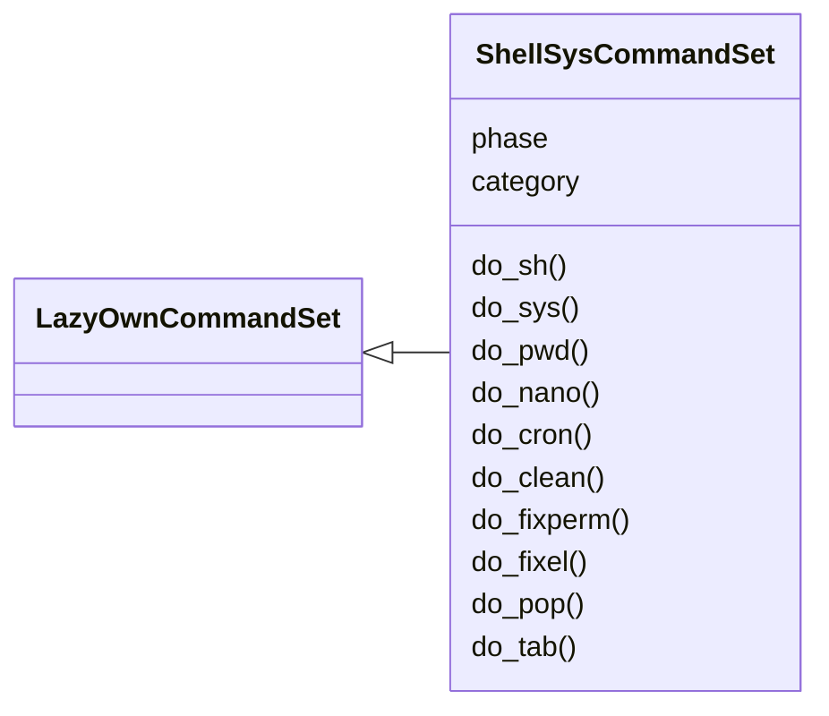
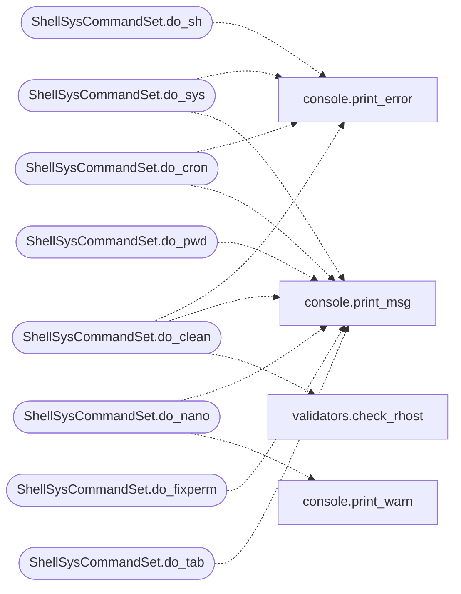

# `cli.commands.shellsys`

> Source: [cli/commands/shellsys.py:1](../../cli/commands/shellsys.py#L1) | language `py` | coverage 100.0% | [API index](../index.md)

Local shell and system extracted from the miscellaneous cluster.

Pending status: originals deleted from ``cli/commands/misc_migrated.py``;
this set is registered by `[`cli.registry`](cli.registry.py.md)`.

## Contents

- **Classes:** [`ShellSysCommandSet`](#shellsyscommandset)

## Type Diagram



## Call Graph

Solid arrows stay in this module, dashed arrows leave it.



## Classes

<a id="shellsyscommandset"></a>

### `ShellSysCommandSet`

`class` | [cli/commands/shellsys.py:23](../../cli/commands/shellsys.py#L23)

```python
class ShellSysCommandSet(LazyOwnCommandSet)
```

Bases: [`LazyOwnCommandSet`](cli.commands._base.py.md#lazyowncommandset)

Local shell and system.

**Attributes**

| Name | Type | Default | Description |
|---|---|---|---|
| [`phase`](#shellsyscommandset-phase) |  | `'misc'` |  |
| [`category`](#shellsyscommandset-category) |  | `'12. Miscellaneous'` |  |

**Members**

| Member | Kind | Summary |
|---|---|---|
| [`do_sh`](#shellsyscommandset-do_sh) | method | Executes a shell command directly from the LazyOwn interface. |
| [`do_sys`](#shellsyscommandset-do_sys) | method | Executes a shell command directly from the LazyOwn interface. |
| [`do_pwd`](#shellsyscommandset-do_pwd) | method | Displays the current working directory and lists files, and copies the current directory path to the clipboard. |
| [`do_nano`](#shellsyscommandset-do_nano) | method | Opens or creates the file using line in the sessions directory for editing using nano. |
| [`do_cron`](#shellsyscommandset-do_cron) | method | Schedules a command to run at a specified time. |
| [`do_clean`](#shellsyscommandset-do_clean) | method | Deletes files and directories in the `sessions` directory, excluding specified files and directories. |
| [`do_fixperm`](#shellsyscommandset-do_fixperm) | method | Fix permissions for LazyOwn shell scripts. |
| [`do_fixel`](#shellsyscommandset-do_fixel) | method | Fixes file permissions and line endings in the project directories. |
| [`do_pop`](#shellsyscommandset-do_pop) | method | Open a centered popup in the current tmux session to execute a shell command. |
| [`do_tab`](#shellsyscommandset-do_tab) | method | Executes the `lazypyautogui.py` script with optional arguments. |

<a id="shellsyscommandset-do_sh"></a>

#### `ShellSysCommandSet.do_sh`

`method` | [cli/commands/shellsys.py:30](../../cli/commands/shellsys.py#L30)

Decorators: `@cmd2.with_category('12. Miscellaneous')`

```python
def do_sh(self, line)
```

Executes a shell command directly from the LazyOwn interface.

This function allows the user to execute arbitrary shell commands without exiting the LazyOwn shell.
It checks if a command is provided, prints a message indicating the command being executed, and then
runs the command using `os.system`.

Usage:
    sh <command>


Example:
    sh ls -la
    # This will execute 'ls -la' in the shell without exiting LazyOwn.

Note:
    Ensure that the command provided is safe to execute and does not include potentially harmful operations.

**Parameters**

| Name | Type | Default | Description |
|---|---|---|---|
| `line` | `str` |  | The shell command to be executed. |

**Returns:** None

**Raises**

- `ValueError`: If no command is provided, an error message is printed indicating that a command is required.

*Calls:* [`print_error`](core.console.py.md#print_error)

<a id="shellsyscommandset-do_sys"></a>

#### `ShellSysCommandSet.do_sys`

`method` | [cli/commands/shellsys.py:62](../../cli/commands/shellsys.py#L62)

Decorators: `@cmd2.with_category('12. Miscellaneous')`

```python
def do_sys(self, line)
```

Executes a shell command directly from the LazyOwn interface.

This function allows the user to execute arbitrary shell commands without exiting the LazyOwn shell.
It checks if a command is provided, prints a message indicating the command being executed, and then
runs the command through the audited safe_run_shell gate with output capture.

Usage:
    sh <command>


Example:
    sh ls -la
    # This will execute 'ls -la' in the shell without exiting LazyOwn.

Note:
    Ensure that the command provided is safe to execute and does not include potentially harmful operations.

**Parameters**

| Name | Type | Default | Description |
|---|---|---|---|
| `line` | `str` |  | The shell command to be executed. |

**Returns:** None

**Raises**

- `ValueError`: If no command is provided, an error message is printed indicating that a command is required.

*Calls:* [`print_error`](core.console.py.md#print_error), [`print_msg`](core.console.py.md#print_msg)

<a id="shellsyscommandset-do_pwd"></a>

#### `ShellSysCommandSet.do_pwd`

`method` | [cli/commands/shellsys.py:110](../../cli/commands/shellsys.py#L110)

Decorators: `@cmd2.with_category('12. Miscellaneous')`

```python
def do_pwd(self, line)
```

Displays the current working directory and lists files, and copies the current directory path to the clipboard.

This function performs the following tasks:
1. Displays the current working directory with `pwd` and lists files in the directory using `ls`.
2. Copies the current directory path to the clipboard using `xclip`.

Usage:
    pwd


Manual execution:
    1. The command `echo -e "[\e[96m\`pwd\`\e[0m]\e[34m" && ls && echo -en "\e[0m"` is executed to display the current working directory and list files in it.
    2. The current directory path is copied to the clipboard using the command `pwd | xclip -sel clip`.

Dependencies:
    - The function relies on `echo`, `pwd`, `ls`, and `xclip` to display the directory and copy the path to the clipboard.

Example:
    pwd
    # This will display the current working directory, list files, and copy the current directory path to the clipboard.

Note:
    Ensure that `xclip` is installed on your system for copying to the clipboard to work.

**Parameters**

| Name | Type | Default | Description |
|---|---|---|---|
| `line` | `str` |  | This parameter is not used in the function but is included for consistency with other command methods. |

**Returns:** None

*Calls:* [`print_msg`](core.console.py.md#print_msg)

<a id="shellsyscommandset-do_nano"></a>

#### `ShellSysCommandSet.do_nano`

`method` | [cli/commands/shellsys.py:146](../../cli/commands/shellsys.py#L146)

Decorators: `@cmd2.with_category('12. Miscellaneous')`

```python
def do_nano(self, line)
```

Opens or creates the file using line in the sessions directory for editing using nano.

**Parameters**

| Name | Type | Default | Description |
|---|---|---|---|
| `line` |  |  | name of the file to use in nano in session directory. |

**Returns:** None

*Calls:* [`print_msg`](core.console.py.md#print_msg), [`print_warn`](core.console.py.md#print_warn)

<a id="shellsyscommandset-do_cron"></a>

#### `ShellSysCommandSet.do_cron`

`method` | [cli/commands/shellsys.py:170](../../cli/commands/shellsys.py#L170)

Decorators: `@cmd2.with_category('12. Miscellaneous')`

```python
def do_cron(self, line)
```

Schedules a command to run at a specified time.

This function allows users to schedule a command to execute at a specific hour and minute.
If the specified time has already passed for the current day, the command will be scheduled
to run the following day.

Usage:
    cron HH:MM command [args]

line (str): The input string containing the scheduled time in 'HH:MM' format followed by the command and arguments.

None

**Parameters**

| Name | Type | Default | Description |
|---|---|---|---|
| `line` |  |  |  |

*Calls:* [`print_error`](core.console.py.md#print_error), [`print_msg`](core.console.py.md#print_msg)

<a id="shellsyscommandset-do_clean"></a>

#### `ShellSysCommandSet.do_clean`

`method` | [cli/commands/shellsys.py:216](../../cli/commands/shellsys.py#L216)

Decorators: `@cmd2.with_category('12. Miscellaneous')`

```python
def do_clean(self, line)
```

Deletes files and directories in the `sessions` directory, excluding specified files and directories.

1. Checks if the `self.params['rhost']` parameter is valid:
- Uses the [`check_rhost`](core.validators.py.md#check_rhost) function to verify if `self.params['rhost']` is assign and valid.
- If `self.params['rhost']` is not valid, exits the function.

2. Lists files and directories in the `sessions` directory:
- Uses `os.listdir` to list all files and directories in the `sessions` directory.
- Compares each item with the list of exclusions.

3. Deletes files and directories not in the exclusion list:
- Uses `os.remove` to delete files and `shutil.rmtree` to delete directories.

4. Prints a message indicating that the cleanup is complete.


Manual execution:
To manually run these tasks, you would need to:
- Ensure that you have the correct `self.params['rhost']` value set.
- Manually execute commands to delete files and directories, excluding specified ones.

Note: This function performs a cleanup by removing various files and directories associated with the current session, excluding specified items.

**Parameters**

| Name | Type | Default | Description |
|---|---|---|---|
| `line` | `str` |  | This parameter is not used in the function. |

**Returns:** None

*Calls:* [`print_error`](core.console.py.md#print_error), [`print_msg`](core.console.py.md#print_msg), [`check_rhost`](core.validators.py.md#check_rhost)

<a id="shellsyscommandset-do_fixperm"></a>

#### `ShellSysCommandSet.do_fixperm`

`method` | [cli/commands/shellsys.py:303](../../cli/commands/shellsys.py#L303)

Decorators: `@cmd2.with_category('12. Miscellaneous')`

```python
def do_fixperm(self, line)
```

Fix permissions for LazyOwn shell scripts.

This function adjusts the file permissions for shell scripts and CGI scripts in the [`modules`](modules.__init__.py.md) directory, making them executable.

Usage:
    fixperm


Manual execution:
1. Change the permissions of all shell scripts in the [`modules`](modules.__init__.py.md) directory to be executable.
2. Change the permissions of all files in the `modules/cgi-bin` directory to be executable.

Dependencies:
- `chmod` command must be available on the system.

Example:
    To execute the function, simply call `fixperm`.

Note:
    - Ensure you have the necessary permissions to modify file permissions.

**Parameters**

| Name | Type | Default | Description |
|---|---|---|---|
| `line` | `str` |  | This parameter is not used in this function. |

**Returns:** None

*Calls:* [`print_msg`](core.console.py.md#print_msg)

<a id="shellsyscommandset-do_fixel"></a>

#### `ShellSysCommandSet.do_fixel`

`method` | [cli/commands/shellsys.py:336](../../cli/commands/shellsys.py#L336)

Decorators: `@cmd2.with_category('12. Miscellaneous')`

```python
def do_fixel(self, line)
```

Fixes file permissions and line endings in the project directories.

This function converts line endings from DOS/Windows format to Unix format for all files in the project directories. This helps to ensure consistent line endings and can prevent issues related to file format mismatches.

Usage:
    fixel


Manual execution:
1. Run the method to fix line endings in the specified directories.

Dependencies:
- The `dos2unix` command must be installed and accessible from the command line.

Examples:
    1. Run [`do_fixel`](#shellsyscommandset-do_fixel) to convert line endings for all files in the project directories.

Note:
    - This method only fixes line endings and does not modify file permissions.
    - Ensure that the `dos2unix` command is installed and functioning correctly.

**Parameters**

| Name | Type | Default | Description |
|---|---|---|---|
| `line` | `str` |  | Command parameters (not used in this function). |

**Returns:** None

<a id="shellsyscommandset-do_pop"></a>

#### `ShellSysCommandSet.do_pop`

`method` | [cli/commands/shellsys.py:369](../../cli/commands/shellsys.py#L369)

Decorators: `@cmd2.with_category('12. Miscellaneous')`

```python
def do_pop(self, line)
```

Open a centered popup in the current tmux session to execute a shell command.

If no command is provided via argument, prompts the user interactively.
The popup remains open after command execution and waits for user acknowledgment
via pressing ENTER, avoiding premature closure without requiring fixed sleep delays.

Requirements:
- Must be run inside an active tmux session (TMUX environment variable set).
- Tmux server must be running.

The command is executed in a bash shell within the popup. If tmux is not available
or the environment is invalid, an error message is displayed and execution aborts.

**Parameters**

| Name | Type | Default | Description |
|---|---|---|---|
| `line` | `str` |  | The command to execute in the popup. If empty, prompts user input. |

<a id="shellsyscommandset-do_tab"></a>

#### `ShellSysCommandSet.do_tab`

`method` | [cli/commands/shellsys.py:406](../../cli/commands/shellsys.py#L406)

Decorators: `@cmd2.with_category('12. Miscellaneous')`

```python
def do_tab(self, line)
```

Executes the `lazypyautogui.py` script with optional arguments.

This open new terminal tab and then run and instance of LazyOwn strokes the keyboard with pyautogui

If a `line` argument is provided, it appends the argument to the command.
Otherwise, it runs the script without additional parameters. The constructed
command is displayed and executed in the system shell.

**Parameters**

| Name | Type | Default | Description |
|---|---|---|---|
| `line` | `str` |  | Optional argument to pass as input to the `lazypyautogui.py` script. |

**Returns:** None

*Calls:* [`print_msg`](core.console.py.md#print_msg)

---
