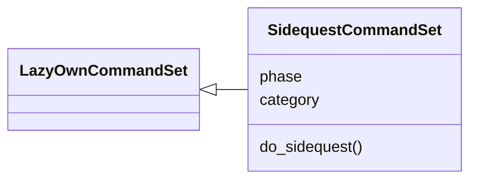
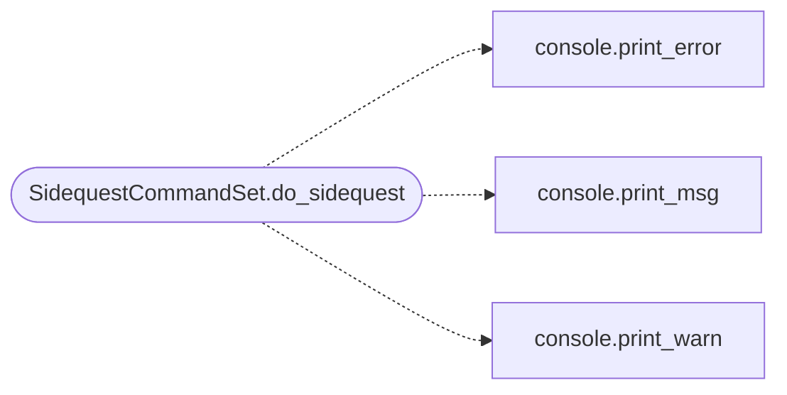

# `cli.commands.sidequest`

> Source: [cli/commands/sidequest.py:1](../../cli/commands/sidequest.py#L1) | language `py` | coverage 100.0% | [API index](../index.md)

Side-question CommandSet: read-only review of loop decision checkpoints.

Exposes the [`modules.sidequest`](modules.sidequest.py.md) engine to the operator shell. Every
decision the autonomous loop records is an immutable checkpoint; these commands
let an operator list them and ask the model a question about one without
touching the running loop. The engine never mutates loop state, so these
commands are safe to run against a live campaign.

## Contents

- **Classes:** [`SidequestCommandSet`](#sidequestcommandset)

## Type Diagram



## Call Graph

Solid arrows stay in this module, dashed arrows leave it.



## Classes

<a id="sidequestcommandset"></a>

### `SidequestCommandSet`

`class` | [cli/commands/sidequest.py:18](../../cli/commands/sidequest.py#L18)

```python
class SidequestCommandSet(LazyOwnCommandSet)
```

Bases: [`LazyOwnCommandSet`](cli.commands._base.py.md#lazyowncommandset)

Operator-facing side-question commands over the decision ledger.

**Attributes**

| Name | Type | Default | Description |
|---|---|---|---|
| [`phase`](#sidequestcommandset-phase) |  | `'diagnostics'` |  |
| [`category`](#sidequestcommandset-category) |  | `'Diagnostics'` |  |

**Members**

| Member | Kind | Summary |
|---|---|---|
| [`do_sidequest`](#sidequestcommandset-do_sidequest) | method | Review frozen loop decisions read-only: sidequest list \| ask. |

<a id="sidequestcommandset-do_sidequest"></a>

#### `SidequestCommandSet.do_sidequest`

`method` | [cli/commands/sidequest.py:25](../../cli/commands/sidequest.py#L25)

Decorators: `@with_category('Diagnostics')`

```python
def do_sidequest(self, statement) -> None
```

Review frozen loop decisions read-only: sidequest list | ask.

Usage:
    sidequest list [run_id]
    sidequest ask <checkpoint_id> <question...>

``list`` prints recent decision checkpoints with their ordinal id.
``ask`` answers a question about one checkpoint using only that frozen
decision, never running a command or changing loop state.

**Parameters**

| Name | Type | Default | Description |
|---|---|---|---|
| `statement` |  |  |  |

*Calls:* [`print_error`](core.console.py.md#print_error), [`print_msg`](core.console.py.md#print_msg), [`print_warn`](core.console.py.md#print_warn)

---
