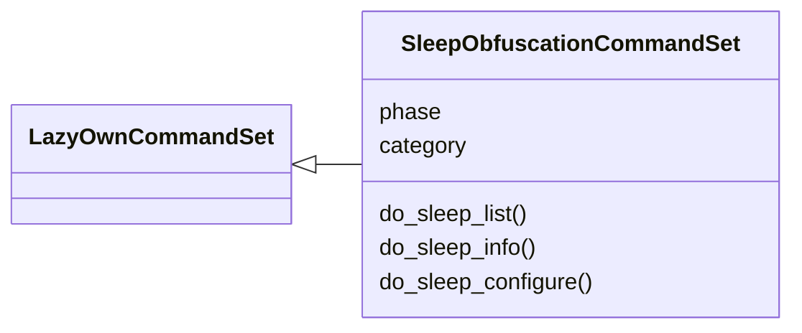
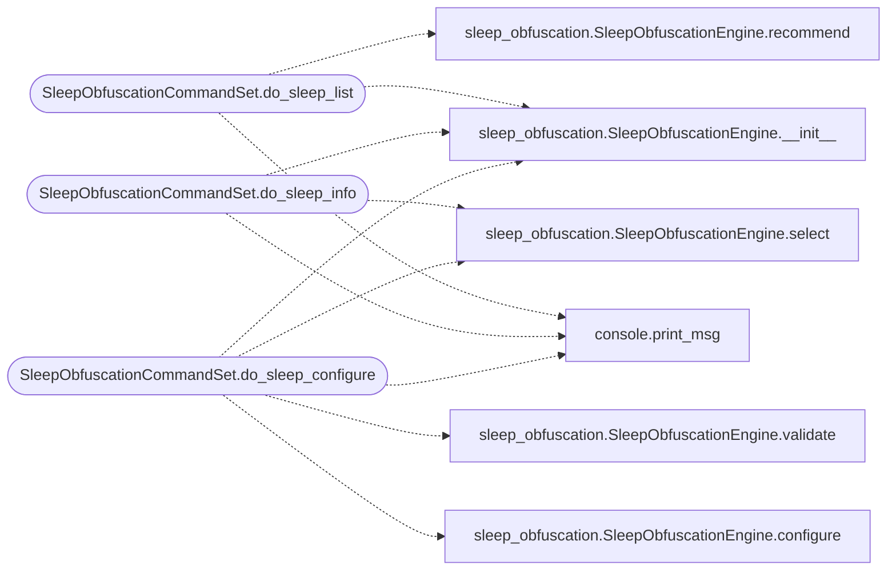

# `cli.commands.sleep_obfuscation`

> Source: [cli/commands/sleep_obfuscation.py:1](../../cli/commands/sleep_obfuscation.py#L1) | language `py` | coverage 100.0% | [API index](../index.md)

Sleep obfuscation CommandSet — beacon memory evasion technique management.

Exposes ``modules/sleep_obfuscation`` through the LazyOwn CLI.

## Contents

- **Classes:** [`SleepObfuscationCommandSet`](#sleepobfuscationcommandset)

## Type Diagram



## Call Graph

Solid arrows stay in this module, dashed arrows leave it.



## Classes

<a id="sleepobfuscationcommandset"></a>

### `SleepObfuscationCommandSet`

`class` | [cli/commands/sleep_obfuscation.py:16](../../cli/commands/sleep_obfuscation.py#L16)

```python
class SleepObfuscationCommandSet(LazyOwnCommandSet)
```

Bases: [`LazyOwnCommandSet`](cli.commands._base.py.md#lazyowncommandset)

Sleep obfuscation technique manager.

**Attributes**

| Name | Type | Default | Description |
|---|---|---|---|
| [`phase`](#sleepobfuscationcommandset-phase) |  | `'evasion'` |  |
| [`category`](#sleepobfuscationcommandset-category) |  | `CATEGORY` |  |

**Members**

| Member | Kind | Summary |
|---|---|---|
| [`do_sleep_list`](#sleepobfuscationcommandset-do_sleep_list) | method | List available sleep obfuscation techniques. |
| [`do_sleep_info`](#sleepobfuscationcommandset-do_sleep_info) | method | Show detailed information about a sleep obfuscation technique. |
| [`do_sleep_configure`](#sleepobfuscationcommandset-do_sleep_configure) | method | Configure the active sleep obfuscation technique. |

<a id="sleepobfuscationcommandset-do_sleep_list"></a>

#### `SleepObfuscationCommandSet.do_sleep_list`

`method` | [cli/commands/sleep_obfuscation.py:23](../../cli/commands/sleep_obfuscation.py#L23)

Decorators: `@cmd2.with_category(CATEGORY)`

```python
def do_sleep_list(self, line: str)
```

List available sleep obfuscation techniques.

Usage: sleep_list [--windows | --linux]

**Parameters**

| Name | Type | Default | Description |
|---|---|---|---|
| `line` | `str` |  |  |

*Calls:* [`print_msg`](core.console.py.md#print_msg), [`SleepObfuscationEngine.__init__`](modules.sleep_obfuscation.py.md#sleepobfuscationengine-__init__), [`SleepObfuscationEngine.recommend`](modules.sleep_obfuscation.py.md#sleepobfuscationengine-recommend)

<a id="sleepobfuscationcommandset-do_sleep_info"></a>

#### `SleepObfuscationCommandSet.do_sleep_info`

`method` | [cli/commands/sleep_obfuscation.py:50](../../cli/commands/sleep_obfuscation.py#L50)

Decorators: `@cmd2.with_category(CATEGORY)`

```python
def do_sleep_info(self, line: str)
```

Show detailed information about a sleep obfuscation technique.

Usage: sleep_info <technique_name>

**Parameters**

| Name | Type | Default | Description |
|---|---|---|---|
| `line` | `str` |  |  |

*Calls:* [`print_msg`](core.console.py.md#print_msg), [`SleepObfuscationEngine.__init__`](modules.sleep_obfuscation.py.md#sleepobfuscationengine-__init__), [`SleepObfuscationEngine.select`](modules.sleep_obfuscation.py.md#sleepobfuscationengine-select)

<a id="sleepobfuscationcommandset-do_sleep_configure"></a>

#### `SleepObfuscationCommandSet.do_sleep_configure`

`method` | [cli/commands/sleep_obfuscation.py:82](../../cli/commands/sleep_obfuscation.py#L82)

Decorators: `@cmd2.with_category(CATEGORY)`

```python
def do_sleep_configure(self, line: str)
```

Configure the active sleep obfuscation technique.

Usage: sleep_configure <technique_name> [--encrypt_heap --indirect_syscalls]

Available techniques:
  sleep_mask, ekko, stack_spoof, module_stomp, fiber_sleep,
  thread_pool, hwbp_sleep, linux_gatekeeper, linux_futex_hide

**Parameters**

| Name | Type | Default | Description |
|---|---|---|---|
| `line` | `str` |  |  |

*Calls:* [`print_msg`](core.console.py.md#print_msg), [`SleepObfuscationEngine.__init__`](modules.sleep_obfuscation.py.md#sleepobfuscationengine-__init__), [`SleepObfuscationEngine.configure`](modules.sleep_obfuscation.py.md#sleepobfuscationengine-configure), [`SleepObfuscationEngine.select`](modules.sleep_obfuscation.py.md#sleepobfuscationengine-select), [`SleepObfuscationEngine.validate`](modules.sleep_obfuscation.py.md#sleepobfuscationengine-validate)

---
