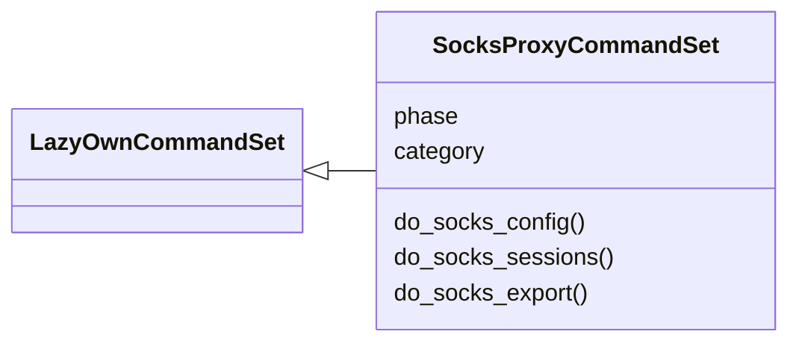
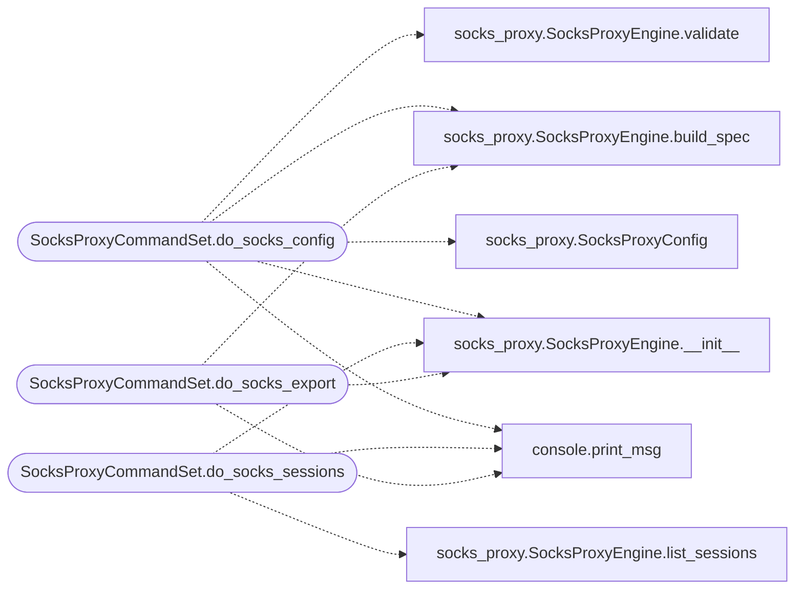

# `cli.commands.socks_proxy`

> Source: [cli/commands/socks_proxy.py:1](../../cli/commands/socks_proxy.py#L1) | language `py` | coverage 100.0% | [API index](../index.md)

SOCKS proxy CommandSet — beacon tunneling configuration.

Exposes ``modules/socks_proxy`` through the LazyOwn CLI.

## Contents

- **Classes:** [`SocksProxyCommandSet`](#socksproxycommandset)

## Type Diagram



## Call Graph

Solid arrows stay in this module, dashed arrows leave it.



## Classes

<a id="socksproxycommandset"></a>

### `SocksProxyCommandSet`

`class` | [cli/commands/socks_proxy.py:18](../../cli/commands/socks_proxy.py#L18)

```python
class SocksProxyCommandSet(LazyOwnCommandSet)
```

Bases: [`LazyOwnCommandSet`](cli.commands._base.py.md#lazyowncommandset)

SOCKS5 proxy configuration commands.

**Attributes**

| Name | Type | Default | Description |
|---|---|---|---|
| [`phase`](#socksproxycommandset-phase) |  | `'c2'` |  |
| [`category`](#socksproxycommandset-category) |  | `CATEGORY` |  |

**Members**

| Member | Kind | Summary |
|---|---|---|
| [`do_socks_config`](#socksproxycommandset-do_socks_config) | method | Show or configure the SOCKS5 proxy. |
| [`do_socks_sessions`](#socksproxycommandset-do_socks_sessions) | method | List active SOCKS proxy sessions. |
| [`do_socks_export`](#socksproxycommandset-do_socks_export) | method | Export SOCKS5 proxy specification for beacon delivery. |

<a id="socksproxycommandset-do_socks_config"></a>

#### `SocksProxyCommandSet.do_socks_config`

`method` | [cli/commands/socks_proxy.py:25](../../cli/commands/socks_proxy.py#L25)

Decorators: `@cmd2.with_category(CATEGORY)`

```python
def do_socks_config(self, line: str)
```

Show or configure the SOCKS5 proxy.

Usage: socks_config [--bind <ip>] [--port <n>] [--no-localhost] [--json]

Displays the current SOCKS proxy configuration. Use flags to
override settings for the next beacon build.

**Parameters**

| Name | Type | Default | Description |
|---|---|---|---|
| `line` | `str` |  |  |

*Calls:* [`print_msg`](core.console.py.md#print_msg), [`SocksProxyConfig`](modules.socks_proxy.py.md#socksproxyconfig), [`SocksProxyEngine.__init__`](modules.socks_proxy.py.md#socksproxyengine-__init__), [`SocksProxyEngine.build_spec`](modules.socks_proxy.py.md#socksproxyengine-build_spec), [`SocksProxyEngine.validate`](modules.socks_proxy.py.md#socksproxyengine-validate)

<a id="socksproxycommandset-do_socks_sessions"></a>

#### `SocksProxyCommandSet.do_socks_sessions`

`method` | [cli/commands/socks_proxy.py:75](../../cli/commands/socks_proxy.py#L75)

Decorators: `@cmd2.with_category(CATEGORY)`

```python
def do_socks_sessions(self, line: str)
```

List active SOCKS proxy sessions.

Usage: socks_sessions

**Parameters**

| Name | Type | Default | Description |
|---|---|---|---|
| `line` | `str` |  |  |

*Calls:* [`print_msg`](core.console.py.md#print_msg), [`SocksProxyEngine.__init__`](modules.socks_proxy.py.md#socksproxyengine-__init__), [`SocksProxyEngine.list_sessions`](modules.socks_proxy.py.md#socksproxyengine-list_sessions)

<a id="socksproxycommandset-do_socks_export"></a>

#### `SocksProxyCommandSet.do_socks_export`

`method` | [cli/commands/socks_proxy.py:94](../../cli/commands/socks_proxy.py#L94)

Decorators: `@cmd2.with_category(CATEGORY)`

```python
def do_socks_export(self, line: str)
```

Export SOCKS5 proxy specification for beacon delivery.

Usage: socks_export [--file <path>]

Outputs the JSON spec that beacons use to configure their
internal SOCKS5 proxy listener.

**Parameters**

| Name | Type | Default | Description |
|---|---|---|---|
| `line` | `str` |  |  |

*Calls:* [`print_msg`](core.console.py.md#print_msg), [`SocksProxyEngine.__init__`](modules.socks_proxy.py.md#socksproxyengine-__init__), [`SocksProxyEngine.build_spec`](modules.socks_proxy.py.md#socksproxyengine-build_spec)

---
