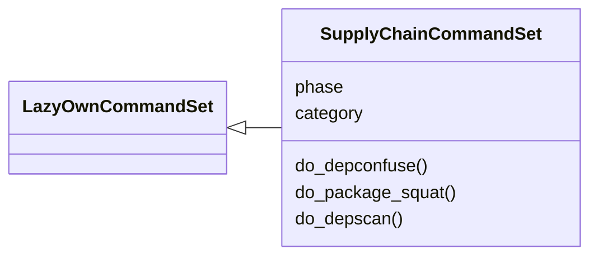
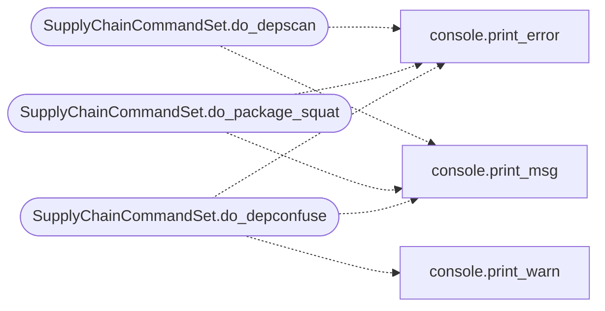

# `cli.commands.supply_chain`

> Source: [cli/commands/supply_chain.py:1](../../cli/commands/supply_chain.py#L1) | language `py` | coverage 100.0% | [API index](../index.md)

Supply Chain Attack command set.

Covers dependency confusion scanning, package squatting detection, and
malicious package template generation for red team operations.

## Contents

- **Classes:** [`SupplyChainCommandSet`](#supplychaincommandset)

## Type Diagram



## Call Graph

Solid arrows stay in this module, dashed arrows leave it.



## Classes

<a id="supplychaincommandset"></a>

### `SupplyChainCommandSet`

`class` | [cli/commands/supply_chain.py:88](../../cli/commands/supply_chain.py#L88)

```python
class SupplyChainCommandSet(LazyOwnCommandSet)
```

Bases: [`LazyOwnCommandSet`](cli.commands._base.py.md#lazyowncommandset)

Supply chain attack operations.

**Attributes**

| Name | Type | Default | Description |
|---|---|---|---|
| [`phase`](#supplychaincommandset-phase) |  | `'exploit'` |  |
| [`category`](#supplychaincommandset-category) |  | `SUPPLY_CHAIN_CATEGORY` |  |

**Members**

| Member | Kind | Summary |
|---|---|---|
| [`do_depconfuse`](#supplychaincommandset-do_depconfuse) | method | Scan a requirements.txt for dependency confusion candidates. |
| [`do_package_squat`](#supplychaincommandset-do_package_squat) | method | Generate a malicious PyPI package for dependency confusion. |
| [`do_depscan`](#supplychaincommandset-do_depscan) | method | Scan a directory tree for dependency files and flag risks. |

<a id="supplychaincommandset-do_depconfuse"></a>

#### `SupplyChainCommandSet.do_depconfuse`

`method` | [cli/commands/supply_chain.py:95](../../cli/commands/supply_chain.py#L95)

Decorators: `@cmd2.with_category(SUPPLY_CHAIN_CATEGORY)`

```python
def do_depconfuse(self, line)
```

Scan a requirements.txt for dependency confusion candidates.

Usage: depconfuse <requirements_file> [--check-registry]

Parses a Python requirements.txt and checks which packages do NOT
exist on PyPI (private/internal packages). These are vulnerable to
dependency confusion attacks.

**Parameters**

| Name | Type | Default | Description |
|---|---|---|---|
| `line` |  |  |  |

*Calls:* [`print_error`](core.console.py.md#print_error), [`print_msg`](core.console.py.md#print_msg), [`print_warn`](core.console.py.md#print_warn)

<a id="supplychaincommandset-do_package_squat"></a>

#### `SupplyChainCommandSet.do_package_squat`

`method` | [cli/commands/supply_chain.py:140](../../cli/commands/supply_chain.py#L140)

Decorators: `@cmd2.with_category(SUPPLY_CHAIN_CATEGORY)`

```python
def do_package_squat(self, line)
```

Generate a malicious PyPI package for dependency confusion.

Usage: package_squat <package_name> [--lhost <ip>] [--lport <port>] [--type <pypi|npm>] [--description <text>]

Creates a package with an install-time reverse shell payload.
Outputs to sessions/supply_chain/<package_name>/.

**Parameters**

| Name | Type | Default | Description |
|---|---|---|---|
| `line` |  |  |  |

*Calls:* [`print_error`](core.console.py.md#print_error), [`print_msg`](core.console.py.md#print_msg)

<a id="supplychaincommandset-do_depscan"></a>

#### `SupplyChainCommandSet.do_depscan`

`method` | [cli/commands/supply_chain.py:216](../../cli/commands/supply_chain.py#L216)

Decorators: `@cmd2.with_category(SUPPLY_CHAIN_CATEGORY)`

```python
def do_depscan(self, line)
```

Scan a directory tree for dependency files and flag risks.

Usage: depscan <directory> [--output <report.json>]

Scans for requirements.txt, package.json, Gemfile, pom.xml,
Cargo.toml, go.mod and reports internal/non-public dependencies.

**Parameters**

| Name | Type | Default | Description |
|---|---|---|---|
| `line` |  |  |  |

*Calls:* [`print_error`](core.console.py.md#print_error), [`print_msg`](core.console.py.md#print_msg)

---
