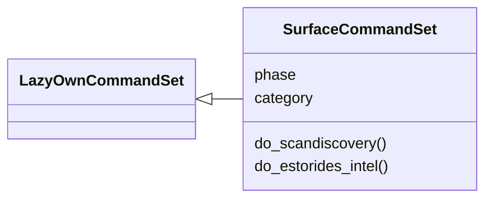
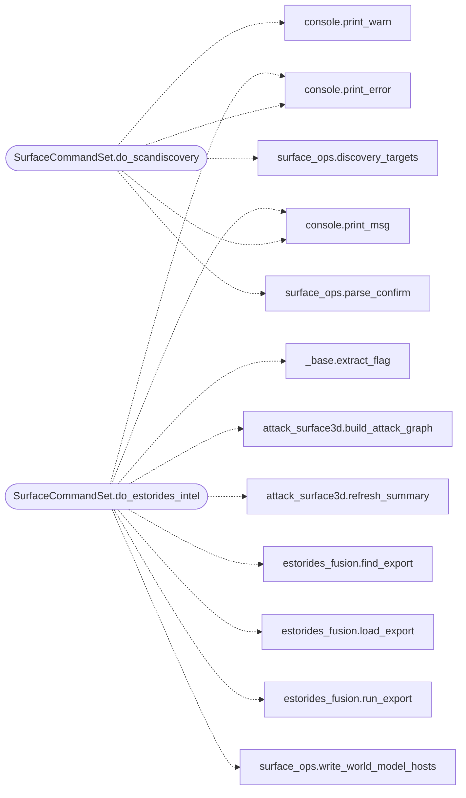

# `cli.commands.surface`

> Source: [cli/commands/surface.py:1](../../cli/commands/surface.py#L1) | language `py` | coverage 100.0% | [API index](../index.md)

Attack-surface operations: confirmed discovery scans, estorides fusion.

``scandiscovery`` lists every IP found in the sessions discovery files
and only launches ``lazynmap`` after the operator confirms — scans never
fire blind. ``estorides_intel`` refreshes the estorides OSINT export and
fuses it into the campaign graphs (intel + attack 3D, circular,
spherical), where matching IPs/values merge nodes instead of duplicating
them, and refreshes the loop summary.

## Contents

- **Classes:** [`SurfaceCommandSet`](#surfacecommandset)
- **Constants:** [`BASE_DIR`](#base_dir), [`SESSIONS_DIR`](#sessions_dir)

## Type Diagram



## Call Graph

Solid arrows stay in this module, dashed arrows leave it.



## Classes

<a id="surfacecommandset"></a>

### `SurfaceCommandSet`

`class` | [cli/commands/surface.py:36](../../cli/commands/surface.py#L36)

```python
class SurfaceCommandSet(LazyOwnCommandSet)
```

Bases: [`LazyOwnCommandSet`](cli.commands._base.py.md#lazyowncommandset)

Discovery scans and OSINT fusion for the attack surface.

**Attributes**

| Name | Type | Default | Description |
|---|---|---|---|
| [`phase`](#surfacecommandset-phase) |  | `'recon'` |  |
| [`category`](#surfacecommandset-category) |  | `'01. Reconnaissance'` |  |

**Members**

| Member | Kind | Summary |
|---|---|---|
| [`do_scandiscovery`](#surfacecommandset-do_scandiscovery) | method | Scan every discovery IP with operator confirmation. |
| [`do_estorides_intel`](#surfacecommandset-do_estorides_intel) | method | Fuse estorides OSINT entities into the campaign intel graphs. |

<a id="surfacecommandset-do_scandiscovery"></a>

#### `SurfaceCommandSet.do_scandiscovery`

`method` | [cli/commands/surface.py:43](../../cli/commands/surface.py#L43)

Decorators: `@cmd2.with_category(scanning_category)`

```python
def do_scandiscovery(self, line)
```

Scan every discovery IP with operator confirmation.

Usage: scandiscovery [--yes]

Lists the IPs collected in ``sessions/hostsdiscovery.txt`` and
``sessions/hosts_*_discovery.txt``, asks for confirmation (skipped
with ``--yes``), then runs ``lazynmap`` once per IP. Aborts
cleanly on EOF/non-interactive shells.

**Parameters**

| Name | Type | Default | Description |
|---|---|---|---|
| `line` |  |  |  |

*Calls:* [`print_error`](core.console.py.md#print_error), [`print_msg`](core.console.py.md#print_msg), [`print_warn`](core.console.py.md#print_warn), [`discovery_targets`](modules.surface_ops.py.md#discovery_targets), [`parse_confirm`](modules.surface_ops.py.md#parse_confirm)

<a id="surfacecommandset-do_estorides_intel"></a>

#### `SurfaceCommandSet.do_estorides_intel`

`method` | [cli/commands/surface.py:86](../../cli/commands/surface.py#L86)

Decorators: `@cmd2.with_category(recon_category)`

```python
def do_estorides_intel(self, line)
```

Fuse estorides OSINT entities into the campaign intel graphs.

Usage: estorides_intel [--run] [--world-model] [--cap N] [--cli PATH]

Refreshes ``sessions/estorides_lazyown.json`` from the estorides
checkout (``--run`` forces re-export), merges entities into the
intel + attack graphs (matching IPs/values fuse nodes, new ones
arrive tagged), refreshes ``intel_summary.json`` for the
autonomous loop, and optionally writes new hosts into
``world_model.json`` (``--world-model``, feeds the killchain).

**Parameters**

| Name | Type | Default | Description |
|---|---|---|---|
| `line` |  |  |  |

*Calls:* [`extract_flag`](cli.commands._base.py.md#extract_flag), [`print_error`](core.console.py.md#print_error), [`print_msg`](core.console.py.md#print_msg), [`build_attack_graph`](modules.attack_surface3d.py.md#build_attack_graph), [`refresh_summary`](modules.attack_surface3d.py.md#refresh_summary), [`find_export`](modules.estorides_fusion.py.md#find_export), [`load_export`](modules.estorides_fusion.py.md#load_export), [`run_export`](modules.estorides_fusion.py.md#run_export), [`write_world_model_hosts`](modules.surface_ops.py.md#write_world_model_hosts)

---

## Constants

<a id="base_dir"></a>

### `BASE_DIR`

`constant` | [cli/commands/surface.py:26](../../cli/commands/surface.py#L26)

```python
BASE_DIR = Path(__file__).resolve().parent.parent.parent
```

---

<a id="sessions_dir"></a>

### `SESSIONS_DIR`

`constant` | [cli/commands/surface.py:27](../../cli/commands/surface.py#L27)

```python
SESSIONS_DIR = BASE_DIR / 'sessions'
```

---
