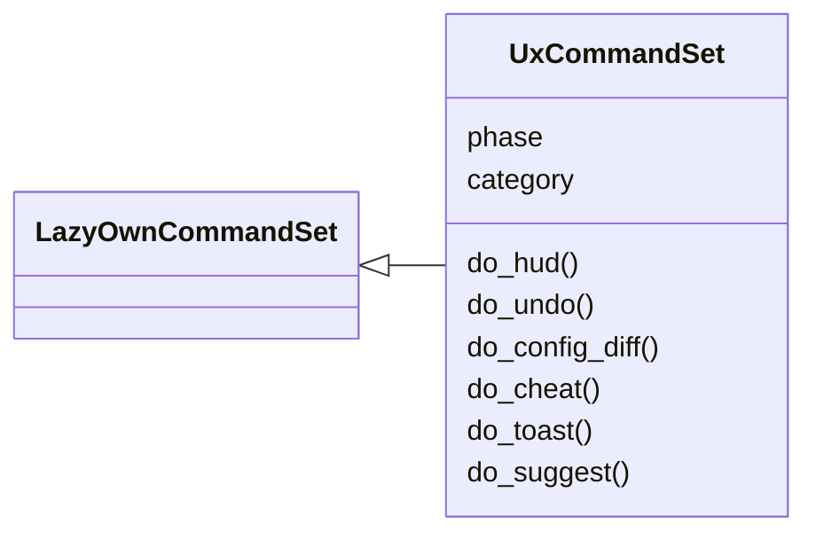
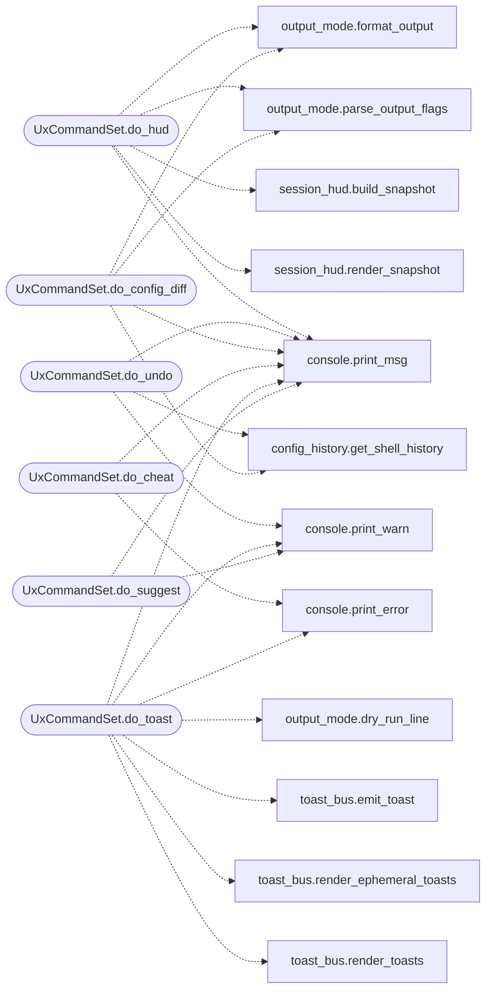

# `cli.commands.ux`

> Source: [cli/commands/ux.py:1](../../cli/commands/ux.py#L1) | language `py` | coverage 100.0% | [API index](../index.md)

Usability commands: hud, undo, config_diff, cheat, suggest.

These commands close the highest-impact UX gaps without touching the
legacy shell: a one-glance session HUD, configuration undo and diff,
an in-shell cheatsheet renderer, and fuzzy typo correction. All data
helpers live in their own contracts; this set only wires them to cmd2.

## Contents

- **Classes:** [`UxCommandSet`](#uxcommandset)

## Type Diagram



## Call Graph

Solid arrows stay in this module, dashed arrows leave it.



## Classes

<a id="uxcommandset"></a>

### `UxCommandSet`

`class` | [cli/commands/ux.py:39](../../cli/commands/ux.py#L39)

```python
class UxCommandSet(LazyOwnCommandSet)
```

Bases: [`LazyOwnCommandSet`](cli.commands._base.py.md#lazyowncommandset)

Session HUD, config undo, cheatsheet and fuzzy suggestion.

**Attributes**

| Name | Type | Default | Description |
|---|---|---|---|
| [`phase`](#uxcommandset-phase) |  | `'misc'` |  |
| [`category`](#uxcommandset-category) |  | `'12. Miscellaneous'` |  |

**Members**

| Member | Kind | Summary |
|---|---|---|
| [`do_hud`](#uxcommandset-do_hud) | method | Session counters: elapsed time, commands run, material captured. |
| [`do_undo`](#uxcommandset-do_undo) | method | Revert the last assign/set configuration change. |
| [`do_config_diff`](#uxcommandset-do_config_diff) | method | Show what changed since the session started. |
| [`do_cheat`](#uxcommandset-do_cheat) | method | Render a cheatsheet section inside the shell. |
| [`do_toast`](#uxcommandset-do_toast) | method | Raise a toast notification inside the cmd2 shell. |
| [`do_suggest`](#uxcommandset-do_suggest) | method | Fuzzy command suggestion for typos and fragments. |

<a id="uxcommandset-do_hud"></a>

#### `UxCommandSet.do_hud`

`method` | [cli/commands/ux.py:46](../../cli/commands/ux.py#L46)

Decorators: `@cmd2.with_category('12. Miscellaneous')`

```python
def do_hud(self, line)
```

Session counters: elapsed time, commands run, material captured.

Complements rather than repeats the other commands. `[`killchain`](lazygui.panels.registry.py.md#panelregistry-killchain)`
owns the kill-chain phases, the status bar already shows target and
phase, and ``sitrep`` owns the full picture. This shows only what
nothing else reports: how long this session has run, how many
commands it executed, and how many credentials and notes exist.

Usage:
    ``hud``          — two counter lines
    ``hud --json``   — machine-readable JSON without ANSI
    ``hud --plain``  — plain text without colours

**Parameters**

| Name | Type | Default | Description |
|---|---|---|---|
| `line` |  |  |  |

*Calls:* [`format_output`](cli.output_mode.py.md#format_output), [`parse_output_flags`](cli.output_mode.py.md#parse_output_flags), [`build_snapshot`](cli.session_hud.py.md#build_snapshot), [`render_snapshot`](cli.session_hud.py.md#render_snapshot), [`print_msg`](core.console.py.md#print_msg)

<a id="uxcommandset-do_undo"></a>

#### `UxCommandSet.do_undo`

`method` | [cli/commands/ux.py:85](../../cli/commands/ux.py#L85)

Decorators: `@cmd2.with_category('12. Miscellaneous')`

```python
def do_undo(self, line)
```

Revert the last assign/set configuration change.

Usage:
    `[`undo`](cli.config_history.py.md#confighistory-undo)`

**Parameters**

| Name | Type | Default | Description |
|---|---|---|---|
| `line` |  |  |  |

*Calls:* [`get_shell_history`](cli.config_history.py.md#get_shell_history), [`print_msg`](core.console.py.md#print_msg), [`print_warn`](core.console.py.md#print_warn)

<a id="uxcommandset-do_config_diff"></a>

#### `UxCommandSet.do_config_diff`

`method` | [cli/commands/ux.py:115](../../cli/commands/ux.py#L115)

Decorators: `@cmd2.with_category('12. Miscellaneous')`

```python
def do_config_diff(self, line)
```

Show what changed since the session started.

Usage:
    ``config_diff``          — human-readable list
    ``config_diff --json``   — machine-readable JSON

**Parameters**

| Name | Type | Default | Description |
|---|---|---|---|
| `line` |  |  |  |

*Calls:* [`get_shell_history`](cli.config_history.py.md#get_shell_history), [`format_output`](cli.output_mode.py.md#format_output), [`parse_output_flags`](cli.output_mode.py.md#parse_output_flags), [`print_msg`](core.console.py.md#print_msg)

<a id="uxcommandset-do_cheat"></a>

#### `UxCommandSet.do_cheat`

`method` | [cli/commands/ux.py:140](../../cli/commands/ux.py#L140)

Decorators: `@cmd2.with_category('12. Miscellaneous')`

```python
def do_cheat(self, line)
```

Render a cheatsheet section inside the shell.

Usage:
    ``cheat``          — list available topics
    ``cheat recon``    — recon commands with examples
    ``cheat privesc``  — privilege escalation checklist

**Parameters**

| Name | Type | Default | Description |
|---|---|---|---|
| `line` |  |  |  |

*Calls:* [`print_error`](core.console.py.md#print_error), [`print_msg`](core.console.py.md#print_msg)

<a id="uxcommandset-do_toast"></a>

#### `UxCommandSet.do_toast`

`method` | [cli/commands/ux.py:167](../../cli/commands/ux.py#L167)

Decorators: `@cmd2.with_category('12. Miscellaneous')`

```python
def do_toast(self, line)
```

Raise a toast notification inside the cmd2 shell.

The shell already renders toasts after every command; this command
lets you raise one yourself. Use it to flag state changes for
yourself or for a teammate tailing the same session. The persistent
ascii panel is the default; ``--live`` renders the same event as a
sonner-style auto-expiring line through the shared toast bus.

Usage:
    ``toast <message>``                      — info level
    ``toast <message> --level success``      — success / warn / error
    ``toast <message> --type beacon``        — custom label
    ``toast <message> --now``                — print immediately
    ``toast <message> --live``               — ephemeral line, auto-erases on TTY
    ``toast <message> --live --duration 2``  — ephemeral with 2s delay
    ``toast <message> --dry-run``            — show what would be written

**Parameters**

| Name | Type | Default | Description |
|---|---|---|---|
| `line` |  |  |  |

*Calls:* [`dry_run_line`](cli.output_mode.py.md#dry_run_line), [`emit_toast`](cli.toast_bus.py.md#emit_toast), [`render_ephemeral_toasts`](cli.toast_bus.py.md#render_ephemeral_toasts), [`render_toasts`](cli.toast_bus.py.md#render_toasts), [`print_error`](core.console.py.md#print_error), [`print_msg`](core.console.py.md#print_msg), [`print_warn`](core.console.py.md#print_warn)

<a id="uxcommandset-do_suggest"></a>

#### `UxCommandSet.do_suggest`

`method` | [cli/commands/ux.py:261](../../cli/commands/ux.py#L261)

Decorators: `@cmd2.with_category('12. Miscellaneous')`

```python
def do_suggest(self, line)
```

Fuzzy command suggestion for typos and fragments.

Usage:
    ``suggest nmp``      — suggests lazynmap, nmap variants
    ``suggest gobustr``  — suggests gobuster

**Parameters**

| Name | Type | Default | Description |
|---|---|---|---|
| `line` |  |  |  |

*Calls:* [`print_msg`](core.console.py.md#print_msg), [`print_warn`](core.console.py.md#print_warn)

---
