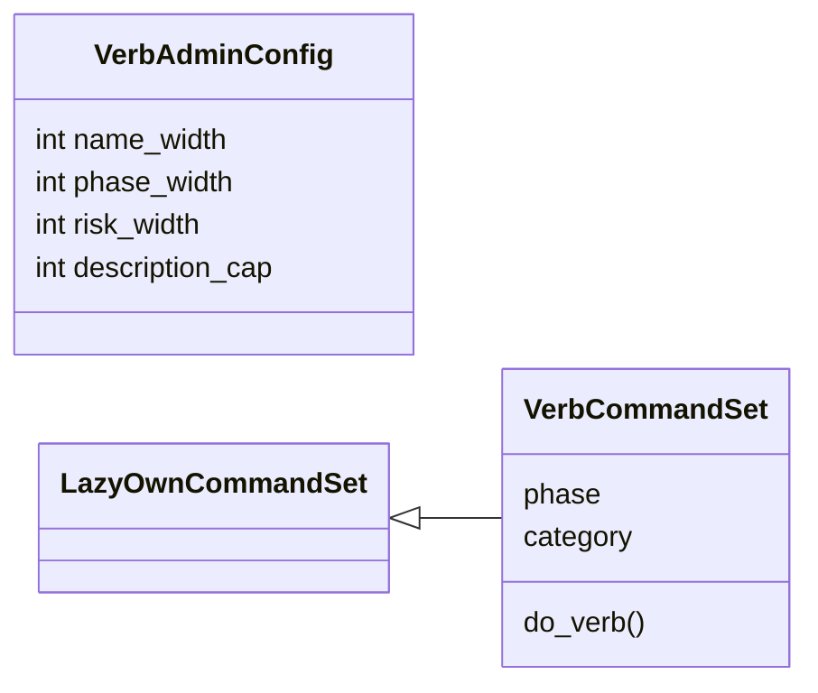
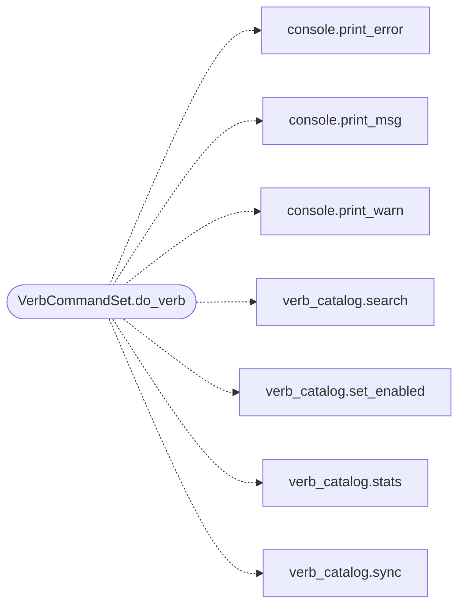

# `cli.commands.verb_admin`

> Source: [cli/commands/verb_admin.py:1](../../cli/commands/verb_admin.py#L1) | language `py` | coverage 100.0% | [API index](../index.md)

Operator administration of the autonomous-loop verb catalog.

The catalog (``modules/verb_catalog``) decides which shell commands the
autonomous loop may propose or execute. Operators browse and toggle it
here instead of editing ``config/verbs.yaml`` by hand: writes are
validated against the live shell catalogue and persisted atomically.
Today's on verbs stay on; everything the operator has not chosen stays
off, so loops never reach a command the operator did not enable.

## Contents

- **Classes:** [`VerbAdminConfig`](#verbadminconfig), [`VerbCommandSet`](#verbcommandset)
- **Constants:** [`VERB_ADMIN`](#verb_admin)

## Type Diagram



## Call Graph

Solid arrows stay in this module, dashed arrows leave it.



## Classes

<a id="verbadminconfig"></a>

### `VerbAdminConfig`

`class` `dataclass` | [cli/commands/verb_admin.py:23](../../cli/commands/verb_admin.py#L23)

Decorators: `@dataclass(frozen=True)`

```python
class VerbAdminConfig
```

Display knobs for catalog listing (single place for widths).

**Attributes**

| Name | Type | Default | Description |
|---|---|---|---|
| [`name_width`](#verbadminconfig-name_width) | `int` | `28` |  |
| [`phase_width`](#verbadminconfig-phase_width) | `int` | `10` |  |
| [`risk_width`](#verbadminconfig-risk_width) | `int` | `8` |  |
| [`description_cap`](#verbadminconfig-description_cap) | `int` | `60` |  |

---

<a id="verbcommandset"></a>

### `VerbCommandSet`

`class` | [cli/commands/verb_admin.py:45](../../cli/commands/verb_admin.py#L45)

```python
class VerbCommandSet(LazyOwnCommandSet)
```

Bases: [`LazyOwnCommandSet`](cli.commands._base.py.md#lazyowncommandset)

Browse, toggle and refresh the loop verb catalog.

**Attributes**

| Name | Type | Default | Description |
|---|---|---|---|
| [`phase`](#verbcommandset-phase) |  | `'misc'` |  |
| [`category`](#verbcommandset-category) |  | `'12. Miscellaneous'` |  |

**Members**

| Member | Kind | Summary |
|---|---|---|
| [`do_verb`](#verbcommandset-do_verb) | method | Manage the autonomous-loop verb catalog. |

<a id="verbcommandset-do_verb"></a>

#### `VerbCommandSet.do_verb`

`method` | [cli/commands/verb_admin.py:52](../../cli/commands/verb_admin.py#L52)

Decorators: `@cmd2.with_category('12. Miscellaneous')`

```python
def do_verb(self, line)
```

Manage the autonomous-loop verb catalog.

Usage:
  verb                     show stats and enabled verbs
  verb list [keyword] [--phase P] [--state on|off]
  verb on <name>           enable one shell command for the loop
  verb off <name>          disable one shell command for the loop
  verb sync                refresh the catalog from the shell scan

**Parameters**

| Name | Type | Default | Description |
|---|---|---|---|
| `line` |  |  |  |

*Calls:* [`print_error`](core.console.py.md#print_error), [`print_msg`](core.console.py.md#print_msg), [`print_warn`](core.console.py.md#print_warn), [`search`](modules.verb_catalog.py.md#search), [`set_enabled`](modules.verb_catalog.py.md#set_enabled), [`stats`](modules.verb_catalog.py.md#stats), [`sync`](modules.verb_catalog.py.md#sync)

---

## Constants

<a id="verb_admin"></a>

### `VERB_ADMIN`

`constant` | [cli/commands/verb_admin.py:32](../../cli/commands/verb_admin.py#L32)

```python
VERB_ADMIN = VerbAdminConfig()
```

---
