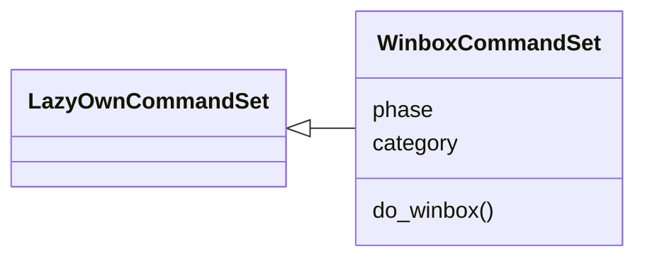
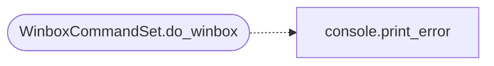

# `cli.commands.winbox_gym`

> Source: [cli/commands/winbox_gym.py:1](../../cli/commands/winbox_gym.py#L1) | language `py` | coverage 100.0% | [API index](../index.md)

WinBox lab CommandSet — VM lifecycle, guest execution and gym matrix.

Bridges the totekuh/winbox platform (isolated Windows vulnerability-research
lab on QEMU/libvirt) into the LazyOwn shell. Every action goes through the
allowlisted, shell-free adapter in [`modules.winbox_gym`](modules.winbox_gym.py.md); the gym matrix
reuses the shared engine via [`modules.gym_winbox_runner`](modules.gym_winbox_runner.py.md) so scored
captures land in the same CTF/leaderboard pipeline as Metasploitable 2.

## Contents

- **Classes:** [`WinboxCommandSet`](#winboxcommandset)

## Type Diagram



## Call Graph

Solid arrows stay in this module, dashed arrows leave it.



## Classes

<a id="winboxcommandset"></a>

### `WinboxCommandSet`

`class` | [cli/commands/winbox_gym.py:44](../../cli/commands/winbox_gym.py#L44)

```python
class WinboxCommandSet(LazyOwnCommandSet)
```

Bases: [`LazyOwnCommandSet`](cli.commands._base.py.md#lazyowncommandset)

WinBox lab control plane and scored gym matrix.

**Attributes**

| Name | Type | Default | Description |
|---|---|---|---|
| [`phase`](#winboxcommandset-phase) |  | `'exploit'` |  |
| [`category`](#winboxcommandset-category) |  | `exploitation_category` |  |

**Members**

| Member | Kind | Summary |
|---|---|---|
| [`do_winbox`](#winboxcommandset-do_winbox) | method | Control the WinBox isolated Windows lab from the LazyOwn shell. |

<a id="winboxcommandset-do_winbox"></a>

#### `WinboxCommandSet.do_winbox`

`method` | [cli/commands/winbox_gym.py:51](../../cli/commands/winbox_gym.py#L51)

Decorators: `@cmd2.with_category(exploitation_category)`

```python
def do_winbox(self, line)
```

Control the WinBox isolated Windows lab from the LazyOwn shell.

Usage:
    winbox status                     # readiness, VM state, IP
    winbox up                         # FULL bootstrap: deps, ISO, VM build, up, rhost
    winbox setup                      # same bootstrap as up (one command)
    winbox up --os server2025         # bootstrap a different guest OS
    winbox down [--force]             # graceful/hard shutdown
    winbox suspend                    # save VM state to disk
    winbox exec [--timeout S] [--user U --password P] [--bg] [--log] <cmd...>
    winbox shell | ssh | vnc          # interactive passthrough
    winbox tools list | add <files...> | remove <name>
    winbox upload <path> [dst]
    winbox eventlogs [--since S] [--max N] [--log L]
    winbox net status | isolate | connect | unplug
    winbox av status | disable | enable
    winbox applocker status | enable | disable
    winbox snapshot list | create <name> | restore <name>
    winbox resolve [ip]               # bind rhost to the lab VM IP
    winbox gym list | chains | validate | info <id> | chain <id>
    winbox gym plan | run [--only a,b] [--dry-run] | report | verify <id>

Destructive actions (av/applocker disable, eventlogs clear, net
unplug, destroy) require an explicit confirm token (-y/--yes).
The lab VM must stay isolated: never point WinBox at production
infrastructure.

**Parameters**

| Name | Type | Default | Description |
|---|---|---|---|
| `line` |  |  |  |

**Example**

```python
winbox status
winbox exec --timeout 120 whoami
winbox gym plan --only winbox_system_exec,winbox_smb_enum
```

*Calls:* [`print_error`](core.console.py.md#print_error)

---
