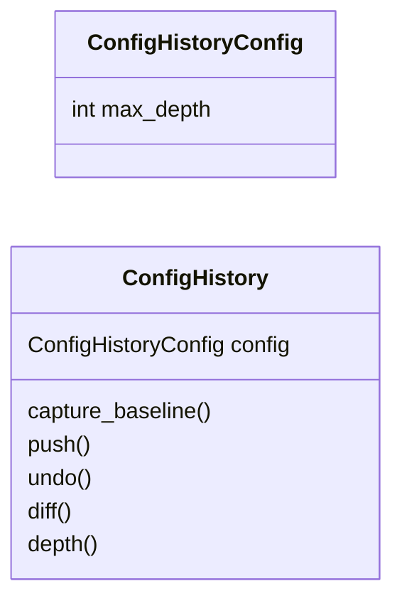
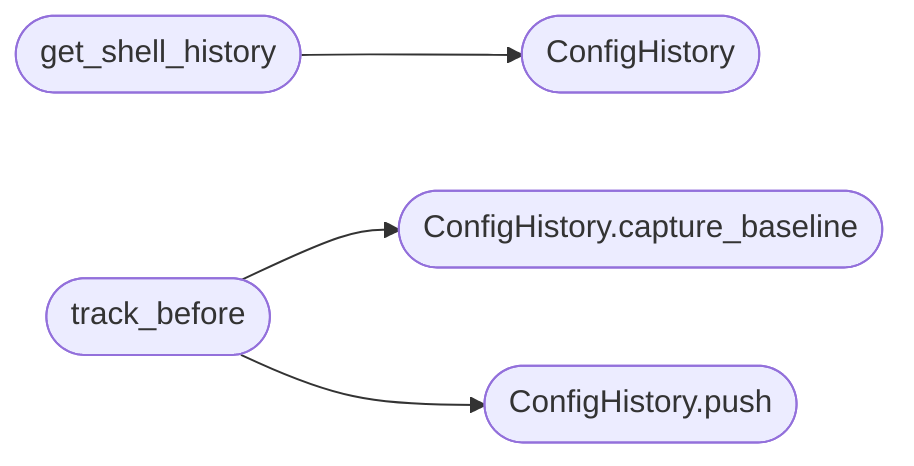

# `cli.config_history`

> Source: [cli/config_history.py:1](../../cli/config_history.py#L1) | language `py` | coverage 100.0% | [API index](../index.md)

In-memory configuration history with undo and diff.

Assign and set commands mutate payload.json without a safety net. This
value object keeps a bounded stack of snapshots so undo restores the
previous state and diff explains what changed since session start.

## Contents

- **Classes:** [`ConfigHistoryConfig`](#confighistoryconfig), [`ConfigHistory`](#confighistory)
- **Functions:** [`get_shell_history`](#get_shell_history), [`track_before`](#track_before)

## Type Diagram



## Call Graph

Solid arrows stay in this module, dashed arrows leave it.



## Classes

<a id="confighistoryconfig"></a>

### `ConfigHistoryConfig`

`class` `dataclass` | [cli/config_history.py:16](../../cli/config_history.py#L16)

Decorators: `@dataclass`

```python
class ConfigHistoryConfig
```

Centralized knobs for history depth.

**Attributes**

| Name | Type | Default | Description |
|---|---|---|---|
| [`max_depth`](#confighistoryconfig-max_depth) | `int` | `50` |  |

---

<a id="confighistory"></a>

### `ConfigHistory`

`class` `dataclass` | [cli/config_history.py:23](../../cli/config_history.py#L23)

Decorators: `@dataclass`

```python
class ConfigHistory
```

Bounded stack of configuration snapshots.

**Attributes**

| Name | Type | Default | Description |
|---|---|---|---|
| [`config`](#confighistory-config) | `ConfigHistoryConfig` | `field(default_factory=ConfigHistoryConfig)` |  |

**Members**

| Member | Kind | Summary |
|---|---|---|
| [`capture_baseline`](#confighistory-capture_baseline) | method | Store session-start snapshot used by diff. |
| [`push`](#confighistory-push) | method | Push a snapshot before mutation. |
| [`undo`](#confighistory-undo) | method | Pop the newest snapshot. |
| [`diff`](#confighistory-diff) | method | Compare current state against the baseline. |
| [`depth`](#confighistory-depth) | method | Return number of stored undo steps. |

<a id="confighistory-capture_baseline"></a>

#### `ConfigHistory.capture_baseline`

`method` | [cli/config_history.py:30](../../cli/config_history.py#L30)

```python
def capture_baseline(self, state: dict[str, Any]) -> None
```

Store session-start snapshot used by diff.

**Parameters**

| Name | Type | Default | Description |
|---|---|---|---|
| `state` | `dict[str, Any]` |  | Current configuration mapping. |

*Called by:* [`track_before`](#track_before)

<a id="confighistory-push"></a>

#### `ConfigHistory.push`

`method` | [cli/config_history.py:38](../../cli/config_history.py#L38)

```python
def push(self, state: dict[str, Any]) -> None
```

Push a snapshot before mutation.

**Parameters**

| Name | Type | Default | Description |
|---|---|---|---|
| `state` | `dict[str, Any]` |  | Configuration mapping before the change. |

*Called by:* [`track_before`](#track_before)

<a id="confighistory-undo"></a>

#### `ConfigHistory.undo`

`method` | [cli/config_history.py:48](../../cli/config_history.py#L48)

```python
def undo(self) -> dict[str, Any] | None
```

Pop the newest snapshot.

**Returns:** `dict[str, Any] | None` - Previous state or None when the stack is empty.

*Called by:* [`Ct.G.I.J.L.M.N.N.Ot.Q.R.S.S.St.T.X.Y.Z.a.b.c.c.d.et.extends.extends.extends.extends.extends.extends.extends.extends.extends.extends.extends.f.g.h.h.h.i.i.i.i.i.j.jt.k.k.m.m.n.o.o.o.o.ot.qt.rt.s.s.t.t.t.t.t.tt.u.u.w`](static.js.quill-2.0.3.js.md#ct-g-i-j-l-m-n-n-ot-q-r-s-s-st-t-x-y-z-a-b-c-c-d-et-extends-extends-extends-extends-extends-extends-extends-extends-extends-extends-extends-f-g-h-h-h-i-i-i-i-i-j-jt-k-k-m-m-n-o-o-o-o-ot-qt-rt-s-s-t-t-t-t-t-tt-u-u-w)

<a id="confighistory-diff"></a>

#### `ConfigHistory.diff`

`method` | [cli/config_history.py:58](../../cli/config_history.py#L58)

```python
def diff(self, current: dict[str, Any]) -> dict[str, tuple[Any, Any]]
```

Compare current state against the baseline.

**Parameters**

| Name | Type | Default | Description |
|---|---|---|---|
| `current` | `dict[str, Any]` |  | Live configuration mapping. |

**Returns:** `dict[str, tuple[Any, Any]]` - Mapping of key to (old, new) for changed keys only.

<a id="confighistory-depth"></a>

#### `ConfigHistory.depth`

`method` | [cli/config_history.py:76](../../cli/config_history.py#L76)

```python
def depth(self) -> int
```

Return number of stored undo steps.

**Returns:** `int`

---

## Functions

<a id="get_shell_history"></a>

### `get_shell_history`

`function` | [cli/config_history.py:81](../../cli/config_history.py#L81)

```python
def get_shell_history(shell: Any) -> ConfigHistory
```

Return the ConfigHistory bound to a shell, creating it on demand.

**Parameters**

| Name | Type | Default | Description |
|---|---|---|---|
| `shell` | `Any` |  | Parent shell object used as attribute host. |

**Returns:** `ConfigHistory` - The shared ConfigHistory instance.

*Calls:* [`ConfigHistory`](#confighistory)

*Called by:* [`SessionOpsCommandSet.do_assign`](cli.commands.session_ops.py.md#sessionopscommandset-do_assign), [`UxCommandSet.do_config_diff`](cli.commands.ux.py.md#uxcommandset-do_config_diff), [`UxCommandSet.do_undo`](cli.commands.ux.py.md#uxcommandset-do_undo)

---

<a id="track_before"></a>

### `track_before`

`function` | [cli/config_history.py:104](../../cli/config_history.py#L104)

```python
def track_before(history: ConfigHistory, state: dict[str, Any]) -> None
```

Capture baseline on first use then push a pre-mutation snapshot.

**Parameters**

| Name | Type | Default | Description |
|---|---|---|---|
| `history` | `ConfigHistory` |  | Shared history instance. |
| `state` | `dict[str, Any]` |  | Configuration mapping before mutation. |

*Calls:* [`ConfigHistory.capture_baseline`](#confighistory-capture_baseline), [`ConfigHistory.push`](#confighistory-push)

---
