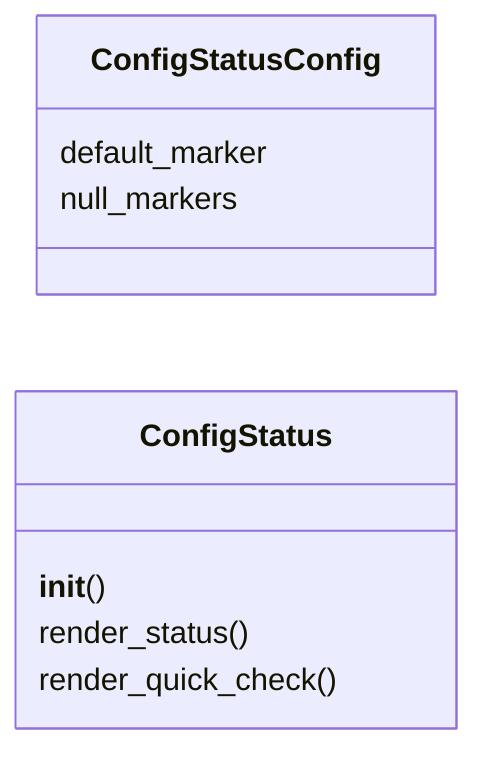
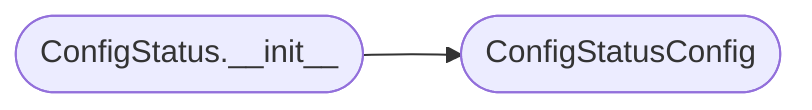

# `cli.config_status`

> Source: [cli/config_status.py:1](../../cli/config_status.py#L1) | language `py` | coverage 100.0% | [API index](../index.md)

Simplified configuration status display for the LazyOwn shell.

Groups payload.json fields by category, shows which are set, which need
attention, and which are optional -- replacing the raw JSON dump with a
human-friendly overview.

Design contract:
    - Zero imports from ``lazyown.py`` or ``lazyc2.py``.
    - All output through ``rich.console.Console``.
    - `[`ConfigStatus`](#configstatus)` receives a params dict; never reads payload.json directly.

## Contents

- **Classes:** [`ConfigStatusConfig`](#configstatusconfig), [`ConfigStatus`](#configstatus)
- **Constants:** [`FIELD_GROUPS`](#field_groups)

## Type Diagram



## Call Graph

Solid arrows stay in this module, dashed arrows leave it.



## Classes

<a id="configstatusconfig"></a>

### `ConfigStatusConfig`

`class` `dataclass` | [cli/config_status.py:55](../../cli/config_status.py#L55)

Decorators: `@dataclass(frozen=True)`

```python
class ConfigStatusConfig
```

Centralised constants for config status display.

**Attributes**

| Name | Type | Default | Description |
|---|---|---|---|
| [`default_marker`](#configstatusconfig-default_marker) |  | `'CHANGE_ME'` |  |
| [`null_markers`](#configstatusconfig-null_markers) |  | `frozenset({'null', 'None', 'none', ''})` |  |

---

<a id="configstatus"></a>

### `ConfigStatus`

`class` | [cli/config_status.py:62](../../cli/config_status.py#L62)

```python
class ConfigStatus
```

Display grouped configuration status.

**Parameters**

| Name | Type | Default | Description |
|---|---|---|---|
| `params` |  |  | Live params dict from the shell. |
| `config` |  |  | Optional config override. |

**Members**

| Member | Kind | Summary |
|---|---|---|
| [`__init__`](#configstatus-__init__) | constructor |  |
| [`render_status`](#configstatus-render_status) | method | Render the grouped configuration status table. |
| [`render_quick_check`](#configstatus-render_quick_check) | method | Quick check: show only required fields that are not set. |

<a id="configstatus-__init__"></a>

#### `ConfigStatus.__init__`

`constructor` | [cli/config_status.py:70](../../cli/config_status.py#L70)

```python
def __init__(self, params: dict[str, Any], config: ConfigStatusConfig | None = None) -> None
```

**Parameters**

| Name | Type | Default | Description |
|---|---|---|---|
| `params` | `dict[str, Any]` |  | Live params dict from the shell. |
| `config` | `ConfigStatusConfig \| None` | `None` | Optional config override. |

*Calls:* [`ConfigStatusConfig`](#configstatusconfig)

*Called by:* [`HelpUiCommandSet.do_config_status`](cli.commands.help_ui.py.md#helpuicommandset-do_config_status)

<a id="configstatus-render_status"></a>

#### `ConfigStatus.render_status`

`method` | [cli/config_status.py:89](../../cli/config_status.py#L89)

```python
def render_status(self) -> None
```

Render the grouped configuration status table.

*Called by:* [`HelpUiCommandSet.do_config_status`](cli.commands.help_ui.py.md#helpuicommandset-do_config_status)

<a id="configstatus-render_quick_check"></a>

#### `ConfigStatus.render_quick_check`

`method` | [cli/config_status.py:129](../../cli/config_status.py#L129)

```python
def render_quick_check(self) -> None
```

Quick check: show only required fields that are not set.

*Called by:* [`HelpUiCommandSet.do_config_status`](cli.commands.help_ui.py.md#helpuicommandset-do_config_status)

---

## Constants

<a id="field_groups"></a>

### `FIELD_GROUPS`

`constant` | [cli/config_status.py:24](../../cli/config_status.py#L24)

```python
FIELD_GROUPS: dict[str, dict[str, tuple[str, str, str]]]
```

---
