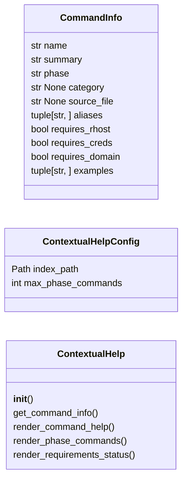
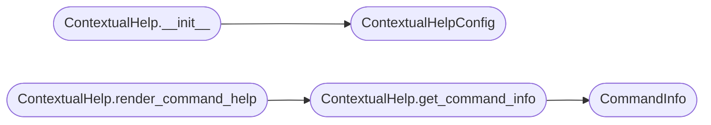

# `cli.contextual_help`

> Source: [cli/contextual_help.py:1](../../cli/contextual_help.py#L1) | language `py` | coverage 100.0% | [API index](../index.md)

Contextual help system for the LazyOwn shell.

Extends the default ``cmd2`` help with phase, requirements, examples,
and alias information sourced from the command index and the shell state.

Design contract:
    - Zero imports from ``lazyown.py`` or ``lazyc2.py``.
    - All output through ``rich.console.Console``.
    - `[`ContextualHelp`](#contextualhelp)` receives its dependencies via constructor.

## Contents

- **Classes:** [`CommandInfo`](#commandinfo), [`ContextualHelpConfig`](#contextualhelpconfig), [`ContextualHelp`](#contextualhelp)
- **Constants:** [`COMMAND_INDEX_PATH`](#command_index_path), [`PHASE_TIPS`](#phase_tips)

## Type Diagram



## Call Graph

Solid arrows stay in this module, dashed arrows leave it.



## Classes

<a id="commandinfo"></a>

### `CommandInfo`

`class` `dataclass` | [cli/contextual_help.py:62](../../cli/contextual_help.py#L62)

Decorators: `@dataclass(frozen=True)`

```python
class CommandInfo
```

Enriched command information for contextual help.

**Attributes**

| Name | Type | Default | Description |
|---|---|---|---|
| [`name`](#commandinfo-name) | `str` |  |  |
| [`summary`](#commandinfo-summary) | `str` |  |  |
| [`phase`](#commandinfo-phase) | `str` |  |  |
| [`category`](#commandinfo-category) | `str \| None` |  |  |
| [`source_file`](#commandinfo-source_file) | `str \| None` |  |  |
| [`aliases`](#commandinfo-aliases) | `tuple[str, ...]` | `()` |  |
| [`requires_rhost`](#commandinfo-requires_rhost) | `bool` | `False` |  |
| [`requires_creds`](#commandinfo-requires_creds) | `bool` | `False` |  |
| [`requires_domain`](#commandinfo-requires_domain) | `bool` | `False` |  |
| [`examples`](#commandinfo-examples) | `tuple[str, ...]` | `()` |  |

---

<a id="contextualhelpconfig"></a>

### `ContextualHelpConfig`

`class` `dataclass` | [cli/contextual_help.py:78](../../cli/contextual_help.py#L78)

Decorators: `@dataclass`

```python
class ContextualHelpConfig
```

Centralised constants for contextual help.

**Attributes**

| Name | Type | Default | Description |
|---|---|---|---|
| [`index_path`](#contextualhelpconfig-index_path) | `Path` | `COMMAND_INDEX_PATH` |  |
| [`max_phase_commands`](#contextualhelpconfig-max_phase_commands) | `int` | `15` |  |

---

<a id="contextualhelp"></a>

### `ContextualHelp`

`class` | [cli/contextual_help.py:167](../../cli/contextual_help.py#L167)

```python
class ContextualHelp
```

Enriched help provider for LazyOwn commands.

**Parameters**

| Name | Type | Default | Description |
|---|---|---|---|
| `aliases` |  |  | Live aliases dict from the shell. |
| `params` |  |  | Live params dict from the shell. |
| `config` |  |  | Optional config override. |

**Members**

| Member | Kind | Summary |
|---|---|---|
| [`__init__`](#contextualhelp-__init__) | constructor |  |
| [`get_command_info`](#contextualhelp-get_command_info) | method | Return enriched info for a command, or None if not found. |
| [`render_command_help`](#contextualhelp-render_command_help) | method | Render contextual help for a single command. |
| [`render_phase_commands`](#contextualhelp-render_phase_commands) | method | Render all commands for a given phase. |
| [`render_requirements_status`](#contextualhelp-render_requirements_status) | method | Show which requirements are met for the current session. |

<a id="contextualhelp-__init__"></a>

#### `ContextualHelp.__init__`

`constructor` | [cli/contextual_help.py:176](../../cli/contextual_help.py#L176)

```python
def __init__(self, aliases: dict[str, str] | None = None, params: dict[str, Any] | None = None, config: ContextualHelpConfig | None = None) -> None
```

**Parameters**

| Name | Type | Default | Description |
|---|---|---|---|
| `aliases` | `dict[str, str] \| None` | `None` | Live aliases dict from the shell. |
| `params` | `dict[str, Any] \| None` | `None` | Live params dict from the shell. |
| `config` | `ContextualHelpConfig \| None` | `None` | Optional config override. |

*Calls:* [`ContextualHelpConfig`](#contextualhelpconfig)

*Called by:* [`HelpUiCommandSet.do_ctx_help`](cli.commands.help_ui.py.md#helpuicommandset-do_ctx_help), [`HelpUiCommandSet.do_help_phase`](cli.commands.help_ui.py.md#helpuicommandset-do_help_phase), [`HelpUiCommandSet.do_help_status`](cli.commands.help_ui.py.md#helpuicommandset-do_help_status)

<a id="contextualhelp-get_command_info"></a>

#### `ContextualHelp.get_command_info`

`method` | [cli/contextual_help.py:188](../../cli/contextual_help.py#L188)

```python
def get_command_info(self, name: str) -> CommandInfo | None
```

Return enriched info for a command, or None if not found.

**Parameters**

| Name | Type | Default | Description |
|---|---|---|---|
| `name` | `str` |  |  |

**Returns:** `CommandInfo | None`

*Calls:* [`CommandInfo`](#commandinfo)

*Called by:* [`ContextualHelp.render_command_help`](#contextualhelp-render_command_help)

<a id="contextualhelp-render_command_help"></a>

#### `ContextualHelp.render_command_help`

`method` | [cli/contextual_help.py:208](../../cli/contextual_help.py#L208)

```python
def render_command_help(self, name: str) -> bool
```

Render contextual help for a single command.

Returns True if rendered.

**Parameters**

| Name | Type | Default | Description |
|---|---|---|---|
| `name` | `str` |  |  |

**Returns:** `bool`

*Calls:* [`ContextualHelp.get_command_info`](#contextualhelp-get_command_info)

*Called by:* [`HelpUiCommandSet.do_ctx_help`](cli.commands.help_ui.py.md#helpuicommandset-do_ctx_help)

<a id="contextualhelp-render_phase_commands"></a>

#### `ContextualHelp.render_phase_commands`

`method` | [cli/contextual_help.py:261](../../cli/contextual_help.py#L261)

```python
def render_phase_commands(self, phase: str) -> None
```

Render all commands for a given phase.

**Parameters**

| Name | Type | Default | Description |
|---|---|---|---|
| `phase` | `str` |  |  |

*Called by:* [`HelpUiCommandSet.do_help_phase`](cli.commands.help_ui.py.md#helpuicommandset-do_help_phase)

<a id="contextualhelp-render_requirements_status"></a>

#### `ContextualHelp.render_requirements_status`

`method` | [cli/contextual_help.py:281](../../cli/contextual_help.py#L281)

```python
def render_requirements_status(self) -> None
```

Show which requirements are met for the current session.

*Called by:* [`HelpUiCommandSet.do_help_status`](cli.commands.help_ui.py.md#helpuicommandset-do_help_status)

---

## Constants

<a id="command_index_path"></a>

### `COMMAND_INDEX_PATH`

`constant` | [cli/contextual_help.py:26](../../cli/contextual_help.py#L26)

```python
COMMAND_INDEX_PATH = Path('cli/command_index.json')
```

---

<a id="phase_tips"></a>

### `PHASE_TIPS`

`constant` | [cli/contextual_help.py:28](../../cli/contextual_help.py#L28)

```python
PHASE_TIPS: dict[str, tuple[str, ...]]
```

---
