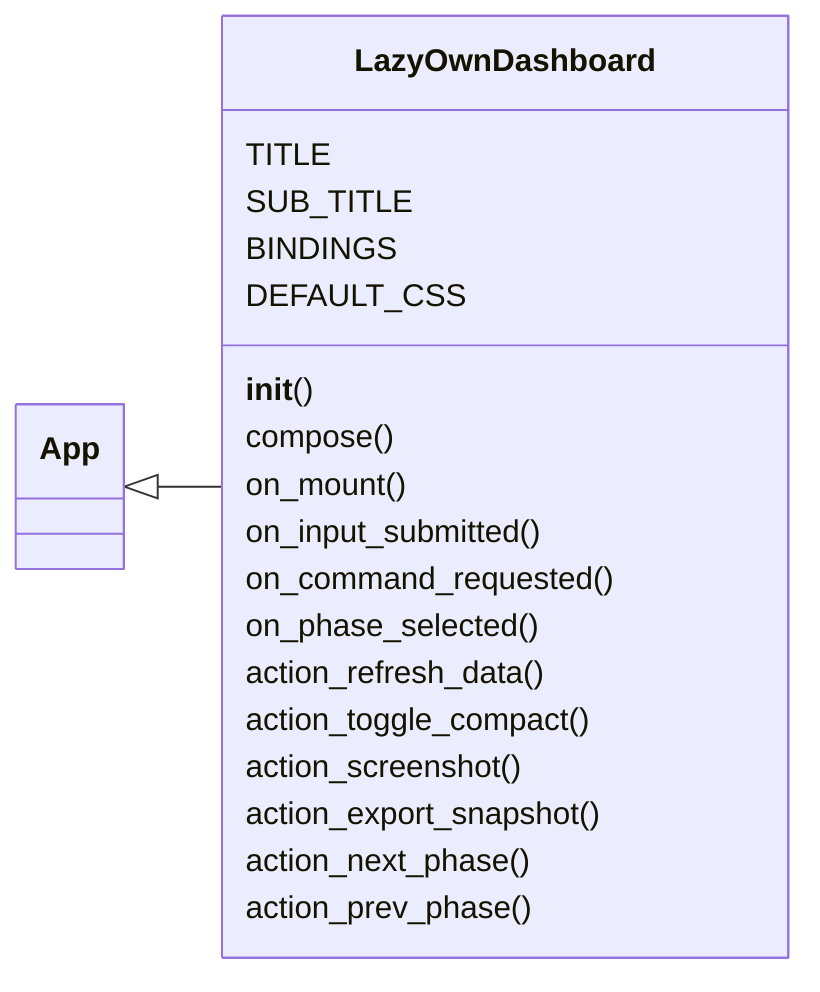
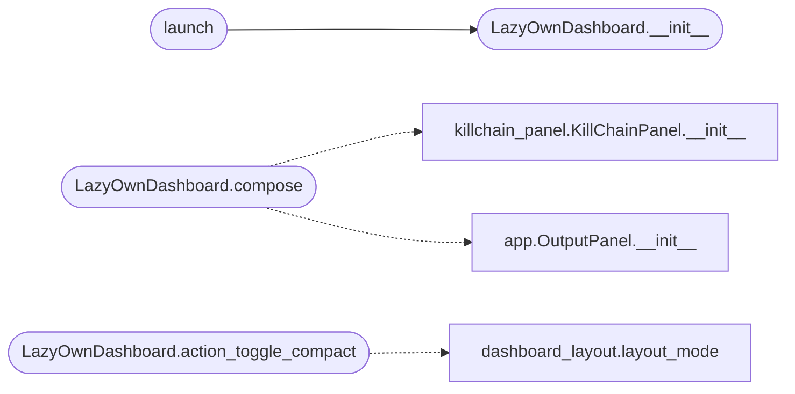

# `cli.dashboard_tui`

> Source: [cli/dashboard_tui.py:1](../../cli/dashboard_tui.py#L1) | language `py` | coverage 73.3% | [API index](../index.md)

LazyOwn operator dashboard — a full-screen Textual TUI.

Launch from the LazyOwn shell with ``dashboard`` or directly:

    python3 -m cli.dashboard_tui [--payload PATH] [--sessions PATH]

The dashboard auto-refreshes every REFRESH_INTERVAL seconds. Press Q or
Ctrl-C to close and return to the cmd2 shell.

Layout:
    ┌─ Header (target / domain / phase / OS) ─────────────────────────────┐
    │  Left (Kill Chain + Config)  │  Center (Commands) │ Right (Ops)      │
    ├──────────────────────────────────────────────────────────────────────┤
    │  Hint bar (graph suggestions)                                        │
    └─ Footer ([Q] Quit  [R] Refresh  [?] Help) ──────────────────────────┘

## Contents

- **Classes:** [`LazyOwnDashboard`](#lazyowndashboard)
- **Functions:** [`launch`](#launch)
- **Constants:** [`KILL_CHAIN_PHASES`](#kill_chain_phases)

## Type Diagram



## Call Graph

Solid arrows stay in this module, dashed arrows leave it.



## Classes

<a id="lazyowndashboard"></a>

### `LazyOwnDashboard`

`class` | [cli/dashboard_tui.py:740](../../cli/dashboard_tui.py#L740)

```python
class LazyOwnDashboard(App)
```

Bases: [`App`](lazy_sentinel4.py.md#app)

Full-screen operator dashboard for LazyOwn.

Reads payload.json, sessions/, and the graphify knowledge graph.
Auto-refreshes every REFRESH_INTERVAL seconds. Press Q to quit.

**Attributes**

| Name | Type | Default | Description |
|---|---|---|---|
| [`TITLE`](#lazyowndashboard-title) |  | `'LazyOwn RedTeam Dashboard'` |  |
| [`SUB_TITLE`](#lazyowndashboard-sub_title) |  | `'type a command below · click a phase or a hint · F compact · S shot · E export · Q quit'` |  |
| [`BINDINGS`](#lazyowndashboard-bindings) |  | `[('q', 'quit', 'Quit'), ('r', 'refresh_data', 'Refresh'), ('p', 'next_phase', 'Next phase'), ('shift+p', 'prev_phase', 'Prev phase'), ('f', 'toggle_compact', 'Compact'), ('s', 'screenshot', 'Screenshot'), ('e', 'export_snapshot', 'Export'), ('?', 'help', 'Help')]` |  |
| [`DEFAULT_CSS`](#lazyowndashboard-default_css) |  | `'\n Screen {\n layout: vertical;\n }\n #top-bar {\n height: 3;\n dock: top;\n }\n #main-area {\n layout: horizontal;\n height: 1fr;\n }\n #left-col {\n layout: vertical;\n width: 28;\n min-width: 22;\n }\n #center-col {\n layout: vertical;\n width: 1fr;\n }\n #right-col {\n layout: vertical;\n width: 30;\n min-width: 24;\n }\n #hint-bar {\n height: auto;\n }\n #cmd-input {\n height: 3;\n margin: 0 1;\n }\n #output-panel {\n height: 1fr;\n }\n #main-area.compact {\n layout: vertical;\n }\n #right-col.compact {\n display: none;\n }\n #reasoning-panel.compact {\n display: none;\n }\n '` |  |

**Members**

| Member | Kind | Summary |
|---|---|---|
| [`__init__`](#lazyowndashboard-__init__) | constructor |  |
| [`compose`](#lazyowndashboard-compose) | method |  |
| [`on_mount`](#lazyowndashboard-on_mount) | method |  |
| [`on_input_submitted`](#lazyowndashboard-on_input_submitted) | method | Run the typed command and clear the input. |
| [`on_command_requested`](#lazyowndashboard-on_command_requested) | method | Dispatch a command in a worker so the UI never blocks. |
| [`on_phase_selected`](#lazyowndashboard-on_phase_selected) | method | Filter the center panel to a phase chosen by clicking the kill chain. |
| [`action_refresh_data`](#lazyowndashboard-action_refresh_data) | method |  |
| [`action_toggle_compact`](#lazyowndashboard-action_toggle_compact) | method | Toggle the compact single-column layout for narrow terminals. |
| [`action_screenshot`](#lazyowndashboard-action_screenshot) | method | Save an SVG screenshot next to the sessions directory. |
| [`action_export_snapshot`](#lazyowndashboard-action_export_snapshot) | method | Export the current dashboard data as JSON for automation. |
| [`action_next_phase`](#lazyowndashboard-action_next_phase) | method | Advance to the next kill-chain phase and refresh the display. |
| [`action_prev_phase`](#lazyowndashboard-action_prev_phase) | method | Step back to the previous kill-chain phase. |

<a id="lazyowndashboard-__init__"></a>

#### `LazyOwnDashboard.__init__`

`constructor` | [cli/dashboard_tui.py:809](../../cli/dashboard_tui.py#L809)

```python
def __init__(self, payload_path: str = PAYLOAD_PATH, sessions_dir: str = SESSIONS_DIR, **kwargs: Any) -> None
```

**Parameters**

| Name | Type | Default | Description |
|---|---|---|---|
| `payload_path` | `str` | `PAYLOAD_PATH` |  |
| `sessions_dir` | `str` | `SESSIONS_DIR` |  |
| `**kwargs` | `Any` |  |  |

*Called by:* [`launch`](#launch), [`KillChainPanel.__init__`](lazygui.panels.killchain_panel.py.md#killchainpanel-__init__)

<a id="lazyowndashboard-compose"></a>

#### `LazyOwnDashboard.compose`

`method` `generator` | [cli/dashboard_tui.py:838](../../cli/dashboard_tui.py#L838)

```python
def compose(self) -> ComposeResult
```

**Returns:** `ComposeResult`

*Calls:* [`KillChainPanel.__init__`](lazygui.panels.killchain_panel.py.md#killchainpanel-__init__), [`OutputPanel.__init__`](poc_tui.app.py.md#outputpanel-__init__)

<a id="lazyowndashboard-on_mount"></a>

#### `LazyOwnDashboard.on_mount`

`method` | [cli/dashboard_tui.py:857](../../cli/dashboard_tui.py#L857)

```python
def on_mount(self) -> None
```

<a id="lazyowndashboard-on_input_submitted"></a>

#### `LazyOwnDashboard.on_input_submitted`

`method` | [cli/dashboard_tui.py:862](../../cli/dashboard_tui.py#L862)

```python
def on_input_submitted(self, event: Input.Submitted) -> None
```

Run the typed command and clear the input.

**Parameters**

| Name | Type | Default | Description |
|---|---|---|---|
| `event` | `Input.Submitted` |  | Input submission event. |

<a id="lazyowndashboard-on_command_requested"></a>

#### `LazyOwnDashboard.on_command_requested`

`method` | [cli/dashboard_tui.py:874](../../cli/dashboard_tui.py#L874)

```python
def on_command_requested(self, event: CommandRequested) -> None
```

Dispatch a command in a worker so the UI never blocks.

**Parameters**

| Name | Type | Default | Description |
|---|---|---|---|
| `event` | `CommandRequested` |  | Request posted by the input or a hint button. |

<a id="lazyowndashboard-on_phase_selected"></a>

#### `LazyOwnDashboard.on_phase_selected`

`method` | [cli/dashboard_tui.py:914](../../cli/dashboard_tui.py#L914)

```python
def on_phase_selected(self, event: PhaseSelected) -> None
```

Filter the center panel to a phase chosen by clicking the kill chain.

**Parameters**

| Name | Type | Default | Description |
|---|---|---|---|
| `event` | `PhaseSelected` |  | Phase selection posted by the kill-chain panel. |

<a id="lazyowndashboard-action_refresh_data"></a>

#### `LazyOwnDashboard.action_refresh_data`

`method` | [cli/dashboard_tui.py:925](../../cli/dashboard_tui.py#L925)

```python
def action_refresh_data(self) -> None
```

<a id="lazyowndashboard-action_toggle_compact"></a>

#### `LazyOwnDashboard.action_toggle_compact`

`method` | [cli/dashboard_tui.py:928](../../cli/dashboard_tui.py#L928)

```python
def action_toggle_compact(self) -> None
```

Toggle the compact single-column layout for narrow terminals.

*Calls:* [`layout_mode`](cli.dashboard_layout.py.md#layout_mode)

<a id="lazyowndashboard-action_screenshot"></a>

#### `LazyOwnDashboard.action_screenshot`

`method` | [cli/dashboard_tui.py:958](../../cli/dashboard_tui.py#L958)

```python
def action_screenshot(self) -> None
```

Save an SVG screenshot next to the sessions directory.

<a id="lazyowndashboard-action_export_snapshot"></a>

#### `LazyOwnDashboard.action_export_snapshot`

`method` | [cli/dashboard_tui.py:969](../../cli/dashboard_tui.py#L969)

```python
def action_export_snapshot(self) -> None
```

Export the current dashboard data as JSON for automation.

<a id="lazyowndashboard-action_next_phase"></a>

#### `LazyOwnDashboard.action_next_phase`

`method` | [cli/dashboard_tui.py:989](../../cli/dashboard_tui.py#L989)

```python
def action_next_phase(self) -> None
```

Advance to the next kill-chain phase and refresh the display.

<a id="lazyowndashboard-action_prev_phase"></a>

#### `LazyOwnDashboard.action_prev_phase`

`method` | [cli/dashboard_tui.py:993](../../cli/dashboard_tui.py#L993)

```python
def action_prev_phase(self) -> None
```

Step back to the previous kill-chain phase.

---

## Functions

<a id="launch"></a>

### `launch`

`function` | [cli/dashboard_tui.py:1066](../../cli/dashboard_tui.py#L1066)

```python
def launch(payload_path: str = PAYLOAD_PATH, sessions_dir: str = SESSIONS_DIR) -> None
```

Launch the dashboard and block until the user quits.

**Parameters**

| Name | Type | Default | Description |
|---|---|---|---|
| `payload_path` | `str` | `PAYLOAD_PATH` | Path to payload.json. |
| `sessions_dir` | `str` | `SESSIONS_DIR` | Path to the sessions directory. |

*Calls:* [`LazyOwnDashboard.__init__`](#lazyowndashboard-__init__)

---

## Constants

<a id="kill_chain_phases"></a>

### `KILL_CHAIN_PHASES`

`constant` | [cli/dashboard_tui.py:48](../../cli/dashboard_tui.py#L48)

```python
KILL_CHAIN_PHASES: tuple[tuple[str, str], ...] = tuple(((p[0], p[1]) for p in _KC.phases_for_display()))
```

---
