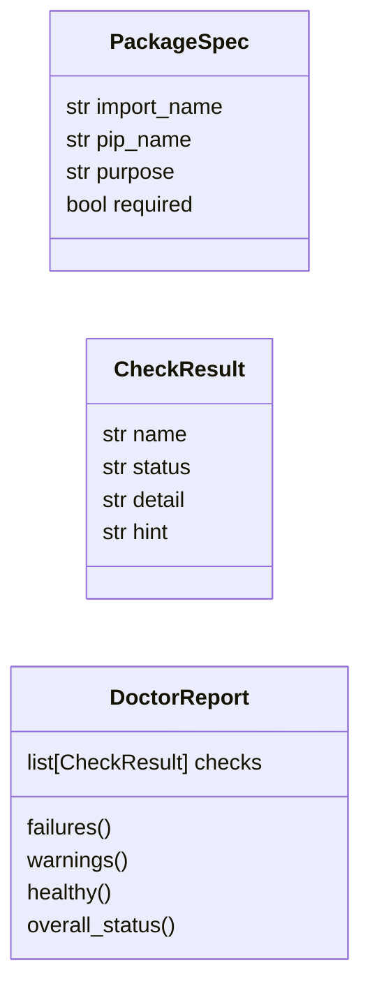
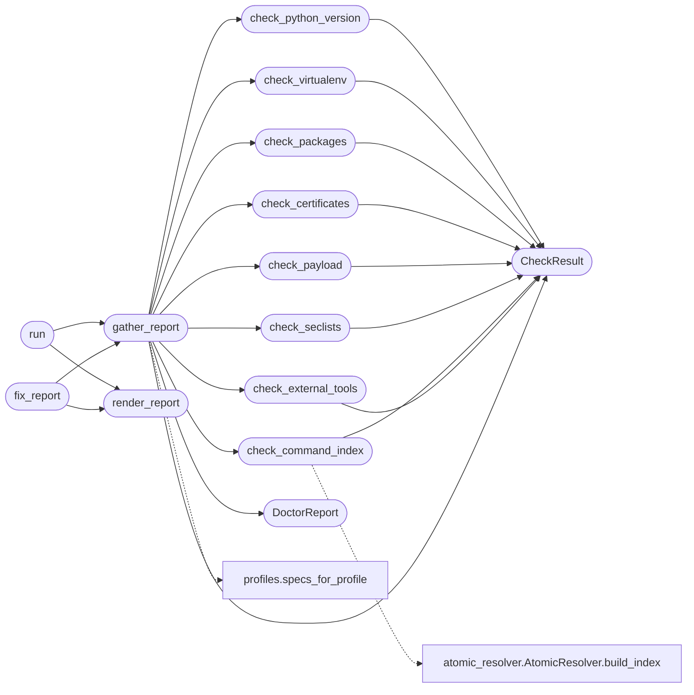

# `cli.doctor`

> Source: [cli/doctor.py:1](../../cli/doctor.py#L1) | language `py` | coverage 95.0% | [API index](../index.md)

Environment health check (preflight doctor) for the LazyOwn framework.

Complements the setup wizard. Where ``wizard`` / ``wizard --check`` validate the
operator's *configuration* (the values in ``payload.json``), ``doctor`` validates
the *installation* itself: the running Python version, whether the virtual
environment is active, importability of the third-party packages that
`[`install.sh`](install.sh.md)` provisions, the presence of the C2 TLS certificates, the
``payload.json`` config file, the SecLists wordlists, and the external kill-chain
tooling.

Design contract:
    - Zero imports from ``lazyown.py`` or ``lazyc2.py`` (Dependency Inversion);
      the command surface depends on this module, never the reverse.
    - Pure check functions return [`CheckResult`](#checkresult) objects and never print,
      so they are unit-testable without capturing stdout. Rendering is isolated
      in [`render_report`](#render_report).
    - External-tool and SecLists detection is delegated to [`cli.wizard`](cli.wizard.py.md) so
      the framework keeps a single source of truth for those checks (DRY).
    - System-touching dependencies (the package finder, the binary checker, the
      filesystem root) are injected so tests can stub them deterministically.

## Contents

- **Classes:** [`PackageSpec`](#packagespec), [`CheckResult`](#checkresult), [`DoctorReport`](#doctorreport)
- **Functions:** [`check_python_version`](#check_python_version), [`check_virtualenv`](#check_virtualenv), [`check_packages`](#check_packages), [`check_certificates`](#check_certificates), [`check_payload`](#check_payload), [`check_seclists`](#check_seclists), [`check_command_index`](#check_command_index), [`check_external_tools`](#check_external_tools), [`gather_report`](#gather_report), [`render_report`](#render_report), [`run`](#run), [`fix_report`](#fix_report)

## Type Diagram



## Call Graph

Solid arrows stay in this module, dashed arrows leave it.



## Classes

<a id="packagespec"></a>

### `PackageSpec`

`class` `dataclass` | [cli/doctor.py:56](../../cli/doctor.py#L56)

Decorators: `@dataclass(frozen=True)`

```python
class PackageSpec
```

Declarative description of a Python dependency the framework imports.

**Attributes**

| Name | Type | Default | Description |
|---|---|---|---|
| [`import_name`](#packagespec-import_name) | `str` |  | Module name passed to the import machinery. Differs from the distribution name for several packages (``yaml`` vs ``pyyaml``, ``bs4`` vs ``beautifulsoup4``, ``Crypto`` vs ``pycryptodome``). |
| [`pip_name`](#packagespec-pip_name) | `str` |  | Distribution name shown in the remediation hint. |
| [`purpose`](#packagespec-purpose) | `str` |  | One-line description of what breaks without the package. |
| [`required`](#packagespec-required) | `bool` |  | When ``True`` a missing package is a hard failure; when ``False`` it is advisory because only an optional feature degrades. |

---

<a id="checkresult"></a>

### `CheckResult`

`class` `dataclass` | [cli/doctor.py:96](../../cli/doctor.py#L96)

Decorators: `@dataclass(frozen=True)`

```python
class CheckResult
```

Outcome of a single preflight check.

**Attributes**

| Name | Type | Default | Description |
|---|---|---|---|
| [`name`](#checkresult-name) | `str` |  | Short human-readable label for the check. |
| [`status`](#checkresult-status) | `str` |  | One of `STATUS_OK`, `STATUS_WARN`, `STATUS_FAIL`. |
| [`detail`](#checkresult-detail) | `str` |  | Description of what was found. |
| [`hint`](#checkresult-hint) | `str` | `''` | Optional remediation command shown when the check is not `[`ok`](scripts.top_tier_check.py.md#ok)`. |

---

<a id="doctorreport"></a>

### `DoctorReport`

`class` `dataclass` | [cli/doctor.py:113](../../cli/doctor.py#L113)

Decorators: `@dataclass`

```python
class DoctorReport
```

Aggregated result of a full preflight run.

**Attributes**

| Name | Type | Default | Description |
|---|---|---|---|
| [`checks`](#doctorreport-checks) | `list[CheckResult]` | `field(default_factory=list)` |  |

**Members**

| Member | Kind | Summary |
|---|---|---|
| [`failures`](#doctorreport-failures) | property | Return the checks whose status is `STATUS_FAIL`. |
| [`warnings`](#doctorreport-warnings) | property | Return the checks whose status is `STATUS_WARN`. |
| [`healthy`](#doctorreport-healthy) | property | Return ``True`` when no check failed (warnings are tolerated). |
| [`overall_status`](#doctorreport-overall_status) | property | Return the worst status across every check. |

<a id="doctorreport-failures"></a>

#### `DoctorReport.failures`

`property` | [cli/doctor.py:119](../../cli/doctor.py#L119)

Decorators: `@property`

```python
def failures(self) -> list[CheckResult]
```

Return the checks whose status is `STATUS_FAIL`.

**Returns:** `list[CheckResult]`

<a id="doctorreport-warnings"></a>

#### `DoctorReport.warnings`

`property` | [cli/doctor.py:124](../../cli/doctor.py#L124)

Decorators: `@property`

```python
def warnings(self) -> list[CheckResult]
```

Return the checks whose status is `STATUS_WARN`.

**Returns:** `list[CheckResult]`

<a id="doctorreport-healthy"></a>

#### `DoctorReport.healthy`

`property` | [cli/doctor.py:129](../../cli/doctor.py#L129)

Decorators: `@property`

```python
def healthy(self) -> bool
```

Return ``True`` when no check failed (warnings are tolerated).

**Returns:** `bool`

<a id="doctorreport-overall_status"></a>

#### `DoctorReport.overall_status`

`property` | [cli/doctor.py:134](../../cli/doctor.py#L134)

Decorators: `@property`

```python
def overall_status(self) -> str
```

Return the worst status across every check.

**Returns:** `str`

---

## Functions

<a id="check_python_version"></a>

### `check_python_version`

`function` | [cli/doctor.py:143](../../cli/doctor.py#L143)

```python
def check_python_version(version_info: Sequence[int] | None = None) -> CheckResult
```

Verify the interpreter satisfies `MIN_PYTHON_VERSION`.

**Parameters**

| Name | Type | Default | Description |
|---|---|---|---|
| `version_info` | `Sequence[int] \| None` | `None` | Two-or-more element sequence of ``(major, minor, ...)``. Injected so tests can assert both the satisfied and unsatisfied branches without spawning a second interpreter. |

**Returns:** `CheckResult` - A [`CheckResult`](#checkresult) flagged ``fail`` below the minimum version.

*Calls:* [`CheckResult`](#checkresult)

*Called by:* [`gather_report`](#gather_report)

---

<a id="check_virtualenv"></a>

### `check_virtualenv`

`function` | [cli/doctor.py:172](../../cli/doctor.py#L172)

```python
def check_virtualenv(*, prefix: str = sys.prefix, base_prefix: str | None = getattr(sys, 'base_prefix', None), root: Path) -> CheckResult
```

Report whether the framework is running inside its virtual environment.

**Parameters**

| Name | Type | Default | Description |
|---|---|---|---|
| `prefix` | `str` | `sys.prefix` | Active interpreter prefix (``sys.prefix``). |
| `base_prefix` | `str \| None` | `getattr(sys, 'base_prefix', None)` | System interpreter prefix (``sys.base_prefix``). ``None`` collapses to ``prefix`` for ancient interpreters. |
| `root` | `Path` |  | Repository root used to locate the ``env/`` directory. |

**Returns:** `CheckResult` - `[`ok`](scripts.top_tier_check.py.md#ok)` when an isolated environment is active; `[`warn`](skills.setup.sh.md#warn)` otherwise so the
operator is nudged to activate ``env/`` without blocking the session.

*Calls:* [`CheckResult`](#checkresult)

*Called by:* [`gather_report`](#gather_report)

---

<a id="check_packages"></a>

### `check_packages`

`function` | [cli/doctor.py:209](../../cli/doctor.py#L209)

```python
def check_packages(specs: Sequence[PackageSpec] = _REQUIRED_PACKAGES, finder: Callable[[str], object | None] = importlib.util.find_spec) -> list[CheckResult]
```

Verify every dependency in ``specs`` is importable without importing it.

Uses `importlib.util.find_spec` so the check stays side-effect free:
no third-party module is actually executed, mirroring the safety contract of
[`cli.wizard.check_binaries`](cli.wizard.py.md#check_binaries).

**Parameters**

| Name | Type | Default | Description |
|---|---|---|---|
| `specs` | `Sequence[PackageSpec]` | `_REQUIRED_PACKAGES` | Package specifications to verify. |
| `finder` | `Callable[[str], object \| None]` | `importlib.util.find_spec` | ``find_spec``-compatible callable. Injected for tests. |

**Returns:** `list[CheckResult]` - One [`CheckResult`](#checkresult) per spec, in input order.

*Calls:* [`CheckResult`](#checkresult)

*Called by:* [`gather_report`](#gather_report)

---

<a id="check_certificates"></a>

### `check_certificates`

`function` | [cli/doctor.py:248](../../cli/doctor.py#L248)

```python
def check_certificates(root: Path) -> CheckResult
```

Verify the self-signed C2 certificate pair exists.

**Parameters**

| Name | Type | Default | Description |
|---|---|---|---|
| `root` | `Path` |  | Repository root containing ``cert.pem`` / ``key.pem``. |

**Returns:** `CheckResult` - `[`warn`](skills.setup.sh.md#warn)` when either file is missing because the certificates are only
needed once the C2 starts, not for CLI-only recon.

*Calls:* [`CheckResult`](#checkresult)

*Called by:* [`gather_report`](#gather_report)

---

<a id="check_payload"></a>

### `check_payload`

`function` | [cli/doctor.py:269](../../cli/doctor.py#L269)

```python
def check_payload(root: Path) -> CheckResult
```

Verify ``payload.json`` exists in the repository root.

**Parameters**

| Name | Type | Default | Description |
|---|---|---|---|
| `root` | `Path` |  | Repository root. |

**Returns:** `CheckResult` - ``fail`` when absent because every component reads this single config
source; the framework cannot run without it.

*Calls:* [`CheckResult`](#checkresult)

*Called by:* [`gather_report`](#gather_report)

---

<a id="check_seclists"></a>

### `check_seclists`

`function` | [cli/doctor.py:289](../../cli/doctor.py#L289)

```python
def check_seclists(finder: Callable[[], str | None] = _find_seclists_root) -> CheckResult
```

Verify a SecLists installation is discoverable on disk.

**Parameters**

| Name | Type | Default | Description |
|---|---|---|---|
| `finder` | `Callable[[], str \| None]` | `_find_seclists_root` | Callable returning the SecLists root or ``None``. Defaults to `cli.wizard._find_seclists_root` so the candidate paths are defined once. |

**Returns:** `CheckResult` - `[`warn`](skills.setup.sh.md#warn)` when not found because wordlist paths can be set manually.

*Calls:* [`CheckResult`](#checkresult)

*Called by:* [`gather_report`](#gather_report)

---

<a id="check_command_index"></a>

### `check_command_index`

`function` | [cli/doctor.py:313](../../cli/doctor.py#L313)

```python
def check_command_index(root: Path) -> CheckResult
```

**Parameters**

| Name | Type | Default | Description |
|---|---|---|---|
| `root` | `Path` |  |  |

**Returns:** `CheckResult`

*Calls:* [`CheckResult`](#checkresult), [`AtomicResolver.build_index`](modules.atomic_resolver.py.md#atomicresolver-build_index)

*Called by:* [`gather_report`](#gather_report)

---

<a id="check_external_tools"></a>

### `check_external_tools`

`function` | [cli/doctor.py:343](../../cli/doctor.py#L343)

```python
def check_external_tools(checker: Callable[[], list[BinaryStatus]] = check_binaries) -> list[CheckResult]
```

Adapt [`cli.wizard.check_binaries`](cli.wizard.py.md#check_binaries) into preflight check results.

Missing external tools are reported as `[`warn`](skills.setup.sh.md#warn)` rather than ``fail`` because
each tool only powers a subset of the kill-chain; recon can proceed while,
for example, ``evil-winrm`` is absent.

**Parameters**

| Name | Type | Default | Description |
|---|---|---|---|
| `checker` | `Callable[[], list[BinaryStatus]]` | `check_binaries` | Callable returning [`cli.wizard.BinaryStatus`](cli.wizard.py.md#binarystatus) items. |

**Returns:** `list[CheckResult]` - One [`CheckResult`](#checkresult) per external tool.

*Calls:* [`CheckResult`](#checkresult)

*Called by:* [`gather_report`](#gather_report)

---

<a id="gather_report"></a>

### `gather_report`

`function` | [cli/doctor.py:368](../../cli/doctor.py#L368)

```python
def gather_report(root: Path) -> DoctorReport
```

Run every preflight check and collect the results without printing.

**Parameters**

| Name | Type | Default | Description |
|---|---|---|---|
| `root` | `Path` |  | Repository root used for file-presence checks. |

**Returns:** `DoctorReport` - A populated [`DoctorReport`](#doctorreport).

*Calls:* [`CheckResult`](#checkresult), [`DoctorReport`](#doctorreport), [`check_certificates`](#check_certificates), [`check_command_index`](#check_command_index), [`check_external_tools`](#check_external_tools), [`check_packages`](#check_packages), [`check_payload`](#check_payload), [`check_python_version`](#check_python_version), [`check_seclists`](#check_seclists), [`check_virtualenv`](#check_virtualenv), [`specs_for_profile`](core.profiles.py.md#specs_for_profile)

*Called by:* [`HelpUiCommandSet.do_doctor`](cli.commands.help_ui.py.md#helpuicommandset-do_doctor), [`fix_report`](#fix_report), [`run`](#run)

---

<a id="render_report"></a>

### `render_report`

`function` | [cli/doctor.py:406](../../cli/doctor.py#L406)

```python
def render_report(report: DoctorReport, console: Console | None = None) -> None
```

Render a [`DoctorReport`](#doctorreport) as a rich table with a summary banner.

**Parameters**

| Name | Type | Default | Description |
|---|---|---|---|
| `report` | `DoctorReport` |  | The report to display. |
| `console` | `Console \| None` | `None` | Optional rich console; a default highlight-free console is created when omitted. |

*Called by:* [`HelpUiCommandSet.do_doctor`](cli.commands.help_ui.py.md#helpuicommandset-do_doctor), [`fix_report`](#fix_report), [`run`](#run)

---

<a id="run"></a>

### `run`

`function` | [cli/doctor.py:451](../../cli/doctor.py#L451)

```python
def run(root: Path | None = None, console: Console | None = None) -> DoctorReport
```

Gather and render the preflight report.

**Parameters**

| Name | Type | Default | Description |
|---|---|---|---|
| `root` | `Path \| None` | `None` | Repository root. Defaults to the parent of this package. |
| `console` | `Console \| None` | `None` | Optional rich console for rendering. |

**Returns:** `DoctorReport` - The [`DoctorReport`](#doctorreport) so callers can inspect the result
programmatically (for example to choose a process exit code).

*Calls:* [`gather_report`](#gather_report), [`render_report`](#render_report)

---

<a id="fix_report"></a>

### `fix_report`

`function` | [cli/doctor.py:468](../../cli/doctor.py#L468)

```python
def fix_report(report: DoctorReport, *, root: Path | None = None, console: Console | None = None, auto_yes: bool = False) -> DoctorReport
```

Interactively offer to fix every failure and warning in the report.

For each non-ok check the operator is prompted (unless *auto_yes* is set)
whether to attempt automatic remediation.  After all fixes the report is
re-gathered and re-rendered so the operator sees the updated status.

**Parameters**

| Name | Type | Default | Description |
|---|---|---|---|
| `report` | `DoctorReport` |  | The pre-flight report to fix. |
| `root` | `Path \| None` | `None` | Repository root for re-checking after fixes. |
| `console` | `Console \| None` | `None` | Rich console for I/O. |
| `auto_yes` | `bool` | `False` | When ``True``, fix every check without prompting. |

**Returns:** `DoctorReport` - A fresh [`DoctorReport`](#doctorreport) after attempted fixes.

*Calls:* [`gather_report`](#gather_report), [`render_report`](#render_report)

*Called by:* [`HelpUiCommandSet.do_doctor`](cli.commands.help_ui.py.md#helpuicommandset-do_doctor)

---
