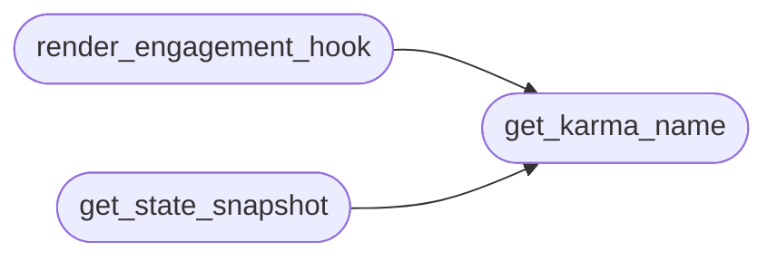

# `cli.engagement_hooks`

> Source: [cli/engagement_hooks.py:1](../../cli/engagement_hooks.py#L1) | language `py` | coverage 100.0% | [API index](../index.md)

Curiosity-driven engagement engine for LazyOwn.

Two psychological mechanisms drive operator adoption:

1. Biological Curiosity (Loewenstein Information Gap Theory, 1994)
   Curiosity arises when we perceive a gap between what we know and what we
   want to know.  The engine surfaces ONE undiscovered command after each
   execution, chosen from the same kill-chain phase as the command just run.
   The gap is made explicit: "You haven't tried X — it does Y."  The operator
   knows something useful exists, doesn't know how it works, and is pulled to
   explore it.  Same suggestion never repeats in a session.

2. Variable Interval Reinforcement (Skinner, 1957)
   The most durable reinforcement schedule known to behavioural science.
   Rewards appear at unpredictable command counts (drawn from a geometric
   distribution with mean MEAN_INTERVAL).  Because the operator cannot predict
   WHEN the next reward arrives, the behaviour of "run another command" is
   maintained even in the absence of an immediate payoff.  Rewards are
   genuinely useful: streak acknowledgements, exploration milestones,
   hidden-feature reveals, phase-progression badges.

Architecture
------------
- Zero imports from lazyown.py, lazyc2.py, or Flask.
- All I/O is wrapped in try/except; failure is always silent.
- Output via rich.Console so ANSI is correct on every terminal.
- State persisted to ``sessions/engagement_state.json`` (cross-session).
- The caller (shell postcmd hook) passes a minimal context dict; this module
  never reads payload.json directly.

## Contents

- **Classes:** [`EngagementState`](#engagementstate)
- **Functions:** [`heal_commands_seen`](#heal_commands_seen), [`get_karma_name`](#get_karma_name), [`render_engagement_hook`](#render_engagement_hook), [`get_state_snapshot`](#get_state_snapshot), [`reset_session`](#reset_session)
- **Constants:** [`STATE_PATH`](#state_path), [`INDEX_PATH`](#index_path), [`USERS_PATH`](#users_path), [`PAYLOAD_PATH`](#payload_path), [`NOTIFICATIONS_PATH`](#notifications_path), [`TASKS_PATH`](#tasks_path), [`OBJECTIVES_PATH`](#objectives_path), [`NOTES_PATH`](#notes_path), [`MEAN_INTERVAL`](#mean_interval), [`KARMA_THRESHOLDS`](#karma_thresholds), [`KARMA_TOP`](#karma_top), [`ELO_BASE`](#elo_base), [`ELO_FIRST_TIME_BONUS`](#elo_first_time_bonus), [`ELO_NEW_PHASE_BONUS`](#elo_new_phase_bonus), [`ELO_HIGH_VALUE_CMDS`](#elo_high_value_cmds), [`ELO_PHASE_BONUS`](#elo_phase_bonus)

## Call Graph

Solid arrows stay in this module, dashed arrows leave it.



## Classes

<a id="engagementstate"></a>

### `EngagementState`

`class` `dataclass` | [cli/engagement_hooks.py:242](../../cli/engagement_hooks.py#L242)

Decorators: `@dataclass`

```python
class EngagementState
```

Persisted cross-session engagement metrics.

**Attributes**

| Name | Type | Default | Description |
|---|---|---|---|
| [`total_commands`](#engagementstate-total_commands) | `int` | `0` |  |
| [`session_commands`](#engagementstate-session_commands) | `int` | `0` |  |
| [`commands_seen`](#engagementstate-commands_seen) | `list[str]` | `field(default_factory=list)` |  |
| [`phases_entered`](#engagementstate-phases_entered) | `list[str]` | `field(default_factory=list)` |  |
| [`rewards_given`](#engagementstate-rewards_given) | `list[str]` | `field(default_factory=list)` |  |
| [`session_curiosity_shown`](#engagementstate-session_curiosity_shown) | `list[str]` | `field(default_factory=list)` |  |
| [`next_reward_at`](#engagementstate-next_reward_at) | `int` | `0` |  |
| [`session_start_ts`](#engagementstate-session_start_ts) | `float` | `field(default_factory=time.time)` |  |
| [`last_cmd`](#engagementstate-last_cmd) | `str` | `''` |  |
| [`elo`](#engagementstate-elo) | `int` | `0` |  |
| [`last_karma_name`](#engagementstate-last_karma_name) | `str` | `'Noob'` |  |
| [`elo_session_delta`](#engagementstate-elo_session_delta) | `int` | `0` |  |
| [`badges`](#engagementstate-badges) | `list[str]` | `field(default_factory=list)` |  |

---

## Functions

<a id="heal_commands_seen"></a>

### `heal_commands_seen`

`function` | [cli/engagement_hooks.py:365](../../cli/engagement_hooks.py#L365)

```python
def heal_commands_seen(known: set[str]) -> int
```

Purge non-command entries from persisted `[`commands_seen`](#engagementstate-commands_seen)` in place.

Called once at shell startup with the live command roster so historical
pollution that survives the syntactic filter (real-looking but invalid
tokens such as ``do_against`` or ``do_como``) is removed against ground
truth. Idempotent: a clean state file is left untouched.

**Parameters**

| Name | Type | Default | Description |
|---|---|---|---|
| `known` | `set[str]` |  | Authoritative set of ``do_``-prefixed command names, typically ``{f"do_{c}" for c in shell.get_all_commands()}``. |

**Returns:** `int` - The number of entries removed. Zero when nothing changed or on error.

---

<a id="get_karma_name"></a>

### `get_karma_name`

`function` | [cli/engagement_hooks.py:716](../../cli/engagement_hooks.py#L716)

```python
def get_karma_name(elo: int) -> str
```

Return karma rank for an ELO score.

Mirrors the bracket function `[`get_karma_name`](#get_karma_name)` in ``lazyc2.py`` so the
terminal and the C2 web UI display identical ranks for the same operator.

**Parameters**

| Name | Type | Default | Description |
|---|---|---|---|
| `elo` | `int` |  | Non-negative integer score. |

**Returns:** `str` - Human-facing karma label (``Noob`` … ``Godlike``).

*Called by:* [`get_state_snapshot`](#get_state_snapshot), [`render_engagement_hook`](#render_engagement_hook), [`whoami`](modules.cli_auth.py.md#whoami)

---

<a id="render_engagement_hook"></a>

### `render_engagement_hook`

`function` | [cli/engagement_hooks.py:898](../../cli/engagement_hooks.py#L898)

```python
def render_engagement_hook(cmd: str, phase: str = '', enabled: bool = True) -> None
```

Post-command hook: curiosity reveal + ELO + VRI reward when due.

**Parameters**

| Name | Type | Default | Description |
|---|---|---|---|
| `cmd` | `str` |  | The command name that just executed (e.g. "lazynmap"). |
| `phase` | `str` | `''` | Current engagement phase from world_model (e.g. "recon"). |
| `enabled` | `bool` | `True` | When False this function is a no-op. Controlled by ``enable_inline_hints`` in payload.json so the operator can silence all engagement output with one flag. |

**Returns:** `None` - None — side effects are at most 2-3 lines written to stdout and one
atomic patch each to ``sessions/engagement_state.json``,
``sessions/notifications.json`` and ``users.json``.

*Calls:* [`get_karma_name`](#get_karma_name)

---

<a id="get_state_snapshot"></a>

### `get_state_snapshot`

`function` | [cli/engagement_hooks.py:978](../../cli/engagement_hooks.py#L978)

```python
def get_state_snapshot() -> dict[str, Any]
```

Return a read-only snapshot of current engagement state for CLI display.

Used by `[`do_karma`](cli.commands.help_ui.py.md#helpuicommandset-do_karma)` in ``lazyown.py`` to print the operator's current
score without touching the on-disk state file.  When the state has not
been loaded yet (e.g. immediately after shell startup) this function
loads it lazily so the first call from ``karma`` returns real data.

**Returns:** `dict[str, Any]` - Plain dict with keys `[`elo`](#engagementstate-elo)`, ``karma_name``, `[`commands_seen`](#engagementstate-commands_seen)`,
`[`phases_entered`](#engagementstate-phases_entered)`, `[`total_commands`](#engagementstate-total_commands)`, `[`session_commands`](#engagementstate-session_commands)`,
`[`session_start_ts`](#engagementstate-session_start_ts)`, `[`elo_session_delta`](#engagementstate-elo_session_delta)`, `[`next_reward_at`](#engagementstate-next_reward_at)`,
`[`badges`](#engagementstate-badges)`.

*Calls:* [`get_karma_name`](#get_karma_name)

*Called by:* [`HelpUiCommandSet.do_karma`](cli.commands.help_ui.py.md#helpuicommandset-do_karma)

---

<a id="reset_session"></a>

### `reset_session`

`function` | [cli/engagement_hooks.py:1066](../../cli/engagement_hooks.py#L1066)

```python
def reset_session() -> None
```

Reset session counters without clearing cross-session progress.

Call this at shell startup so commands_seen accumulates across sessions
but session_commands restarts from 0.

---

## Constants

<a id="state_path"></a>

### `STATE_PATH`

`constant` | [cli/engagement_hooks.py:43](../../cli/engagement_hooks.py#L43)

```python
STATE_PATH = Path('sessions/engagement_state.json')
```

---

<a id="index_path"></a>

### `INDEX_PATH`

`constant` | [cli/engagement_hooks.py:44](../../cli/engagement_hooks.py#L44)

```python
INDEX_PATH = Path('cli/command_index.json')
```

---

<a id="users_path"></a>

### `USERS_PATH`

`constant` | [cli/engagement_hooks.py:45](../../cli/engagement_hooks.py#L45)

```python
USERS_PATH = Path('users.json')
```

---

<a id="payload_path"></a>

### `PAYLOAD_PATH`

`constant` | [cli/engagement_hooks.py:46](../../cli/engagement_hooks.py#L46)

```python
PAYLOAD_PATH = Path('payload.json')
```

---

<a id="notifications_path"></a>

### `NOTIFICATIONS_PATH`

`constant` | [cli/engagement_hooks.py:47](../../cli/engagement_hooks.py#L47)

```python
NOTIFICATIONS_PATH = Path('sessions/notifications.json')
```

---

<a id="tasks_path"></a>

### `TASKS_PATH`

`constant` | [cli/engagement_hooks.py:48](../../cli/engagement_hooks.py#L48)

```python
TASKS_PATH = Path('sessions/tasks.json')
```

---

<a id="objectives_path"></a>

### `OBJECTIVES_PATH`

`constant` | [cli/engagement_hooks.py:49](../../cli/engagement_hooks.py#L49)

```python
OBJECTIVES_PATH = Path('sessions/objectives.jsonl')
```

---

<a id="notes_path"></a>

### `NOTES_PATH`

`constant` | [cli/engagement_hooks.py:50](../../cli/engagement_hooks.py#L50)

```python
NOTES_PATH = Path('sessions/notes.jsonl')
```

---

<a id="mean_interval"></a>

### `MEAN_INTERVAL`

`constant` | [cli/engagement_hooks.py:52](../../cli/engagement_hooks.py#L52)

```python
MEAN_INTERVAL: int = 8
```

---

<a id="karma_thresholds"></a>

### `KARMA_THRESHOLDS`

`constant` | [cli/engagement_hooks.py:59](../../cli/engagement_hooks.py#L59)

```python
KARMA_THRESHOLDS: tuple[tuple[int, str], ...]
```

---

<a id="karma_top"></a>

### `KARMA_TOP`

`constant` | [cli/engagement_hooks.py:67](../../cli/engagement_hooks.py#L67)

```python
KARMA_TOP: str = 'Godlike'
```

---

<a id="elo_base"></a>

### `ELO_BASE`

`constant` | [cli/engagement_hooks.py:69](../../cli/engagement_hooks.py#L69)

```python
ELO_BASE: int = 5
```

---

<a id="elo_first_time_bonus"></a>

### `ELO_FIRST_TIME_BONUS`

`constant` | [cli/engagement_hooks.py:70](../../cli/engagement_hooks.py#L70)

```python
ELO_FIRST_TIME_BONUS: int = 25
```

---

<a id="elo_new_phase_bonus"></a>

### `ELO_NEW_PHASE_BONUS`

`constant` | [cli/engagement_hooks.py:71](../../cli/engagement_hooks.py#L71)

```python
ELO_NEW_PHASE_BONUS: int = 50
```

---

<a id="elo_high_value_cmds"></a>

### `ELO_HIGH_VALUE_CMDS`

`constant` | [cli/engagement_hooks.py:73](../../cli/engagement_hooks.py#L73)

```python
ELO_HIGH_VALUE_CMDS: dict[str, int]
```

---

<a id="elo_phase_bonus"></a>

### `ELO_PHASE_BONUS`

`constant` | [cli/engagement_hooks.py:126](../../cli/engagement_hooks.py#L126)

```python
ELO_PHASE_BONUS: dict[str, int]
```

---
