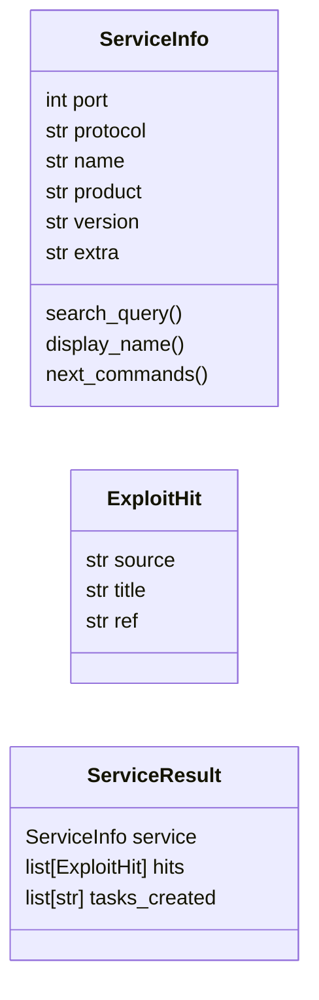

# `cli.exploit_advisor`

> Source: [cli/exploit_advisor.py:1](../../cli/exploit_advisor.py#L1) | language `py` | coverage 91.7% | [API index](../index.md)

Exploit advisor: connects nmap scan results to exploit search and next-step commands.

Two responsibilities:
  1. Parse nmap XML files and extract structured (port, service, version) tuples.
  2. Map each service to the LazyOwn commands most likely to advance the engagement.

Pure module — no imports from lazyown.py or lazyc2.py.

## Contents

- **Classes:** [`ServiceInfo`](#serviceinfo), [`ExploitHit`](#exploithit), [`ServiceResult`](#serviceresult)
- **Functions:** [`parse_nmap_xml`](#parse_nmap_xml), [`find_nmap_xml`](#find_nmap_xml), [`print_exploit_summary`](#print_exploit_summary), [`save_ss_results`](#save_ss_results), [`inject_exploit_tasks`](#inject_exploit_tasks)

## Type Diagram



## Call Graph

Solid arrows stay in this module, dashed arrows leave it.


## Classes

<a id="serviceinfo"></a>

### `ServiceInfo`

`class` `dataclass` | [cli/exploit_advisor.py:111](../../cli/exploit_advisor.py#L111)

Decorators: `@dataclass`

```python
class ServiceInfo
```

One open port with its service fingerprint.

**Attributes**

| Name | Type | Default | Description |
|---|---|---|---|
| [`port`](#serviceinfo-port) | `int` |  |  |
| [`protocol`](#serviceinfo-protocol) | `str` |  |  |
| [`name`](#serviceinfo-name) | `str` |  |  |
| [`product`](#serviceinfo-product) | `str` |  |  |
| [`version`](#serviceinfo-version) | `str` |  |  |
| [`extra`](#serviceinfo-extra) | `str` | `''` |  |

**Members**

| Member | Kind | Summary |
|---|---|---|
| [`search_query`](#serviceinfo-search_query) | property | Best query string for searchsploit / NVD. |
| [`display_name`](#serviceinfo-display_name) | property |  |
| [`next_commands`](#serviceinfo-next_commands) | method | Return (command, reason) pairs recommended for this service. |

<a id="serviceinfo-search_query"></a>

#### `ServiceInfo.search_query`

`property` | [cli/exploit_advisor.py:122](../../cli/exploit_advisor.py#L122)

Decorators: `@property`

```python
def search_query(self) -> str
```

Best query string for searchsploit / NVD.

**Returns:** `str`

<a id="serviceinfo-display_name"></a>

#### `ServiceInfo.display_name`

`property` | [cli/exploit_advisor.py:128](../../cli/exploit_advisor.py#L128)

Decorators: `@property`

```python
def display_name(self) -> str
```

**Returns:** `str`

<a id="serviceinfo-next_commands"></a>

#### `ServiceInfo.next_commands`

`method` | [cli/exploit_advisor.py:132](../../cli/exploit_advisor.py#L132)

```python
def next_commands(self) -> list[tuple[str, str]]
```

Return (command, reason) pairs recommended for this service.

**Returns:** `list[tuple[str, str]]`

---

<a id="exploithit"></a>

### `ExploitHit`

`class` `dataclass` | [cli/exploit_advisor.py:144](../../cli/exploit_advisor.py#L144)

Decorators: `@dataclass`

```python
class ExploitHit
```

One exploit result from any source.

**Attributes**

| Name | Type | Default | Description |
|---|---|---|---|
| [`source`](#exploithit-source) | `str` |  |  |
| [`title`](#exploithit-title) | `str` |  |  |
| [`ref`](#exploithit-ref) | `str` | `''` |  |

---

<a id="serviceresult"></a>

### `ServiceResult`

`class` `dataclass` | [cli/exploit_advisor.py:153](../../cli/exploit_advisor.py#L153)

Decorators: `@dataclass`

```python
class ServiceResult
```

Aggregated results for one service after exploit search.

**Attributes**

| Name | Type | Default | Description |
|---|---|---|---|
| [`service`](#serviceresult-service) | `ServiceInfo` |  |  |
| [`hits`](#serviceresult-hits) | `list[ExploitHit]` | `field(default_factory=list)` |  |
| [`tasks_created`](#serviceresult-tasks_created) | `list[str]` | `field(default_factory=list)` |  |

---

## Functions

<a id="parse_nmap_xml"></a>

### `parse_nmap_xml`

`function` | [cli/exploit_advisor.py:164](../../cli/exploit_advisor.py#L164)

```python
def parse_nmap_xml(path: str) -> list[ServiceInfo]
```

Extract open services from a nmap XML file.

**Parameters**

| Name | Type | Default | Description |
|---|---|---|---|
| `path` | `str` |  | Path to the .nmap.xml file. |

**Returns:** `list[ServiceInfo]` - List of ServiceInfo for every open TCP/UDP port found.

*Calls:* [`ServiceInfo`](#serviceinfo)

*Called by:* [`ReconCommandSet.do_ss`](cli.commands.recon.py.md#reconcommandset-do_ss)

---

<a id="find_nmap_xml"></a>

### `find_nmap_xml`

`function` | [cli/exploit_advisor.py:203](../../cli/exploit_advisor.py#L203)

```python
def find_nmap_xml(rhost: str, sessions_dir: str = 'sessions') -> list[str]
```

Return all nmap XML files for a given rhost, newest first.

**Parameters**

| Name | Type | Default | Description |
|---|---|---|---|
| `rhost` | `str` |  | Target IP to filter on. |
| `sessions_dir` | `str` | `'sessions'` | Path to the sessions directory. |

**Returns:** `list[str]` - Sorted list of paths (newest first).

*Called by:* [`ReconCommandSet.do_ss`](cli.commands.recon.py.md#reconcommandset-do_ss)

---

<a id="print_exploit_summary"></a>

### `print_exploit_summary`

`function` | [cli/exploit_advisor.py:222](../../cli/exploit_advisor.py#L222)

```python
def print_exploit_summary(results: list[ServiceResult], rhost: str = '') -> None
```

Print a rich summary table of exploit search results with next-step commands.

**Parameters**

| Name | Type | Default | Description |
|---|---|---|---|
| `results` | `list[ServiceResult]` |  | List of ServiceResult (one per service searched). |
| `rhost` | `str` | `''` | Target IP for display purposes. |

*Called by:* [`ReconCommandSet.do_ss`](cli.commands.recon.py.md#reconcommandset-do_ss)

---

<a id="save_ss_results"></a>

### `save_ss_results`

`function` | [cli/exploit_advisor.py:296](../../cli/exploit_advisor.py#L296)

```python
def save_ss_results(results: list[ServiceResult], rhost: str, sessions_dir: str = 'sessions') -> str
```

Save exploit search results to sessions/ss_results_<rhost>.json.

**Parameters**

| Name | Type | Default | Description |
|---|---|---|---|
| `results` | `list[ServiceResult]` |  | List of ServiceResult to persist. |
| `rhost` | `str` |  | Target IP (used in filename). |
| `sessions_dir` | `str` | `'sessions'` | Path to sessions directory. |

**Returns:** `str` - Path to the written file.

*Called by:* [`ReconCommandSet.do_ss`](cli.commands.recon.py.md#reconcommandset-do_ss)

---

<a id="inject_exploit_tasks"></a>

### `inject_exploit_tasks`

`function` | [cli/exploit_advisor.py:338](../../cli/exploit_advisor.py#L338)

```python
def inject_exploit_tasks(results: list[ServiceResult], rhost: str, tasks_path: str = 'sessions/tasks.json') -> int
```

Append one task per service with significant exploit hits to tasks.json.

**Parameters**

| Name | Type | Default | Description |
|---|---|---|---|
| `results` | `list[ServiceResult]` |  | Results from exploit search. |
| `rhost` | `str` |  | Target IP for task context. |
| `tasks_path` | `str` | `'sessions/tasks.json'` | Path to tasks.json. |

**Returns:** `int` - Number of tasks created.

*Called by:* [`ReconCommandSet.do_ss`](cli.commands.recon.py.md#reconcommandset-do_ss)

---
