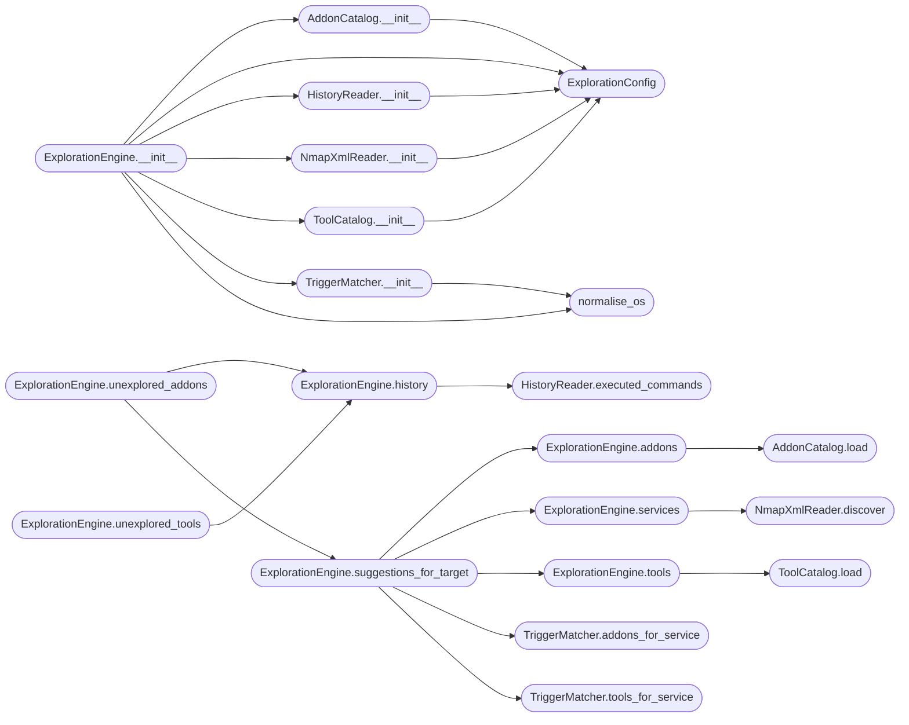

# `cli.exploration`

> Source: [cli/exploration.py:1](../../cli/exploration.py#L1) | language `py` | coverage 100.0% | [API index](../index.md)

Exploration engine: trigger and OS aware addon/tool matching.

This module is the single source of truth for two new operator-facing
features:

1. Filtering ``lazyaddons/*.yaml`` and ``tools/*.tool`` entries by the
   nmap services discovered in ``sessions/scan_*.nmap.xml`` and the
   victim platform recorded in ``payload.json`` (``os_id`` / ``platform``).
2. Computing an exploration coverage report consumed by the ``explore``
   shell command, `[`suggest_next`](cli.graph_advisor.py.md#graphadvisor-suggest_next)`, and ``recommend_next``.

Design (SOLID):

- `[`ExplorationConfig`](#explorationconfig)` centralises every magic value (default paths,
  glob patterns, MITRE platform whitelist, OS aliases).
- `[`DiscoveredService`](#discoveredservice)`, `[`AddonEntry`](#addonentry)`, `[`ToolEntry`](#toolentry)` are immutable
  value objects.
- `[`NmapXmlReader`](#nmapxmlreader)` is the only piece that touches XML.
- `[`AddonCatalog`](#addoncatalog)` and `[`ToolCatalog`](#toolcatalog)` each have one reason to change
  (their respective on-disk schema).
- `[`TriggerMatcher`](#triggermatcher)` is a pure ranking primitive.
- `[`ExplorationEngine`](#explorationengine)` composes the pieces above and exposes the small
  public surface used by the CLI, MCP layer, and tests.

The module has zero coupling to ``cmd2``, ``flask``, ``rich`` or
``lazyown.py`` and every public method returns plain Python types so it
can be reused inside the shell, the MCP server, or the Textual TUI
without modification.

## Contents

- **Classes:** [`ExplorationConfig`](#explorationconfig), [`DiscoveredService`](#discoveredservice), [`AddonEntry`](#addonentry), [`ToolEntry`](#toolentry), [`CoverageReport`](#coveragereport), [`NmapXmlReader`](#nmapxmlreader), [`AddonCatalog`](#addoncatalog), [`ToolCatalog`](#toolcatalog), [`TriggerMatcher`](#triggermatcher), [`HistoryReader`](#historyreader), [`ExplorationEngine`](#explorationengine)
- **Functions:** [`resolve_current_os`](#resolve_current_os), [`normalise_os`](#normalise_os), [`normalise_trigger`](#normalise_trigger)
- **Constants:** [`MITRE_PLATFORMS`](#mitre_platforms), [`ANY_OS`](#any_os), [`ALLOWED_OS_VALUES`](#allowed_os_values), [`OS_ID_TO_PLATFORM`](#os_id_to_platform), [`TRIGGER_WILDCARD`](#trigger_wildcard)

## Type Diagram

```mermaid
classDiagram
    direction LR
    class ExplorationConfig
    ExplorationConfig : str sessions_dir
    ExplorationConfig : str lazyaddons_dir
    ExplorationConfig : str tools_dir
    ExplorationConfig : str nmap_xml_glob
    ExplorationConfig : str history_csv
    ExplorationConfig : tuple[str, ] history_command_columns
    ExplorationConfig : str default_os
    ExplorationConfig : tuple[str, ] default_trigger
    ExplorationConfig : int coverage_decimals
    class DiscoveredService
    DiscoveredService : str host
    DiscoveredService : int port
    DiscoveredService : str proto
    DiscoveredService : str service
    DiscoveredService : str product
    DiscoveredService : str version
    DiscoveredService : label()
    class AddonEntry
    AddonEntry : str name
    AddonEntry : str description
    AddonEntry : str category
    AddonEntry : str addon_os
    AddonEntry : tuple[str, ] trigger
    AddonEntry : str repo_url
    AddonEntry : bool enabled
    AddonEntry : str source_path
    class ToolEntry
    ToolEntry : str name
    ToolEntry : str description
    ToolEntry : str category
    ToolEntry : str tool_os
    ToolEntry : tuple[str, ] trigger
    ToolEntry : bool active
    ToolEntry : str source_path
    class CoverageReport
    CoverageReport : int services_total
    CoverageReport : int services_with_run_command
    CoverageReport : int addons_total
    CoverageReport : int addons_enabled
    CoverageReport : int addons_executed
    CoverageReport : int tools_total
    CoverageReport : int tools_executed
    CoverageReport : int history_commands
    CoverageReport : service_coverage()
    CoverageReport : addon_coverage()
    CoverageReport : tool_coverage()
    class NmapXmlReader
    NmapXmlReader : __init__()
    NmapXmlReader : discover()
    class AddonCatalog
    AddonCatalog : __init__()
    AddonCatalog : load()
    AddonCatalog : clear_cache()
    class ToolCatalog
    ToolCatalog : __init__()
    ToolCatalog : load()
    ToolCatalog : clear_cache()
    class TriggerMatcher
    TriggerMatcher : __init__()
    TriggerMatcher : addons_for_service()
    TriggerMatcher : tools_for_service()
    class HistoryReader
    HistoryReader : __init__()
    HistoryReader : executed_commands()
    class ExplorationEngine
    ExplorationEngine : __init__()
    ExplorationEngine : services()
    ExplorationEngine : addons()
    ExplorationEngine : tools()
    ExplorationEngine : history()
    ExplorationEngine : suggestions_for_target()
    ExplorationEngine : unexplored_addons()
    ExplorationEngine : unexplored_tools()
    ExplorationEngine : coverage()
```



## Call Graph

Solid arrows stay in this module, dashed arrows leave it.



## Classes

<a id="explorationconfig"></a>

### `ExplorationConfig`

`class` `dataclass` | [cli/exploration.py:68](../../cli/exploration.py#L68)

Decorators: `@dataclass(frozen=True)`

```python
class ExplorationConfig
```

Centralised constants for the exploration engine.

Every path, glob, default value and whitelist lives here so the
engine is fully data-driven and trivially testable.

**Attributes**

| Name | Type | Default | Description |
|---|---|---|---|
| [`sessions_dir`](#explorationconfig-sessions_dir) | `str` | `'sessions'` |  |
| [`lazyaddons_dir`](#explorationconfig-lazyaddons_dir) | `str` | `'lazyaddons'` |  |
| [`tools_dir`](#explorationconfig-tools_dir) | `str` | `'tools'` |  |
| [`nmap_xml_glob`](#explorationconfig-nmap_xml_glob) | `str` | `'scan_*.nmap.xml'` |  |
| [`history_csv`](#explorationconfig-history_csv) | `str` | `'LazyOwn_session_report.csv'` |  |
| [`history_command_columns`](#explorationconfig-history_command_columns) | `tuple[str, ...]` | `('tool', 'command', 'name')` |  |
| [`default_os`](#explorationconfig-default_os) | `str` | `ANY_OS` |  |
| [`default_trigger`](#explorationconfig-default_trigger) | `tuple[str, ...]` | `()` |  |
| [`coverage_decimals`](#explorationconfig-coverage_decimals) | `int` | `1` |  |

---

<a id="discoveredservice"></a>

### `DiscoveredService`

`class` `dataclass` | [cli/exploration.py:87](../../cli/exploration.py#L87)

Decorators: `@dataclass(frozen=True)`

```python
class DiscoveredService
```

A single open port discovered by nmap on a host.

**Attributes**

| Name | Type | Default | Description |
|---|---|---|---|
| [`host`](#discoveredservice-host) | `str` |  |  |
| [`port`](#discoveredservice-port) | `int` |  |  |
| [`proto`](#discoveredservice-proto) | `str` |  |  |
| [`service`](#discoveredservice-service) | `str` |  |  |
| [`product`](#discoveredservice-product) | `str` | `''` |  |
| [`version`](#discoveredservice-version) | `str` | `''` |  |

**Members**

| Member | Kind | Summary |
|---|---|---|
| [`label`](#discoveredservice-label) | property | Return a compact human-readable label such as ``smb:445/tcp``. |

<a id="discoveredservice-label"></a>

#### `DiscoveredService.label`

`property` | [cli/exploration.py:98](../../cli/exploration.py#L98)

Decorators: `@property`

```python
def label(self) -> str
```

Return a compact human-readable label such as ``smb:445/tcp``.

**Returns:** `str`

---

<a id="addonentry"></a>

### `AddonEntry`

`class` `dataclass` | [cli/exploration.py:105](../../cli/exploration.py#L105)

Decorators: `@dataclass(frozen=True)`

```python
class AddonEntry
```

A parsed lazyaddon YAML file with trigger/OS metadata.

**Attributes**

| Name | Type | Default | Description |
|---|---|---|---|
| [`name`](#addonentry-name) | `str` |  |  |
| [`description`](#addonentry-description) | `str` |  |  |
| [`category`](#addonentry-category) | `str` |  |  |
| [`addon_os`](#addonentry-addon_os) | `str` |  |  |
| [`trigger`](#addonentry-trigger) | `tuple[str, ...]` |  |  |
| [`repo_url`](#addonentry-repo_url) | `str` |  |  |
| [`enabled`](#addonentry-enabled) | `bool` |  |  |
| [`source_path`](#addonentry-source_path) | `str` |  |  |

---

<a id="toolentry"></a>

### `ToolEntry`

`class` `dataclass` | [cli/exploration.py:119](../../cli/exploration.py#L119)

Decorators: `@dataclass(frozen=True)`

```python
class ToolEntry
```

A parsed ``.tool`` file from the ``tools/`` directory.

**Attributes**

| Name | Type | Default | Description |
|---|---|---|---|
| [`name`](#toolentry-name) | `str` |  |  |
| [`description`](#toolentry-description) | `str` |  |  |
| [`category`](#toolentry-category) | `str` |  |  |
| [`tool_os`](#toolentry-tool_os) | `str` |  |  |
| [`trigger`](#toolentry-trigger) | `tuple[str, ...]` |  |  |
| [`active`](#toolentry-active) | `bool` |  |  |
| [`source_path`](#toolentry-source_path) | `str` |  |  |

---

<a id="coveragereport"></a>

### `CoverageReport`

`class` `dataclass` | [cli/exploration.py:132](../../cli/exploration.py#L132)

Decorators: `@dataclass(frozen=True)`

```python
class CoverageReport
```

Aggregate exploration metrics for the active engagement.

**Attributes**

| Name | Type | Default | Description |
|---|---|---|---|
| [`services_total`](#coveragereport-services_total) | `int` |  |  |
| [`services_with_run_command`](#coveragereport-services_with_run_command) | `int` |  |  |
| [`addons_total`](#coveragereport-addons_total) | `int` |  |  |
| [`addons_enabled`](#coveragereport-addons_enabled) | `int` |  |  |
| [`addons_executed`](#coveragereport-addons_executed) | `int` |  |  |
| [`tools_total`](#coveragereport-tools_total) | `int` |  |  |
| [`tools_executed`](#coveragereport-tools_executed) | `int` |  |  |
| [`history_commands`](#coveragereport-history_commands) | `int` |  |  |

**Members**

| Member | Kind | Summary |
|---|---|---|
| [`service_coverage`](#coveragereport-service_coverage) | property | Fraction of discovered services with at least one run command. |
| [`addon_coverage`](#coveragereport-addon_coverage) | property | Fraction of enabled addons that have been executed at least once. |
| [`tool_coverage`](#coveragereport-tool_coverage) | property | Fraction of active tools that have been executed at least once. |

<a id="coveragereport-service_coverage"></a>

#### `CoverageReport.service_coverage`

`property` | [cli/exploration.py:145](../../cli/exploration.py#L145)

Decorators: `@property`

```python
def service_coverage(self) -> float
```

Fraction of discovered services with at least one run command.

**Returns:** `float`

<a id="coveragereport-addon_coverage"></a>

#### `CoverageReport.addon_coverage`

`property` | [cli/exploration.py:153](../../cli/exploration.py#L153)

Decorators: `@property`

```python
def addon_coverage(self) -> float
```

Fraction of enabled addons that have been executed at least once.

**Returns:** `float`

<a id="coveragereport-tool_coverage"></a>

#### `CoverageReport.tool_coverage`

`property` | [cli/exploration.py:161](../../cli/exploration.py#L161)

Decorators: `@property`

```python
def tool_coverage(self) -> float
```

Fraction of active tools that have been executed at least once.

**Returns:** `float`

---

<a id="nmapxmlreader"></a>

### `NmapXmlReader`

`class` | [cli/exploration.py:169](../../cli/exploration.py#L169)

```python
class NmapXmlReader
```

Read discovered services from nmap XML files in ``sessions/``.

Falls back to the stdlib XML parser to avoid coupling to ``libnmap``
which is only an optional runtime dependency in tests.

**Members**

| Member | Kind | Summary |
|---|---|---|
| [`__init__`](#nmapxmlreader-__init__) | constructor | Store the configuration used to locate the nmap XML directory. |
| [`discover`](#nmapxmlreader-discover) | method | Return every open service across every nmap XML in sessions. |

<a id="nmapxmlreader-__init__"></a>

#### `NmapXmlReader.__init__`

`constructor` | [cli/exploration.py:176](../../cli/exploration.py#L176)

```python
def __init__(self, config: ExplorationConfig | None = None) -> None
```

Store the configuration used to locate the nmap XML directory.

**Parameters**

| Name | Type | Default | Description |
|---|---|---|---|
| `config` | `ExplorationConfig \| None` | `None` |  |

*Calls:* [`ExplorationConfig`](#explorationconfig)

*Called by:* [`ExplorationEngine.__init__`](#explorationengine-__init__)

<a id="nmapxmlreader-discover"></a>

#### `NmapXmlReader.discover`

`method` | [cli/exploration.py:181](../../cli/exploration.py#L181)

```python
def discover(self, target: str | None = None) -> list[DiscoveredService]
```

Return every open service across every nmap XML in sessions.

**Parameters**

| Name | Type | Default | Description |
|---|---|---|---|
| `target` | `str \| None` | `None` | Optional rhost filter. When provided, only files that contain the target in their filename are read. |

**Returns:** `list[DiscoveredService]` - A flat list of [`DiscoveredService`](#discoveredservice) instances.

*Called by:* [`ExplorationEngine.services`](#explorationengine-services)

---

<a id="addoncatalog"></a>

### `AddonCatalog`

`class` | [cli/exploration.py:252](../../cli/exploration.py#L252)

```python
class AddonCatalog
```

Load every ``lazyaddons/*.yaml`` exposing ``os`` and `[`trigger`](#addonentry-trigger)`.

Missing fields default to ``os: any`` and ``trigger: []`` so existing
addons continue to load without modification. Parsed entries are
cached per-process by ``(path, mtime)`` so repeated ``load()`` calls
inside long-lived sessions (CLI shell, MCP server) re-parse only the
YAML files that actually changed on disk.

**Members**

| Member | Kind | Summary |
|---|---|---|
| [`__init__`](#addoncatalog-__init__) | constructor | Store the configuration used to locate the addons directory. |
| [`load`](#addoncatalog-load) | method | Return every parseable addon as an [`AddonEntry`](#addonentry). |
| [`clear_cache`](#addoncatalog-clear_cache) | classmethod | Drop the per-process addon cache (mainly used by tests). |

<a id="addoncatalog-__init__"></a>

#### `AddonCatalog.__init__`

`constructor` | [cli/exploration.py:264](../../cli/exploration.py#L264)

```python
def __init__(self, config: ExplorationConfig | None = None) -> None
```

Store the configuration used to locate the addons directory.

**Parameters**

| Name | Type | Default | Description |
|---|---|---|---|
| `config` | `ExplorationConfig \| None` | `None` |  |

*Calls:* [`ExplorationConfig`](#explorationconfig)

*Called by:* [`ExplorationEngine.__init__`](#explorationengine-__init__)

<a id="addoncatalog-load"></a>

#### `AddonCatalog.load`

`method` | [cli/exploration.py:269](../../cli/exploration.py#L269)

```python
def load(self) -> list[AddonEntry]
```

Return every parseable addon as an [`AddonEntry`](#addonentry).

**Returns:** `list[AddonEntry]`

*Called by:* [`ExplorationEngine.addons`](#explorationengine-addons)

<a id="addoncatalog-clear_cache"></a>

#### `AddonCatalog.clear_cache`

`classmethod` | [cli/exploration.py:299](../../cli/exploration.py#L299)

Decorators: `@classmethod`

```python
def clear_cache(cls) -> None
```

Drop the per-process addon cache (mainly used by tests).

---

<a id="toolcatalog"></a>

### `ToolCatalog`

`class` | [cli/exploration.py:333](../../cli/exploration.py#L333)

```python
class ToolCatalog
```

Load every ``tools/*.tool`` exposing ``os`` and `[`trigger`](#addonentry-trigger)`.

The ``.tool`` schema already carries a `[`trigger`](#addonentry-trigger)` list; this catalog
adds OS awareness with a ``any`` default so the legacy files keep
working. Parsed entries are cached per-process by ``(path, mtime)``
so repeated ``load()`` calls only re-parse changed files.

**Members**

| Member | Kind | Summary |
|---|---|---|
| [`__init__`](#toolcatalog-__init__) | constructor | Store the configuration used to locate the tools directory. |
| [`load`](#toolcatalog-load) | method | Return every parseable ``.tool`` file as a [`ToolEntry`](#toolentry). |
| [`clear_cache`](#toolcatalog-clear_cache) | classmethod | Drop the per-process tool cache (mainly used by tests). |

<a id="toolcatalog-__init__"></a>

#### `ToolCatalog.__init__`

`constructor` | [cli/exploration.py:344](../../cli/exploration.py#L344)

```python
def __init__(self, config: ExplorationConfig | None = None) -> None
```

Store the configuration used to locate the tools directory.

**Parameters**

| Name | Type | Default | Description |
|---|---|---|---|
| `config` | `ExplorationConfig \| None` | `None` |  |

*Calls:* [`ExplorationConfig`](#explorationconfig)

*Called by:* [`ExplorationEngine.__init__`](#explorationengine-__init__)

<a id="toolcatalog-load"></a>

#### `ToolCatalog.load`

`method` | [cli/exploration.py:349](../../cli/exploration.py#L349)

```python
def load(self) -> list[ToolEntry]
```

Return every parseable ``.tool`` file as a [`ToolEntry`](#toolentry).

**Returns:** `list[ToolEntry]`

*Called by:* [`ExplorationEngine.tools`](#explorationengine-tools)

<a id="toolcatalog-clear_cache"></a>

#### `ToolCatalog.clear_cache`

`classmethod` | [cli/exploration.py:379](../../cli/exploration.py#L379)

Decorators: `@classmethod`

```python
def clear_cache(cls) -> None
```

Drop the per-process tool cache (mainly used by tests).

---

<a id="triggermatcher"></a>

### `TriggerMatcher`

`class` | [cli/exploration.py:410](../../cli/exploration.py#L410)

```python
class TriggerMatcher
```

Match addons and tools against discovered services + current OS.

**Members**

| Member | Kind | Summary |
|---|---|---|
| [`__init__`](#triggermatcher-__init__) | constructor | Store the platform used to filter incompatible entries. |
| [`addons_for_service`](#triggermatcher-addons_for_service) | method | Return addons whose trigger and OS match the given service. |
| [`tools_for_service`](#triggermatcher-tools_for_service) | method | Return active tools whose trigger and OS match the service. |

<a id="triggermatcher-__init__"></a>

#### `TriggerMatcher.__init__`

`constructor` | [cli/exploration.py:413](../../cli/exploration.py#L413)

```python
def __init__(self, current_os: str = ANY_OS) -> None
```

Store the platform used to filter incompatible entries.

**Parameters**

| Name | Type | Default | Description |
|---|---|---|---|
| `current_os` | `str` | `ANY_OS` |  |

*Calls:* [`normalise_os`](#normalise_os)

*Called by:* [`ExplorationEngine.__init__`](#explorationengine-__init__)

<a id="triggermatcher-addons_for_service"></a>

#### `TriggerMatcher.addons_for_service`

`method` | [cli/exploration.py:418](../../cli/exploration.py#L418)

```python
def addons_for_service(self, service: DiscoveredService, addons: Sequence[AddonEntry]) -> list[AddonEntry]
```

Return addons whose trigger and OS match the given service.

**Parameters**

| Name | Type | Default | Description |
|---|---|---|---|
| `service` | `DiscoveredService` |  |  |
| `addons` | `Sequence[AddonEntry]` |  |  |

**Returns:** `list[AddonEntry]`

*Called by:* [`ExplorationEngine.coverage`](#explorationengine-coverage), [`ExplorationEngine.suggestions_for_target`](#explorationengine-suggestions_for_target)

<a id="triggermatcher-tools_for_service"></a>

#### `TriggerMatcher.tools_for_service`

`method` | [cli/exploration.py:435](../../cli/exploration.py#L435)

```python
def tools_for_service(self, service: DiscoveredService, tools: Sequence[ToolEntry]) -> list[ToolEntry]
```

Return active tools whose trigger and OS match the service.

**Parameters**

| Name | Type | Default | Description |
|---|---|---|---|
| `service` | `DiscoveredService` |  |  |
| `tools` | `Sequence[ToolEntry]` |  |  |

**Returns:** `list[ToolEntry]`

*Called by:* [`ExplorationEngine.coverage`](#explorationengine-coverage), [`ExplorationEngine.suggestions_for_target`](#explorationengine-suggestions_for_target)

---

<a id="historyreader"></a>

### `HistoryReader`

`class` | [cli/exploration.py:470](../../cli/exploration.py#L470)

```python
class HistoryReader
```

Read previously executed commands from the session CSV transcript.

**Members**

| Member | Kind | Summary |
|---|---|---|
| [`__init__`](#historyreader-__init__) | constructor | Store the configuration used to locate the transcript file. |
| [`executed_commands`](#historyreader-executed_commands) | method | Return the set of unique tool/command names already run. |

<a id="historyreader-__init__"></a>

#### `HistoryReader.__init__`

`constructor` | [cli/exploration.py:473](../../cli/exploration.py#L473)

```python
def __init__(self, config: ExplorationConfig | None = None) -> None
```

Store the configuration used to locate the transcript file.

**Parameters**

| Name | Type | Default | Description |
|---|---|---|---|
| `config` | `ExplorationConfig \| None` | `None` |  |

*Calls:* [`ExplorationConfig`](#explorationconfig)

*Called by:* [`ExplorationEngine.__init__`](#explorationengine-__init__)

<a id="historyreader-executed_commands"></a>

#### `HistoryReader.executed_commands`

`method` | [cli/exploration.py:478](../../cli/exploration.py#L478)

```python
def executed_commands(self) -> set[str]
```

Return the set of unique tool/command names already run.

**Returns:** `set[str]`

*Called by:* [`ExplorationEngine.history`](#explorationengine-history)

---

<a id="explorationengine"></a>

### `ExplorationEngine`

`class` | [cli/exploration.py:502](../../cli/exploration.py#L502)

```python
class ExplorationEngine
```

Compose nmap + addons + tools + history into a coverage view.

This is the entry point used by `[`do_explore`](cli.commands.misc_migrated.py.md#miscmigratedcommandset-do_explore)`, `[`do_suggest_next`](cli.commands.misc_migrated.py.md#miscmigratedcommandset-do_suggest_next)`
and `[`do_recommend_next`](cli.commands.misc_migrated.py.md#miscmigratedcommandset-do_recommend_next)`. It does no I/O on its own — every read is
delegated to a single-responsibility collaborator.

**Members**

| Member | Kind | Summary |
|---|---|---|
| [`__init__`](#explorationengine-__init__) | constructor | Wire collaborators together using the supplied configuration. |
| [`services`](#explorationengine-services) | method | Return the discovered services for the engagement. |
| [`addons`](#explorationengine-addons) | method | Return the parsed lazyaddon catalogue. |
| [`tools`](#explorationengine-tools) | method | Return the parsed ``.tool`` catalogue. |
| [`history`](#explorationengine-history) | method | Return the set of already-executed command names. |
| [`suggestions_for_target`](#explorationengine-suggestions_for_target) | method | Group matching addons and tools by service for a target. |
| [`unexplored_addons`](#explorationengine-unexplored_addons) | method | Return addons triggered by the scan that have never been run. |
| [`unexplored_tools`](#explorationengine-unexplored_tools) | method | Return tools triggered by the scan that have never been run. |
| [`coverage`](#explorationengine-coverage) | method | Return an aggregate [`CoverageReport`](#coveragereport) for the engagement. |

<a id="explorationengine-__init__"></a>

#### `ExplorationEngine.__init__`

`constructor` | [cli/exploration.py:510](../../cli/exploration.py#L510)

```python
def __init__(self, config: ExplorationConfig | None = None, current_os: str = ANY_OS) -> None
```

Wire collaborators together using the supplied configuration.

**Parameters**

| Name | Type | Default | Description |
|---|---|---|---|
| `config` | `ExplorationConfig \| None` | `None` |  |
| `current_os` | `str` | `ANY_OS` |  |

*Calls:* [`AddonCatalog.__init__`](#addoncatalog-__init__), [`ExplorationConfig`](#explorationconfig), [`HistoryReader.__init__`](#historyreader-__init__), [`NmapXmlReader.__init__`](#nmapxmlreader-__init__), [`ToolCatalog.__init__`](#toolcatalog-__init__), [`TriggerMatcher.__init__`](#triggermatcher-__init__), [`normalise_os`](#normalise_os)

*Called by:* [`MiscMigratedCommandSet.do_explore`](cli.commands.misc_migrated.py.md#miscmigratedcommandset-do_explore), [`MiscMigratedCommandSet.do_prev`](cli.commands.misc_migrated.py.md#miscmigratedcommandset-do_prev), [`MiscMigratedCommandSet.do_suggest_next`](cli.commands.misc_migrated.py.md#miscmigratedcommandset-do_suggest_next)

<a id="explorationengine-services"></a>

#### `ExplorationEngine.services`

`method` | [cli/exploration.py:525](../../cli/exploration.py#L525)

```python
def services(self, target: str | None = None) -> list[DiscoveredService]
```

Return the discovered services for the engagement.

**Parameters**

| Name | Type | Default | Description |
|---|---|---|---|
| `target` | `str \| None` | `None` |  |

**Returns:** `list[DiscoveredService]`

*Calls:* [`NmapXmlReader.discover`](#nmapxmlreader-discover)

*Called by:* [`ExplorationEngine.coverage`](#explorationengine-coverage), [`ExplorationEngine.suggestions_for_target`](#explorationengine-suggestions_for_target), [`render_exploration`](cli.exploration_view.py.md#render_exploration), [`build_recon_plan`](cli.recon_plan.py.md#build_recon_plan)

<a id="explorationengine-addons"></a>

#### `ExplorationEngine.addons`

`method` | [cli/exploration.py:530](../../cli/exploration.py#L530)

```python
def addons(self) -> list[AddonEntry]
```

Return the parsed lazyaddon catalogue.

**Returns:** `list[AddonEntry]`

*Calls:* [`AddonCatalog.load`](#addoncatalog-load)

*Called by:* [`ExplorationEngine.coverage`](#explorationengine-coverage), [`ExplorationEngine.suggestions_for_target`](#explorationengine-suggestions_for_target)

<a id="explorationengine-tools"></a>

#### `ExplorationEngine.tools`

`method` | [cli/exploration.py:535](../../cli/exploration.py#L535)

```python
def tools(self) -> list[ToolEntry]
```

Return the parsed ``.tool`` catalogue.

**Returns:** `list[ToolEntry]`

*Calls:* [`ToolCatalog.load`](#toolcatalog-load)

*Called by:* [`ExplorationEngine.coverage`](#explorationengine-coverage), [`ExplorationEngine.suggestions_for_target`](#explorationengine-suggestions_for_target), [`install_external_tools`](install.sh.md#install_external_tools)

<a id="explorationengine-history"></a>

#### `ExplorationEngine.history`

`method` | [cli/exploration.py:540](../../cli/exploration.py#L540)

```python
def history(self) -> set[str]
```

Return the set of already-executed command names.

**Returns:** `set[str]`

*Calls:* [`HistoryReader.executed_commands`](#historyreader-executed_commands)

*Called by:* [`MiscMigratedCommandSet.do_explore`](cli.commands.misc_migrated.py.md#miscmigratedcommandset-do_explore), [`MiscMigratedCommandSet.do_prev`](cli.commands.misc_migrated.py.md#miscmigratedcommandset-do_prev), [`ExplorationEngine.coverage`](#explorationengine-coverage), [`ExplorationEngine.unexplored_addons`](#explorationengine-unexplored_addons), [`ExplorationEngine.unexplored_tools`](#explorationengine-unexplored_tools), [`build_recon_plan`](cli.recon_plan.py.md#build_recon_plan)

<a id="explorationengine-suggestions_for_target"></a>

#### `ExplorationEngine.suggestions_for_target`

`method` | [cli/exploration.py:545](../../cli/exploration.py#L545)

```python
def suggestions_for_target(self, target: str | None = None) -> dict[str, dict[str, list[AddonEntry | ToolEntry]]]
```

Group matching addons and tools by service for a target.

**Parameters**

| Name | Type | Default | Description |
|---|---|---|---|
| `target` | `str \| None` | `None` |  |

**Returns:** `dict[str, dict[str, list[AddonEntry | ToolEntry]]]` - Mapping ``service.label -> {"addons": [...], "tools": [...]}``
covering every open port in the latest scan for the target.

*Calls:* [`ExplorationEngine.addons`](#explorationengine-addons), [`ExplorationEngine.services`](#explorationengine-services), [`ExplorationEngine.tools`](#explorationengine-tools), [`TriggerMatcher.addons_for_service`](#triggermatcher-addons_for_service), [`TriggerMatcher.tools_for_service`](#triggermatcher-tools_for_service)

*Called by:* [`ExplorationEngine.unexplored_addons`](#explorationengine-unexplored_addons), [`ExplorationEngine.unexplored_tools`](#explorationengine-unexplored_tools), [`render_exploration`](cli.exploration_view.py.md#render_exploration)

<a id="explorationengine-unexplored_addons"></a>

#### `ExplorationEngine.unexplored_addons`

`method` | [cli/exploration.py:568](../../cli/exploration.py#L568)

```python
def unexplored_addons(self, target: str | None = None) -> list[AddonEntry]
```

Return addons triggered by the scan that have never been run.

**Parameters**

| Name | Type | Default | Description |
|---|---|---|---|
| `target` | `str \| None` | `None` |  |

**Returns:** `list[AddonEntry]`

*Calls:* [`ExplorationEngine.history`](#explorationengine-history), [`ExplorationEngine.suggestions_for_target`](#explorationengine-suggestions_for_target)

*Called by:* [`MiscMigratedCommandSet.do_suggest_next`](cli.commands.misc_migrated.py.md#miscmigratedcommandset-do_suggest_next), [`render_exploration`](cli.exploration_view.py.md#render_exploration), [`build_recon_plan`](cli.recon_plan.py.md#build_recon_plan)

<a id="explorationengine-unexplored_tools"></a>

#### `ExplorationEngine.unexplored_tools`

`method` | [cli/exploration.py:589](../../cli/exploration.py#L589)

```python
def unexplored_tools(self, target: str | None = None) -> list[ToolEntry]
```

Return tools triggered by the scan that have never been run.

**Parameters**

| Name | Type | Default | Description |
|---|---|---|---|
| `target` | `str \| None` | `None` |  |

**Returns:** `list[ToolEntry]`

*Calls:* [`ExplorationEngine.history`](#explorationengine-history), [`ExplorationEngine.suggestions_for_target`](#explorationengine-suggestions_for_target)

*Called by:* [`MiscMigratedCommandSet.do_suggest_next`](cli.commands.misc_migrated.py.md#miscmigratedcommandset-do_suggest_next), [`render_exploration`](cli.exploration_view.py.md#render_exploration), [`build_recon_plan`](cli.recon_plan.py.md#build_recon_plan)

<a id="explorationengine-coverage"></a>

#### `ExplorationEngine.coverage`

`method` | [cli/exploration.py:610](../../cli/exploration.py#L610)

```python
def coverage(self, target: str | None = None) -> CoverageReport
```

Return an aggregate [`CoverageReport`](#coveragereport) for the engagement.

**Parameters**

| Name | Type | Default | Description |
|---|---|---|---|
| `target` | `str \| None` | `None` |  |

**Returns:** `CoverageReport`

*Calls:* [`CoverageReport`](#coveragereport), [`ExplorationEngine.addons`](#explorationengine-addons), [`ExplorationEngine.history`](#explorationengine-history), [`ExplorationEngine.services`](#explorationengine-services), [`ExplorationEngine.tools`](#explorationengine-tools), [`TriggerMatcher.addons_for_service`](#triggermatcher-addons_for_service), [`TriggerMatcher.tools_for_service`](#triggermatcher-tools_for_service)

*Called by:* [`render_exploration`](cli.exploration_view.py.md#render_exploration)

---

## Functions

<a id="resolve_current_os"></a>

### `resolve_current_os`

`function` | [cli/exploration.py:656](../../cli/exploration.py#L656)

```python
def resolve_current_os(payload: Mapping[str, object] | None) -> str
```

Resolve the current victim platform from a payload-like mapping.

The lookup honours both the explicit ``platform`` key (new) and the
legacy numeric ``os_id`` so existing payload.json files keep working.
Unknown or missing values fall back to [`ANY_OS`](#any_os).

**Parameters**

| Name | Type | Default | Description |
|---|---|---|---|
| `payload` | `Mapping[str, object] \| None` |  |  |

**Returns:** `str`

*Called by:* [`MiscMigratedCommandSet.do_explore`](cli.commands.misc_migrated.py.md#miscmigratedcommandset-do_explore), [`MiscMigratedCommandSet.do_prev`](cli.commands.misc_migrated.py.md#miscmigratedcommandset-do_prev), [`MiscMigratedCommandSet.do_suggest_next`](cli.commands.misc_migrated.py.md#miscmigratedcommandset-do_suggest_next)

---

<a id="normalise_os"></a>

### `normalise_os`

`function` | [cli/exploration.py:677](../../cli/exploration.py#L677)

```python
def normalise_os(value: object, default: str) -> str
```

Coerce arbitrary YAML/JSON values to a whitelisted OS string.

**Parameters**

| Name | Type | Default | Description |
|---|---|---|---|
| `value` | `object` |  |  |
| `default` | `str` |  |  |

**Returns:** `str`

*Called by:* [`ExplorationEngine.__init__`](#explorationengine-__init__), [`TriggerMatcher.__init__`](#triggermatcher-__init__), [`LazyOwnShell.register_yaml_plugin`](lazyown.py.md#lazyownshell-register_yaml_plugin)

---

<a id="normalise_trigger"></a>

### `normalise_trigger`

`function` | [cli/exploration.py:690](../../cli/exploration.py#L690)

```python
def normalise_trigger(value: object) -> tuple[str, ...]
```

Coerce arbitrary YAML/JSON values to a tuple of trigger strings.

**Parameters**

| Name | Type | Default | Description |
|---|---|---|---|
| `value` | `object` |  |  |

**Returns:** `tuple[str, ...]`

*Called by:* [`LazyOwnShell.register_yaml_plugin`](lazyown.py.md#lazyownshell-register_yaml_plugin)

---

## Constants

<a id="mitre_platforms"></a>

### `MITRE_PLATFORMS`

`constant` | [cli/exploration.py:43](../../cli/exploration.py#L43)

```python
MITRE_PLATFORMS: frozenset[str]
```

---

<a id="any_os"></a>

### `ANY_OS`

`constant` | [cli/exploration.py:55](../../cli/exploration.py#L55)

```python
ANY_OS: str = 'any'
```

---

<a id="allowed_os_values"></a>

### `ALLOWED_OS_VALUES`

`constant` | [cli/exploration.py:56](../../cli/exploration.py#L56)

```python
ALLOWED_OS_VALUES: frozenset[str] = MITRE_PLATFORMS | {ANY_OS}
```

---

<a id="os_id_to_platform"></a>

### `OS_ID_TO_PLATFORM`

`constant` | [cli/exploration.py:58](../../cli/exploration.py#L58)

```python
OS_ID_TO_PLATFORM: Mapping[int, str] = {1: 'linux', 2: 'windows', 3: 'macos'}
```

---

<a id="trigger_wildcard"></a>

### `TRIGGER_WILDCARD`

`constant` | [cli/exploration.py:64](../../cli/exploration.py#L64)

```python
TRIGGER_WILDCARD: str = 'all'
```

---
