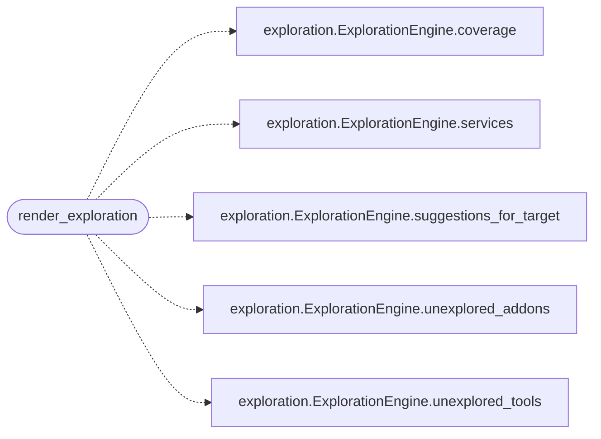

# `cli.exploration_view`

> Source: [cli/exploration_view.py:1](../../cli/exploration_view.py#L1) | language `py` | coverage 100.0% | [API index](../index.md)

Rich-based renderers for the exploration engine.

Keeps the rendering logic out of [`cli.exploration`](cli.exploration.py.md) so the engine
stays pure (no console / no terminal dependency) and trivially unit-
testable. Every renderer here accepts plain dataclasses from the engine
and writes to a `rich.console.Console` instance supplied by the
caller, so the shell, the dashboard TUI and the tests can all share the
same output without coupling.

## Contents

- **Functions:** [`render_exploration`](#render_exploration)

## Call Graph

Solid arrows stay in this module, dashed arrows leave it.



## Functions

<a id="render_exploration"></a>

### `render_exploration`

`function` | [cli/exploration_view.py:39](../../cli/exploration_view.py#L39)

```python
def render_exploration(console: Console, engine: ExplorationEngine, target: str | None, history: set[str]) -> None
```

Render the full ``explore`` view to ``console``.

**Parameters**

| Name | Type | Default | Description |
|---|---|---|---|
| `console` | `Console` |  | Rich console used for output. |
| `engine` | `ExplorationEngine` |  | Pre-configured exploration engine to query. |
| `target` | `str \| None` |  | Optional rhost filter for the nmap scan lookup. |
| `history` | `set[str]` |  | Set of already executed command/tool/addon names. |

*Calls:* [`ExplorationEngine.coverage`](cli.exploration.py.md#explorationengine-coverage), [`ExplorationEngine.services`](cli.exploration.py.md#explorationengine-services), [`ExplorationEngine.suggestions_for_target`](cli.exploration.py.md#explorationengine-suggestions_for_target), [`ExplorationEngine.unexplored_addons`](cli.exploration.py.md#explorationengine-unexplored_addons), [`ExplorationEngine.unexplored_tools`](cli.exploration.py.md#explorationengine-unexplored_tools)

*Called by:* [`MiscMigratedCommandSet.do_explore`](cli.commands.misc_migrated.py.md#miscmigratedcommandset-do_explore)

---
