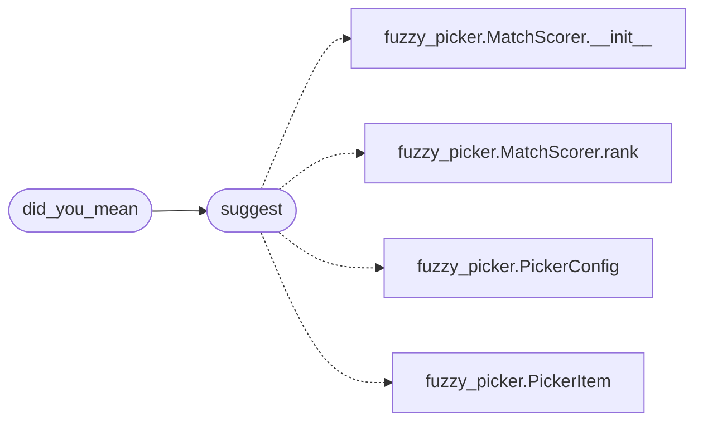

# `cli.fuzzy_match`

> Source: [cli/fuzzy_match.py:1](../../cli/fuzzy_match.py#L1) | language `py` | coverage 100.0% | [API index](../index.md)

Non-interactive fuzzy matching reusing the picker's scorer.

The curses dropdown in [`cli.fuzzy_picker`](cli.fuzzy_picker.py.md) already ranks candidates
with [`MatchScorer`](cli.fuzzy_picker.py.md#matchscorer). Typo correction (did you mean) and headless
suggestion need the same ranking without a terminal UI. This module is
the thin pure adapter: build picker items, rank, return names.

## Contents

- **Classes:** [`FuzzyMatchConfig`](#fuzzymatchconfig)
- **Functions:** [`suggest`](#suggest), [`did_you_mean`](#did_you_mean)
- **Constants:** [`DEFAULT_FUZZY_CONFIG`](#default_fuzzy_config)

## Call Graph

Solid arrows stay in this module, dashed arrows leave it.



## Classes

<a id="fuzzymatchconfig"></a>

### `FuzzyMatchConfig`

`class` `dataclass` | [cli/fuzzy_match.py:18](../../cli/fuzzy_match.py#L18)

Decorators: `@dataclass(frozen=True)`

```python
class FuzzyMatchConfig
```

Centralized knobs for fuzzy suggestion.

**Attributes**

| Name | Type | Default | Description |
|---|---|---|---|
| [`limit`](#fuzzymatchconfig-limit) | `int` | `5` |  |
| [`min_score`](#fuzzymatchconfig-min_score) | `float` | `0.0` |  |

---

## Functions

<a id="suggest"></a>

### `suggest`

`function` | [cli/fuzzy_match.py:28](../../cli/fuzzy_match.py#L28)

```python
def suggest(query: str, candidates: Sequence[str], limit: int = DEFAULT_FUZZY_CONFIG.limit, config: PickerConfig | None = None) -> list[str]
```

Return up to limit candidate names ranked by relevance to query.

**Parameters**

| Name | Type | Default | Description |
|---|---|---|---|
| `query` | `str` |  | Raw operator input, possibly a typo or prefix fragment. |
| `candidates` | `Sequence[str]` |  | Command or phase names to rank. |
| `limit` | `int` | `DEFAULT_FUZZY_CONFIG.limit` | Maximum names returned. |
| `config` | `PickerConfig \| None` | `None` | Picker scoring constants. Defaults to PickerConfig(). |

**Returns:** `list[str]` - Ranked names, strongest first. Empty when nothing scores above zero.

*Calls:* [`MatchScorer.__init__`](cli.fuzzy_picker.py.md#matchscorer-__init__), [`MatchScorer.rank`](cli.fuzzy_picker.py.md#matchscorer-rank), [`PickerConfig`](cli.fuzzy_picker.py.md#pickerconfig), [`PickerItem`](cli.fuzzy_picker.py.md#pickeritem)

*Called by:* [`did_you_mean`](#did_you_mean)

---

<a id="did_you_mean"></a>

### `did_you_mean`

`function` | [cli/fuzzy_match.py:56](../../cli/fuzzy_match.py#L56)

```python
def did_you_mean(query: str, candidates: Sequence[str]) -> str | None
```

Return the single best correction for query or None.

**Parameters**

| Name | Type | Default | Description |
|---|---|---|---|
| `query` | `str` |  | Raw operator input. |
| `candidates` | `Sequence[str]` |  | Names to correct against. |

**Returns:** `str | None` - Best candidate name, or None when no candidate scores.

*Calls:* [`suggest`](#suggest)

---

## Constants

<a id="default_fuzzy_config"></a>

### `DEFAULT_FUZZY_CONFIG`

`constant` | [cli/fuzzy_match.py:25](../../cli/fuzzy_match.py#L25)

```python
DEFAULT_FUZZY_CONFIG = FuzzyMatchConfig()
```

---
