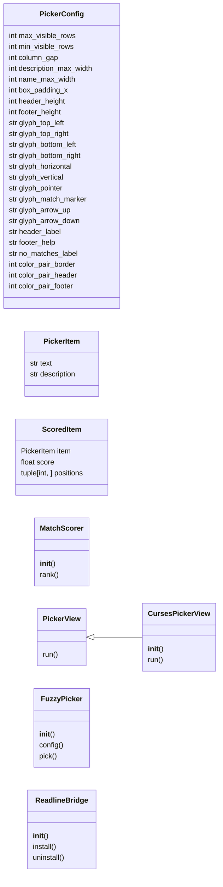
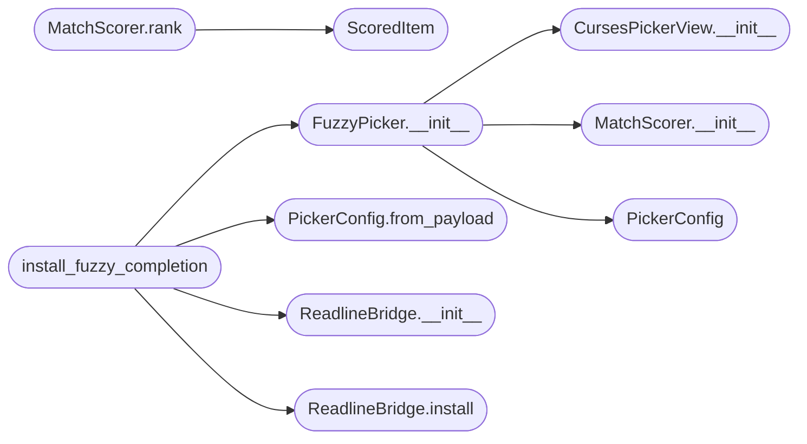

# `cli.fuzzy_picker`

> Source: [cli/fuzzy_picker.py:1](../../cli/fuzzy_picker.py#L1) | language `py` | coverage 68.2% | [API index](../index.md)

Curses-based fuzzy dropdown picker for the LazyOwn interactive shell.

This module is self-contained: it ships a `[`PickerConfig`](#pickerconfig)` with every tunable
constant, a pure scoring primitive, a curses view, an orchestrator that wires
them together, and a thin readline bridge that installs the picker into a
``cmd2`` shell as the Tab-completion display handler.

The module follows SOLID:

- `[`PickerConfig`](#pickerconfig)` centralises every magic value (colors, key codes,
  geometry, glyphs) so callers can override without touching the core.
- `[`MatchScorer`](#matchscorer)` is the only place that knows how to rank a candidate
  against a query (Strategy / Single Responsibility).
- `[`PickerView`](#pickerview)` is an abstract base class; `[`CursesPickerView`](#cursespickerview)` is the only
  concrete realisation but tests can substitute a fake without touching
  curses (Dependency Inversion / Liskov).
- `[`FuzzyPicker`](#fuzzypicker)` orchestrates scorer + view and exposes a small surface.
- `[`ReadlineBridge`](#readlinebridge)` is the integration adaptor with the GNU readline
  display hook contract; it never imports cmd2.
- `[`install_fuzzy_completion`](#install_fuzzy_completion)` is the only public entry point cmd2 callers
  should use.

The picker is invoked on a single Tab press whenever readline reports two or
more candidate completions. With a single candidate, readline's default
behaviour is preserved (auto-insert). The picker honours arrow navigation,
Tab/Enter for selection, Escape/Ctrl-C/Ctrl-G for cancel, and Backspace to
edit the query in-place. Selection is injected back into the readline buffer
through ``readline.insert_text`` so the rest of the framework sees the same
final input string it would have seen with a normal completion.

The picker degrades gracefully when curses cannot initialise (e.g. dumb
terminal, no TTY, no color support) by returning ``None`` and letting
readline's default display take over.

## Contents

- **Classes:** [`PickerConfig`](#pickerconfig), [`PickerItem`](#pickeritem), [`ScoredItem`](#scoreditem), [`MatchScorer`](#matchscorer), [`PickerView`](#pickerview), [`CursesPickerView`](#cursespickerview), [`FuzzyPicker`](#fuzzypicker), [`ReadlineBridge`](#readlinebridge)
- **Functions:** [`install_fuzzy_completion`](#install_fuzzy_completion)

## Type Diagram



## Call Graph

Solid arrows stay in this module, dashed arrows leave it.



## Classes

<a id="pickerconfig"></a>

### `PickerConfig`

`class` `dataclass` | [cli/fuzzy_picker.py:50](../../cli/fuzzy_picker.py#L50)

Decorators: `@dataclass(frozen=True)`

```python
class PickerConfig
```

Centralised constants for the fuzzy picker.

Every magic number / glyph / key code lives here so that operators or
tests can override behaviour without editing the picker core. Instances
are frozen to keep the configuration value-semantics-safe.

**Attributes**

| Name | Type | Default | Description |
|---|---|---|---|
| [`max_visible_rows`](#pickerconfig-max_visible_rows) | `int` | `12` |  |
| [`min_visible_rows`](#pickerconfig-min_visible_rows) | `int` | `3` |  |
| [`column_gap`](#pickerconfig-column_gap) | `int` | `2` |  |
| [`description_max_width`](#pickerconfig-description_max_width) | `int` | `80` |  |
| [`name_max_width`](#pickerconfig-name_max_width) | `int` | `32` |  |
| [`box_padding_x`](#pickerconfig-box_padding_x) | `int` | `1` |  |
| [`header_height`](#pickerconfig-header_height) | `int` | `1` |  |
| [`footer_height`](#pickerconfig-footer_height) | `int` | `1` |  |
| [`glyph_top_left`](#pickerconfig-glyph_top_left) | `str` | `'╔'` |  |
| [`glyph_top_right`](#pickerconfig-glyph_top_right) | `str` | `'╗'` |  |
| [`glyph_bottom_left`](#pickerconfig-glyph_bottom_left) | `str` | `'╚'` |  |
| [`glyph_bottom_right`](#pickerconfig-glyph_bottom_right) | `str` | `'╝'` |  |
| [`glyph_horizontal`](#pickerconfig-glyph_horizontal) | `str` | `'═'` |  |
| [`glyph_vertical`](#pickerconfig-glyph_vertical) | `str` | `'║'` |  |
| [`glyph_pointer`](#pickerconfig-glyph_pointer) | `str` | `'➜'` |  |
| [`glyph_match_marker`](#pickerconfig-glyph_match_marker) | `str` | `'▸'` |  |
| [`glyph_arrow_up`](#pickerconfig-glyph_arrow_up) | `str` | `'▲'` |  |
| [`glyph_arrow_down`](#pickerconfig-glyph_arrow_down) | `str` | `'▼'` |  |
| [`header_label`](#pickerconfig-header_label) | `str` | `'LazyOwn fuzzy completion'` |  |
| [`footer_help`](#pickerconfig-footer_help) | `str` | `'[↑/↓] move [Tab/Enter] select [Esc] cancel [Bksp] edit'` |  |
| [`no_matches_label`](#pickerconfig-no_matches_label) | `str` | `'no matches'` |  |
| [`color_pair_border`](#pickerconfig-color_pair_border) | `int` | `1` |  |
| [`color_pair_header`](#pickerconfig-color_pair_header) | `int` | `2` |  |
| [`color_pair_footer`](#pickerconfig-color_pair_footer) | `int` | `3` |  |
| [`color_pair_item`](#pickerconfig-color_pair_item) | `int` | `4` |  |
| [`color_pair_selected`](#pickerconfig-color_pair_selected) | `int` | `5` |  |
| [`color_pair_highlight`](#pickerconfig-color_pair_highlight) | `int` | `6` |  |
| [`color_pair_description`](#pickerconfig-color_pair_description) | `int` | `7` |  |
| [`color_border_fg`](#pickerconfig-color_border_fg) | `int` | `curses.COLOR_CYAN` |  |
| [`color_header_fg`](#pickerconfig-color_header_fg) | `int` | `curses.COLOR_GREEN` |  |
| [`color_footer_fg`](#pickerconfig-color_footer_fg) | `int` | `curses.COLOR_YELLOW` |  |
| [`color_item_fg`](#pickerconfig-color_item_fg) | `int` | `curses.COLOR_WHITE` |  |
| [`color_selected_fg`](#pickerconfig-color_selected_fg) | `int` | `curses.COLOR_BLACK` |  |
| [`color_selected_bg`](#pickerconfig-color_selected_bg) | `int` | `curses.COLOR_GREEN` |  |
| [`color_highlight_fg`](#pickerconfig-color_highlight_fg) | `int` | `curses.COLOR_MAGENTA` |  |
| [`color_description_fg`](#pickerconfig-color_description_fg) | `int` | `curses.COLOR_BLUE` |  |
| [`key_tab`](#pickerconfig-key_tab) | `int` | `9` |  |
| [`key_enter`](#pickerconfig-key_enter) | `int` | `10` |  |
| [`key_carriage_return`](#pickerconfig-key_carriage_return) | `int` | `13` |  |
| [`key_escape`](#pickerconfig-key_escape) | `int` | `27` |  |
| [`key_ctrl_c`](#pickerconfig-key_ctrl_c) | `int` | `3` |  |
| [`key_ctrl_g`](#pickerconfig-key_ctrl_g) | `int` | `7` |  |
| [`score_exact`](#pickerconfig-score_exact) | `float` | `1.0` |  |
| [`score_prefix`](#pickerconfig-score_prefix) | `float` | `0.9` |  |
| [`score_subsequence`](#pickerconfig-score_subsequence) | `float` | `0.7` |  |
| [`score_substring`](#pickerconfig-score_substring) | `float` | `0.6` |  |
| [`score_similarity_weight`](#pickerconfig-score_similarity_weight) | `float` | `0.55` |  |
| [`score_similarity_floor`](#pickerconfig-score_similarity_floor) | `float` | `0.4` |  |
| [`score_zero`](#pickerconfig-score_zero) | `float` | `0.0` |  |
| [`activation_threshold`](#pickerconfig-activation_threshold) | `int` | `2` |  |

**Members**

| Member | Kind | Summary |
|---|---|---|
| [`from_payload`](#pickerconfig-from_payload) | classmethod | Build a config from a payload.json view, falling back to defaults. |

<a id="pickerconfig-from_payload"></a>

#### `PickerConfig.from_payload`

`classmethod` | [cli/fuzzy_picker.py:117](../../cli/fuzzy_picker.py#L117)

Decorators: `@classmethod`

```python
def from_payload(cls, payload: dict | None) -> PickerConfig
```

Build a config from a payload.json view, falling back to defaults.

Honours an optional ``fuzzy_picker`` mapping inside ``payload.json``
so operators can pin the picker geometry without code changes. Any
unknown key is ignored.

**Parameters**

| Name | Type | Default | Description |
|---|---|---|---|
| `payload` | `dict \| None` |  |  |

**Returns:** `PickerConfig`

*Called by:* [`install_fuzzy_completion`](#install_fuzzy_completion)

---

<a id="pickeritem"></a>

### `PickerItem`

`class` `dataclass` | [cli/fuzzy_picker.py:140](../../cli/fuzzy_picker.py#L140)

Decorators: `@dataclass(frozen=True)`

```python
class PickerItem
```

Single candidate displayed in the picker.

`[`text`](#pickeritem-text)` is the value inserted into the readline buffer on selection.
`[`description`](#pickeritem-description)` is an optional secondary string rendered to the right of
the name; it never participates in matching.

**Attributes**

| Name | Type | Default | Description |
|---|---|---|---|
| [`text`](#pickeritem-text) | `str` |  |  |
| [`description`](#pickeritem-description) | `str` | `''` |  |

---

<a id="scoreditem"></a>

### `ScoredItem`

`class` `dataclass` | [cli/fuzzy_picker.py:153](../../cli/fuzzy_picker.py#L153)

Decorators: `@dataclass(frozen=True)`

```python
class ScoredItem
```

A picker item paired with a relevance score and matched positions.

**Attributes**

| Name | Type | Default | Description |
|---|---|---|---|
| [`item`](#scoreditem-item) | `PickerItem` |  |  |
| [`score`](#scoreditem-score) | `float` |  |  |
| [`positions`](#scoreditem-positions) | `tuple[int, ...]` | `()` |  |

---

<a id="matchscorer"></a>

### `MatchScorer`

`class` | [cli/fuzzy_picker.py:161](../../cli/fuzzy_picker.py#L161)

```python
class MatchScorer
```

Score and rank candidates against a query.

The scorer prefers exact and prefix matches, then ordered-subsequence
matches (the classic fuzzy-finder behaviour), then substring matches,
then ``difflib`` similarity as a graceful floor. Positions of matched
characters are exposed for in-line highlighting in the view.

**Members**

| Member | Kind | Summary |
|---|---|---|
| [`__init__`](#matchscorer-__init__) | constructor |  |
| [`rank`](#matchscorer-rank) | method | Return ``items`` ranked by descending relevance against ``query``. |

<a id="matchscorer-__init__"></a>

#### `MatchScorer.__init__`

`constructor` | [cli/fuzzy_picker.py:170](../../cli/fuzzy_picker.py#L170)

```python
def __init__(self, config: PickerConfig) -> None
```

**Parameters**

| Name | Type | Default | Description |
|---|---|---|---|
| `config` | `PickerConfig` |  |  |

*Called by:* [`suggest`](cli.fuzzy_match.py.md#suggest), [`FuzzyPicker.__init__`](#fuzzypicker-__init__)

<a id="matchscorer-rank"></a>

#### `MatchScorer.rank`

`method` | [cli/fuzzy_picker.py:173](../../cli/fuzzy_picker.py#L173)

```python
def rank(self, items: Sequence[PickerItem], query: str) -> list[ScoredItem]
```

Return ``items`` ranked by descending relevance against ``query``.

An empty query yields every input ranked by its position in the
original sequence so the operator sees a stable list.

**Parameters**

| Name | Type | Default | Description |
|---|---|---|---|
| `items` | `Sequence[PickerItem]` |  |  |
| `query` | `str` |  |  |

**Returns:** `list[ScoredItem]`

*Calls:* [`ScoredItem`](#scoreditem)

*Called by:* [`suggest`](cli.fuzzy_match.py.md#suggest)

---

<a id="pickerview"></a>

### `PickerView`

`class` `abstract` | [cli/fuzzy_picker.py:221](../../cli/fuzzy_picker.py#L221)

```python
class PickerView(ABC)
```

Bases: `ABC`

Subclasses: [`CursesPickerView`](#cursespickerview)

Abstract view contract for a fuzzy picker.

Returning ``None`` signals the user cancelled the picker. Returning a
string is the selected `[`PickerItem.text`](#pickeritem-text)` to be injected into readline.
Tests can substitute a deterministic fake view to drive integration
scenarios.

**Members**

| Member | Kind | Summary |
|---|---|---|
| [`run`](#pickerview-run) | method |  |

<a id="pickerview-run"></a>

#### `PickerView.run`

`method` `abstract` | [cli/fuzzy_picker.py:231](../../cli/fuzzy_picker.py#L231)

Decorators: `@abstractmethod`

```python
def run(self, items: Sequence[PickerItem], initial_query: str) -> str | None
```

**Parameters**

| Name | Type | Default | Description |
|---|---|---|---|
| `items` | `Sequence[PickerItem]` |  |  |
| `initial_query` | `str` |  |  |

**Returns:** `str | None`

---

<a id="cursespickerview"></a>

### `CursesPickerView`

`class` | [cli/fuzzy_picker.py:234](../../cli/fuzzy_picker.py#L234)

```python
class CursesPickerView(PickerView)
```

Bases: [`PickerView`](#pickerview)

Curses-driven implementation of [`PickerView`](#pickerview).

The view paints a bordered dropdown anchored to the cursor location and
consumes keystrokes until the user selects an entry or cancels. All
layout values come from [`PickerConfig`](#pickerconfig) so the geometry can be
retuned by operators without source edits.

**Members**

| Member | Kind | Summary |
|---|---|---|
| [`__init__`](#cursespickerview-__init__) | constructor |  |
| [`run`](#cursespickerview-run) | method |  |

<a id="cursespickerview-__init__"></a>

#### `CursesPickerView.__init__`

`constructor` | [cli/fuzzy_picker.py:243](../../cli/fuzzy_picker.py#L243)

```python
def __init__(self, config: PickerConfig, scorer: MatchScorer) -> None
```

**Parameters**

| Name | Type | Default | Description |
|---|---|---|---|
| `config` | `PickerConfig` |  |  |
| `scorer` | `MatchScorer` |  |  |

*Called by:* [`FuzzyPicker.__init__`](#fuzzypicker-__init__)

<a id="cursespickerview-run"></a>

#### `CursesPickerView.run`

`method` | [cli/fuzzy_picker.py:247](../../cli/fuzzy_picker.py#L247)

```python
def run(self, items: Sequence[PickerItem], initial_query: str) -> str | None
```

**Parameters**

| Name | Type | Default | Description |
|---|---|---|---|
| `items` | `Sequence[PickerItem]` |  |  |
| `initial_query` | `str` |  |  |

**Returns:** `str | None`

---

<a id="fuzzypicker"></a>

### `FuzzyPicker`

`class` | [cli/fuzzy_picker.py:548](../../cli/fuzzy_picker.py#L548)

```python
class FuzzyPicker
```

Top-level orchestrator binding a scorer to a view.

**Members**

| Member | Kind | Summary |
|---|---|---|
| [`__init__`](#fuzzypicker-__init__) | constructor |  |
| [`config`](#fuzzypicker-config) | property |  |
| [`pick`](#fuzzypicker-pick) | method | Return the selected item text or ``None`` on cancel / empty input. |

<a id="fuzzypicker-__init__"></a>

#### `FuzzyPicker.__init__`

`constructor` | [cli/fuzzy_picker.py:551](../../cli/fuzzy_picker.py#L551)

```python
def __init__(self, config: PickerConfig | None = None, view_factory: Callable[[PickerConfig, MatchScorer], PickerView] | None = None) -> None
```

**Parameters**

| Name | Type | Default | Description |
|---|---|---|---|
| `config` | `PickerConfig \| None` | `None` |  |
| `view_factory` | `Callable[[PickerConfig, MatchScorer], PickerView] \| None` | `None` |  |

*Calls:* [`CursesPickerView.__init__`](#cursespickerview-__init__), [`MatchScorer.__init__`](#matchscorer-__init__), [`PickerConfig`](#pickerconfig)

*Called by:* [`install_fuzzy_completion`](#install_fuzzy_completion)

<a id="fuzzypicker-config"></a>

#### `FuzzyPicker.config`

`property` | [cli/fuzzy_picker.py:562](../../cli/fuzzy_picker.py#L562)

Decorators: `@property`

```python
def config(self) -> PickerConfig
```

**Returns:** `PickerConfig`

<a id="fuzzypicker-pick"></a>

#### `FuzzyPicker.pick`

`method` | [cli/fuzzy_picker.py:565](../../cli/fuzzy_picker.py#L565)

```python
def pick(self, items: Sequence[PickerItem], initial_query: str = '') -> str | None
```

Return the selected item text or ``None`` on cancel / empty input.

When there are fewer items than `[`activation_threshold`](#pickerconfig-activation_threshold)` the picker
short-circuits to the single value, preserving readline's normal
single-match auto-insertion semantics for callers that route every
match through the picker.

**Parameters**

| Name | Type | Default | Description |
|---|---|---|---|
| `items` | `Sequence[PickerItem]` |  |  |
| `initial_query` | `str` | `''` |  |

**Returns:** `str | None`

---

<a id="readlinebridge"></a>

### `ReadlineBridge`

`class` | [cli/fuzzy_picker.py:580](../../cli/fuzzy_picker.py#L580)

```python
class ReadlineBridge
```

Bridge a [`FuzzyPicker`](#fuzzypicker) into GNU readline's display hook.

The bridge is the single place that touches the ``readline`` module so
that the rest of the picker code remains testable without a terminal.
Installation is idempotent: calling [`install`](#readlinebridge-install) twice replaces
any previously installed hook, which keeps a single live picker per
shell process.

**Members**

| Member | Kind | Summary |
|---|---|---|
| [`__init__`](#readlinebridge-__init__) | constructor |  |
| [`install`](#readlinebridge-install) | method | Wire the picker into ``readline.set_completion_display_matches_hook``. |
| [`uninstall`](#readlinebridge-uninstall) | method | Remove the readline display hook installed by [`install`](#readlinebridge-install). |

<a id="readlinebridge-__init__"></a>

#### `ReadlineBridge.__init__`

`constructor` | [cli/fuzzy_picker.py:592](../../cli/fuzzy_picker.py#L592)

```python
def __init__(self, picker: FuzzyPicker) -> None
```

**Parameters**

| Name | Type | Default | Description |
|---|---|---|---|
| `picker` | `FuzzyPicker` |  |  |

*Called by:* [`install_fuzzy_completion`](#install_fuzzy_completion)

<a id="readlinebridge-install"></a>

#### `ReadlineBridge.install`

`method` | [cli/fuzzy_picker.py:595](../../cli/fuzzy_picker.py#L595)

```python
def install(self) -> None
```

Wire the picker into ``readline.set_completion_display_matches_hook``.

*Called by:* [`install_fuzzy_completion`](#install_fuzzy_completion)

<a id="readlinebridge-uninstall"></a>

#### `ReadlineBridge.uninstall`

`method` | [cli/fuzzy_picker.py:603](../../cli/fuzzy_picker.py#L603)

```python
def uninstall(self) -> None
```

Remove the readline display hook installed by [`install`](#readlinebridge-install).

---

## Functions

<a id="install_fuzzy_completion"></a>

### `install_fuzzy_completion`

`function` | [cli/fuzzy_picker.py:645](../../cli/fuzzy_picker.py#L645)

```python
def install_fuzzy_completion(shell: Any, payload: dict | None = None, config: PickerConfig | None = None) -> ReadlineBridge | None
```

Install the fuzzy picker into a cmd2 shell.

The function is the single public entry point used by ``lazyown.py``.
Returns the live [`ReadlineBridge`](#readlinebridge) so the caller can later
uninstall the hook (useful in tests). Returns ``None`` when running in
a non-interactive environment where readline is unavailable.

**Parameters**

| Name | Type | Default | Description |
|---|---|---|---|
| `shell` | `Any` |  |  |
| `payload` | `dict \| None` | `None` |  |
| `config` | `PickerConfig \| None` | `None` |  |

**Returns:** `ReadlineBridge | None`

*Calls:* [`FuzzyPicker.__init__`](#fuzzypicker-__init__), [`PickerConfig.from_payload`](#pickerconfig-from_payload), [`ReadlineBridge.__init__`](#readlinebridge-__init__), [`ReadlineBridge.install`](#readlinebridge-install)

---
