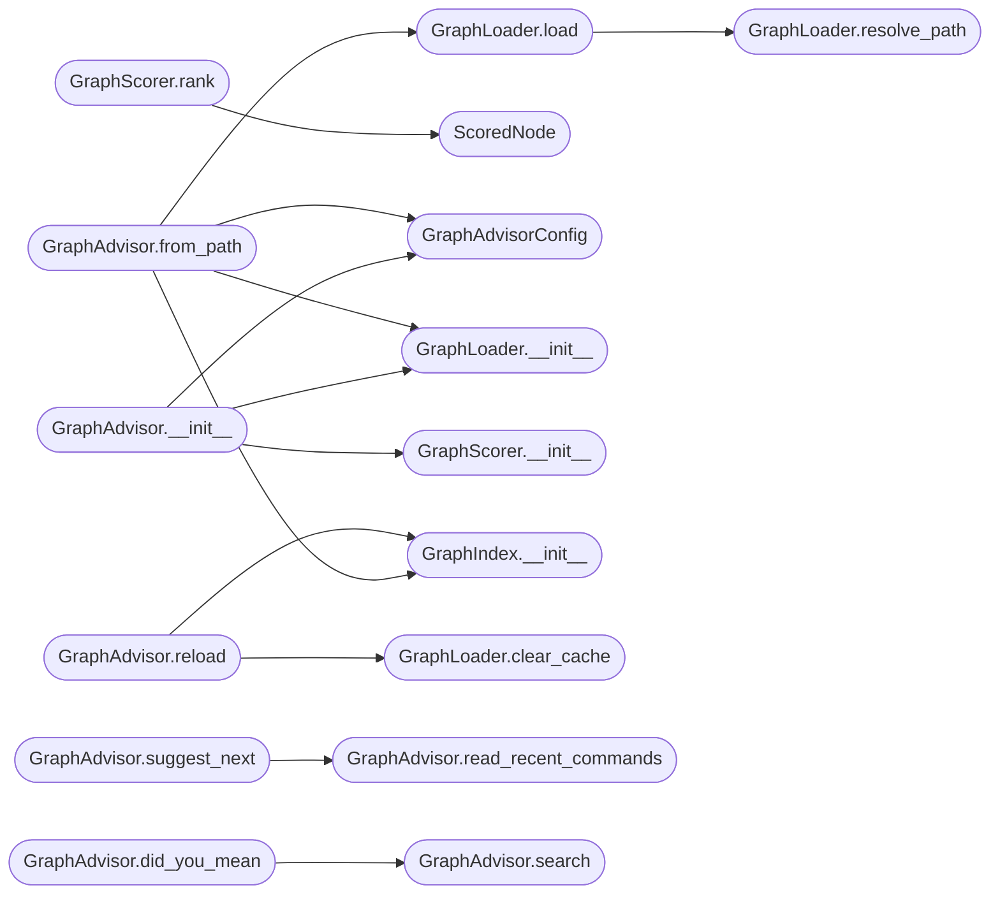

# `cli.graph_advisor`

> Source: [cli/graph_advisor.py:1](../../cli/graph_advisor.py#L1) | language `py` | coverage 39.0% | [API index](../index.md)

Graph-aware advisor backed by the graphify knowledge graph.

This module turns the JSON file produced by ``/graphify`` over the LazyOwn
codebase (``graphify-out/graph_lazyown.json`` or any standard graphify
``graph.json``) into a fast, in-memory advisor that powers two new
user-experience features:

1. **Human operators** get graph-aware CLI commands — ``graph_search``,
   `[`neighbors`](#graphindex-neighbors)`, `[`god_nodes`](#graphadvisor-god_nodes)`, `[`suggest_next`](#graphadvisor-suggest_next)` — and "did you mean ...?"
   recovery when they type an unknown ``do_*`` command. The advisor reads
   the recent ``LazyOwn_session_report.csv`` and recommends the next
   command by walking the graph outward from the most recent nodes.
2. **MCP agents** get four token-budget-aware tools so they can ask the
   knowledge graph for related commands, neighbours, suggestions, and a
   summary without re-reading the full report each turn.

Design (SOLID):

- `[`GraphAdvisorConfig`](#graphadvisorconfig)` centralises every magic value (file paths,
  budgets, scoring weights, glyphs, token-budget caps).
- `[`GraphLoader`](#graphloader)` is the only piece touching the filesystem. It caches by
  ``(path, mtime)`` so repeated calls inside one process are free.
- `[`GraphIndex`](#graphindex)` provides O(1) lookups by id, label, and community.
- `[`GraphScorer`](#graphscorer)` is a pure ranking primitive (Single Responsibility).
- `[`GraphAdvisor`](#graphadvisor)` is the orchestrator. It composes loader + index +
  scorer and exposes the small public surface used by the CLI, the MCP
  layer, the C2 web UI and the test suite.

The module has zero coupling to ``cmd2``, ``mcp.server``, ``flask`` or
``lazyown.py``. Every public method returns plain Python types so the
same advisor instance works equally well in any caller.

## Contents

- **Classes:** [`GraphAdvisorConfig`](#graphadvisorconfig), [`GraphNode`](#graphnode), [`GraphEdge`](#graphedge), [`ScoredNode`](#scorednode), [`GraphLoader`](#graphloader), [`GraphIndex`](#graphindex), [`GraphScorer`](#graphscorer), [`GraphAdvisor`](#graphadvisor)
- **Functions:** [`format_search_table`](#format_search_table), [`format_neighbors`](#format_neighbors), [`format_god_nodes`](#format_god_nodes), [`format_suggestions`](#format_suggestions)

## Type Diagram

```mermaid
classDiagram
    direction LR
    class GraphAdvisorConfig
    GraphAdvisorConfig : str sessions_dir
    GraphAdvisorConfig : str graphify_dir
    GraphAdvisorConfig : tuple[str, ] graph_candidates
    GraphAdvisorConfig : str transcript_filename
    GraphAdvisorConfig : str transcript_command_column
    GraphAdvisorConfig : tuple[str, ] fallback_transcript_columns
    GraphAdvisorConfig : int default_search_limit
    GraphAdvisorConfig : int default_neighbor_depth
    GraphAdvisorConfig : int default_neighbor_limit
    GraphAdvisorConfig : int default_god_node_limit
    GraphAdvisorConfig : int default_suggestion_limit
    GraphAdvisorConfig : int default_recent_command_window
    GraphAdvisorConfig : int default_token_budget
    GraphAdvisorConfig : int chars_per_token
    GraphAdvisorConfig : float stale_after_days
    GraphAdvisorConfig : str health_fresh
    GraphAdvisorConfig : str health_stale
    GraphAdvisorConfig : str health_empty
    GraphAdvisorConfig : float score_exact
    GraphAdvisorConfig : float score_prefix
    GraphAdvisorConfig : float score_subsequence
    GraphAdvisorConfig : float score_substring
    GraphAdvisorConfig : float score_similarity_weight
    GraphAdvisorConfig : float score_similarity_floor
    class GraphNode
    GraphNode : str id
    GraphNode : str label
    GraphNode : int  None community
    GraphNode : str file_type
    GraphNode : str source_file
    GraphNode : str source_location
    GraphNode : dict[str, Any] extra
    GraphNode : to_summary()
    class GraphEdge
    GraphEdge : str source
    GraphEdge : str target
    GraphEdge : str relation
    GraphEdge : str confidence
    GraphEdge : float weight
    GraphEdge : float confidence_score
    GraphEdge : to_summary()
    class ScoredNode
    ScoredNode : GraphNode node
    ScoredNode : float score
    ScoredNode : str matched_field
    class GraphLoader
    GraphLoader : __init__()
    GraphLoader : resolve_path()
    GraphLoader : load()
    GraphLoader : clear_cache()
    class GraphIndex
    GraphIndex : __init__()
    GraphIndex : nodes()
    GraphIndex : get()
    GraphIndex : neighbors()
    GraphIndex : edges_between()
    GraphIndex : community_members()
    GraphIndex : degree()
    GraphIndex : degree_ranked()
    class GraphScorer
    GraphScorer : __init__()
    GraphScorer : rank()
    class GraphAdvisor
    GraphAdvisor : __init__()
    GraphAdvisor : from_path()
    GraphAdvisor : is_available()
    GraphAdvisor : reload()
    GraphAdvisor : summary()
    GraphAdvisor : search()
    GraphAdvisor : neighbors()
    GraphAdvisor : god_nodes()
    GraphAdvisor : suggest_next()
    GraphAdvisor : read_recent_commands()
    GraphAdvisor : did_you_mean()
    GraphAdvisor : truncate_to_budget()
```



## Call Graph

Solid arrows stay in this module, dashed arrows leave it.



## Classes

<a id="graphadvisorconfig"></a>

### `GraphAdvisorConfig`

`class` `dataclass` | [cli/graph_advisor.py:50](../../cli/graph_advisor.py#L50)

Decorators: `@dataclass(frozen=True)`

```python
class GraphAdvisorConfig
```

Centralised constants for the graph advisor.

Every magic path, budget, weight or glyph lives here. Operators or
tests can override any field by passing a fresh instance to
[`GraphAdvisor`](#graphadvisor).

**Attributes**

| Name | Type | Default | Description |
|---|---|---|---|
| [`sessions_dir`](#graphadvisorconfig-sessions_dir) | `str` | `'sessions'` |  |
| [`graphify_dir`](#graphadvisorconfig-graphify_dir) | `str` | `'graphify-out'` |  |
| [`graph_candidates`](#graphadvisorconfig-graph_candidates) | `tuple[str, ...]` | `('graph.json', 'graph_lazyown.json', 'graph_focused.json')` |  |
| [`transcript_filename`](#graphadvisorconfig-transcript_filename) | `str` | `'LazyOwn_session_report.csv'` |  |
| [`transcript_command_column`](#graphadvisorconfig-transcript_command_column) | `str` | `'tool'` |  |
| [`fallback_transcript_columns`](#graphadvisorconfig-fallback_transcript_columns) | `tuple[str, ...]` | `('command', 'tool', 'name')` |  |
| [`default_search_limit`](#graphadvisorconfig-default_search_limit) | `int` | `10` |  |
| [`default_neighbor_depth`](#graphadvisorconfig-default_neighbor_depth) | `int` | `1` |  |
| [`default_neighbor_limit`](#graphadvisorconfig-default_neighbor_limit) | `int` | `25` |  |
| [`default_god_node_limit`](#graphadvisorconfig-default_god_node_limit) | `int` | `10` |  |
| [`default_suggestion_limit`](#graphadvisorconfig-default_suggestion_limit) | `int` | `5` |  |
| [`default_recent_command_window`](#graphadvisorconfig-default_recent_command_window) | `int` | `12` |  |
| [`default_token_budget`](#graphadvisorconfig-default_token_budget) | `int` | `1500` |  |
| [`chars_per_token`](#graphadvisorconfig-chars_per_token) | `int` | `4` |  |
| [`stale_after_days`](#graphadvisorconfig-stale_after_days) | `float` | `7.0` |  |
| [`health_fresh`](#graphadvisorconfig-health_fresh) | `str` | `'fresh'` |  |
| [`health_stale`](#graphadvisorconfig-health_stale) | `str` | `'stale'` |  |
| [`health_empty`](#graphadvisorconfig-health_empty) | `str` | `'empty'` |  |
| [`score_exact`](#graphadvisorconfig-score_exact) | `float` | `1.0` |  |
| [`score_prefix`](#graphadvisorconfig-score_prefix) | `float` | `0.9` |  |
| [`score_subsequence`](#graphadvisorconfig-score_subsequence) | `float` | `0.7` |  |
| [`score_substring`](#graphadvisorconfig-score_substring) | `float` | `0.6` |  |
| [`score_similarity_weight`](#graphadvisorconfig-score_similarity_weight) | `float` | `0.55` |  |
| [`score_similarity_floor`](#graphadvisorconfig-score_similarity_floor) | `float` | `0.4` |  |
| [`score_zero`](#graphadvisorconfig-score_zero) | `float` | `0.0` |  |
| [`suggestion_decay`](#graphadvisorconfig-suggestion_decay) | `float` | `0.65` |  |
| [`suggestion_seed_self_weight`](#graphadvisorconfig-suggestion_seed_self_weight) | `float` | `0.0` |  |
| [`truncate_indicator`](#graphadvisorconfig-truncate_indicator) | `str` | `' …'` |  |

---

<a id="graphnode"></a>

### `GraphNode`

`class` `dataclass` | [cli/graph_advisor.py:98](../../cli/graph_advisor.py#L98)

Decorators: `@dataclass(frozen=True)`

```python
class GraphNode
```

Immutable view onto a node loaded from the graphify JSON.

**Attributes**

| Name | Type | Default | Description |
|---|---|---|---|
| [`id`](#graphnode-id) | `str` |  |  |
| [`label`](#graphnode-label) | `str` |  |  |
| [`community`](#graphnode-community) | `int \| None` |  |  |
| [`file_type`](#graphnode-file_type) | `str` |  |  |
| [`source_file`](#graphnode-source_file) | `str` |  |  |
| [`source_location`](#graphnode-source_location) | `str` |  |  |
| [`extra`](#graphnode-extra) | `dict[str, Any]` | `field(default_factory=dict)` |  |

**Members**

| Member | Kind | Summary |
|---|---|---|
| [`to_summary`](#graphnode-to_summary) | method | Return a small, JSON-safe summary suitable for MCP responses. |

<a id="graphnode-to_summary"></a>

#### `GraphNode.to_summary`

`method` | [cli/graph_advisor.py:109](../../cli/graph_advisor.py#L109)

```python
def to_summary(self) -> dict[str, Any]
```

Return a small, JSON-safe summary suitable for MCP responses.

**Returns:** `dict[str, Any]`

---

<a id="graphedge"></a>

### `GraphEdge`

`class` `dataclass` | [cli/graph_advisor.py:122](../../cli/graph_advisor.py#L122)

Decorators: `@dataclass(frozen=True)`

```python
class GraphEdge
```

Immutable view onto an edge loaded from the graphify JSON.

**Attributes**

| Name | Type | Default | Description |
|---|---|---|---|
| [`source`](#graphedge-source) | `str` |  |  |
| [`target`](#graphedge-target) | `str` |  |  |
| [`relation`](#graphedge-relation) | `str` |  |  |
| [`confidence`](#graphedge-confidence) | `str` |  |  |
| [`weight`](#graphedge-weight) | `float` |  |  |
| [`confidence_score`](#graphedge-confidence_score) | `float` |  |  |

**Members**

| Member | Kind | Summary |
|---|---|---|
| [`to_summary`](#graphedge-to_summary) | method |  |

<a id="graphedge-to_summary"></a>

#### `GraphEdge.to_summary`

`method` | [cli/graph_advisor.py:132](../../cli/graph_advisor.py#L132)

```python
def to_summary(self) -> dict[str, Any]
```

**Returns:** `dict[str, Any]`

---

<a id="scorednode"></a>

### `ScoredNode`

`class` `dataclass` | [cli/graph_advisor.py:143](../../cli/graph_advisor.py#L143)

Decorators: `@dataclass(frozen=True)`

```python
class ScoredNode
```

Node plus its score and match position metadata.

**Attributes**

| Name | Type | Default | Description |
|---|---|---|---|
| [`node`](#scorednode-node) | `GraphNode` |  |  |
| [`score`](#scorednode-score) | `float` |  |  |
| [`matched_field`](#scorednode-matched_field) | `str` |  |  |

---

<a id="graphloader"></a>

### `GraphLoader`

`class` | [cli/graph_advisor.py:151](../../cli/graph_advisor.py#L151)

```python
class GraphLoader
```

Load a graphify JSON file with per-process ``(path, mtime)`` cache.

**Members**

| Member | Kind | Summary |
|---|---|---|
| [`__init__`](#graphloader-__init__) | constructor |  |
| [`resolve_path`](#graphloader-resolve_path) | method | Resolve which graphify JSON file to load. |
| [`load`](#graphloader-load) | method |  |
| [`clear_cache`](#graphloader-clear_cache) | classmethod |  |

<a id="graphloader-__init__"></a>

#### `GraphLoader.__init__`

`constructor` | [cli/graph_advisor.py:156](../../cli/graph_advisor.py#L156)

```python
def __init__(self, config: GraphAdvisorConfig) -> None
```

**Parameters**

| Name | Type | Default | Description |
|---|---|---|---|
| `config` | `GraphAdvisorConfig` |  |  |

*Called by:* [`GraphAdvisor.__init__`](#graphadvisor-__init__), [`GraphAdvisor.from_path`](#graphadvisor-from_path)

<a id="graphloader-resolve_path"></a>

#### `GraphLoader.resolve_path`

`method` | [cli/graph_advisor.py:160](../../cli/graph_advisor.py#L160)

```python
def resolve_path(self, override: str | os.PathLike[str] | None = None) -> Path | None
```

Resolve which graphify JSON file to load.

Honours an explicit override; otherwise returns the last path
successfully loaded through this loader, falling back to a scan
of [`GraphAdvisorConfig.graph_candidates`](#graphadvisorconfig-graph_candidates) inside
[`GraphAdvisorConfig.graphify_dir`](#graphadvisorconfig-graphify_dir). Returns ``None`` when no
graph is available so callers can present a clear "graph
missing" message instead of crashing.

**Parameters**

| Name | Type | Default | Description |
|---|---|---|---|
| `override` | `str \| os.PathLike[str] \| None` | `None` |  |

**Returns:** `Path | None`

*Called by:* [`GraphLoader.load`](#graphloader-load)

<a id="graphloader-load"></a>

#### `GraphLoader.load`

`method` | [cli/graph_advisor.py:184](../../cli/graph_advisor.py#L184)

```python
def load(self, override: str | os.PathLike[str] | None = None) -> dict[str, Any] | None
```

**Parameters**

| Name | Type | Default | Description |
|---|---|---|---|
| `override` | `str \| os.PathLike[str] \| None` | `None` |  |

**Returns:** `dict[str, Any] | None`

*Calls:* [`GraphLoader.resolve_path`](#graphloader-resolve_path)

*Called by:* [`GraphAdvisor.from_path`](#graphadvisor-from_path)

<a id="graphloader-clear_cache"></a>

#### `GraphLoader.clear_cache`

`classmethod` | [cli/graph_advisor.py:207](../../cli/graph_advisor.py#L207)

Decorators: `@classmethod`

```python
def clear_cache(cls) -> None
```

*Called by:* [`GraphAdvisor.reload`](#graphadvisor-reload)

---

<a id="graphindex"></a>

### `GraphIndex`

`class` | [cli/graph_advisor.py:211](../../cli/graph_advisor.py#L211)

```python
class GraphIndex
```

In-memory index over a graphify graph for O(1) lookups.

**Members**

| Member | Kind | Summary |
|---|---|---|
| [`__init__`](#graphindex-__init__) | constructor |  |
| [`nodes`](#graphindex-nodes) | method |  |
| [`get`](#graphindex-get) | method |  |
| [`neighbors`](#graphindex-neighbors) | method |  |
| [`edges_between`](#graphindex-edges_between) | method |  |
| [`community_members`](#graphindex-community_members) | method |  |
| [`degree`](#graphindex-degree) | method |  |
| [`degree_ranked`](#graphindex-degree_ranked) | method |  |

<a id="graphindex-__init__"></a>

#### `GraphIndex.__init__`

`constructor` | [cli/graph_advisor.py:214](../../cli/graph_advisor.py#L214)

```python
def __init__(self, data: dict[str, Any]) -> None
```

**Parameters**

| Name | Type | Default | Description |
|---|---|---|---|
| `data` | `dict[str, Any]` |  |  |

*Called by:* [`GraphAdvisor.from_path`](#graphadvisor-from_path), [`GraphAdvisor.reload`](#graphadvisor-reload)

<a id="graphindex-nodes"></a>

#### `GraphIndex.nodes`

`method` | [cli/graph_advisor.py:277](../../cli/graph_advisor.py#L277)

```python
def nodes(self) -> list[GraphNode]
```

**Returns:** `list[GraphNode]`

<a id="graphindex-get"></a>

#### `GraphIndex.get`

`method` | [cli/graph_advisor.py:280](../../cli/graph_advisor.py#L280)

```python
def get(self, node_id: str) -> GraphNode | None
```

**Parameters**

| Name | Type | Default | Description |
|---|---|---|---|
| `node_id` | `str` |  |  |

**Returns:** `GraphNode | None`

<a id="graphindex-neighbors"></a>

#### `GraphIndex.neighbors`

`method` | [cli/graph_advisor.py:283](../../cli/graph_advisor.py#L283)

```python
def neighbors(self, node_id: str) -> list[str]
```

**Parameters**

| Name | Type | Default | Description |
|---|---|---|---|
| `node_id` | `str` |  |  |

**Returns:** `list[str]`

<a id="graphindex-edges_between"></a>

#### `GraphIndex.edges_between`

`method` | [cli/graph_advisor.py:286](../../cli/graph_advisor.py#L286)

```python
def edges_between(self, source: str, target: str) -> list[GraphEdge]
```

**Parameters**

| Name | Type | Default | Description |
|---|---|---|---|
| `source` | `str` |  |  |
| `target` | `str` |  |  |

**Returns:** `list[GraphEdge]`

<a id="graphindex-community_members"></a>

#### `GraphIndex.community_members`

`method` | [cli/graph_advisor.py:289](../../cli/graph_advisor.py#L289)

```python
def community_members(self, community_id: int) -> list[str]
```

**Parameters**

| Name | Type | Default | Description |
|---|---|---|---|
| `community_id` | `int` |  |  |

**Returns:** `list[str]`

<a id="graphindex-degree"></a>

#### `GraphIndex.degree`

`method` | [cli/graph_advisor.py:292](../../cli/graph_advisor.py#L292)

```python
def degree(self, node_id: str) -> int
```

**Parameters**

| Name | Type | Default | Description |
|---|---|---|---|
| `node_id` | `str` |  |  |

**Returns:** `int`

<a id="graphindex-degree_ranked"></a>

#### `GraphIndex.degree_ranked`

`method` | [cli/graph_advisor.py:295](../../cli/graph_advisor.py#L295)

```python
def degree_ranked(self) -> list[tuple[str, int]]
```

**Returns:** `list[tuple[str, int]]`

---

<a id="graphscorer"></a>

### `GraphScorer`

`class` | [cli/graph_advisor.py:299](../../cli/graph_advisor.py#L299)

```python
class GraphScorer
```

Pure ranking primitive shared by search and suggest-next.

**Members**

| Member | Kind | Summary |
|---|---|---|
| [`__init__`](#graphscorer-__init__) | constructor |  |
| [`rank`](#graphscorer-rank) | method |  |

<a id="graphscorer-__init__"></a>

#### `GraphScorer.__init__`

`constructor` | [cli/graph_advisor.py:304](../../cli/graph_advisor.py#L304)

```python
def __init__(self, config: GraphAdvisorConfig) -> None
```

**Parameters**

| Name | Type | Default | Description |
|---|---|---|---|
| `config` | `GraphAdvisorConfig` |  |  |

*Called by:* [`GraphAdvisor.__init__`](#graphadvisor-__init__)

<a id="graphscorer-rank"></a>

#### `GraphScorer.rank`

`method` | [cli/graph_advisor.py:307](../../cli/graph_advisor.py#L307)

```python
def rank(self, nodes: Iterable[GraphNode], query: str) -> list[ScoredNode]
```

**Parameters**

| Name | Type | Default | Description |
|---|---|---|---|
| `nodes` | `Iterable[GraphNode]` |  |  |
| `query` | `str` |  |  |

**Returns:** `list[ScoredNode]`

*Calls:* [`ScoredNode`](#scorednode)

---

<a id="graphadvisor"></a>

### `GraphAdvisor`

`class` | [cli/graph_advisor.py:354](../../cli/graph_advisor.py#L354)

```python
class GraphAdvisor
```

High-level facade over the graphify knowledge graph.

All public methods return plain Python lists/dicts so callers can
serialise to JSON (MCP), render Markdown (CLI) or template HTML (web
UI) without further translation.

**Members**

| Member | Kind | Summary |
|---|---|---|
| [`__init__`](#graphadvisor-__init__) | constructor |  |
| [`from_path`](#graphadvisor-from_path) | classmethod |  |
| [`is_available`](#graphadvisor-is_available) | method |  |
| [`reload`](#graphadvisor-reload) | method |  |
| [`summary`](#graphadvisor-summary) | method |  |
| [`search`](#graphadvisor-search) | method |  |
| [`neighbors`](#graphadvisor-neighbors) | method |  |
| [`god_nodes`](#graphadvisor-god_nodes) | method |  |
| [`suggest_next`](#graphadvisor-suggest_next) | method | Suggest next commands by walking the graph outward from recent ones. |
| [`read_recent_commands`](#graphadvisor-read_recent_commands) | method | Read the last N executed commands from the session transcript. |
| [`did_you_mean`](#graphadvisor-did_you_mean) | method |  |
| [`truncate_to_budget`](#graphadvisor-truncate_to_budget) | method | Trim list fields in-place so the JSON dump fits a token budget. |

<a id="graphadvisor-__init__"></a>

#### `GraphAdvisor.__init__`

`constructor` | [cli/graph_advisor.py:362](../../cli/graph_advisor.py#L362)

```python
def __init__(self, config: GraphAdvisorConfig | None = None, loader: GraphLoader | None = None, index: GraphIndex | None = None, scorer: GraphScorer | None = None) -> None
```

**Parameters**

| Name | Type | Default | Description |
|---|---|---|---|
| `config` | `GraphAdvisorConfig \| None` | `None` |  |
| `loader` | `GraphLoader \| None` | `None` |  |
| `index` | `GraphIndex \| None` | `None` |  |
| `scorer` | `GraphScorer \| None` | `None` |  |

*Calls:* [`GraphAdvisorConfig`](#graphadvisorconfig), [`GraphLoader.__init__`](#graphloader-__init__), [`GraphScorer.__init__`](#graphscorer-__init__)

<a id="graphadvisor-from_path"></a>

#### `GraphAdvisor.from_path`

`classmethod` | [cli/graph_advisor.py:375](../../cli/graph_advisor.py#L375)

Decorators: `@classmethod`

```python
def from_path(cls, path: str | os.PathLike[str] | None = None, config: GraphAdvisorConfig | None = None) -> GraphAdvisor
```

**Parameters**

| Name | Type | Default | Description |
|---|---|---|---|
| `path` | `str \| os.PathLike[str] \| None` | `None` |  |
| `config` | `GraphAdvisorConfig \| None` | `None` |  |

**Returns:** `GraphAdvisor`

*Calls:* [`GraphAdvisorConfig`](#graphadvisorconfig), [`GraphIndex.__init__`](#graphindex-__init__), [`GraphLoader.__init__`](#graphloader-__init__), [`GraphLoader.load`](#graphloader-load)

<a id="graphadvisor-is_available"></a>

#### `GraphAdvisor.is_available`

`method` | [cli/graph_advisor.py:384](../../cli/graph_advisor.py#L384)

```python
def is_available(self) -> bool
```

**Returns:** `bool`

<a id="graphadvisor-reload"></a>

#### `GraphAdvisor.reload`

`method` | [cli/graph_advisor.py:387](../../cli/graph_advisor.py#L387)

```python
def reload(self, path: str | os.PathLike[str] | None = None) -> bool
```

**Parameters**

| Name | Type | Default | Description |
|---|---|---|---|
| `path` | `str \| os.PathLike[str] \| None` | `None` |  |

**Returns:** `bool`

*Calls:* [`GraphIndex.__init__`](#graphindex-__init__), [`GraphLoader.clear_cache`](#graphloader-clear_cache)

<a id="graphadvisor-summary"></a>

#### `GraphAdvisor.summary`

`method` | [cli/graph_advisor.py:396](../../cli/graph_advisor.py#L396)

```python
def summary(self) -> dict[str, Any]
```

**Returns:** `dict[str, Any]`

<a id="graphadvisor-search"></a>

#### `GraphAdvisor.search`

`method` | [cli/graph_advisor.py:445](../../cli/graph_advisor.py#L445)

```python
def search(self, query: str, limit: int | None = None) -> list[dict[str, Any]]
```

**Parameters**

| Name | Type | Default | Description |
|---|---|---|---|
| `query` | `str` |  |  |
| `limit` | `int \| None` | `None` |  |

**Returns:** `list[dict[str, Any]]`

*Called by:* [`GraphAdvisor.did_you_mean`](#graphadvisor-did_you_mean)

<a id="graphadvisor-neighbors"></a>

#### `GraphAdvisor.neighbors`

`method` | [cli/graph_advisor.py:456](../../cli/graph_advisor.py#L456)

```python
def neighbors(self, node_query: str, depth: int | None = None, limit: int | None = None) -> dict[str, Any]
```

**Parameters**

| Name | Type | Default | Description |
|---|---|---|---|
| `node_query` | `str` |  |  |
| `depth` | `int \| None` | `None` |  |
| `limit` | `int \| None` | `None` |  |

**Returns:** `dict[str, Any]`

<a id="graphadvisor-god_nodes"></a>

#### `GraphAdvisor.god_nodes`

`method` | [cli/graph_advisor.py:505](../../cli/graph_advisor.py#L505)

```python
def god_nodes(self, limit: int | None = None) -> list[dict[str, Any]]
```

**Parameters**

| Name | Type | Default | Description |
|---|---|---|---|
| `limit` | `int \| None` | `None` |  |

**Returns:** `list[dict[str, Any]]`

<a id="graphadvisor-suggest_next"></a>

#### `GraphAdvisor.suggest_next`

`method` | [cli/graph_advisor.py:520](../../cli/graph_advisor.py#L520)

```python
def suggest_next(self, recent_commands: Sequence[str] | None = None, limit: int | None = None) -> list[dict[str, Any]]
```

Suggest next commands by walking the graph outward from recent ones.

``recent_commands`` is a list of command identifiers — typically
read from ``sessions/LazyOwn_session_report.csv``. The suggestion
score is the weighted sum of inverse-distance contributions from
every recent seed, with an exponential decay configured on
[`GraphAdvisorConfig`](#graphadvisorconfig). Nodes that *are* recent commands are
deprioritised so the suggestion is always forward-looking.

**Parameters**

| Name | Type | Default | Description |
|---|---|---|---|
| `recent_commands` | `Sequence[str] \| None` | `None` |  |
| `limit` | `int \| None` | `None` |  |

**Returns:** `list[dict[str, Any]]`

*Calls:* [`GraphAdvisor.read_recent_commands`](#graphadvisor-read_recent_commands)

*Called by:* [`render_inline_hints`](cli.reactive_hints.py.md#render_inline_hints)

<a id="graphadvisor-read_recent_commands"></a>

#### `GraphAdvisor.read_recent_commands`

`method` | [cli/graph_advisor.py:566](../../cli/graph_advisor.py#L566)

```python
def read_recent_commands(self, window: int | None = None) -> list[str]
```

Read the last N executed commands from the session transcript.

**Parameters**

| Name | Type | Default | Description |
|---|---|---|---|
| `window` | `int \| None` | `None` |  |

**Returns:** `list[str]`

*Called by:* [`GraphAdvisor.suggest_next`](#graphadvisor-suggest_next)

<a id="graphadvisor-did_you_mean"></a>

#### `GraphAdvisor.did_you_mean`

`method` | [cli/graph_advisor.py:591](../../cli/graph_advisor.py#L591)

```python
def did_you_mean(self, query: str, limit: int = 3) -> list[str]
```

**Parameters**

| Name | Type | Default | Description |
|---|---|---|---|
| `query` | `str` |  |  |
| `limit` | `int` | `3` |  |

**Returns:** `list[str]`

*Calls:* [`GraphAdvisor.search`](#graphadvisor-search)

<a id="graphadvisor-truncate_to_budget"></a>

#### `GraphAdvisor.truncate_to_budget`

`method` | [cli/graph_advisor.py:605](../../cli/graph_advisor.py#L605)

```python
def truncate_to_budget(self, payload: dict[str, Any], budget_tokens: int | None = None) -> dict[str, Any]
```

Trim list fields in-place so the JSON dump fits a token budget.

**Parameters**

| Name | Type | Default | Description |
|---|---|---|---|
| `payload` | `dict[str, Any]` |  |  |
| `budget_tokens` | `int \| None` | `None` |  |

**Returns:** `dict[str, Any]`

---

## Functions

<a id="format_search_table"></a>

### `format_search_table`

`function` | [cli/graph_advisor.py:691](../../cli/graph_advisor.py#L691)

```python
def format_search_table(results: Sequence[dict[str, Any]]) -> str
```

Render search results as a fixed-width table for the cmd2 shell.

**Parameters**

| Name | Type | Default | Description |
|---|---|---|---|
| `results` | `Sequence[dict[str, Any]]` |  |  |

**Returns:** `str`

---

<a id="format_neighbors"></a>

### `format_neighbors`

`function` | [cli/graph_advisor.py:706](../../cli/graph_advisor.py#L706)

```python
def format_neighbors(result: dict[str, Any]) -> str
```

Render a [`GraphAdvisor.neighbors`](#graphadvisor-neighbors) result as plain text.

**Parameters**

| Name | Type | Default | Description |
|---|---|---|---|
| `result` | `dict[str, Any]` |  |  |

**Returns:** `str`

---

<a id="format_god_nodes"></a>

### `format_god_nodes`

`function` | [cli/graph_advisor.py:724](../../cli/graph_advisor.py#L724)

```python
def format_god_nodes(results: Sequence[dict[str, Any]]) -> str
```

**Parameters**

| Name | Type | Default | Description |
|---|---|---|---|
| `results` | `Sequence[dict[str, Any]]` |  |  |

**Returns:** `str`

---

<a id="format_suggestions"></a>

### `format_suggestions`

`function` | [cli/graph_advisor.py:734](../../cli/graph_advisor.py#L734)

```python
def format_suggestions(results: Sequence[dict[str, Any]]) -> str
```

**Parameters**

| Name | Type | Default | Description |
|---|---|---|---|
| `results` | `Sequence[dict[str, Any]]` |  |  |

**Returns:** `str`

---
