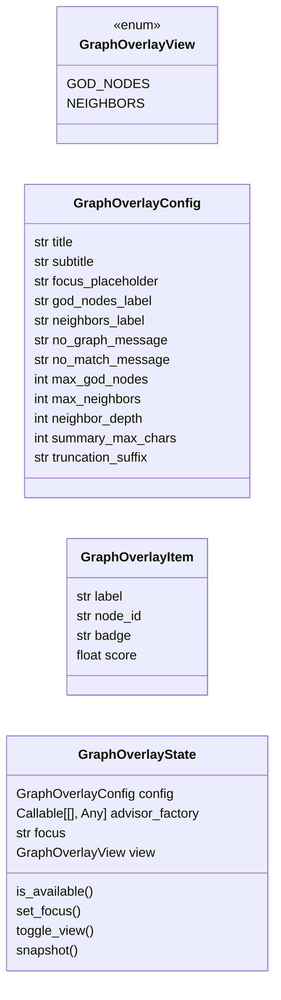
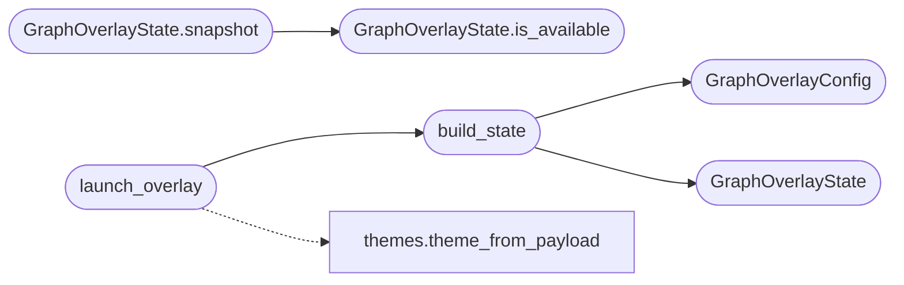

# `cli.graph_overlay`

> Source: [cli/graph_overlay.py:1](../../cli/graph_overlay.py#L1) | language `py` | coverage 100.0% | [API index](../index.md)

Textual overlay over [`cli.graph_advisor`](cli.graph_advisor.py.md).

The overlay visualises the same data `[`god_nodes`](cli.graph_advisor.py.md#graphadvisor-god_nodes)` and ``neighbors``
already expose as text. The operator types a focus node, sees the
matching seed plus its neighbours grouped by hop, and switches between
"god nodes" (highest-degree) and "neighbors of <node>" modes from a
single screen.

Design (SOLID):

- Single Responsibility: [`GraphOverlayConfig`](#graphoverlayconfig) owns constants,
  [`GraphOverlayState`](#graphoverlaystate) calls into [`GraphAdvisor`](cli.graph_advisor.py.md#graphadvisor) and
  normalises the results, `GraphOverlayApp` renders.
- Open/Closed: a new view mode is one ``View`` enum entry plus one
  branch in [`GraphOverlayState.snapshot`](#graphoverlaystate-snapshot).
- Dependency Inversion: the state takes a callable that returns a
  [`GraphAdvisor`](cli.graph_advisor.py.md#graphadvisor)-shaped object so tests pass a fake.
- No magic numbers / hardcoded paths: every value lives in the config.
- Textual is imported lazily — [`launch_overlay`](#launch_overlay) returns ``None``
  when Textual is missing or the graph is unavailable.

## Contents

- **Classes:** [`GraphOverlayConfig`](#graphoverlayconfig), [`GraphOverlayItem`](#graphoverlayitem), [`GraphOverlayState`](#graphoverlaystate)
- **Enums:** [`GraphOverlayView`](#graphoverlayview)
- **Functions:** [`build_state`](#build_state), [`launch_overlay`](#launch_overlay)

## Type Diagram



## Call Graph

Solid arrows stay in this module, dashed arrows leave it.



## Classes

<a id="graphoverlayconfig"></a>

### `GraphOverlayConfig`

`class` `dataclass` | [cli/graph_overlay.py:41](../../cli/graph_overlay.py#L41)

Decorators: `@dataclass(frozen=True)`

```python
class GraphOverlayConfig
```

Centralised constants for the overlay.

**Attributes**

| Name | Type | Default | Description |
|---|---|---|---|
| [`title`](#graphoverlayconfig-title) | `str` | `'Graph overlay'` |  |
| [`subtitle`](#graphoverlayconfig-subtitle) | `str` | `'Tab to switch mode, type to focus, Esc to close'` |  |
| [`focus_placeholder`](#graphoverlayconfig-focus_placeholder) | `str` | `'Type a node id, label, or command verb'` |  |
| [`god_nodes_label`](#graphoverlayconfig-god_nodes_label) | `str` | `'Top central nodes'` |  |
| [`neighbors_label`](#graphoverlayconfig-neighbors_label) | `str` | `'Neighbors'` |  |
| [`no_graph_message`](#graphoverlayconfig-no_graph_message) | `str` | `'Graph not available — run /graphify . to enable.'` |  |
| [`no_match_message`](#graphoverlayconfig-no_match_message) | `str` | `'No node matches the current focus.'` |  |
| [`max_god_nodes`](#graphoverlayconfig-max_god_nodes) | `int` | `20` |  |
| [`max_neighbors`](#graphoverlayconfig-max_neighbors) | `int` | `40` |  |
| [`neighbor_depth`](#graphoverlayconfig-neighbor_depth) | `int` | `2` |  |
| [`summary_max_chars`](#graphoverlayconfig-summary_max_chars) | `int` | `88` |  |
| [`truncation_suffix`](#graphoverlayconfig-truncation_suffix) | `str` | `'...'` |  |

---

<a id="graphoverlayitem"></a>

### `GraphOverlayItem`

`class` `dataclass` | [cli/graph_overlay.py:59](../../cli/graph_overlay.py#L59)

Decorators: `@dataclass(frozen=True)`

```python
class GraphOverlayItem
```

One render-ready row.

**Attributes**

| Name | Type | Default | Description |
|---|---|---|---|
| [`label`](#graphoverlayitem-label) | `str` |  |  |
| [`node_id`](#graphoverlayitem-node_id) | `str` |  |  |
| [`badge`](#graphoverlayitem-badge) | `str` |  |  |
| [`score`](#graphoverlayitem-score) | `float` |  |  |

---

<a id="graphoverlaystate"></a>

### `GraphOverlayState`

`class` `dataclass` | [cli/graph_overlay.py:69](../../cli/graph_overlay.py#L69)

Decorators: `@dataclass`

```python
class GraphOverlayState
```

Pure data layer for the overlay.

**Attributes**

| Name | Type | Default | Description |
|---|---|---|---|
| [`config`](#graphoverlaystate-config) | `GraphOverlayConfig` |  |  |
| [`advisor_factory`](#graphoverlaystate-advisor_factory) | `Callable[[], Any]` |  |  |
| [`focus`](#graphoverlaystate-focus) | `str` | `''` |  |
| [`view`](#graphoverlaystate-view) | `GraphOverlayView` | `GraphOverlayView.GOD_NODES` |  |

**Members**

| Member | Kind | Summary |
|---|---|---|
| [`is_available`](#graphoverlaystate-is_available) | method | Return ``True`` when the underlying graph advisor has data. |
| [`set_focus`](#graphoverlaystate-set_focus) | method | Replace the focus query. |
| [`toggle_view`](#graphoverlaystate-toggle_view) | method | Switch between god-nodes and neighbors-of-focus. |
| [`snapshot`](#graphoverlaystate-snapshot) | method | Return ``(header, items)`` for the current view. |

<a id="graphoverlaystate-is_available"></a>

#### `GraphOverlayState.is_available`

`method` | [cli/graph_overlay.py:77](../../cli/graph_overlay.py#L77)

```python
def is_available(self) -> bool
```

Return ``True`` when the underlying graph advisor has data.

**Returns:** `bool`

*Called by:* [`GraphOverlayState.snapshot`](#graphoverlaystate-snapshot)

<a id="graphoverlaystate-set_focus"></a>

#### `GraphOverlayState.set_focus`

`method` | [cli/graph_overlay.py:87](../../cli/graph_overlay.py#L87)

```python
def set_focus(self, value: str) -> None
```

Replace the focus query.

**Parameters**

| Name | Type | Default | Description |
|---|---|---|---|
| `value` | `str` |  |  |

<a id="graphoverlaystate-toggle_view"></a>

#### `GraphOverlayState.toggle_view`

`method` | [cli/graph_overlay.py:95](../../cli/graph_overlay.py#L95)

```python
def toggle_view(self) -> None
```

Switch between god-nodes and neighbors-of-focus.

<a id="graphoverlaystate-snapshot"></a>

#### `GraphOverlayState.snapshot`

`method` | [cli/graph_overlay.py:102](../../cli/graph_overlay.py#L102)

```python
def snapshot(self) -> tuple[str, list[GraphOverlayItem]]
```

Return ``(header, items)`` for the current view.

**Returns:** `tuple[str, list[GraphOverlayItem]]`

*Calls:* [`GraphOverlayState.is_available`](#graphoverlaystate-is_available)

---

## Enums

<a id="graphoverlayview"></a>

### `GraphOverlayView`

`enum` | [cli/graph_overlay.py:33](../../cli/graph_overlay.py#L33)

```python
class GraphOverlayView(StrEnum)
```

Bases: `StrEnum`

Two view modes the overlay toggles between.

**Attributes**

| Name | Type | Default | Description |
|---|---|---|---|
| [`GOD_NODES`](#graphoverlayview-god_nodes) |  | `'god_nodes'` |  |
| [`NEIGHBORS`](#graphoverlayview-neighbors) |  | `'neighbors'` |  |

---

## Functions

<a id="build_state"></a>

### `build_state`

`function` | [cli/graph_overlay.py:192](../../cli/graph_overlay.py#L192)

```python
def build_state(config: GraphOverlayConfig | None = None, advisor_factory: Callable[[], Any] | None = None) -> GraphOverlayState
```

Wire the canonical state used by [`launch_overlay`](#launch_overlay).

**Parameters**

| Name | Type | Default | Description |
|---|---|---|---|
| `config` | `GraphOverlayConfig \| None` | `None` |  |
| `advisor_factory` | `Callable[[], Any] \| None` | `None` |  |

**Returns:** `GraphOverlayState`

*Calls:* [`GraphOverlayConfig`](#graphoverlayconfig), [`GraphOverlayState`](#graphoverlaystate)

*Called by:* [`launch_overlay`](#launch_overlay)

---

<a id="launch_overlay"></a>

### `launch_overlay`

`function` | [cli/graph_overlay.py:203](../../cli/graph_overlay.py#L203)

```python
def launch_overlay(payload: Mapping[str, Any] | None = None, state: GraphOverlayState | None = None, runner: Any | None = None) -> str | None
```

Open the overlay and return the last-focused node id on exit.

**Parameters**

| Name | Type | Default | Description |
|---|---|---|---|
| `payload` | `Mapping[str, Any] \| None` | `None` | Loaded ``payload.json``. |
| `state` | `GraphOverlayState \| None` | `None` | Optional pre-built state. |
| `runner` | `Any \| None` | `None` | Optional callable used by tests. |

**Returns:** `str | None` - The last focused node id, or ``None`` when cancelled / Textual
unavailable.

*Calls:* [`build_state`](#build_state), [`theme_from_payload`](cli.themes.py.md#theme_from_payload)

---
