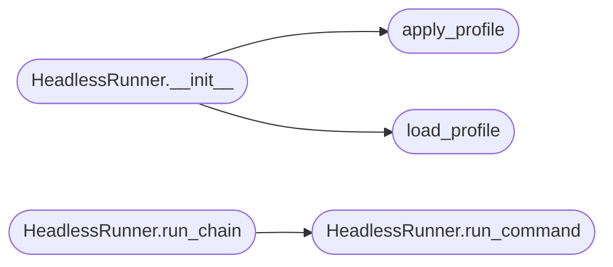

# `cli.headless`

> Source: [cli/headless.py:1](../../cli/headless.py#L1) | language `py` | coverage 85.7% | [API index](../index.md)

Headless / non-interactive runner for automated pipelines.

Provides HeadlessRunner which wraps LazyOwnShell and produces
structured JSON output suitable for CI/CD and agent-driven ops.

## Contents

- **Classes:** [`HeadlessRunner`](#headlessrunner)
- **Functions:** [`load_profile`](#load_profile), [`apply_profile`](#apply_profile)
- **Constants:** [`EXIT_OK`](#exit_ok), [`EXIT_ERROR`](#exit_error), [`EXIT_CONFIG`](#exit_config), [`EXIT_SCOPE`](#exit_scope), [`EXIT_TIMEOUT`](#exit_timeout), [`EXIT_LABELS`](#exit_labels)

## Call Graph

Solid arrows stay in this module, dashed arrows leave it.



## Classes

<a id="headlessrunner"></a>

### `HeadlessRunner`

`class` | [cli/headless.py:62](../../cli/headless.py#L62)

```python
class HeadlessRunner
```

Non-interactive runner that executes commands and emits structured output.

Usage:
    shell = LazyOwnShell()
    runner = HeadlessRunner(shell, json_output=True)
    runner.run_command("nmap_scan")
    sys.exit(runner.exit_code)

**Members**

| Member | Kind | Summary |
|---|---|---|
| [`__init__`](#headlessrunner-__init__) | constructor |  |
| [`run_command`](#headlessrunner-run_command) | method | Execute a single command, capture output, return structured result. |
| [`run_chain`](#headlessrunner-run_chain) | method | Execute multiple commands and emit final summary. |

<a id="headlessrunner-__init__"></a>

#### `HeadlessRunner.__init__`

`constructor` | [cli/headless.py:72](../../cli/headless.py#L72)

```python
def __init__(self, shell, json_output: bool = False, profile_path: str | None = None)
```

**Parameters**

| Name | Type | Default | Description |
|---|---|---|---|
| `shell` |  |  |  |
| `json_output` | `bool` | `False` |  |
| `profile_path` | `str \| None` | `None` |  |

*Calls:* [`apply_profile`](#apply_profile), [`load_profile`](#load_profile)

*Called by:* [`main`](lazyown.py.md#main)

<a id="headlessrunner-run_command"></a>

#### `HeadlessRunner.run_command`

`method` | [cli/headless.py:87](../../cli/headless.py#L87)

```python
def run_command(self, cmd: str, timeout: int | None = None) -> dict[str, Any]
```

Execute a single command, capture output, return structured result.

**Parameters**

| Name | Type | Default | Description |
|---|---|---|---|
| `cmd` | `str` |  | command string to execute via onecmd. |
| `timeout` | `int \| None` | `None` | optional timeout in seconds (not yet enforced). |

**Returns:** `dict[str, Any]` - Dict with keys: command, success, output, error, duration_ms.

*Called by:* [`HeadlessRunner.run_chain`](#headlessrunner-run_chain), [`main`](lazyown.py.md#main)

<a id="headlessrunner-run_chain"></a>

#### `HeadlessRunner.run_chain`

`method` | [cli/headless.py:132](../../cli/headless.py#L132)

```python
def run_chain(self, commands: list[str]) -> list[dict[str, Any]]
```

Execute multiple commands and emit final summary.

**Parameters**

| Name | Type | Default | Description |
|---|---|---|---|
| `commands` | `list[str]` |  | list of command strings to execute sequentially. |

**Returns:** `list[dict[str, Any]]` - List of result dicts, one per command.

*Calls:* [`HeadlessRunner.run_command`](#headlessrunner-run_command)

*Called by:* [`main`](lazyown.py.md#main)

---

## Functions

<a id="load_profile"></a>

### `load_profile`

`function` | [cli/headless.py:31](../../cli/headless.py#L31)

```python
def load_profile(path: str) -> dict[str, Any]
```

Load a YAML profile that overrides payload.json keys.

**Parameters**

| Name | Type | Default | Description |
|---|---|---|---|
| `path` | `str` |  | filesystem path to the YAML profile. |

**Returns:** `dict[str, Any]` - Dictionary of config overrides.

**Raises**

- `FileNotFoundError`: profile not found.
- `yaml.YAMLError`: malformed YAML.

*Called by:* [`HeadlessRunner.__init__`](#headlessrunner-__init__)

---

<a id="apply_profile"></a>

### `apply_profile`

`function` | [cli/headless.py:48](../../cli/headless.py#L48)

```python
def apply_profile(config: dict[str, Any], profile: dict[str, Any]) -> dict[str, Any]
```

Merge profile values into config (shallow overlay).

**Parameters**

| Name | Type | Default | Description |
|---|---|---|---|
| `config` | `dict[str, Any]` |  | base configuration dictionary (e.g. shell.params). |
| `profile` | `dict[str, Any]` |  | override dictionary from profile file. |

**Returns:** `dict[str, Any]` - Updated config (same reference).

*Called by:* [`HeadlessRunner.__init__`](#headlessrunner-__init__)

---

## Constants

<a id="exit_ok"></a>

### `EXIT_OK`

`constant` | [cli/headless.py:16](../../cli/headless.py#L16)

```python
EXIT_OK = 0
```

---

<a id="exit_error"></a>

### `EXIT_ERROR`

`constant` | [cli/headless.py:17](../../cli/headless.py#L17)

```python
EXIT_ERROR = 1
```

---

<a id="exit_config"></a>

### `EXIT_CONFIG`

`constant` | [cli/headless.py:18](../../cli/headless.py#L18)

```python
EXIT_CONFIG = 2
```

---

<a id="exit_scope"></a>

### `EXIT_SCOPE`

`constant` | [cli/headless.py:19](../../cli/headless.py#L19)

```python
EXIT_SCOPE = 3
```

---

<a id="exit_timeout"></a>

### `EXIT_TIMEOUT`

`constant` | [cli/headless.py:20](../../cli/headless.py#L20)

```python
EXIT_TIMEOUT = 4
```

---

<a id="exit_labels"></a>

### `EXIT_LABELS`

`constant` | [cli/headless.py:22](../../cli/headless.py#L22)

```python
EXIT_LABELS
```

---
