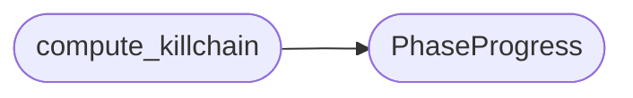

# `cli.killchain`

> Source: [cli/killchain.py:1](../../cli/killchain.py#L1) | language `py` | coverage 100.0% | [API index](../index.md)

Self-populating kill-chain progress derived from the daemon event stream.

This module exists for backward compatibility. The canonical phase definitions
and progress computation now live in `[`modules.killchain.KillChain`](modules.killchain.py.md#killchain)`, which already
wraps `[`WorldModel`](modules.world_model.py.md#worldmodel)` and raw ``world_model.json``. Consumers should migrate there.

For daemon-event-stream-based progress that includes per-phase activity and
reward statistics, the [`compute_killchain`](#compute_killchain) function remains.

## Contents

- **Classes:** [`PhaseProgress`](#phaseprogress)
- **Functions:** [`compute_killchain`](#compute_killchain)
- **Constants:** [`DEFAULT_PHASES`](#default_phases), [`STATE_DONE`](#state_done), [`STATE_ACTIVE`](#state_active), [`STATE_PENDING`](#state_pending)

## Call Graph

Solid arrows stay in this module, dashed arrows leave it.



## Classes

<a id="phaseprogress"></a>

### `PhaseProgress`

`class` `dataclass` | [cli/killchain.py:29](../../cli/killchain.py#L29)

Decorators: `@dataclass(frozen=True)`

```python
class PhaseProgress
```

Computed progress for a single kill-chain phase.

**Attributes**

| Name | Type | Default | Description |
|---|---|---|---|
| [`key`](#phaseprogress-key) | `str` |  | Canonical phase identifier (e.g. ``recon``). |
| [`label`](#phaseprogress-label) | `str` |  | Human-readable phase label (e.g. ``Recon``). |
| [`state`](#phaseprogress-state) | `str` |  | One of [`STATE_DONE`](#state_done), [`STATE_ACTIVE`](#state_active), [`STATE_PENDING`](#state_pending). |
| [`activity`](#phaseprogress-activity) | `int` |  | Number of daemon step events observed in this phase. |
| [`reward`](#phaseprogress-reward) | `float` |  | Sum of step rewards recorded in this phase. |

---

## Functions

<a id="compute_killchain"></a>

### `compute_killchain`

`function` | [cli/killchain.py:83](../../cli/killchain.py#L83)

```python
def compute_killchain(events: list[dict[str, Any]], world: dict[str, Any] | None = None, phases: tuple[tuple[str, str], ...] = DEFAULT_PHASES) -> list[PhaseProgress]
```

Compute kill-chain progress from daemon events and the world model.

A phase is marked *done* when the engagement has advanced past it (its index
is below the active phase) or the world model explicitly lists it as
completed. The active phase is *active*; everything after it is *pending*.
Per-phase activity counts and accumulated reward are derived from the step
events regardless of state.

**Parameters**

| Name | Type | Default | Description |
|---|---|---|---|
| `events` | `list[dict[str, Any]]` |  | Daemon events ordered oldest first (see [`cli.reasoning_stream.read_raw_events`](cli.reasoning_stream.py.md#read_raw_events)). |
| `world` | `dict[str, Any] \| None` | `None` | Optional ``world_model.json`` snapshot used as a fallback for the current phase and for an explicit ``completed_phases`` list. |
| `phases` | `tuple[tuple[str, str], ...]` | `DEFAULT_PHASES` | Ordered ``(key, label)`` pairs describing the kill chain. |

**Returns:** `list[PhaseProgress]` - One [`PhaseProgress`](#phaseprogress) per phase, in kill-chain order.

*Calls:* [`PhaseProgress`](#phaseprogress)

---

## Constants

<a id="default_phases"></a>

### `DEFAULT_PHASES`

`constant` | [cli/killchain.py:18](../../cli/killchain.py#L18)

```python
DEFAULT_PHASES: tuple[tuple[str, str], ...] = tuple(((p[0], p[1]) for p in _KC.phases_for_display()))
```

---

<a id="state_done"></a>

### `STATE_DONE`

`constant` | [cli/killchain.py:20](../../cli/killchain.py#L20)

```python
STATE_DONE: str = 'done'
```

---

<a id="state_active"></a>

### `STATE_ACTIVE`

`constant` | [cli/killchain.py:21](../../cli/killchain.py#L21)

```python
STATE_ACTIVE: str = 'active'
```

---

<a id="state_pending"></a>

### `STATE_PENDING`

`constant` | [cli/killchain.py:22](../../cli/killchain.py#L22)

```python
STATE_PENDING: str = 'pending'
```

---
