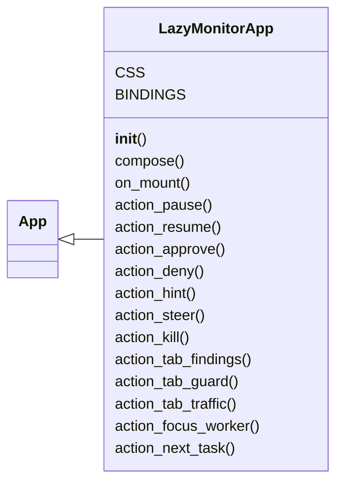
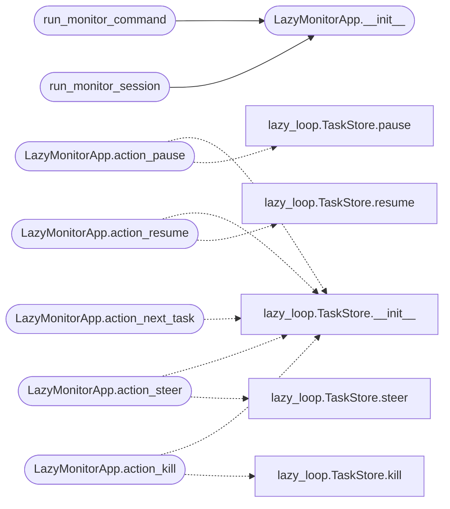

# `cli.lazy_monitor`

> Source: [cli/lazy_monitor.py:1](../../cli/lazy_monitor.py#L1) | language `py` | coverage 100.0% | [API index](../index.md)

Live worker-visibility monitor for the autonomous loop.

The loop is never a black box: every worker's tool calls, results,
guard decisions, approvals, traffic and findings stream into a
multi-pane Textual view. Two modes share the same rendering:

- attach (``lazy_view [task]``): tails the task's store files, so it
  works from a second terminal while ``lazy_loop`` runs elsewhere and
  keeps working after the run for audit;
- embedded (``lazy_loop --view``): the runner starts the engine inside
  this app and also streams the executor's raw output live.

Keys: ``q`` quit, ``p``/``r`` pause/resume, `[`a`](static.js.xterm-addon-web-links-0.5.0.js.md#a)`/`[`d`](static.js.particles.js.md#d)` approve/deny
first pending intercept, ``h`` hint, ``s`` steer, ``k`` kill, `[`f`](static.js.quill-2.0.3.js.md#ct-g-i-j-l-m-n-n-ot-q-r-s-s-st-t-x-y-z-a-b-c-c-d-et-extends-extends-extends-extends-extends-extends-extends-extends-extends-extends-extends-f)`
findings, `[`g`](static.js.quill-2.0.3.js.md#ct-g-i-j-l-m-n-n-ot-q-r-s-s-st-t-x-y-z-a-b-c-c-d-et-extends-extends-extends-extends-extends-extends-extends-extends-extends-extends-extends-f-g)` guard, ``t`` traffic, ``1``..``5`` focus a worker.

## Contents

- **Classes:** [`LazyMonitorApp`](#lazymonitorapp)
- **Functions:** [`run_monitor_command`](#run_monitor_command), [`run_monitor_session`](#run_monitor_session)

## Type Diagram



## Call Graph

Solid arrows stay in this module, dashed arrows leave it.



## Classes

<a id="lazymonitorapp"></a>

### `LazyMonitorApp`

`class` | [cli/lazy_monitor.py:89](../../cli/lazy_monitor.py#L89)

```python
class LazyMonitorApp(App[dict])
```

Bases: [`App[dict]`](lazy_sentinel4.py.md#app)

Multi-pane loop monitor with operator controls.

**Attributes**

| Name | Type | Default | Description |
|---|---|---|---|
| [`CSS`](#lazymonitorapp-css) |  | `'\n #body { height: 1fr; }\n #left { width: 38; border: round $accent; padding: 0 1; }\n #workers-grid { width: 1fr; }\n .worker-pane { border: round $primary; height: 1fr; }\n .worker-title { background: $boost; }\n #bottom { height: 14; border: round $secondary; }\n .modal-box { width: 70; height: auto; padding: 1 2; background: $surface;\n border: round $accent; }\n .modal-title { text-style: bold; padding-bottom: 1; }\n '` |  |
| [`BINDINGS`](#lazymonitorapp-bindings) |  | `[Binding('q', 'quit', 'Quit'), Binding('n', 'next_task', 'Next task'), Binding('p', 'pause', 'Pause'), Binding('r', 'resume', 'Resume'), Binding('a', 'approve', 'Approve'), Binding('d', 'deny', 'Deny'), Binding('h', 'hint', 'Hint'), Binding('s', 'steer', 'Steer'), Binding('k', 'kill', 'Kill'), Binding('f', 'tab_findings', 'Findings'), Binding('g', 'tab_guard', 'Guard'), Binding('t', 'tab_traffic', 'Traffic'), Binding('1', 'focus_worker(1)', 'W1', show=False), Binding('2', 'focus_worker(2)', 'W2', show=False), Binding('3', 'focus_worker(3)', 'W3', show=False), Binding('4', 'focus_worker(4)', 'W4', show=False), Binding('5', 'focus_worker(5)', 'W5', show=False)]` |  |

**Members**

| Member | Kind | Summary |
|---|---|---|
| [`__init__`](#lazymonitorapp-__init__) | constructor | Bind the monitor to a task and optionally embed a live engine. |
| [`compose`](#lazymonitorapp-compose) | method | Build the split view: stages, worker panes, audit tabs. |
| [`on_mount`](#lazymonitorapp-on_mount) | method | Resolve the task, wire pane logs and start polling. |
| [`action_pause`](#lazymonitorapp-action_pause) | method | Pause the task between worker steps. |
| [`action_resume`](#lazymonitorapp-action_resume) | method | Resume a paused task. |
| [`action_approve`](#lazymonitorapp-action_approve) | method | Approve the first pending intercept. |
| [`action_deny`](#lazymonitorapp-action_deny) | method | Deny the first pending intercept. |
| [`action_hint`](#lazymonitorapp-action_hint) | method | Inject an operator hint for the next planner round. |
| [`action_steer`](#lazymonitorapp-action_steer) | method | Send a mid-run correction to the newest running intent. |
| [`action_kill`](#lazymonitorapp-action_kill) | method | Kill the newest running intent. |
| [`action_tab_findings`](#lazymonitorapp-action_tab_findings) | method | Focus the findings tab. |
| [`action_tab_guard`](#lazymonitorapp-action_tab_guard) | method | Focus the guard tab. |
| [`action_tab_traffic`](#lazymonitorapp-action_tab_traffic) | method | Focus the traffic tab. |
| [`action_focus_worker`](#lazymonitorapp-action_focus_worker) | method | Scroll the matching worker pane into view. |
| [`action_next_task`](#lazymonitorapp-action_next_task) | method | Switch the monitor to the next task in the store. |

<a id="lazymonitorapp-__init__"></a>

#### `LazyMonitorApp.__init__`

`constructor` | [cli/lazy_monitor.py:124](../../cli/lazy_monitor.py#L124)

```python
def __init__(self, task_id: str = '', engine=None, config=None, params: dict | None = None) -> None
```

Bind the monitor to a task and optionally embed a live engine.

**Parameters**

| Name | Type | Default | Description |
|---|---|---|---|
| `task_id` | `str` | `''` |  |
| `engine` |  | `None` |  |
| `config` |  | `None` |  |
| `params` | `dict \| None` | `None` |  |

*Called by:* [`run_monitor_command`](#run_monitor_command), [`run_monitor_session`](#run_monitor_session), [`run`](modules.tools.monitor_smoke.py.md#run)

<a id="lazymonitorapp-compose"></a>

#### `LazyMonitorApp.compose`

`method` `generator` | [cli/lazy_monitor.py:140](../../cli/lazy_monitor.py#L140)

```python
def compose(self) -> ComposeResult
```

Build the split view: stages, worker panes, audit tabs.

**Returns:** `ComposeResult`

<a id="lazymonitorapp-on_mount"></a>

#### `LazyMonitorApp.on_mount`

`method` | [cli/lazy_monitor.py:168](../../cli/lazy_monitor.py#L168)

```python
def on_mount(self) -> None
```

Resolve the task, wire pane logs and start polling.

<a id="lazymonitorapp-action_pause"></a>

#### `LazyMonitorApp.action_pause`

`method` | [cli/lazy_monitor.py:409](../../cli/lazy_monitor.py#L409)

```python
def action_pause(self) -> None
```

Pause the task between worker steps.

*Calls:* [`TaskStore.__init__`](modules.lazy_loop.py.md#taskstore-__init__), [`TaskStore.pause`](modules.lazy_loop.py.md#taskstore-pause)

<a id="lazymonitorapp-action_resume"></a>

#### `LazyMonitorApp.action_resume`

`method` | [cli/lazy_monitor.py:417](../../cli/lazy_monitor.py#L417)

```python
def action_resume(self) -> None
```

Resume a paused task.

*Calls:* [`TaskStore.__init__`](modules.lazy_loop.py.md#taskstore-__init__), [`TaskStore.resume`](modules.lazy_loop.py.md#taskstore-resume)

<a id="lazymonitorapp-action_approve"></a>

#### `LazyMonitorApp.action_approve`

`method` | [cli/lazy_monitor.py:425](../../cli/lazy_monitor.py#L425)

```python
def action_approve(self) -> None
```

Approve the first pending intercept.

<a id="lazymonitorapp-action_deny"></a>

#### `LazyMonitorApp.action_deny`

`method` | [cli/lazy_monitor.py:429](../../cli/lazy_monitor.py#L429)

```python
def action_deny(self) -> None
```

Deny the first pending intercept.

<a id="lazymonitorapp-action_hint"></a>

#### `LazyMonitorApp.action_hint`

`method` | [cli/lazy_monitor.py:445](../../cli/lazy_monitor.py#L445)

```python
def action_hint(self) -> None
```

Inject an operator hint for the next planner round.

<a id="lazymonitorapp-action_steer"></a>

#### `LazyMonitorApp.action_steer`

`method` | [cli/lazy_monitor.py:460](../../cli/lazy_monitor.py#L460)

```python
def action_steer(self) -> None
```

Send a mid-run correction to the newest running intent.

*Calls:* [`TaskStore.__init__`](modules.lazy_loop.py.md#taskstore-__init__), [`TaskStore.steer`](modules.lazy_loop.py.md#taskstore-steer)

<a id="lazymonitorapp-action_kill"></a>

#### `LazyMonitorApp.action_kill`

`method` | [cli/lazy_monitor.py:477](../../cli/lazy_monitor.py#L477)

```python
def action_kill(self) -> None
```

Kill the newest running intent.

*Calls:* [`TaskStore.__init__`](modules.lazy_loop.py.md#taskstore-__init__), [`TaskStore.kill`](modules.lazy_loop.py.md#taskstore-kill)

<a id="lazymonitorapp-action_tab_findings"></a>

#### `LazyMonitorApp.action_tab_findings`

`method` | [cli/lazy_monitor.py:489](../../cli/lazy_monitor.py#L489)

```python
def action_tab_findings(self) -> None
```

Focus the findings tab.

<a id="lazymonitorapp-action_tab_guard"></a>

#### `LazyMonitorApp.action_tab_guard`

`method` | [cli/lazy_monitor.py:493](../../cli/lazy_monitor.py#L493)

```python
def action_tab_guard(self) -> None
```

Focus the guard tab.

<a id="lazymonitorapp-action_tab_traffic"></a>

#### `LazyMonitorApp.action_tab_traffic`

`method` | [cli/lazy_monitor.py:497](../../cli/lazy_monitor.py#L497)

```python
def action_tab_traffic(self) -> None
```

Focus the traffic tab.

<a id="lazymonitorapp-action_focus_worker"></a>

#### `LazyMonitorApp.action_focus_worker`

`method` | [cli/lazy_monitor.py:508](../../cli/lazy_monitor.py#L508)

```python
def action_focus_worker(self, index: int) -> None
```

Scroll the matching worker pane into view.

**Parameters**

| Name | Type | Default | Description |
|---|---|---|---|
| `index` | `int` |  |  |

<a id="lazymonitorapp-action_next_task"></a>

#### `LazyMonitorApp.action_next_task`

`method` | [cli/lazy_monitor.py:518](../../cli/lazy_monitor.py#L518)

```python
def action_next_task(self) -> None
```

Switch the monitor to the next task in the store.

*Calls:* [`TaskStore.__init__`](modules.lazy_loop.py.md#taskstore-__init__)

---

## Functions

<a id="run_monitor_command"></a>

### `run_monitor_command`

`function` | [cli/lazy_monitor.py:575](../../cli/lazy_monitor.py#L575)

```python
def run_monitor_command(task_id: str = '') -> dict
```

Attach the monitor to an existing task (never blocks the loop).

**Parameters**

| Name | Type | Default | Description |
|---|---|---|---|
| `task_id` | `str` | `''` | Task to inspect (empty picks the newest task). |

**Returns:** `dict` - App exit payload (unused by attach mode, kept for symmetry).

*Calls:* [`LazyMonitorApp.__init__`](#lazymonitorapp-__init__)

*Called by:* [`LazyQueueCommandSet.do_lazy_view`](cli.commands.lazyloop.py.md#lazyqueuecommandset-do_lazy_view)

---

<a id="run_monitor_session"></a>

### `run_monitor_session`

`function` | [cli/lazy_monitor.py:589](../../cli/lazy_monitor.py#L589)

```python
def run_monitor_session(engine, config, params: dict | None = None) -> dict
```

Run the loop inside the monitor (``lazy_loop --view``).

**Parameters**

| Name | Type | Default | Description |
|---|---|---|---|
| `engine` |  |  | Bound [`LazyEngine`](modules.lazy_engine.py.md#lazyengine). |
| `config` |  |  | [`modules.lazy_runner.LoopRunConfig`](modules.lazy_runner.py.md#looprunconfig). |
| `params` | `dict \| None` | `None` | Payload mapping (kept for signature parity). |

**Returns:** `dict` - Orchestrator summary produced by the embedded run.

*Calls:* [`LazyMonitorApp.__init__`](#lazymonitorapp-__init__)

*Called by:* [`run_loop`](modules.lazy_runner.py.md#run_loop)

---
