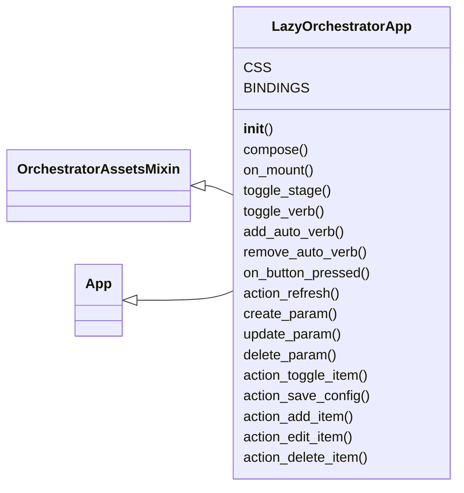
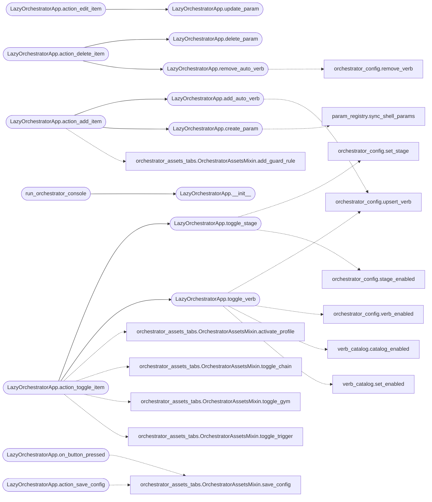

# `cli.lazy_orchestrator`

> Source: [cli/lazy_orchestrator.py:1](../../cli/lazy_orchestrator.py#L1) | language `py` | coverage 100.0% | [API index](../index.md)

Orchestrator admin console for the autonomous loop.

A Textual TUI in the spirit of the marketplace configurator:

- Now: what the loop is executing right now (task, stages, live activity
  tail, per-worker current command);
- Config: every payload knob the runner reads (rounds, workers,
  heartbeat, verb timeout, agentic flags, NOA, proxy);
- Verbs: auto-verb registry with a searchable command picker;
- Playbooks/Gyms/Chains/Profiles: YAML asset tabs managed by the `[`OrchestratorAssetsMixin`](cli.orchestrator_assets_tabs.py.md#orchestratorassetsmixin)`; the Models and Guard rules live here.
- Models: the LLM failover chain (add/remove members);
- Guard: the intercept rules (add/remove).

Edits persist straight to ``payload.json`` (or a sandbox path in tests)
through `[`core.config`](core.config.py.md)`; playbook changes are confined to the playbooks
directory and written atomically.

## Contents

- **Classes:** [`LazyOrchestratorApp`](#lazyorchestratorapp)
- **Functions:** [`run_orchestrator_console`](#run_orchestrator_console)

## Type Diagram



## Call Graph

Solid arrows stay in this module, dashed arrows leave it.



## Classes

<a id="lazyorchestratorapp"></a>

### `LazyOrchestratorApp`

`class` | [cli/lazy_orchestrator.py:144](../../cli/lazy_orchestrator.py#L144)

```python
class LazyOrchestratorApp(OrchestratorAssetsMixin, App[None])
```

Bases: [`OrchestratorAssetsMixin`](cli.orchestrator_assets_tabs.py.md#orchestratorassetsmixin), [`App[None]`](lazy_sentinel4.py.md#app)

Admin console: Now / Config / Verbs / Chains / Models / Guard.

**Attributes**

| Name | Type | Default | Description |
|---|---|---|---|
| [`CSS`](#lazyorchestratorapp-css) |  | `'\n #now-status { height: 6; border: round $accent; padding: 0 1; }\n #now-log { height: 1fr; border: round $primary; }\n #config-status { height: 3; color: $text-muted; }\n #chains-detail, #profiles-detail, #playbooks-detail, #gyms-detail { height: 10;\n border: round $secondary; padding: 0 1; }\n DataTable { height: 1fr; }\n .modal-box { width: 70; height: auto; padding: 1 2; background: $surface;\n border: round $accent; }\n .modal-box-wide { width: 100; height: 38; padding: 1 2; background: $surface;\n border: round $accent; }\n .modal-title { text-style: bold; padding-bottom: 1; }\n .modal-label { padding-top: 1; }\n .modal-hint { color: $text-muted; padding-top: 1; }\n .modal-error { color: $error; padding-top: 1; }\n '` |  |
| [`BINDINGS`](#lazyorchestratorapp-bindings) |  | `[Binding('q', 'quit', 'Quit'), Binding('r', 'refresh', 'Refresh'), Binding('s', 'save_config', 'Save config'), Binding('space', 'toggle_item', 'Toggle'), Binding('a', 'add_item', 'Add'), Binding('e', 'edit_item', 'Edit'), Binding('d', 'delete_item', 'Delete')]` |  |

**Members**

| Member | Kind | Summary |
|---|---|---|
| [`__init__`](#lazyorchestratorapp-__init__) | constructor | Bind the console to a payload file and an optional task. |
| [`compose`](#lazyorchestratorapp-compose) | method | Build the four panes. |
| [`on_mount`](#lazyorchestratorapp-on_mount) | method | Load the payload into the form and refresh the data tables. |
| [`toggle_stage`](#lazyorchestratorapp-toggle_stage) | method | Flip one pipeline stage on/off and persist it. |
| [`toggle_verb`](#lazyorchestratorapp-toggle_verb) | method | Flip one auto verb on/off and persist it in its owning layer. |
| [`add_auto_verb`](#lazyorchestratorapp-add_auto_verb) | method | Register a new operator-defined auto verb. |
| [`remove_auto_verb`](#lazyorchestratorapp-remove_auto_verb) | method | Delete a custom verb, or disable a built-in one. |
| [`on_button_pressed`](#lazyorchestratorapp-on_button_pressed) | method | Handle the config save button. |
| [`action_refresh`](#lazyorchestratorapp-action_refresh) | method | Reload tables and form from disk. |
| [`create_param`](#lazyorchestratorapp-create_param) | method | Declare a reusable parameter and publish it to the live shell. |
| [`update_param`](#lazyorchestratorapp-update_param) | method | Update a declared parameter and repaint the table. |
| [`delete_param`](#lazyorchestratorapp-delete_param) | method | Delete an operator parameter and drop it from the live shell. |
| [`action_toggle_item`](#lazyorchestratorapp-action_toggle_item) | method | Toggle the selected stage, auto verb, or chain. |
| [`action_save_config`](#lazyorchestratorapp-action_save_config) | method | Save the form values (keyboard shortcut). |
| [`action_add_item`](#lazyorchestratorapp-action_add_item) | method | Open the add modal for the active tab. |
| [`action_edit_item`](#lazyorchestratorapp-action_edit_item) | method | Edit the selected playbook YAML, LLM member priority or parameter. |
| [`action_delete_item`](#lazyorchestratorapp-action_delete_item) | method | Delete the selected row in the active tab. |

<a id="lazyorchestratorapp-__init__"></a>

#### `LazyOrchestratorApp.__init__`

`constructor` | [cli/lazy_orchestrator.py:174](../../cli/lazy_orchestrator.py#L174)

```python
def __init__(self, payload_path: str | Path | None = None, task_id: str = '', shell: object | None = None, param_root: str | Path | None = None) -> None
```

Bind the console to a payload file and an optional task.

**Parameters**

| Name | Type | Default | Description |
|---|---|---|---|
| `payload_path` | `str \| Path \| None` | `None` | Optional payload file override (tests). |
| `task_id` | `str` | `''` | Task identifier the console attaches to. |
| `shell` | `object \| None` | `None` | Optional parent shell, used to push newly declared parameters into the live ``params`` dict so they are substitutable in the same session. |
| `param_root` | `str \| Path \| None` | `None` | Optional repository root override for the parameter registry (sandboxed tests). |

*Called by:* [`run_orchestrator_console`](#run_orchestrator_console)

<a id="lazyorchestratorapp-compose"></a>

#### `LazyOrchestratorApp.compose`

`method` `generator` | [cli/lazy_orchestrator.py:208](../../cli/lazy_orchestrator.py#L208)

```python
def compose(self) -> ComposeResult
```

Build the four panes.

**Returns:** `ComposeResult`

<a id="lazyorchestratorapp-on_mount"></a>

#### `LazyOrchestratorApp.on_mount`

`method` | [cli/lazy_orchestrator.py:260](../../cli/lazy_orchestrator.py#L260)

```python
def on_mount(self) -> None
```

Load the payload into the form and refresh the data tables.

<a id="lazyorchestratorapp-toggle_stage"></a>

#### `LazyOrchestratorApp.toggle_stage`

`method` | [cli/lazy_orchestrator.py:276](../../cli/lazy_orchestrator.py#L276)

```python
def toggle_stage(self, name: str) -> bool
```

Flip one pipeline stage on/off and persist it.

**Parameters**

| Name | Type | Default | Description |
|---|---|---|---|
| `name` | `str` |  |  |

**Returns:** `bool`

*Calls:* [`set_stage`](modules.orchestrator_config.py.md#set_stage), [`stage_enabled`](modules.orchestrator_config.py.md#stage_enabled)

*Called by:* [`LazyOrchestratorApp.action_toggle_item`](#lazyorchestratorapp-action_toggle_item)

<a id="lazyorchestratorapp-toggle_verb"></a>

#### `LazyOrchestratorApp.toggle_verb`

`method` | [cli/lazy_orchestrator.py:285](../../cli/lazy_orchestrator.py#L285)

```python
def toggle_verb(self, name: str) -> bool
```

Flip one auto verb on/off and persist it in its owning layer.

**Parameters**

| Name | Type | Default | Description |
|---|---|---|---|
| `name` | `str` |  |  |

**Returns:** `bool`

*Calls:* [`upsert_verb`](modules.orchestrator_config.py.md#upsert_verb), [`verb_enabled`](modules.orchestrator_config.py.md#verb_enabled), [`catalog_enabled`](modules.verb_catalog.py.md#catalog_enabled), [`set_enabled`](modules.verb_catalog.py.md#set_enabled)

*Called by:* [`LazyOrchestratorApp.action_toggle_item`](#lazyorchestratorapp-action_toggle_item)

<a id="lazyorchestratorapp-add_auto_verb"></a>

#### `LazyOrchestratorApp.add_auto_verb`

`method` | [cli/lazy_orchestrator.py:301](../../cli/lazy_orchestrator.py#L301)

```python
def add_auto_verb(self, name: str, keywords: str = '', needs_target: str = 'true', description: str = '', phases: str = '') -> dict
```

Register a new operator-defined auto verb.

**Parameters**

| Name | Type | Default | Description |
|---|---|---|---|
| `name` | `str` |  |  |
| `keywords` | `str` | `''` |  |
| `needs_target` | `str` | `'true'` |  |
| `description` | `str` | `''` |  |
| `phases` | `str` | `''` |  |

**Returns:** `dict`

*Calls:* [`upsert_verb`](modules.orchestrator_config.py.md#upsert_verb)

*Called by:* [`LazyOrchestratorApp.action_add_item`](#lazyorchestratorapp-action_add_item)

<a id="lazyorchestratorapp-remove_auto_verb"></a>

#### `LazyOrchestratorApp.remove_auto_verb`

`method` | [cli/lazy_orchestrator.py:324](../../cli/lazy_orchestrator.py#L324)

```python
def remove_auto_verb(self, name: str) -> bool
```

Delete a custom verb, or disable a built-in one.

**Parameters**

| Name | Type | Default | Description |
|---|---|---|---|
| `name` | `str` |  |  |

**Returns:** `bool`

*Calls:* [`remove_verb`](modules.orchestrator_config.py.md#remove_verb)

*Called by:* [`LazyOrchestratorApp.action_delete_item`](#lazyorchestratorapp-action_delete_item)

<a id="lazyorchestratorapp-on_button_pressed"></a>

#### `LazyOrchestratorApp.on_button_pressed`

`method` | [cli/lazy_orchestrator.py:385](../../cli/lazy_orchestrator.py#L385)

```python
def on_button_pressed(self, event: Button.Pressed) -> None
```

Handle the config save button.

**Parameters**

| Name | Type | Default | Description |
|---|---|---|---|
| `event` | `Button.Pressed` |  |  |

*Calls:* [`OrchestratorAssetsMixin.save_config`](cli.orchestrator_assets_tabs.py.md#orchestratorassetsmixin-save_config)

<a id="lazyorchestratorapp-action_refresh"></a>

#### `LazyOrchestratorApp.action_refresh`

`method` | [cli/lazy_orchestrator.py:403](../../cli/lazy_orchestrator.py#L403)

```python
def action_refresh(self) -> None
```

Reload tables and form from disk.

<a id="lazyorchestratorapp-create_param"></a>

#### `LazyOrchestratorApp.create_param`

`method` | [cli/lazy_orchestrator.py:440](../../cli/lazy_orchestrator.py#L440)

```python
def create_param(self, name: str, kind: str = 'string', default: str = '', description: str = '', category: str = 'general') -> dict
```

Declare a reusable parameter and publish it to the live shell.

**Parameters**

| Name | Type | Default | Description |
|---|---|---|---|
| `name` | `str` |  | Parameter name; generic names only. |
| `kind` | `str` | `'string'` | Payload field kind. |
| `default` | `str` | `''` | Default value. |
| `description` | `str` | `''` | Help text shown to the operator. |
| `category` | `str` | `'general'` | Payload schema category. |

**Returns:** `dict` - Mapping describing the created parameter.

*Calls:* [`sync_shell_params`](core.param_registry.py.md#sync_shell_params)

*Called by:* [`LazyOrchestratorApp.action_add_item`](#lazyorchestratorapp-action_add_item)

<a id="lazyorchestratorapp-update_param"></a>

#### `LazyOrchestratorApp.update_param`

`method` | [cli/lazy_orchestrator.py:480](../../cli/lazy_orchestrator.py#L480)

```python
def update_param(self, name: str, default: str | None = None, description: str | None = None) -> dict
```

Update a declared parameter and repaint the table.

**Parameters**

| Name | Type | Default | Description |
|---|---|---|---|
| `name` | `str` |  | Parameter name. |
| `default` | `str \| None` | `None` | New default value; ``None`` keeps the current one. |
| `description` | `str \| None` | `None` | New description; ``None`` keeps the current one. |

**Returns:** `dict` - Mapping describing the updated parameter.

*Called by:* [`LazyOrchestratorApp.action_edit_item`](#lazyorchestratorapp-action_edit_item)

<a id="lazyorchestratorapp-delete_param"></a>

#### `LazyOrchestratorApp.delete_param`

`method` | [cli/lazy_orchestrator.py:512](../../cli/lazy_orchestrator.py#L512)

```python
def delete_param(self, name: str) -> bool
```

Delete an operator parameter and drop it from the live shell.

**Parameters**

| Name | Type | Default | Description |
|---|---|---|---|
| `name` | `str` |  | Parameter name. |

**Returns:** `bool` - ``True`` when the parameter was removed.

*Called by:* [`LazyOrchestratorApp.action_delete_item`](#lazyorchestratorapp-action_delete_item)

<a id="lazyorchestratorapp-action_toggle_item"></a>

#### `LazyOrchestratorApp.action_toggle_item`

`method` | [cli/lazy_orchestrator.py:544](../../cli/lazy_orchestrator.py#L544)

```python
def action_toggle_item(self) -> None
```

Toggle the selected stage, auto verb, or chain.

*Calls:* [`LazyOrchestratorApp.toggle_stage`](#lazyorchestratorapp-toggle_stage), [`LazyOrchestratorApp.toggle_verb`](#lazyorchestratorapp-toggle_verb), [`OrchestratorAssetsMixin.activate_profile`](cli.orchestrator_assets_tabs.py.md#orchestratorassetsmixin-activate_profile), [`OrchestratorAssetsMixin.toggle_chain`](cli.orchestrator_assets_tabs.py.md#orchestratorassetsmixin-toggle_chain), [`OrchestratorAssetsMixin.toggle_gym`](cli.orchestrator_assets_tabs.py.md#orchestratorassetsmixin-toggle_gym), [`OrchestratorAssetsMixin.toggle_trigger`](cli.orchestrator_assets_tabs.py.md#orchestratorassetsmixin-toggle_trigger)

<a id="lazyorchestratorapp-action_save_config"></a>

#### `LazyOrchestratorApp.action_save_config`

`method` | [cli/lazy_orchestrator.py:574](../../cli/lazy_orchestrator.py#L574)

```python
def action_save_config(self) -> None
```

Save the form values (keyboard shortcut).

*Calls:* [`OrchestratorAssetsMixin.save_config`](cli.orchestrator_assets_tabs.py.md#orchestratorassetsmixin-save_config)

<a id="lazyorchestratorapp-action_add_item"></a>

#### `LazyOrchestratorApp.action_add_item`

`method` | [cli/lazy_orchestrator.py:591](../../cli/lazy_orchestrator.py#L591)

```python
def action_add_item(self) -> None
```

Open the add modal for the active tab.

*Calls:* [`LazyOrchestratorApp.add_auto_verb`](#lazyorchestratorapp-add_auto_verb), [`LazyOrchestratorApp.create_param`](#lazyorchestratorapp-create_param), [`OrchestratorAssetsMixin.add_guard_rule`](cli.orchestrator_assets_tabs.py.md#orchestratorassetsmixin-add_guard_rule), [`OrchestratorAssetsMixin.add_model_member`](cli.orchestrator_assets_tabs.py.md#orchestratorassetsmixin-add_model_member), [`OrchestratorAssetsMixin.add_trigger`](cli.orchestrator_assets_tabs.py.md#orchestratorassetsmixin-add_trigger), [`OrchestratorAssetsMixin.create_playbook_file`](cli.orchestrator_assets_tabs.py.md#orchestratorassetsmixin-create_playbook_file), [`OrchestratorAssetsMixin.generate_chain`](cli.orchestrator_assets_tabs.py.md#orchestratorassetsmixin-generate_chain), [`OrchestratorAssetsMixin.playbook_candidates`](cli.orchestrator_assets_tabs.py.md#orchestratorassetsmixin-playbook_candidates), [`OrchestratorAssetsMixin.trigger_kind_options`](cli.orchestrator_assets_tabs.py.md#orchestratorassetsmixin-trigger_kind_options), [`FormModal.__init__`](cli.tui_forms.py.md#formmodal-__init__), [`SearchSelectModal.__init__`](cli.tui_forms.py.md#searchselectmodal-__init__), [`create_gym`](modules.redteam_gym.py.md#create_gym)

<a id="lazyorchestratorapp-action_edit_item"></a>

#### `LazyOrchestratorApp.action_edit_item`

`method` | [cli/lazy_orchestrator.py:823](../../cli/lazy_orchestrator.py#L823)

```python
def action_edit_item(self) -> None
```

Edit the selected playbook YAML, LLM member priority or parameter.

*Calls:* [`LazyOrchestratorApp.update_param`](#lazyorchestratorapp-update_param), [`OrchestratorAssetsMixin.set_model_priority`](cli.orchestrator_assets_tabs.py.md#orchestratorassetsmixin-set_model_priority), [`FormModal.__init__`](cli.tui_forms.py.md#formmodal-__init__), [`load_entries`](core.param_registry.py.md#load_entries), [`LlmPool.__init__`](modules.lazy_loop.py.md#llmpool-__init__), [`LlmPool.members`](modules.lazy_loop.py.md#llmpool-members)

<a id="lazyorchestratorapp-action_delete_item"></a>

#### `LazyOrchestratorApp.action_delete_item`

`method` | [cli/lazy_orchestrator.py:902](../../cli/lazy_orchestrator.py#L902)

```python
def action_delete_item(self) -> None
```

Delete the selected row in the active tab.

*Calls:* [`LazyOrchestratorApp.delete_param`](#lazyorchestratorapp-delete_param), [`LazyOrchestratorApp.remove_auto_verb`](#lazyorchestratorapp-remove_auto_verb), [`OrchestratorAssetsMixin.delete_playbook_file`](cli.orchestrator_assets_tabs.py.md#orchestratorassetsmixin-delete_playbook_file), [`OrchestratorAssetsMixin.remove_chain`](cli.orchestrator_assets_tabs.py.md#orchestratorassetsmixin-remove_chain), [`OrchestratorAssetsMixin.remove_guard_rule`](cli.orchestrator_assets_tabs.py.md#orchestratorassetsmixin-remove_guard_rule), [`OrchestratorAssetsMixin.remove_model_member`](cli.orchestrator_assets_tabs.py.md#orchestratorassetsmixin-remove_model_member), [`OrchestratorAssetsMixin.remove_trigger`](cli.orchestrator_assets_tabs.py.md#orchestratorassetsmixin-remove_trigger), [`ConfirmModal.__init__`](cli.tui_forms.py.md#confirmmodal-__init__), [`delete_gym`](modules.redteam_gym.py.md#delete_gym)

---

## Functions

<a id="run_orchestrator_console"></a>

### `run_orchestrator_console`

`function` | [cli/lazy_orchestrator.py:994](../../cli/lazy_orchestrator.py#L994)

```python
def run_orchestrator_console(task_id: str = '', shell: object | None = None) -> None
```

Launch the admin console (attach mode).

**Parameters**

| Name | Type | Default | Description |
|---|---|---|---|
| `task_id` | `str` | `''` | Task identifier the console attaches to. |
| `shell` | `object \| None` | `None` | Optional parent shell, used to publish newly declared parameters into the live ``params`` dict. |

*Calls:* [`LazyOrchestratorApp.__init__`](#lazyorchestratorapp-__init__)

*Called by:* [`LazyQueueCommandSet.do_lazy_orchestrator`](cli.commands.lazyloop.py.md#lazyqueuecommandset-do_lazy_orchestrator)

---
