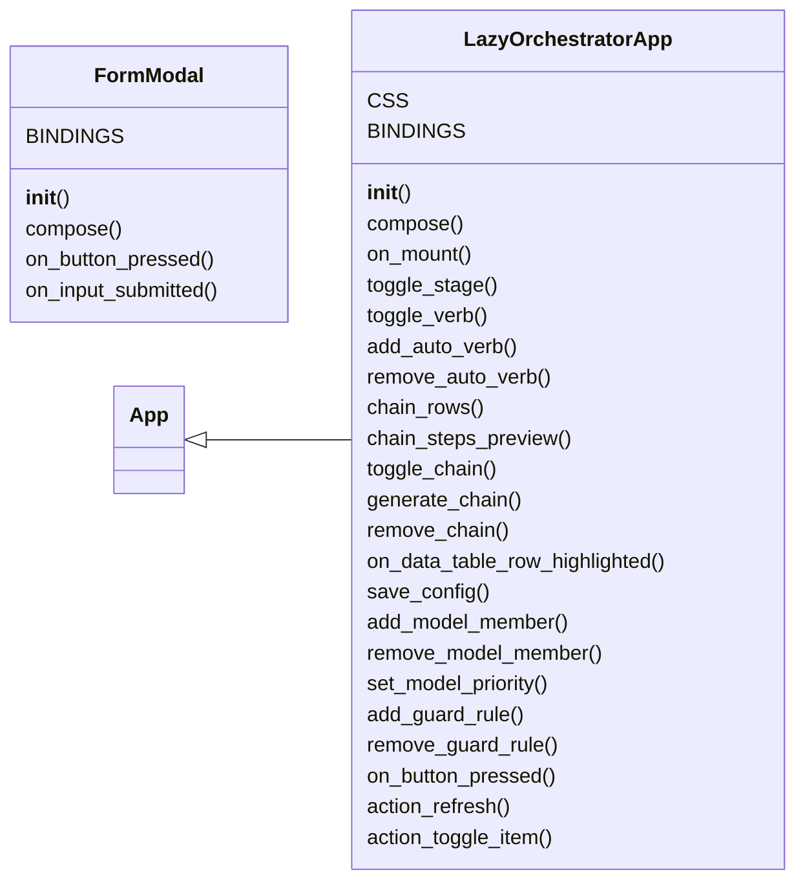
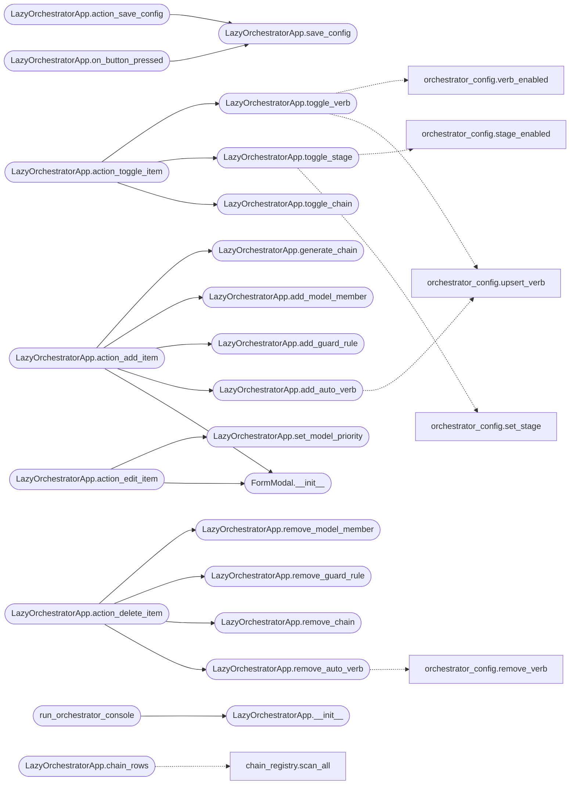

# `cli.lazy_orchestrator`

> Source: [cli/lazy_orchestrator.py:1](../../cli/lazy_orchestrator.py#L1) | language `py` | coverage 100.0% | [API index](../index.md)

Orchestrator admin console for the autonomous loop.

A Textual TUI in the spirit of the marketplace configurator:

- Now: what the loop is executing right now (task, stages, live activity
  tail, per-worker current command);
- Config: every payload knob the runner reads (rounds, workers,
  heartbeat, verb timeout, agentic flags, NOA, proxy);
- Models: the LLM failover chain (add/remove members);
- Guard: the intercept rules (add/remove).

Edits persist straight to ``payload.json`` (or a sandbox path in tests)
through `[`core.config`](core.config.py.md)`; nothing else mutates global state.

## Contents

- **Classes:** [`FormModal`](#formmodal), [`LazyOrchestratorApp`](#lazyorchestratorapp)
- **Functions:** [`run_orchestrator_console`](#run_orchestrator_console)

## Type Diagram



## Call Graph

Solid arrows stay in this module, dashed arrows leave it.



## Classes

<a id="formmodal"></a>

### `FormModal`

`class` | [cli/lazy_orchestrator.py:81](../../cli/lazy_orchestrator.py#L81)

```python
class FormModal(ModalScreen[dict])
```

Bases: `ModalScreen[dict]`

Generic key/value modal used for models and guard rules.

**Attributes**

| Name | Type | Default | Description |
|---|---|---|---|
| [`BINDINGS`](#formmodal-bindings) |  | `[('escape', 'dismiss(None)', 'cancel')]` |  |

**Members**

| Member | Kind | Summary |
|---|---|---|
| [`__init__`](#formmodal-__init__) | constructor | Store the title and (id, label, placeholder) field specs. |
| [`compose`](#formmodal-compose) | method | One labeled input per field plus a save button. |
| [`on_button_pressed`](#formmodal-on_button_pressed) | method | Collect the values and close the modal. |
| [`on_input_submitted`](#formmodal-on_input_submitted) | method | Enter commits the form like the save button. |

<a id="formmodal-__init__"></a>

#### `FormModal.__init__`

`constructor` | [cli/lazy_orchestrator.py:86](../../cli/lazy_orchestrator.py#L86)

```python
def __init__(self, title: str, fields: list[tuple[str, str, str]]) -> None
```

Store the title and (id, label, placeholder) field specs.

**Parameters**

| Name | Type | Default | Description |
|---|---|---|---|
| `title` | `str` |  |  |
| `fields` | `list[tuple[str, str, str]]` |  |  |

*Called by:* [`LazyOrchestratorApp.action_add_item`](#lazyorchestratorapp-action_add_item), [`LazyOrchestratorApp.action_edit_item`](#lazyorchestratorapp-action_edit_item)

<a id="formmodal-compose"></a>

#### `FormModal.compose`

`method` `generator` | [cli/lazy_orchestrator.py:92](../../cli/lazy_orchestrator.py#L92)

```python
def compose(self) -> ComposeResult
```

One labeled input per field plus a save button.

**Returns:** `ComposeResult`

<a id="formmodal-on_button_pressed"></a>

#### `FormModal.on_button_pressed`

`method` | [cli/lazy_orchestrator.py:101](../../cli/lazy_orchestrator.py#L101)

```python
def on_button_pressed(self, event: Button.Pressed) -> None
```

Collect the values and close the modal.

**Parameters**

| Name | Type | Default | Description |
|---|---|---|---|
| `event` | `Button.Pressed` |  |  |

<a id="formmodal-on_input_submitted"></a>

#### `FormModal.on_input_submitted`

`method` | [cli/lazy_orchestrator.py:110](../../cli/lazy_orchestrator.py#L110)

```python
def on_input_submitted(self, event: Input.Submitted) -> None
```

Enter commits the form like the save button.

**Parameters**

| Name | Type | Default | Description |
|---|---|---|---|
| `event` | `Input.Submitted` |  |  |

---

<a id="lazyorchestratorapp"></a>

### `LazyOrchestratorApp`

`class` | [cli/lazy_orchestrator.py:118](../../cli/lazy_orchestrator.py#L118)

```python
class LazyOrchestratorApp(App[None])
```

Bases: [`App[None]`](lazy_sentinel4.py.md#app)

Admin console: Now / Config / Verbs / Chains / Models / Guard.

**Attributes**

| Name | Type | Default | Description |
|---|---|---|---|
| [`CSS`](#lazyorchestratorapp-css) |  | `'\n #now-status { height: 6; border: round $accent; padding: 0 1; }\n #now-log { height: 1fr; border: round $primary; }\n #config-status { height: 3; color: $text-muted; }\n DataTable { height: 1fr; }\n .modal-box { width: 70; height: auto; padding: 1 2; background: $surface;\n border: round $accent; }\n .modal-title { text-style: bold; padding-bottom: 1; }\n .modal-label { padding-top: 1; }\n '` |  |
| [`BINDINGS`](#lazyorchestratorapp-bindings) |  | `[Binding('q', 'quit', 'Quit'), Binding('r', 'refresh', 'Refresh'), Binding('s', 'save_config', 'Save config'), Binding('space', 'toggle_item', 'Toggle'), Binding('a', 'add_item', 'Add'), Binding('e', 'edit_item', 'Edit priority'), Binding('d', 'delete_item', 'Delete')]` |  |

**Members**

| Member | Kind | Summary |
|---|---|---|
| [`__init__`](#lazyorchestratorapp-__init__) | constructor | Bind the console to a payload file and an optional task. |
| [`compose`](#lazyorchestratorapp-compose) | method | Build the four panes. |
| [`on_mount`](#lazyorchestratorapp-on_mount) | method | Load the payload into the form and refresh the data tables. |
| [`toggle_stage`](#lazyorchestratorapp-toggle_stage) | method | Flip one pipeline stage on/off and persist it. |
| [`toggle_verb`](#lazyorchestratorapp-toggle_verb) | method | Flip one auto verb on/off and persist it. |
| [`add_auto_verb`](#lazyorchestratorapp-add_auto_verb) | method | Register a new operator-defined auto verb. |
| [`remove_auto_verb`](#lazyorchestratorapp-remove_auto_verb) | method | Delete a custom verb, or disable a built-in one. |
| [`chain_rows`](#lazyorchestratorapp-chain_rows) | method | Return one row per chain file, including disabled ones. |
| [`chain_steps_preview`](#lazyorchestratorapp-chain_steps_preview) | method | Return the resolved step lines of a chain for the detail pane. |
| [`toggle_chain`](#lazyorchestratorapp-toggle_chain) | method | Flip a chain's enabled flag in its YAML file. |
| [`generate_chain`](#lazyorchestratorapp-generate_chain) | method | Generate chains/apt_<slug>.yaml from a playbook engine key. |
| [`remove_chain`](#lazyorchestratorapp-remove_chain) | method | Delete a chain file unless others extend it or it is the base. |
| [`on_data_table_row_highlighted`](#lazyorchestratorapp-on_data_table_row_highlighted) | method | Refresh the chains detail pane when the cursor moves. |
| [`save_config`](#lazyorchestratorapp-save_config) | method | Merge the given keys into the payload and persist it. |
| [`add_model_member`](#lazyorchestratorapp-add_model_member) | method | Append one LLM chain member; returns the stored name. |
| [`remove_model_member`](#lazyorchestratorapp-remove_model_member) | method | Drop one LLM chain member by name. |
| [`set_model_priority`](#lazyorchestratorapp-set_model_priority) | method | Change one LLM member's failover rank and repaint the table. |
| [`add_guard_rule`](#lazyorchestratorapp-add_guard_rule) | method | Register one guard intercept rule. |
| [`remove_guard_rule`](#lazyorchestratorapp-remove_guard_rule) | method | Delete one guard rule by exact pattern. |
| [`on_button_pressed`](#lazyorchestratorapp-on_button_pressed) | method | Handle the config save button. |
| [`action_refresh`](#lazyorchestratorapp-action_refresh) | method | Reload tables and form from disk. |
| [`action_toggle_item`](#lazyorchestratorapp-action_toggle_item) | method | Toggle the selected stage, auto verb, or chain. |
| [`action_save_config`](#lazyorchestratorapp-action_save_config) | method | Save the form values (keyboard shortcut). |
| [`action_add_item`](#lazyorchestratorapp-action_add_item) | method | Open the add modal for the active tab. |
| [`action_edit_item`](#lazyorchestratorapp-action_edit_item) | method | Edit the selected LLM member's priority (models tab only). |
| [`action_delete_item`](#lazyorchestratorapp-action_delete_item) | method | Delete the selected row in the active tab. |

<a id="lazyorchestratorapp-__init__"></a>

#### `LazyOrchestratorApp.__init__`

`constructor` | [cli/lazy_orchestrator.py:142](../../cli/lazy_orchestrator.py#L142)

```python
def __init__(self, payload_path: str | Path | None = None, task_id: str = '') -> None
```

Bind the console to a payload file and an optional task.

**Parameters**

| Name | Type | Default | Description |
|---|---|---|---|
| `payload_path` | `str \| Path \| None` | `None` |  |
| `task_id` | `str` | `''` |  |

*Called by:* [`run_orchestrator_console`](#run_orchestrator_console)

<a id="lazyorchestratorapp-compose"></a>

#### `LazyOrchestratorApp.compose`

`method` `generator` | [cli/lazy_orchestrator.py:153](../../cli/lazy_orchestrator.py#L153)

```python
def compose(self) -> ComposeResult
```

Build the four panes.

**Returns:** `ComposeResult`

<a id="lazyorchestratorapp-on_mount"></a>

#### `LazyOrchestratorApp.on_mount`

`method` | [cli/lazy_orchestrator.py:182](../../cli/lazy_orchestrator.py#L182)

```python
def on_mount(self) -> None
```

Load the payload into the form and refresh the data tables.

<a id="lazyorchestratorapp-toggle_stage"></a>

#### `LazyOrchestratorApp.toggle_stage`

`method` | [cli/lazy_orchestrator.py:193](../../cli/lazy_orchestrator.py#L193)

```python
def toggle_stage(self, name: str) -> bool
```

Flip one pipeline stage on/off and persist it.

**Parameters**

| Name | Type | Default | Description |
|---|---|---|---|
| `name` | `str` |  |  |

**Returns:** `bool`

*Calls:* [`set_stage`](modules.orchestrator_config.py.md#set_stage), [`stage_enabled`](modules.orchestrator_config.py.md#stage_enabled)

*Called by:* [`LazyOrchestratorApp.action_toggle_item`](#lazyorchestratorapp-action_toggle_item)

<a id="lazyorchestratorapp-toggle_verb"></a>

#### `LazyOrchestratorApp.toggle_verb`

`method` | [cli/lazy_orchestrator.py:202](../../cli/lazy_orchestrator.py#L202)

```python
def toggle_verb(self, name: str) -> bool
```

Flip one auto verb on/off and persist it.

**Parameters**

| Name | Type | Default | Description |
|---|---|---|---|
| `name` | `str` |  |  |

**Returns:** `bool`

*Calls:* [`upsert_verb`](modules.orchestrator_config.py.md#upsert_verb), [`verb_enabled`](modules.orchestrator_config.py.md#verb_enabled)

*Called by:* [`LazyOrchestratorApp.action_toggle_item`](#lazyorchestratorapp-action_toggle_item)

<a id="lazyorchestratorapp-add_auto_verb"></a>

#### `LazyOrchestratorApp.add_auto_verb`

`method` | [cli/lazy_orchestrator.py:211](../../cli/lazy_orchestrator.py#L211)

```python
def add_auto_verb(self, name: str, keywords: str = '', needs_target: str = 'true', description: str = '') -> dict
```

Register a new operator-defined auto verb.

**Parameters**

| Name | Type | Default | Description |
|---|---|---|---|
| `name` | `str` |  |  |
| `keywords` | `str` | `''` |  |
| `needs_target` | `str` | `'true'` |  |
| `description` | `str` | `''` |  |

**Returns:** `dict`

*Calls:* [`upsert_verb`](modules.orchestrator_config.py.md#upsert_verb)

*Called by:* [`LazyOrchestratorApp.action_add_item`](#lazyorchestratorapp-action_add_item)

<a id="lazyorchestratorapp-remove_auto_verb"></a>

#### `LazyOrchestratorApp.remove_auto_verb`

`method` | [cli/lazy_orchestrator.py:226](../../cli/lazy_orchestrator.py#L226)

```python
def remove_auto_verb(self, name: str) -> bool
```

Delete a custom verb, or disable a built-in one.

**Parameters**

| Name | Type | Default | Description |
|---|---|---|---|
| `name` | `str` |  |  |

**Returns:** `bool`

*Calls:* [`remove_verb`](modules.orchestrator_config.py.md#remove_verb)

*Called by:* [`LazyOrchestratorApp.action_delete_item`](#lazyorchestratorapp-action_delete_item)

<a id="lazyorchestratorapp-chain_rows"></a>

#### `LazyOrchestratorApp.chain_rows`

`method` | [cli/lazy_orchestrator.py:242](../../cli/lazy_orchestrator.py#L242)

```python
def chain_rows(self) -> list[dict]
```

Return one row per chain file, including disabled ones.

**Returns:** `list[dict]`

*Calls:* [`scan_all`](modules.chain_registry.py.md#scan_all)

<a id="lazyorchestratorapp-chain_steps_preview"></a>

#### `LazyOrchestratorApp.chain_steps_preview`

`method` | [cli/lazy_orchestrator.py:251](../../cli/lazy_orchestrator.py#L251)

```python
def chain_steps_preview(self, name: str, limit: int = 10) -> str
```

Return the resolved step lines of a chain for the detail pane.

**Parameters**

| Name | Type | Default | Description |
|---|---|---|---|
| `name` | `str` |  |  |
| `limit` | `int` | `10` |  |

**Returns:** `str`

*Calls:* [`AptPlaybookEngine.get`](modules.apt_playbooks.py.md#aptplaybookengine-get)

<a id="lazyorchestratorapp-toggle_chain"></a>

#### `LazyOrchestratorApp.toggle_chain`

`method` | [cli/lazy_orchestrator.py:268](../../cli/lazy_orchestrator.py#L268)

```python
def toggle_chain(self, name: str) -> bool
```

Flip a chain's enabled flag in its YAML file.

**Parameters**

| Name | Type | Default | Description |
|---|---|---|---|
| `name` | `str` |  |  |

**Returns:** `bool`

*Calls:* [`scan_all`](modules.chain_registry.py.md#scan_all), [`set_enabled`](modules.chain_registry.py.md#set_enabled)

*Called by:* [`LazyOrchestratorApp.action_toggle_item`](#lazyorchestratorapp-action_toggle_item)

<a id="lazyorchestratorapp-generate_chain"></a>

#### `LazyOrchestratorApp.generate_chain`

`method` | [cli/lazy_orchestrator.py:279](../../cli/lazy_orchestrator.py#L279)

```python
def generate_chain(self, playbook_key: str) -> str
```

Generate chains/apt_<slug>.yaml from a playbook engine key.

**Parameters**

| Name | Type | Default | Description |
|---|---|---|---|
| `playbook_key` | `str` |  |  |

**Returns:** `str`

*Calls:* [`AptPlaybookEngine.__init__`](modules.apt_playbooks.py.md#aptplaybookengine-__init__), [`AptPlaybookEngine.get`](modules.apt_playbooks.py.md#aptplaybookengine-get), [`generate_for_playbook`](modules.chain_registry.py.md#generate_for_playbook)

*Called by:* [`LazyOrchestratorApp.action_add_item`](#lazyorchestratorapp-action_add_item)

<a id="lazyorchestratorapp-remove_chain"></a>

#### `LazyOrchestratorApp.remove_chain`

`method` | [cli/lazy_orchestrator.py:293](../../cli/lazy_orchestrator.py#L293)

```python
def remove_chain(self, name: str) -> bool
```

Delete a chain file unless others extend it or it is the base.

Returns False (refusing loudly) for the base ``apt_chain`` and
for any parent with children — edit or disable those instead.

**Parameters**

| Name | Type | Default | Description |
|---|---|---|---|
| `name` | `str` |  |  |

**Returns:** `bool`

*Calls:* [`scan_all`](modules.chain_registry.py.md#scan_all)

*Called by:* [`LazyOrchestratorApp.action_delete_item`](#lazyorchestratorapp-action_delete_item)

<a id="lazyorchestratorapp-on_data_table_row_highlighted"></a>

#### `LazyOrchestratorApp.on_data_table_row_highlighted`

`method` | [cli/lazy_orchestrator.py:349](../../cli/lazy_orchestrator.py#L349)

```python
def on_data_table_row_highlighted(self, event: DataTable.RowHighlighted) -> None
```

Refresh the chains detail pane when the cursor moves.

**Parameters**

| Name | Type | Default | Description |
|---|---|---|---|
| `event` | `DataTable.RowHighlighted` |  |  |

<a id="lazyorchestratorapp-save_config"></a>

#### `LazyOrchestratorApp.save_config`

`method` | [cli/lazy_orchestrator.py:423](../../cli/lazy_orchestrator.py#L423)

```python
def save_config(self, values: dict) -> dict
```

Merge the given keys into the payload and persist it.

**Parameters**

| Name | Type | Default | Description |
|---|---|---|---|
| `values` | `dict` |  | Mapping of payload keys to new values (strings). |

**Returns:** `dict` - The updated payload mapping.

*Calls:* [`save_payload`](core.config.py.md#save_payload)

*Called by:* [`LazyOrchestratorApp.action_save_config`](#lazyorchestratorapp-action_save_config), [`LazyOrchestratorApp.on_button_pressed`](#lazyorchestratorapp-on_button_pressed)

<a id="lazyorchestratorapp-add_model_member"></a>

#### `LazyOrchestratorApp.add_model_member`

`method` | [cli/lazy_orchestrator.py:445](../../cli/lazy_orchestrator.py#L445)

```python
def add_model_member(self, name: str, model: str, priority: str = '0') -> str
```

Append one LLM chain member; returns the stored name.

**Parameters**

| Name | Type | Default | Description |
|---|---|---|---|
| `name` | `str` |  |  |
| `model` | `str` |  |  |
| `priority` | `str` | `'0'` |  |

**Returns:** `str`

*Calls:* [`LlmPool.__init__`](modules.lazy_loop.py.md#llmpool-__init__), [`LlmPool.add_member`](modules.lazy_loop.py.md#llmpool-add_member)

*Called by:* [`LazyOrchestratorApp.action_add_item`](#lazyorchestratorapp-action_add_item)

<a id="lazyorchestratorapp-remove_model_member"></a>

#### `LazyOrchestratorApp.remove_model_member`

`method` | [cli/lazy_orchestrator.py:453](../../cli/lazy_orchestrator.py#L453)

```python
def remove_model_member(self, name: str) -> bool
```

Drop one LLM chain member by name.

**Parameters**

| Name | Type | Default | Description |
|---|---|---|---|
| `name` | `str` |  |  |

**Returns:** `bool`

*Calls:* [`LlmPool.__init__`](modules.lazy_loop.py.md#llmpool-__init__), [`LlmPool.remove_member`](modules.lazy_loop.py.md#llmpool-remove_member)

*Called by:* [`LazyOrchestratorApp.action_delete_item`](#lazyorchestratorapp-action_delete_item)

<a id="lazyorchestratorapp-set_model_priority"></a>

#### `LazyOrchestratorApp.set_model_priority`

`method` | [cli/lazy_orchestrator.py:461](../../cli/lazy_orchestrator.py#L461)

```python
def set_model_priority(self, name: str, priority: str = '0') -> bool
```

Change one LLM member's failover rank and repaint the table.

**Parameters**

| Name | Type | Default | Description |
|---|---|---|---|
| `name` | `str` |  |  |
| `priority` | `str` | `'0'` |  |

**Returns:** `bool`

*Calls:* [`LlmPool.__init__`](modules.lazy_loop.py.md#llmpool-__init__), [`LlmPool.set_priority`](modules.lazy_loop.py.md#llmpool-set_priority)

*Called by:* [`LazyOrchestratorApp.action_edit_item`](#lazyorchestratorapp-action_edit_item)

<a id="lazyorchestratorapp-add_guard_rule"></a>

#### `LazyOrchestratorApp.add_guard_rule`

`method` | [cli/lazy_orchestrator.py:473](../../cli/lazy_orchestrator.py#L473)

```python
def add_guard_rule(self, pattern: str, action: str = 'ask', reason: str = '') -> bool
```

Register one guard intercept rule.

**Parameters**

| Name | Type | Default | Description |
|---|---|---|---|
| `pattern` | `str` |  |  |
| `action` | `str` | `'ask'` |  |
| `reason` | `str` | `''` |  |

**Returns:** `bool`

*Calls:* [`Guard.__init__`](modules.lazy_loop.py.md#guard-__init__), [`Guard.add_rule`](modules.lazy_loop.py.md#guard-add_rule)

*Called by:* [`LazyOrchestratorApp.action_add_item`](#lazyorchestratorapp-action_add_item)

<a id="lazyorchestratorapp-remove_guard_rule"></a>

#### `LazyOrchestratorApp.remove_guard_rule`

`method` | [cli/lazy_orchestrator.py:481](../../cli/lazy_orchestrator.py#L481)

```python
def remove_guard_rule(self, pattern: str) -> bool
```

Delete one guard rule by exact pattern.

**Parameters**

| Name | Type | Default | Description |
|---|---|---|---|
| `pattern` | `str` |  |  |

**Returns:** `bool`

*Calls:* [`Guard.__init__`](modules.lazy_loop.py.md#guard-__init__), [`Guard.remove_rule`](modules.lazy_loop.py.md#guard-remove_rule)

*Called by:* [`LazyOrchestratorApp.action_delete_item`](#lazyorchestratorapp-action_delete_item)

<a id="lazyorchestratorapp-on_button_pressed"></a>

#### `LazyOrchestratorApp.on_button_pressed`

`method` | [cli/lazy_orchestrator.py:585](../../cli/lazy_orchestrator.py#L585)

```python
def on_button_pressed(self, event: Button.Pressed) -> None
```

Handle the config save button.

**Parameters**

| Name | Type | Default | Description |
|---|---|---|---|
| `event` | `Button.Pressed` |  |  |

*Calls:* [`LazyOrchestratorApp.save_config`](#lazyorchestratorapp-save_config)

<a id="lazyorchestratorapp-action_refresh"></a>

#### `LazyOrchestratorApp.action_refresh`

`method` | [cli/lazy_orchestrator.py:603](../../cli/lazy_orchestrator.py#L603)

```python
def action_refresh(self) -> None
```

Reload tables and form from disk.

<a id="lazyorchestratorapp-action_toggle_item"></a>

#### `LazyOrchestratorApp.action_toggle_item`

`method` | [cli/lazy_orchestrator.py:621](../../cli/lazy_orchestrator.py#L621)

```python
def action_toggle_item(self) -> None
```

Toggle the selected stage, auto verb, or chain.

*Calls:* [`LazyOrchestratorApp.toggle_chain`](#lazyorchestratorapp-toggle_chain), [`LazyOrchestratorApp.toggle_stage`](#lazyorchestratorapp-toggle_stage), [`LazyOrchestratorApp.toggle_verb`](#lazyorchestratorapp-toggle_verb)

<a id="lazyorchestratorapp-action_save_config"></a>

#### `LazyOrchestratorApp.action_save_config`

`method` | [cli/lazy_orchestrator.py:637](../../cli/lazy_orchestrator.py#L637)

```python
def action_save_config(self) -> None
```

Save the form values (keyboard shortcut).

*Calls:* [`LazyOrchestratorApp.save_config`](#lazyorchestratorapp-save_config)

<a id="lazyorchestratorapp-action_add_item"></a>

#### `LazyOrchestratorApp.action_add_item`

`method` | [cli/lazy_orchestrator.py:654](../../cli/lazy_orchestrator.py#L654)

```python
def action_add_item(self) -> None
```

Open the add modal for the active tab.

*Calls:* [`FormModal.__init__`](#formmodal-__init__), [`LazyOrchestratorApp.add_auto_verb`](#lazyorchestratorapp-add_auto_verb), [`LazyOrchestratorApp.add_guard_rule`](#lazyorchestratorapp-add_guard_rule), [`LazyOrchestratorApp.add_model_member`](#lazyorchestratorapp-add_model_member), [`LazyOrchestratorApp.generate_chain`](#lazyorchestratorapp-generate_chain)

<a id="lazyorchestratorapp-action_edit_item"></a>

#### `LazyOrchestratorApp.action_edit_item`

`method` | [cli/lazy_orchestrator.py:730](../../cli/lazy_orchestrator.py#L730)

```python
def action_edit_item(self) -> None
```

Edit the selected LLM member's priority (models tab only).

*Calls:* [`FormModal.__init__`](#formmodal-__init__), [`LazyOrchestratorApp.set_model_priority`](#lazyorchestratorapp-set_model_priority), [`LlmPool.__init__`](modules.lazy_loop.py.md#llmpool-__init__), [`LlmPool.members`](modules.lazy_loop.py.md#llmpool-members)

<a id="lazyorchestratorapp-action_delete_item"></a>

#### `LazyOrchestratorApp.action_delete_item`

`method` | [cli/lazy_orchestrator.py:764](../../cli/lazy_orchestrator.py#L764)

```python
def action_delete_item(self) -> None
```

Delete the selected row in the active tab.

*Calls:* [`LazyOrchestratorApp.remove_auto_verb`](#lazyorchestratorapp-remove_auto_verb), [`LazyOrchestratorApp.remove_chain`](#lazyorchestratorapp-remove_chain), [`LazyOrchestratorApp.remove_guard_rule`](#lazyorchestratorapp-remove_guard_rule), [`LazyOrchestratorApp.remove_model_member`](#lazyorchestratorapp-remove_model_member)

---

## Functions

<a id="run_orchestrator_console"></a>

### `run_orchestrator_console`

`function` | [cli/lazy_orchestrator.py:810](../../cli/lazy_orchestrator.py#L810)

```python
def run_orchestrator_console(task_id: str = '') -> None
```

Launch the admin console (attach mode).

**Parameters**

| Name | Type | Default | Description |
|---|---|---|---|
| `task_id` | `str` | `''` |  |

*Calls:* [`LazyOrchestratorApp.__init__`](#lazyorchestratorapp-__init__)

*Called by:* [`LazyQueueCommandSet.do_lazy_orchestrator`](cli.commands.lazyloop.py.md#lazyqueuecommandset-do_lazy_orchestrator)

---
