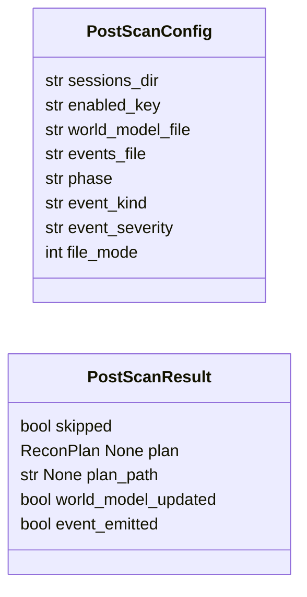
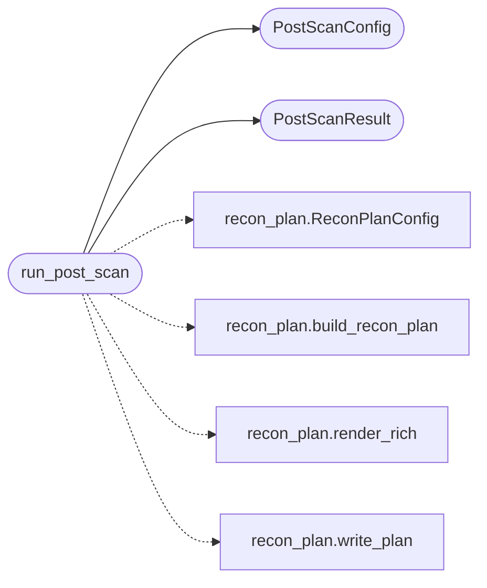

# `cli.lazynmap_post`

> Source: [cli/lazynmap_post.py:1](../../cli/lazynmap_post.py#L1) | language `py` | coverage 100.0% | [API index](../index.md)

Post-scan side effects executed at the tail of `[`do_lazynmap`](cli.commands.recon.py.md#reconcommandset-do_lazynmap)`.

Three artefacts are produced after every successful scan:

1. ``sessions/recon_plan_<target>.md`` — operator + LLM-readable plan
   generated by [`cli.recon_plan.build_recon_plan`](cli.recon_plan.py.md#build_recon_plan).
2. ``sessions/world_model.json`` — phase bumped to ``enum`` through the
    `[`KillChain.advance_phase`](modules.killchain.py.md#killchain-advance_phase)` canonical entrypoint (single-writer seam
    for the kill-chain) so the daemon / autonomous loop / status bar
    agree we have just transitioned past pure recon.
3. ``sessions/autonomous_events.jsonl`` — one ``lazynmap.recon_plan``
   event so MCP consumers (``lazyown_poll_events`` and the dashboard)
   see the transition.

Every step is best-effort: failure in one branch must not block the
others or propagate back into [`LazyOwnShell`](lazyown.py.md#lazyownshell). The implementation
is pure Python (no ``cmd2``, ``rich`` or ``flask`` imports) so the suite
can exercise it with hand-rolled fixtures.

## Contents

- **Classes:** [`PostScanConfig`](#postscanconfig), [`PostScanResult`](#postscanresult)
- **Functions:** [`run_post_scan`](#run_post_scan)

## Type Diagram



## Call Graph

Solid arrows stay in this module, dashed arrows leave it.



## Classes

<a id="postscanconfig"></a>

### `PostScanConfig`

`class` `dataclass` | [cli/lazynmap_post.py:57](../../cli/lazynmap_post.py#L57)

Decorators: `@dataclass(frozen=True)`

```python
class PostScanConfig
```

Immutable configuration for [`run_post_scan`](#run_post_scan).

Every default mirrors a key already documented in ``CLAUDE.md`` so
the operator can adjust behaviour via ``payload.json`` without
touching code.

**Attributes**

| Name | Type | Default | Description |
|---|---|---|---|
| [`sessions_dir`](#postscanconfig-sessions_dir) | `str` | `'sessions'` |  |
| [`enabled_key`](#postscanconfig-enabled_key) | `str` | `_DEFAULT_ENABLED_KEY` |  |
| [`world_model_file`](#postscanconfig-world_model_file) | `str` | `_DEFAULT_WORLD_MODEL_FILE` |  |
| [`events_file`](#postscanconfig-events_file) | `str` | `_DEFAULT_EVENTS_FILE` |  |
| [`phase`](#postscanconfig-phase) | `str` | `_DEFAULT_PHASE` |  |
| [`event_kind`](#postscanconfig-event_kind) | `str` | `_DEFAULT_EVENT_KIND` |  |
| [`event_severity`](#postscanconfig-event_severity) | `str` | `_DEFAULT_EVENT_SEVERITY` |  |
| [`file_mode`](#postscanconfig-file_mode) | `int` | `_FILE_MODE` |  |

---

<a id="postscanresult"></a>

### `PostScanResult`

`class` `dataclass` | [cli/lazynmap_post.py:76](../../cli/lazynmap_post.py#L76)

Decorators: `@dataclass(frozen=True)`

```python
class PostScanResult
```

Structured outcome of [`run_post_scan`](#run_post_scan).

**Attributes**

| Name | Type | Default | Description |
|---|---|---|---|
| [`skipped`](#postscanresult-skipped) | `bool` |  | ``True`` when the operator toggled the feature off. |
| [`plan`](#postscanresult-plan) | `ReconPlan \| None` |  | The generated [`ReconPlan`](cli.recon_plan.py.md#reconplan), or ``None`` on failure. |
| [`plan_path`](#postscanresult-plan_path) | `str \| None` |  | Filesystem path the plan was written to, when any. |
| [`world_model_updated`](#postscanresult-world_model_updated) | `bool` |  | ``True`` when the phase write succeeded. |
| [`event_emitted`](#postscanresult-event_emitted) | `bool` |  | ``True`` when the events.jsonl append succeeded. |

---

## Functions

<a id="run_post_scan"></a>

### `run_post_scan`

`function` | [cli/lazynmap_post.py:94](../../cli/lazynmap_post.py#L94)

```python
def run_post_scan(target: str, payload: Mapping[str, Any], console: Any = None, config: PostScanConfig | None = None, engine_factory: Callable[[], ExplorationEngine] | None = None, plan_config: ReconPlanConfig | None = None, clock: Callable[[], float] | None = None) -> PostScanResult
```

Generate the plan, bump the world model and emit an event.

**Parameters**

| Name | Type | Default | Description |
|---|---|---|---|
| `target` | `str` |  | Host the scan was performed on. |
| `payload` | `Mapping[str, Any]` |  | ``payload.json`` mapping. Used to resolve the active platform and the ``enable_recon_plan`` toggle. |
| `console` | `Any` | `None` | Optional duck-typed console (``rich.console.Console`` compatible). When ``None`` the plan is still written to disk; only the inline preview is suppressed. |
| `config` | `PostScanConfig \| None` | `None` | Optional [`PostScanConfig`](#postscanconfig) override. |
| `engine_factory` | `Callable[[], ExplorationEngine] \| None` | `None` | Zero-arg callable returning an [`ExplorationEngine`](cli.exploration.py.md#explorationengine). Defaults to one wired against ``cfg.sessions_dir`` and the payload-resolved OS. |
| `plan_config` | `ReconPlanConfig \| None` | `None` | Optional [`ReconPlanConfig`](cli.recon_plan.py.md#reconplanconfig) override. |
| `clock` | `Callable[[], float] \| None` | `None` | Zero-arg callable returning epoch seconds. |

**Returns:** `PostScanResult` - A [`PostScanResult`](#postscanresult) summarising what was produced. The
function never raises — every error path is logged via
``console.print`` and recorded as ``False`` in the result.

*Calls:* [`PostScanConfig`](#postscanconfig), [`PostScanResult`](#postscanresult), [`ReconPlanConfig`](cli.recon_plan.py.md#reconplanconfig), [`build_recon_plan`](cli.recon_plan.py.md#build_recon_plan), [`render_rich`](cli.recon_plan.py.md#render_rich), [`write_plan`](cli.recon_plan.py.md#write_plan)

---
