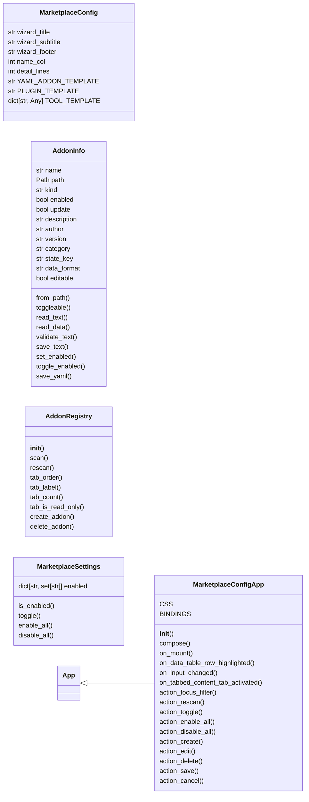
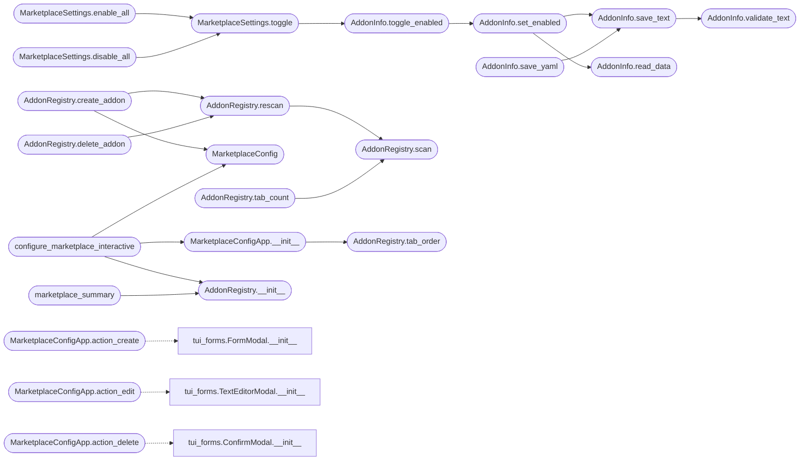

# `cli.marketplace_config`

> Source: [cli/marketplace_config.py:1](../../cli/marketplace_config.py#L1) | language `py` | coverage 100.0% | [API index](../index.md)

Interactive marketplace manager for LazyOwn lazyaddons, plugins, and tools.

A Textual console in the same style as ``lazy_orchestrator``: searchable
tabs, a table per source, a detail/preview pane and keyboard actions to
toggle, edit, create and delete entries.

Sources and their state keys:

===============  =============  ===========  =====================
tab              format         state key    notes
===============  =============  ===========  =====================
``lazyaddons``   YAML           `[`enabled`](#addoninfo-enabled)`  tool integrations
``plugins``      YAML           `[`enabled`](#addoninfo-enabled)`  metadata beside Lua code
`[`tools`](cli.exploration.py.md#explorationengine-tools)`        JSON           ``active``   pwntomate auto-jobs
``yara``         text           -            read-only rules
``nuclei``       YAML           -            read-only templates
===============  =============  ===========  =====================

Design (SOLID):

- `[`MarketplaceConfig`](#marketplaceconfig)` centralises labels, columns and file templates.
- `[`AddonInfo`](#addoninfo)` knows how to read and persist one entry in its own format.
- `[`AddonRegistry`](#addonregistry)` scans directories, creates and deletes entries.
- `[`MarketplaceSettings`](#marketplacesettings)` is the mutable enabled-state view.
- `[`MarketplaceConfigApp`](#marketplaceconfigapp)` is the only Textual surface.
- `[`configure_marketplace_interactive`](#configure_marketplace_interactive)` is the public entry point.

## Contents

- **Classes:** [`MarketplaceConfig`](#marketplaceconfig), [`AddonInfo`](#addoninfo), [`AddonRegistry`](#addonregistry), [`MarketplaceSettings`](#marketplacesettings), [`MarketplaceConfigApp`](#marketplaceconfigapp)
- **Functions:** [`configure_marketplace_interactive`](#configure_marketplace_interactive), [`marketplace_summary`](#marketplace_summary)

## Type Diagram



## Call Graph

Solid arrows stay in this module, dashed arrows leave it.



## Classes

<a id="marketplaceconfig"></a>

### `MarketplaceConfig`

`class` `dataclass` | [cli/marketplace_config.py:78](../../cli/marketplace_config.py#L78)

Decorators: `@dataclass(frozen=True)`

```python
class MarketplaceConfig
```

Centralised labels, columns and file templates.

**Attributes**

| Name | Type | Default | Description |
|---|---|---|---|
| [`wizard_title`](#marketplaceconfig-wizard_title) | `str` | `'LazyOwn Marketplace Manager'` |  |
| [`wizard_subtitle`](#marketplaceconfig-wizard_subtitle) | `str` | `'Addon / Plugin / Tool - search, toggle, edit, create'` |  |
| [`wizard_footer`](#marketplaceconfig-wizard_footer) | `str` | `'[/] filter [space] toggle [a/n] all/none [e] edit [c] create [d] delete [r] rescan [enter] save [esc] cancel'` |  |
| [`name_col`](#marketplaceconfig-name_col) | `int` | `34` |  |
| [`detail_lines`](#marketplaceconfig-detail_lines) | `int` | `PREVIEW_LINES` |  |
| [`YAML_ADDON_TEMPLATE`](#marketplaceconfig-yaml_addon_template) | `str` | `"name: {name}\ndescription: >\n Short description of what {name} does.\nauthor: LazyOwn RedTeam\nversion: '1.0'\nenabled: true\nparams: []\nos: any\ntrigger: []\ntool:\n name: {name}\n repo_url: https://github.com/example/{name}.git\n install_path: external/.exploit/{name}\n install_command: ''\n execute_command: ''\ncategory: 12. Miscellaneous\n"` |  |
| [`PLUGIN_TEMPLATE`](#marketplaceconfig-plugin_template) | `str` | `"name: {name}\nversion: '1.0'\ndescription: >\n Short description of what {name} does.\nauthor: LazyOwn RedTeam\ncategory: custom\nphase: post_exploitation\nenabled: true\ntags:\n - custom\nparams: []\n"` |  |
| [`TOOL_TEMPLATE`](#marketplaceconfig-tool_template) | `dict[str, Any]` | `field(default_factory=lambda: {'toolname': '{name}', 'command': '', 'trigger': [], 'active': True, 'category': '12. Miscellaneous', 'description': 'Pwntomate tool: {name}'})` |  |

---

<a id="addoninfo"></a>

### `AddonInfo`

`class` `dataclass` | [cli/marketplace_config.py:134](../../cli/marketplace_config.py#L134)

Decorators: `@dataclass`

```python
class AddonInfo
```

One marketplace entry plus the rules to read and persist it.

**Attributes**

| Name | Type | Default | Description |
|---|---|---|---|
| [`name`](#addoninfo-name) | `str` |  |  |
| [`path`](#addoninfo-path) | `Path` |  |  |
| [`kind`](#addoninfo-kind) | `str` |  |  |
| [`enabled`](#addoninfo-enabled) | `bool` | `True` |  |
| [`update`](#addoninfo-update) | `bool` | `False` |  |
| [`description`](#addoninfo-description) | `str` | `''` |  |
| [`author`](#addoninfo-author) | `str` | `''` |  |
| [`version`](#addoninfo-version) | `str` | `''` |  |
| [`category`](#addoninfo-category) | `str` | `''` |  |
| [`state_key`](#addoninfo-state_key) | `str` | `'enabled'` |  |
| [`data_format`](#addoninfo-data_format) | `str` | `'yaml'` |  |
| [`editable`](#addoninfo-editable) | `bool` | `True` |  |

**Members**

| Member | Kind | Summary |
|---|---|---|
| [`from_path`](#addoninfo-from_path) | classmethod | Build one entry from its file, tolerating malformed content. |
| [`toggleable`](#addoninfo-toggleable) | property | Return whether this entry has a persisted enable/disable flag. |
| [`read_text`](#addoninfo-read_text) | method | Return the raw file text, capped for the in-app editor. |
| [`read_data`](#addoninfo-read_data) | method | Return the parsed mapping for the entry's format. |
| [`validate_text`](#addoninfo-validate_text) | method | Raise ``ValueError`` when the edited document is not usable. |
| [`save_text`](#addoninfo-save_text) | method | Validate and atomically rewrite the raw entry. |
| [`set_enabled`](#addoninfo-set_enabled) | method | Persist the enable/disable flag in the entry's native format. |
| [`toggle_enabled`](#addoninfo-toggle_enabled) | method | Flip the enabled state on disk. |
| [`save_yaml`](#addoninfo-save_yaml) | method | Rewrite a YAML entry with the given mapping (compatibility helper). |

<a id="addoninfo-from_path"></a>

#### `AddonInfo.from_path`

`classmethod` | [cli/marketplace_config.py:151](../../cli/marketplace_config.py#L151)

Decorators: `@classmethod`

```python
def from_path(cls, path: Path, kind: str) -> AddonInfo
```

Build one entry from its file, tolerating malformed content.

**Parameters**

| Name | Type | Default | Description |
|---|---|---|---|
| `path` | `Path` |  |  |
| `kind` | `str` |  |  |

**Returns:** `AddonInfo`

<a id="addoninfo-toggleable"></a>

#### `AddonInfo.toggleable`

`property` | [cli/marketplace_config.py:221](../../cli/marketplace_config.py#L221)

Decorators: `@property`

```python
def toggleable(self) -> bool
```

Return whether this entry has a persisted enable/disable flag.

**Returns:** `bool`

<a id="addoninfo-read_text"></a>

#### `AddonInfo.read_text`

`method` | [cli/marketplace_config.py:225](../../cli/marketplace_config.py#L225)

```python
def read_text(self) -> str
```

Return the raw file text, capped for the in-app editor.

**Returns:** `str`

<a id="addoninfo-read_data"></a>

#### `AddonInfo.read_data`

`method` | [cli/marketplace_config.py:229](../../cli/marketplace_config.py#L229)

```python
def read_data(self) -> dict[str, Any] | None
```

Return the parsed mapping for the entry's format.

**Returns:** `dict[str, Any] | None`

*Called by:* [`AddonInfo.set_enabled`](#addoninfo-set_enabled)

<a id="addoninfo-validate_text"></a>

#### `AddonInfo.validate_text`

`method` | [cli/marketplace_config.py:238](../../cli/marketplace_config.py#L238)

```python
def validate_text(self, text: str) -> None
```

Raise ``ValueError`` when the edited document is not usable.

**Parameters**

| Name | Type | Default | Description |
|---|---|---|---|
| `text` | `str` |  |  |

**Raises**

- `ValueError`: (raised in the body, not documented)

*Called by:* [`AddonInfo.save_text`](#addoninfo-save_text)

<a id="addoninfo-save_text"></a>

#### `AddonInfo.save_text`

`method` | [cli/marketplace_config.py:260](../../cli/marketplace_config.py#L260)

```python
def save_text(self, text: str) -> bool
```

Validate and atomically rewrite the raw entry.

**Parameters**

| Name | Type | Default | Description |
|---|---|---|---|
| `text` | `str` |  |  |

**Returns:** `bool`

*Calls:* [`AddonInfo.validate_text`](#addoninfo-validate_text)

*Called by:* [`AddonInfo.save_yaml`](#addoninfo-save_yaml), [`AddonInfo.set_enabled`](#addoninfo-set_enabled)

<a id="addoninfo-set_enabled"></a>

#### `AddonInfo.set_enabled`

`method` | [cli/marketplace_config.py:278](../../cli/marketplace_config.py#L278)

```python
def set_enabled(self, enabled: bool) -> bool
```

Persist the enable/disable flag in the entry's native format.

**Parameters**

| Name | Type | Default | Description |
|---|---|---|---|
| `enabled` | `bool` |  |  |

**Returns:** `bool`

*Calls:* [`AddonInfo.read_data`](#addoninfo-read_data), [`AddonInfo.save_text`](#addoninfo-save_text)

*Called by:* [`AddonInfo.toggle_enabled`](#addoninfo-toggle_enabled)

<a id="addoninfo-toggle_enabled"></a>

#### `AddonInfo.toggle_enabled`

`method` | [cli/marketplace_config.py:299](../../cli/marketplace_config.py#L299)

```python
def toggle_enabled(self) -> bool
```

Flip the enabled state on disk.

**Returns:** `bool`

*Calls:* [`AddonInfo.set_enabled`](#addoninfo-set_enabled)

*Called by:* [`MarketplaceSettings.toggle`](#marketplacesettings-toggle)

<a id="addoninfo-save_yaml"></a>

#### `AddonInfo.save_yaml`

`method` | [cli/marketplace_config.py:303](../../cli/marketplace_config.py#L303)

```python
def save_yaml(self, data: dict) -> bool
```

Rewrite a YAML entry with the given mapping (compatibility helper).

**Parameters**

| Name | Type | Default | Description |
|---|---|---|---|
| `data` | `dict` |  |  |

**Returns:** `bool`

*Calls:* [`AddonInfo.save_text`](#addoninfo-save_text)

---

<a id="addonregistry"></a>

### `AddonRegistry`

`class` | [cli/marketplace_config.py:314](../../cli/marketplace_config.py#L314)

```python
class AddonRegistry
```

Scan marketplace directories and create or delete entries.

**Members**

| Member | Kind | Summary |
|---|---|---|
| [`__init__`](#addonregistry-__init__) | constructor | Start with an empty per-tab cache. |
| [`scan`](#addonregistry-scan) | method | Return the cached (or freshly scanned) rows for one tab. |
| [`rescan`](#addonregistry-rescan) | method | Drop one tab cache and scan again. |
| [`tab_order`](#addonregistry-tab_order) | method | Return the tab order used by the console. |
| [`tab_label`](#addonregistry-tab_label) | method | Return the human label for one tab. |
| [`tab_count`](#addonregistry-tab_count) | method | Return how many entries one tab holds. |
| [`tab_is_read_only`](#addonregistry-tab_is_read_only) | method | Return whether toggles are meaningless for the tab. |
| [`create_addon`](#addonregistry-create_addon) | method | Create one entry from the tab template. |
| [`delete_addon`](#addonregistry-delete_addon) | method | Delete one writable entry confined to its source directory. |

<a id="addonregistry-__init__"></a>

#### `AddonRegistry.__init__`

`constructor` | [cli/marketplace_config.py:331](../../cli/marketplace_config.py#L331)

```python
def __init__(self) -> None
```

Start with an empty per-tab cache.

*Called by:* [`configure_marketplace_interactive`](#configure_marketplace_interactive), [`marketplace_summary`](#marketplace_summary)

<a id="addonregistry-scan"></a>

#### `AddonRegistry.scan`

`method` | [cli/marketplace_config.py:342](../../cli/marketplace_config.py#L342)

```python
def scan(self, tab: str) -> list[AddonInfo]
```

Return the cached (or freshly scanned) rows for one tab.

**Parameters**

| Name | Type | Default | Description |
|---|---|---|---|
| `tab` | `str` |  |  |

**Returns:** `list[AddonInfo]`

*Called by:* [`AddonRegistry.rescan`](#addonregistry-rescan), [`AddonRegistry.tab_count`](#addonregistry-tab_count)

<a id="addonregistry-rescan"></a>

#### `AddonRegistry.rescan`

`method` | [cli/marketplace_config.py:426](../../cli/marketplace_config.py#L426)

```python
def rescan(self, tab: str) -> list[AddonInfo]
```

Drop one tab cache and scan again.

**Parameters**

| Name | Type | Default | Description |
|---|---|---|---|
| `tab` | `str` |  |  |

**Returns:** `list[AddonInfo]`

*Calls:* [`AddonRegistry.scan`](#addonregistry-scan)

*Called by:* [`AddonRegistry.create_addon`](#addonregistry-create_addon), [`AddonRegistry.delete_addon`](#addonregistry-delete_addon)

<a id="addonregistry-tab_order"></a>

#### `AddonRegistry.tab_order`

`method` | [cli/marketplace_config.py:431](../../cli/marketplace_config.py#L431)

```python
def tab_order(self) -> list[str]
```

Return the tab order used by the console.

**Returns:** `list[str]`

*Called by:* [`MarketplaceConfigApp.__init__`](#marketplaceconfigapp-__init__)

<a id="addonregistry-tab_label"></a>

#### `AddonRegistry.tab_label`

`method` | [cli/marketplace_config.py:435](../../cli/marketplace_config.py#L435)

```python
def tab_label(self, tab: str) -> str
```

Return the human label for one tab.

**Parameters**

| Name | Type | Default | Description |
|---|---|---|---|
| `tab` | `str` |  |  |

**Returns:** `str`

<a id="addonregistry-tab_count"></a>

#### `AddonRegistry.tab_count`

`method` | [cli/marketplace_config.py:439](../../cli/marketplace_config.py#L439)

```python
def tab_count(self, tab: str) -> int
```

Return how many entries one tab holds.

**Parameters**

| Name | Type | Default | Description |
|---|---|---|---|
| `tab` | `str` |  |  |

**Returns:** `int`

*Calls:* [`AddonRegistry.scan`](#addonregistry-scan)

<a id="addonregistry-tab_is_read_only"></a>

#### `AddonRegistry.tab_is_read_only`

`method` | [cli/marketplace_config.py:443](../../cli/marketplace_config.py#L443)

```python
def tab_is_read_only(self, tab: str) -> bool
```

Return whether toggles are meaningless for the tab.

**Parameters**

| Name | Type | Default | Description |
|---|---|---|---|
| `tab` | `str` |  |  |

**Returns:** `bool`

<a id="addonregistry-create_addon"></a>

#### `AddonRegistry.create_addon`

`method` | [cli/marketplace_config.py:447](../../cli/marketplace_config.py#L447)

```python
def create_addon(self, tab: str, name: str) -> Path | None
```

Create one entry from the tab template.

**Parameters**

| Name | Type | Default | Description |
|---|---|---|---|
| `tab` | `str` |  | Destination tab (``lazyaddons``, ``plugins`` or `[`tools`](cli.exploration.py.md#explorationengine-tools)`). |
| `name` | `str` |  | File stem; sanitized to ``[a-z0-9_-]``. |

**Returns:** `Path | None` - The created path, or None when the tab is read-only or the
file already exists.

*Calls:* [`AddonRegistry.rescan`](#addonregistry-rescan), [`MarketplaceConfig`](#marketplaceconfig)

<a id="addonregistry-delete_addon"></a>

#### `AddonRegistry.delete_addon`

`method` | [cli/marketplace_config.py:491](../../cli/marketplace_config.py#L491)

```python
def delete_addon(self, addon: AddonInfo) -> bool
```

Delete one writable entry confined to its source directory.

**Parameters**

| Name | Type | Default | Description |
|---|---|---|---|
| `addon` | `AddonInfo` |  |  |

**Returns:** `bool`

*Calls:* [`AddonRegistry.rescan`](#addonregistry-rescan)

---

<a id="marketplacesettings"></a>

### `MarketplaceSettings`

`class` `dataclass` | [cli/marketplace_config.py:508](../../cli/marketplace_config.py#L508)

Decorators: `@dataclass`

```python
class MarketplaceSettings
```

Mutable marketplace state: which addons are enabled.

**Attributes**

| Name | Type | Default | Description |
|---|---|---|---|
| [`enabled`](#marketplacesettings-enabled) | `dict[str, set[str]]` | `field(default_factory=dict)` |  |

**Members**

| Member | Kind | Summary |
|---|---|---|
| [`is_enabled`](#marketplacesettings-is_enabled) | method | Return whether one entry is enabled. |
| [`toggle`](#marketplacesettings-toggle) | method | Flip one entry, updating the in-memory view only on success. |
| [`enable_all`](#marketplacesettings-enable_all) | method | Enable every toggleable entry; return how many changed. |
| [`disable_all`](#marketplacesettings-disable_all) | method | Disable every toggleable entry; return how many changed. |

<a id="marketplacesettings-is_enabled"></a>

#### `MarketplaceSettings.is_enabled`

`method` | [cli/marketplace_config.py:513](../../cli/marketplace_config.py#L513)

```python
def is_enabled(self, kind: str, name: str) -> bool
```

Return whether one entry is enabled.

**Parameters**

| Name | Type | Default | Description |
|---|---|---|---|
| `kind` | `str` |  |  |
| `name` | `str` |  |  |

**Returns:** `bool`

<a id="marketplacesettings-toggle"></a>

#### `MarketplaceSettings.toggle`

`method` | [cli/marketplace_config.py:517](../../cli/marketplace_config.py#L517)

```python
def toggle(self, addon: AddonInfo) -> bool
```

Flip one entry, updating the in-memory view only on success.

**Parameters**

| Name | Type | Default | Description |
|---|---|---|---|
| `addon` | `AddonInfo` |  |  |

**Returns:** `bool`

*Calls:* [`AddonInfo.toggle_enabled`](#addoninfo-toggle_enabled)

*Called by:* [`MarketplaceSettings.disable_all`](#marketplacesettings-disable_all), [`MarketplaceSettings.enable_all`](#marketplacesettings-enable_all)

<a id="marketplacesettings-enable_all"></a>

#### `MarketplaceSettings.enable_all`

`method` | [cli/marketplace_config.py:529](../../cli/marketplace_config.py#L529)

```python
def enable_all(self, addons: list[AddonInfo]) -> int
```

Enable every toggleable entry; return how many changed.

**Parameters**

| Name | Type | Default | Description |
|---|---|---|---|
| `addons` | `list[AddonInfo]` |  |  |

**Returns:** `int`

*Calls:* [`MarketplaceSettings.toggle`](#marketplacesettings-toggle)

<a id="marketplacesettings-disable_all"></a>

#### `MarketplaceSettings.disable_all`

`method` | [cli/marketplace_config.py:537](../../cli/marketplace_config.py#L537)

```python
def disable_all(self, addons: list[AddonInfo]) -> int
```

Disable every toggleable entry; return how many changed.

**Parameters**

| Name | Type | Default | Description |
|---|---|---|---|
| `addons` | `list[AddonInfo]` |  |  |

**Returns:** `int`

*Calls:* [`MarketplaceSettings.toggle`](#marketplacesettings-toggle)

---

<a id="marketplaceconfigapp"></a>

### `MarketplaceConfigApp`

`class` | [cli/marketplace_config.py:546](../../cli/marketplace_config.py#L546)

```python
class MarketplaceConfigApp(App[MarketplaceSettings | None])
```

Bases: [`App[MarketplaceSettings | None]`](lazy_sentinel4.py.md#app)

Textual marketplace console: search, toggle, edit, create, delete.

**Attributes**

| Name | Type | Default | Description |
|---|---|---|---|
| [`CSS`](#marketplaceconfigapp-css) |  | `'\n #market-filter { dock: top; margin: 0 1; }\n #market-tabs { height: 1fr; }\n DataTable { height: 1fr; }\n #market-detail { height: 10; border: round $secondary; padding: 0 1; }\n .modal-box { width: 70; height: auto; padding: 1 2; background: $surface;\n border: round $accent; }\n .modal-box-wide { width: 100; height: 38; padding: 1 2; background: $surface;\n border: round $accent; }\n .modal-title { text-style: bold; padding-bottom: 1; }\n .modal-label { padding-top: 1; }\n .modal-hint { color: $text-muted; padding-top: 1; }\n .modal-error { color: $error; padding-top: 1; }\n '` |  |
| [`BINDINGS`](#marketplaceconfigapp-bindings) |  | `[Binding('q', 'cancel', 'Quit'), Binding('escape', 'cancel', 'Cancel'), Binding('enter', 'save', 'Save'), Binding('r', 'rescan', 'Rescan'), Binding('space', 'toggle', 'Toggle'), Binding('a', 'enable_all', 'All on'), Binding('n', 'disable_all', 'All off'), Binding('e', 'edit', 'Edit'), Binding('c', 'create', 'Create'), Binding('d', 'delete', 'Delete'), Binding('/', 'focus_filter', 'Filter')]` |  |

**Members**

| Member | Kind | Summary |
|---|---|---|
| [`__init__`](#marketplaceconfigapp-__init__) | constructor | Bind the console to a config, registry and initial state. |
| [`compose`](#marketplaceconfigapp-compose) | method | Header, filter box, one table per tab and the detail pane. |
| [`on_mount`](#marketplaceconfigapp-on_mount) | method | Render every table and focus the filter box. |
| [`on_data_table_row_highlighted`](#marketplaceconfigapp-on_data_table_row_highlighted) | method | Refresh the detail pane when the cursor moves. |
| [`on_input_changed`](#marketplaceconfigapp-on_input_changed) | method | Filter the active table as the operator types. |
| [`on_tabbed_content_tab_activated`](#marketplaceconfigapp-on_tabbed_content_tab_activated) | method | Repaint the table that just became visible. |
| [`action_focus_filter`](#marketplaceconfigapp-action_focus_filter) | method | Move focus to the filter box. |
| [`action_rescan`](#marketplaceconfigapp-action_rescan) | method | Rescan the active tab and repaint. |
| [`action_toggle`](#marketplaceconfigapp-action_toggle) | method | Toggle the selected entry when the tab supports it. |
| [`action_enable_all`](#marketplaceconfigapp-action_enable_all) | method | Enable every toggleable entry in the active tab. |
| [`action_disable_all`](#marketplaceconfigapp-action_disable_all) | method | Disable every toggleable entry in the active tab. |
| [`action_create`](#marketplaceconfigapp-action_create) | method | Create one entry in the active tab from its template. |
| [`action_edit`](#marketplaceconfigapp-action_edit) | method | Open the raw file editor for the selected entry. |
| [`action_delete`](#marketplaceconfigapp-action_delete) | method | Delete the selected entry after confirmation. |
| [`action_save`](#marketplaceconfigapp-action_save) | method | Close the console and return the final settings. |
| [`action_cancel`](#marketplaceconfigapp-action_cancel) | method | Close the console without returning settings. |

<a id="marketplaceconfigapp-__init__"></a>

#### `MarketplaceConfigApp.__init__`

`constructor` | [cli/marketplace_config.py:578](../../cli/marketplace_config.py#L578)

```python
def __init__(self, config: MarketplaceConfig, registry: AddonRegistry, initial: MarketplaceSettings, start_tab: str = '') -> None
```

Bind the console to a config, registry and initial state.

**Parameters**

| Name | Type | Default | Description |
|---|---|---|---|
| `config` | `MarketplaceConfig` |  |  |
| `registry` | `AddonRegistry` |  |  |
| `initial` | `MarketplaceSettings` |  |  |
| `start_tab` | `str` | `''` |  |

*Calls:* [`AddonRegistry.tab_order`](#addonregistry-tab_order)

*Called by:* [`configure_marketplace_interactive`](#configure_marketplace_interactive)

<a id="marketplaceconfigapp-compose"></a>

#### `MarketplaceConfigApp.compose`

`method` `generator` | [cli/marketplace_config.py:593](../../cli/marketplace_config.py#L593)

```python
def compose(self) -> ComposeResult
```

Header, filter box, one table per tab and the detail pane.

**Returns:** `ComposeResult`

<a id="marketplaceconfigapp-on_mount"></a>

#### `MarketplaceConfigApp.on_mount`

`method` | [cli/marketplace_config.py:604](../../cli/marketplace_config.py#L604)

```python
def on_mount(self) -> None
```

Render every table and focus the filter box.

<a id="marketplaceconfigapp-on_data_table_row_highlighted"></a>

#### `MarketplaceConfigApp.on_data_table_row_highlighted`

`method` | [cli/marketplace_config.py:722](../../cli/marketplace_config.py#L722)

```python
def on_data_table_row_highlighted(self, event: DataTable.RowHighlighted) -> None
```

Refresh the detail pane when the cursor moves.

**Parameters**

| Name | Type | Default | Description |
|---|---|---|---|
| `event` | `DataTable.RowHighlighted` |  |  |

<a id="marketplaceconfigapp-on_input_changed"></a>

#### `MarketplaceConfigApp.on_input_changed`

`method` | [cli/marketplace_config.py:732](../../cli/marketplace_config.py#L732)

```python
def on_input_changed(self, event: Input.Changed) -> None
```

Filter the active table as the operator types.

**Parameters**

| Name | Type | Default | Description |
|---|---|---|---|
| `event` | `Input.Changed` |  |  |

<a id="marketplaceconfigapp-on_tabbed_content_tab_activated"></a>

#### `MarketplaceConfigApp.on_tabbed_content_tab_activated`

`method` | [cli/marketplace_config.py:738](../../cli/marketplace_config.py#L738)

```python
def on_tabbed_content_tab_activated(self, event: TabbedContent.TabActivated) -> None
```

Repaint the table that just became visible.

**Parameters**

| Name | Type | Default | Description |
|---|---|---|---|
| `event` | `TabbedContent.TabActivated` |  |  |

<a id="marketplaceconfigapp-action_focus_filter"></a>

#### `MarketplaceConfigApp.action_focus_filter`

`method` | [cli/marketplace_config.py:747](../../cli/marketplace_config.py#L747)

```python
def action_focus_filter(self) -> None
```

Move focus to the filter box.

<a id="marketplaceconfigapp-action_rescan"></a>

#### `MarketplaceConfigApp.action_rescan`

`method` | [cli/marketplace_config.py:754](../../cli/marketplace_config.py#L754)

```python
def action_rescan(self) -> None
```

Rescan the active tab and repaint.

<a id="marketplaceconfigapp-action_toggle"></a>

#### `MarketplaceConfigApp.action_toggle`

`method` | [cli/marketplace_config.py:761](../../cli/marketplace_config.py#L761)

```python
def action_toggle(self) -> None
```

Toggle the selected entry when the tab supports it.

<a id="marketplaceconfigapp-action_enable_all"></a>

#### `MarketplaceConfigApp.action_enable_all`

`method` | [cli/marketplace_config.py:772](../../cli/marketplace_config.py#L772)

```python
def action_enable_all(self) -> None
```

Enable every toggleable entry in the active tab.

<a id="marketplaceconfigapp-action_disable_all"></a>

#### `MarketplaceConfigApp.action_disable_all`

`method` | [cli/marketplace_config.py:779](../../cli/marketplace_config.py#L779)

```python
def action_disable_all(self) -> None
```

Disable every toggleable entry in the active tab.

<a id="marketplaceconfigapp-action_create"></a>

#### `MarketplaceConfigApp.action_create`

`method` | [cli/marketplace_config.py:786](../../cli/marketplace_config.py#L786)

```python
def action_create(self) -> None
```

Create one entry in the active tab from its template.

*Calls:* [`FormModal.__init__`](cli.tui_forms.py.md#formmodal-__init__)

<a id="marketplaceconfigapp-action_edit"></a>

#### `MarketplaceConfigApp.action_edit`

`method` | [cli/marketplace_config.py:811](../../cli/marketplace_config.py#L811)

```python
def action_edit(self) -> None
```

Open the raw file editor for the selected entry.

*Calls:* [`TextEditorModal.__init__`](cli.tui_forms.py.md#texteditormodal-__init__)

<a id="marketplaceconfigapp-action_delete"></a>

#### `MarketplaceConfigApp.action_delete`

`method` | [cli/marketplace_config.py:839](../../cli/marketplace_config.py#L839)

```python
def action_delete(self) -> None
```

Delete the selected entry after confirmation.

*Calls:* [`ConfirmModal.__init__`](cli.tui_forms.py.md#confirmmodal-__init__)

<a id="marketplaceconfigapp-action_save"></a>

#### `MarketplaceConfigApp.action_save`

`method` | [cli/marketplace_config.py:863](../../cli/marketplace_config.py#L863)

```python
def action_save(self) -> None
```

Close the console and return the final settings.

<a id="marketplaceconfigapp-action_cancel"></a>

#### `MarketplaceConfigApp.action_cancel`

`method` | [cli/marketplace_config.py:867](../../cli/marketplace_config.py#L867)

```python
def action_cancel(self) -> None
```

Close the console without returning settings.

---

## Functions

<a id="configure_marketplace_interactive"></a>

### `configure_marketplace_interactive`

`function` | [cli/marketplace_config.py:872](../../cli/marketplace_config.py#L872)

```python
def configure_marketplace_interactive(config: MarketplaceConfig | None = None, start_tab: str = '') -> MarketplaceSettings | None
```

Open the Textual marketplace console.

**Parameters**

| Name | Type | Default | Description |
|---|---|---|---|
| `config` | `MarketplaceConfig \| None` | `None` | Optional custom configuration. |
| `start_tab` | `str` | `''` | Optional tab pre-selection (``lazyaddons``, ``plugins``, `[`tools`](cli.exploration.py.md#explorationengine-tools)`, ``yara``, ``nuclei``). |

**Returns:** `MarketplaceSettings | None` - The final [`MarketplaceSettings`](#marketplacesettings), or ``None`` when the
operator cancels or the environment cannot host a Textual app.

*Calls:* [`AddonRegistry.__init__`](#addonregistry-__init__), [`MarketplaceConfig`](#marketplaceconfig), [`MarketplaceConfigApp.__init__`](#marketplaceconfigapp-__init__)

---

<a id="marketplace_summary"></a>

### `marketplace_summary`

`function` | [cli/marketplace_config.py:907](../../cli/marketplace_config.py#L907)

```python
def marketplace_summary(registry: AddonRegistry | None = None) -> str
```

Return a text summary of enabled/disabled addons across all tabs.

**Parameters**

| Name | Type | Default | Description |
|---|---|---|---|
| `registry` | `AddonRegistry \| None` | `None` |  |

**Returns:** `str`

*Calls:* [`AddonRegistry.__init__`](#addonregistry-__init__)

*Called by:* [`MarketplaceCommandSet.do_marketplace_config`](cli.commands.marketplace.py.md#marketplacecommandset-do_marketplace_config)

---
