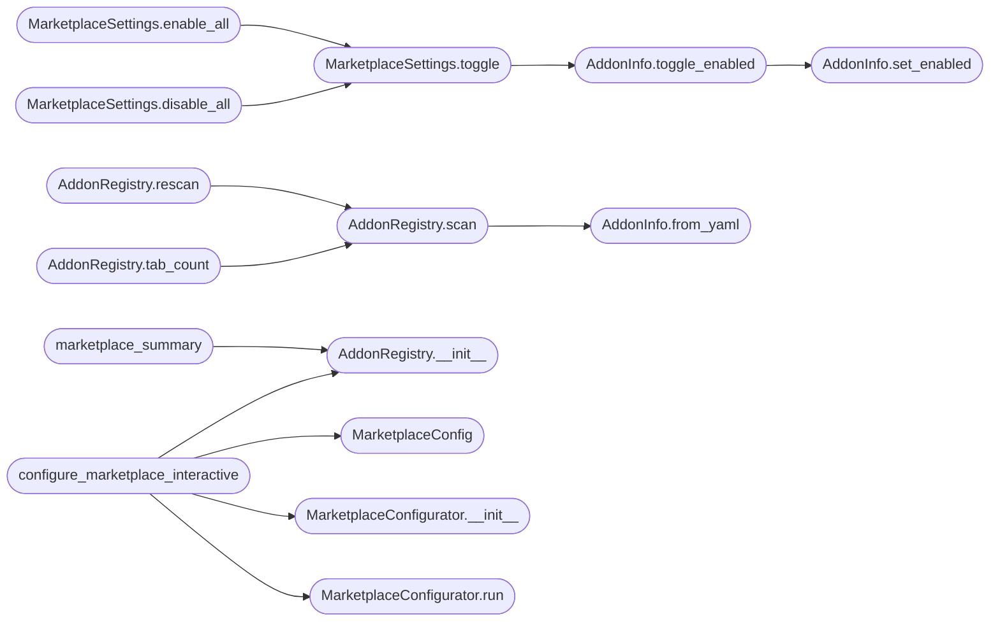

# `cli.marketplace_config`

> Source: [cli/marketplace_config.py:1](../../cli/marketplace_config.py#L1) | language `py` | coverage 45.8% | [API index](../index.md)

Interactive marketplace manager for LazyOwn lazyaddons, plugins, and tools.

Provides a curses-based TUI mirroring the Powerlevel10k-style configurator from
``banner_config.py``. The operator can browse, enable/disable, edit, and create
lazyaddons, Lua plugins, and pwntomate tools from a single interface.

Design (SOLID):

- `[`MarketplaceConfig`](#marketplaceconfig)` centralises constants (keys, key codes, palette IDs).
- `[`MarketplaceSettings`](#marketplacesettings)` is the mutable state (enabled/disabled per addon).
- `[`AddonInfo`](#addoninfo)` describes a single addon from YAML/Lua/.tool on disk.
- `[`AddonRegistry`](#addonregistry)` scans ``lazyaddons/``, ``plugins/``, ``tools/`` and builds the
  canonical list.
- `[`MarketplaceConfigurator`](#marketplaceconfigurator)` is the only piece bound to curses; tests can
  drive any registry behaviour without a TTY.
- `[`configure_marketplace_interactive`](#configure_marketplace_interactive)` is the public entry point.

## Contents

- **Classes:** [`MarketplaceConfig`](#marketplaceconfig), [`AddonInfo`](#addoninfo), [`AddonRegistry`](#addonregistry), [`MarketplaceSettings`](#marketplacesettings), [`MarketplaceConfigurator`](#marketplaceconfigurator)
- **Functions:** [`configure_marketplace_interactive`](#configure_marketplace_interactive), [`marketplace_summary`](#marketplace_summary)
- **Constants:** [`BASE_DIR`](#base_dir), [`LAZYADDONS_DIR`](#lazyaddons_dir), [`PLUGINS_DIR`](#plugins_dir), [`TOOLS_DIR`](#tools_dir), [`YARA_DIR`](#yara_dir), [`EDITOR`](#editor)

## Type Diagram

```mermaid
classDiagram
    direction LR
    class MarketplaceConfig
    MarketplaceConfig : str wizard_title
    MarketplaceConfig : str wizard_subtitle
    MarketplaceConfig : str wizard_preview_label
    MarketplaceConfig : str wizard_footer
    MarketplaceConfig : int wizard_padding_x
    MarketplaceConfig : int wizard_min_width
    MarketplaceConfig : int wizard_max_width
    MarketplaceConfig : int wizard_name_col
    MarketplaceConfig : int wizard_type_col
    MarketplaceConfig : int wizard_author_col
    MarketplaceConfig : int color_pair_border
    MarketplaceConfig : int color_pair_title
    MarketplaceConfig : int color_pair_help
    MarketplaceConfig : int color_pair_row
    MarketplaceConfig : int color_pair_selected
    MarketplaceConfig : int color_pair_enabled
    MarketplaceConfig : int color_pair_disabled
    MarketplaceConfig : int color_pair_preview
    MarketplaceConfig : int color_pair_tab_active
    MarketplaceConfig : int color_pair_tab_inactive
    MarketplaceConfig : int color_border_fg
    MarketplaceConfig : int color_title_fg
    MarketplaceConfig : int color_help_fg
    MarketplaceConfig : int color_row_fg
    class AddonInfo
    AddonInfo : str name
    AddonInfo : Path path
    AddonInfo : str kind
    AddonInfo : bool enabled
    AddonInfo : str description
    AddonInfo : str author
    AddonInfo : str version
    AddonInfo : str category
    AddonInfo : from_yaml()
    AddonInfo : toggle_enabled()
    AddonInfo : set_enabled()
    AddonInfo : save_yaml()
    class AddonRegistry
    AddonRegistry : __init__()
    AddonRegistry : scan()
    AddonRegistry : rescan()
    AddonRegistry : tab_order()
    AddonRegistry : tab_label()
    AddonRegistry : tab_count()
    class MarketplaceSettings
    MarketplaceSettings : dict[str, set[str]] enabled
    MarketplaceSettings : is_enabled()
    MarketplaceSettings : toggle()
    MarketplaceSettings : enable_all()
    MarketplaceSettings : disable_all()
    class MarketplaceConfigurator
    MarketplaceConfigurator : __init__()
    MarketplaceConfigurator : run()
```



## Call Graph

Solid arrows stay in this module, dashed arrows leave it.



## Classes

<a id="marketplaceconfig"></a>

### `MarketplaceConfig`

`class` `dataclass` | [cli/marketplace_config.py:56](../../cli/marketplace_config.py#L56)

Decorators: `@dataclass(frozen=True)`

```python
class MarketplaceConfig
```

Centralised constants for the marketplace configurator.

**Attributes**

| Name | Type | Default | Description |
|---|---|---|---|
| [`wizard_title`](#marketplaceconfig-wizard_title) | `str` | `'LazyOwn Marketplace Manager'` |  |
| [`wizard_subtitle`](#marketplaceconfig-wizard_subtitle) | `str` | `'Addon / Plugin / Tool — enable, disable, edit, create'` |  |
| [`wizard_preview_label`](#marketplaceconfig-wizard_preview_label) | `str` | `'Details:'` |  |
| [`wizard_footer`](#marketplaceconfig-wizard_footer) | `str` | `'[up/down] move [space] toggle [a/n] all/none [e] edit [c] create [tab] tab [enter] save [esc] cancel'` |  |
| [`wizard_padding_x`](#marketplaceconfig-wizard_padding_x) | `int` | `2` |  |
| [`wizard_min_width`](#marketplaceconfig-wizard_min_width) | `int` | `88` |  |
| [`wizard_max_width`](#marketplaceconfig-wizard_max_width) | `int` | `132` |  |
| [`wizard_name_col`](#marketplaceconfig-wizard_name_col) | `int` | `28` |  |
| [`wizard_type_col`](#marketplaceconfig-wizard_type_col) | `int` | `10` |  |
| [`wizard_author_col`](#marketplaceconfig-wizard_author_col) | `int` | `14` |  |
| [`color_pair_border`](#marketplaceconfig-color_pair_border) | `int` | `1` |  |
| [`color_pair_title`](#marketplaceconfig-color_pair_title) | `int` | `2` |  |
| [`color_pair_help`](#marketplaceconfig-color_pair_help) | `int` | `3` |  |
| [`color_pair_row`](#marketplaceconfig-color_pair_row) | `int` | `4` |  |
| [`color_pair_selected`](#marketplaceconfig-color_pair_selected) | `int` | `5` |  |
| [`color_pair_enabled`](#marketplaceconfig-color_pair_enabled) | `int` | `6` |  |
| [`color_pair_disabled`](#marketplaceconfig-color_pair_disabled) | `int` | `7` |  |
| [`color_pair_preview`](#marketplaceconfig-color_pair_preview) | `int` | `8` |  |
| [`color_pair_tab_active`](#marketplaceconfig-color_pair_tab_active) | `int` | `9` |  |
| [`color_pair_tab_inactive`](#marketplaceconfig-color_pair_tab_inactive) | `int` | `10` |  |
| [`color_border_fg`](#marketplaceconfig-color_border_fg) | `int` | `curses.COLOR_CYAN` |  |
| [`color_title_fg`](#marketplaceconfig-color_title_fg) | `int` | `curses.COLOR_GREEN` |  |
| [`color_help_fg`](#marketplaceconfig-color_help_fg) | `int` | `curses.COLOR_YELLOW` |  |
| [`color_row_fg`](#marketplaceconfig-color_row_fg) | `int` | `curses.COLOR_WHITE` |  |
| [`color_selected_bg`](#marketplaceconfig-color_selected_bg) | `int` | `curses.COLOR_BLUE` |  |
| [`color_selected_fg`](#marketplaceconfig-color_selected_fg) | `int` | `curses.COLOR_WHITE` |  |
| [`color_enabled_fg`](#marketplaceconfig-color_enabled_fg) | `int` | `curses.COLOR_GREEN` |  |
| [`color_disabled_fg`](#marketplaceconfig-color_disabled_fg) | `int` | `curses.COLOR_MAGENTA` |  |
| [`color_preview_fg`](#marketplaceconfig-color_preview_fg) | `int` | `curses.COLOR_CYAN` |  |
| [`color_tab_active_fg`](#marketplaceconfig-color_tab_active_fg) | `int` | `curses.COLOR_BLACK` |  |
| [`color_tab_active_bg`](#marketplaceconfig-color_tab_active_bg) | `int` | `curses.COLOR_GREEN` |  |
| [`color_tab_inactive_fg`](#marketplaceconfig-color_tab_inactive_fg) | `int` | `curses.COLOR_WHITE` |  |
| [`key_tab`](#marketplaceconfig-key_tab) | `int` | `9` |  |
| [`key_btab`](#marketplaceconfig-key_btab) | `int` | `353` |  |
| [`key_enter`](#marketplaceconfig-key_enter) | `int` | `10` |  |
| [`key_carriage_return`](#marketplaceconfig-key_carriage_return) | `int` | `13` |  |
| [`key_escape`](#marketplaceconfig-key_escape) | `int` | `27` |  |
| [`key_ctrl_c`](#marketplaceconfig-key_ctrl_c) | `int` | `3` |  |
| [`key_space`](#marketplaceconfig-key_space) | `int` | `ord(' ')` |  |
| [`key_d_lower`](#marketplaceconfig-key_d_lower) | `int` | `ord('d')` |  |
| [`key_a_lower`](#marketplaceconfig-key_a_lower) | `int` | `ord('a')` |  |
| [`key_n_lower`](#marketplaceconfig-key_n_lower) | `int` | `ord('n')` |  |
| [`key_e_lower`](#marketplaceconfig-key_e_lower) | `int` | `ord('e')` |  |
| [`key_c_lower`](#marketplaceconfig-key_c_lower) | `int` | `ord('c')` |  |
| [`YAML_ADDON_TEMPLATE`](#marketplaceconfig-yaml_addon_template) | `str` | `"name: {name}\ndescription: >\n Short description of what {name} does.\nauthor: LazyOwn RedTeam\nversion: '1.0'\nenabled: true\nparams: []\nos: any\ntrigger: []\ntool:\n name: {name}\n repo_url: https://github.com/example/{name}.git\n install_path: external/.exploit/{name}\n install_command: ''\n execute_command: ''\ncategory: 12. Miscellaneous\n"` |  |

---

<a id="addoninfo"></a>

### `AddonInfo`

`class` `dataclass` | [cli/marketplace_config.py:131](../../cli/marketplace_config.py#L131)

Decorators: `@dataclass`

```python
class AddonInfo
```

Metadata for one addon on disk.

**Attributes**

| Name | Type | Default | Description |
|---|---|---|---|
| [`name`](#addoninfo-name) | `str` |  |  |
| [`path`](#addoninfo-path) | `Path` |  |  |
| [`kind`](#addoninfo-kind) | `str` |  |  |
| [`enabled`](#addoninfo-enabled) | `bool` | `True` |  |
| [`description`](#addoninfo-description) | `str` | `''` |  |
| [`author`](#addoninfo-author) | `str` | `''` |  |
| [`version`](#addoninfo-version) | `str` | `''` |  |
| [`category`](#addoninfo-category) | `str` | `''` |  |

**Members**

| Member | Kind | Summary |
|---|---|---|
| [`from_yaml`](#addoninfo-from_yaml) | classmethod |  |
| [`toggle_enabled`](#addoninfo-toggle_enabled) | method | Flip the enabled state on disk. |
| [`set_enabled`](#addoninfo-set_enabled) | method | Set the enabled state and persist to disk. |
| [`save_yaml`](#addoninfo-save_yaml) | method | Rewrite the YAML file with the given data dictionary. |

<a id="addoninfo-from_yaml"></a>

#### `AddonInfo.from_yaml`

`classmethod` | [cli/marketplace_config.py:144](../../cli/marketplace_config.py#L144)

Decorators: `@classmethod`

```python
def from_yaml(cls, path: Path) -> AddonInfo
```

**Parameters**

| Name | Type | Default | Description |
|---|---|---|---|
| `path` | `Path` |  |  |

**Returns:** `AddonInfo`

*Called by:* [`AddonRegistry.scan`](#addonregistry-scan)

<a id="addoninfo-toggle_enabled"></a>

#### `AddonInfo.toggle_enabled`

`method` | [cli/marketplace_config.py:164](../../cli/marketplace_config.py#L164)

```python
def toggle_enabled(self) -> None
```

Flip the enabled state on disk.

*Calls:* [`AddonInfo.set_enabled`](#addoninfo-set_enabled)

*Called by:* [`MarketplaceSettings.toggle`](#marketplacesettings-toggle)

<a id="addoninfo-set_enabled"></a>

#### `AddonInfo.set_enabled`

`method` | [cli/marketplace_config.py:168](../../cli/marketplace_config.py#L168)

```python
def set_enabled(self, enabled: bool) -> None
```

Set the enabled state and persist to disk.

**Parameters**

| Name | Type | Default | Description |
|---|---|---|---|
| `enabled` | `bool` |  |  |

*Called by:* [`AddonInfo.toggle_enabled`](#addoninfo-toggle_enabled)

<a id="addoninfo-save_yaml"></a>

#### `AddonInfo.save_yaml`

`method` | [cli/marketplace_config.py:185](../../cli/marketplace_config.py#L185)

```python
def save_yaml(self, data: dict) -> None
```

Rewrite the YAML file with the given data dictionary.

**Parameters**

| Name | Type | Default | Description |
|---|---|---|---|
| `data` | `dict` |  |  |

---

<a id="addonregistry"></a>

### `AddonRegistry`

`class` | [cli/marketplace_config.py:197](../../cli/marketplace_config.py#L197)

```python
class AddonRegistry
```

Scans lazyaddons/, plugins/, tools/, yara_rules/, nuclei-templates/ and builds the addon list.

**Members**

| Member | Kind | Summary |
|---|---|---|
| [`__init__`](#addonregistry-__init__) | constructor |  |
| [`scan`](#addonregistry-scan) | method |  |
| [`rescan`](#addonregistry-rescan) | method |  |
| [`tab_order`](#addonregistry-tab_order) | method |  |
| [`tab_label`](#addonregistry-tab_label) | method |  |
| [`tab_count`](#addonregistry-tab_count) | method |  |

<a id="addonregistry-__init__"></a>

#### `AddonRegistry.__init__`

`constructor` | [cli/marketplace_config.py:220](../../cli/marketplace_config.py#L220)

```python
def __init__(self) -> None
```

*Called by:* [`configure_marketplace_interactive`](#configure_marketplace_interactive), [`marketplace_summary`](#marketplace_summary)

<a id="addonregistry-scan"></a>

#### `AddonRegistry.scan`

`method` | [cli/marketplace_config.py:235](../../cli/marketplace_config.py#L235)

```python
def scan(self, tab: str) -> list[AddonInfo]
```

**Parameters**

| Name | Type | Default | Description |
|---|---|---|---|
| `tab` | `str` |  |  |

**Returns:** `list[AddonInfo]`

*Calls:* [`AddonInfo.from_yaml`](#addoninfo-from_yaml)

*Called by:* [`AddonRegistry.rescan`](#addonregistry-rescan), [`AddonRegistry.tab_count`](#addonregistry-tab_count)

<a id="addonregistry-rescan"></a>

#### `AddonRegistry.rescan`

`method` | [cli/marketplace_config.py:334](../../cli/marketplace_config.py#L334)

```python
def rescan(self, tab: str) -> list[AddonInfo]
```

**Parameters**

| Name | Type | Default | Description |
|---|---|---|---|
| `tab` | `str` |  |  |

**Returns:** `list[AddonInfo]`

*Calls:* [`AddonRegistry.scan`](#addonregistry-scan)

<a id="addonregistry-tab_order"></a>

#### `AddonRegistry.tab_order`

`method` | [cli/marketplace_config.py:338](../../cli/marketplace_config.py#L338)

```python
def tab_order(self) -> list[str]
```

**Returns:** `list[str]`

<a id="addonregistry-tab_label"></a>

#### `AddonRegistry.tab_label`

`method` | [cli/marketplace_config.py:341](../../cli/marketplace_config.py#L341)

```python
def tab_label(self, tab: str) -> str
```

**Parameters**

| Name | Type | Default | Description |
|---|---|---|---|
| `tab` | `str` |  |  |

**Returns:** `str`

<a id="addonregistry-tab_count"></a>

#### `AddonRegistry.tab_count`

`method` | [cli/marketplace_config.py:344](../../cli/marketplace_config.py#L344)

```python
def tab_count(self, tab: str) -> int
```

**Parameters**

| Name | Type | Default | Description |
|---|---|---|---|
| `tab` | `str` |  |  |

**Returns:** `int`

*Calls:* [`AddonRegistry.scan`](#addonregistry-scan)

---

<a id="marketplacesettings"></a>

### `MarketplaceSettings`

`class` `dataclass` | [cli/marketplace_config.py:349](../../cli/marketplace_config.py#L349)

Decorators: `@dataclass`

```python
class MarketplaceSettings
```

Mutable marketplace state: which addons are enabled.

**Attributes**

| Name | Type | Default | Description |
|---|---|---|---|
| [`enabled`](#marketplacesettings-enabled) | `dict[str, set[str]]` | `field(default_factory=dict)` |  |

**Members**

| Member | Kind | Summary |
|---|---|---|
| [`is_enabled`](#marketplacesettings-is_enabled) | method |  |
| [`toggle`](#marketplacesettings-toggle) | method |  |
| [`enable_all`](#marketplacesettings-enable_all) | method |  |
| [`disable_all`](#marketplacesettings-disable_all) | method |  |

<a id="marketplacesettings-is_enabled"></a>

#### `MarketplaceSettings.is_enabled`

`method` | [cli/marketplace_config.py:354](../../cli/marketplace_config.py#L354)

```python
def is_enabled(self, kind: str, name: str) -> bool
```

**Parameters**

| Name | Type | Default | Description |
|---|---|---|---|
| `kind` | `str` |  |  |
| `name` | `str` |  |  |

**Returns:** `bool`

<a id="marketplacesettings-toggle"></a>

#### `MarketplaceSettings.toggle`

`method` | [cli/marketplace_config.py:357](../../cli/marketplace_config.py#L357)

```python
def toggle(self, addon: AddonInfo) -> None
```

**Parameters**

| Name | Type | Default | Description |
|---|---|---|---|
| `addon` | `AddonInfo` |  |  |

*Calls:* [`AddonInfo.toggle_enabled`](#addoninfo-toggle_enabled)

*Called by:* [`MarketplaceSettings.disable_all`](#marketplacesettings-disable_all), [`MarketplaceSettings.enable_all`](#marketplacesettings-enable_all)

<a id="marketplacesettings-enable_all"></a>

#### `MarketplaceSettings.enable_all`

`method` | [cli/marketplace_config.py:367](../../cli/marketplace_config.py#L367)

```python
def enable_all(self, addons: list[AddonInfo]) -> None
```

**Parameters**

| Name | Type | Default | Description |
|---|---|---|---|
| `addons` | `list[AddonInfo]` |  |  |

*Calls:* [`MarketplaceSettings.toggle`](#marketplacesettings-toggle)

<a id="marketplacesettings-disable_all"></a>

#### `MarketplaceSettings.disable_all`

`method` | [cli/marketplace_config.py:372](../../cli/marketplace_config.py#L372)

```python
def disable_all(self, addons: list[AddonInfo]) -> None
```

**Parameters**

| Name | Type | Default | Description |
|---|---|---|---|
| `addons` | `list[AddonInfo]` |  |  |

*Calls:* [`MarketplaceSettings.toggle`](#marketplacesettings-toggle)

---

<a id="marketplaceconfigurator"></a>

### `MarketplaceConfigurator`

`class` | [cli/marketplace_config.py:378](../../cli/marketplace_config.py#L378)

```python
class MarketplaceConfigurator
```

Curses-driven p10k-style wizard for marketplace management.

**Members**

| Member | Kind | Summary |
|---|---|---|
| [`__init__`](#marketplaceconfigurator-__init__) | constructor |  |
| [`run`](#marketplaceconfigurator-run) | method |  |

<a id="marketplaceconfigurator-__init__"></a>

#### `MarketplaceConfigurator.__init__`

`constructor` | [cli/marketplace_config.py:381](../../cli/marketplace_config.py#L381)

```python
def __init__(self, config: MarketplaceConfig, registry: AddonRegistry, initial: MarketplaceSettings) -> None
```

**Parameters**

| Name | Type | Default | Description |
|---|---|---|---|
| `config` | `MarketplaceConfig` |  |  |
| `registry` | `AddonRegistry` |  |  |
| `initial` | `MarketplaceSettings` |  |  |

*Called by:* [`configure_marketplace_interactive`](#configure_marketplace_interactive)

<a id="marketplaceconfigurator-run"></a>

#### `MarketplaceConfigurator.run`

`method` | [cli/marketplace_config.py:395](../../cli/marketplace_config.py#L395)

```python
def run(self, start_tab: str = '') -> MarketplaceSettings | None
```

**Parameters**

| Name | Type | Default | Description |
|---|---|---|---|
| `start_tab` | `str` | `''` |  |

**Returns:** `MarketplaceSettings | None`

*Called by:* [`configure_marketplace_interactive`](#configure_marketplace_interactive)

---

## Functions

<a id="configure_marketplace_interactive"></a>

### `configure_marketplace_interactive`

`function` | [cli/marketplace_config.py:751](../../cli/marketplace_config.py#L751)

```python
def configure_marketplace_interactive(config: MarketplaceConfig | None = None, start_tab: str = '') -> MarketplaceSettings | None
```

Open the multi-tab curses wizard for marketplace management.

Returns ``None`` when the operator cancels or the environment cannot
host a curses session.

**Parameters**

| Name | Type | Default | Description |
|---|---|---|---|
| `config` | `MarketplaceConfig \| None` | `None` | Optional custom configuration. |
| `start_tab` | `str` | `''` | Optional tab pre-selection ("lazyaddons", "plugins", "tools", "yara", "nuclei"). |

**Returns:** `MarketplaceSettings | None` - [`MarketplaceSettings`](#marketplacesettings) with the final state, or ``None``.

*Calls:* [`AddonRegistry.__init__`](#addonregistry-__init__), [`MarketplaceConfig`](#marketplaceconfig), [`MarketplaceConfigurator.__init__`](#marketplaceconfigurator-__init__), [`MarketplaceConfigurator.run`](#marketplaceconfigurator-run)

---

<a id="marketplace_summary"></a>

### `marketplace_summary`

`function` | [cli/marketplace_config.py:784](../../cli/marketplace_config.py#L784)

```python
def marketplace_summary(registry: AddonRegistry | None = None) -> str
```

Return a text summary of enabled/disabled addons across all tabs.

**Parameters**

| Name | Type | Default | Description |
|---|---|---|---|
| `registry` | `AddonRegistry \| None` | `None` |  |

**Returns:** `str`

*Calls:* [`AddonRegistry.__init__`](#addonregistry-__init__)

*Called by:* [`MarketplaceCommandSet.do_marketplace_config`](cli.commands.marketplace.py.md#marketplacecommandset-do_marketplace_config)

---

## Constants

<a id="base_dir"></a>

### `BASE_DIR`

`constant` | [cli/marketplace_config.py:33](../../cli/marketplace_config.py#L33)

```python
BASE_DIR = Path(__file__).resolve().parent.parent
```

---

<a id="lazyaddons_dir"></a>

### `LAZYADDONS_DIR`

`constant` | [cli/marketplace_config.py:34](../../cli/marketplace_config.py#L34)

```python
LAZYADDONS_DIR = BASE_DIR / 'lazyaddons'
```

---

<a id="plugins_dir"></a>

### `PLUGINS_DIR`

`constant` | [cli/marketplace_config.py:35](../../cli/marketplace_config.py#L35)

```python
PLUGINS_DIR = BASE_DIR / 'plugins'
```

---

<a id="tools_dir"></a>

### `TOOLS_DIR`

`constant` | [cli/marketplace_config.py:36](../../cli/marketplace_config.py#L36)

```python
TOOLS_DIR = BASE_DIR / 'tools'
```

---

<a id="yara_dir"></a>

### `YARA_DIR`

`constant` | [cli/marketplace_config.py:37](../../cli/marketplace_config.py#L37)

```python
YARA_DIR = BASE_DIR / 'yara_rules'
```

---

<a id="editor"></a>

### `EDITOR`

`constant` | [cli/marketplace_config.py:52](../../cli/marketplace_config.py#L52)

```python
EDITOR = os.environ.get('EDITOR', os.environ.get('VISUAL', 'vim'))
```

---
