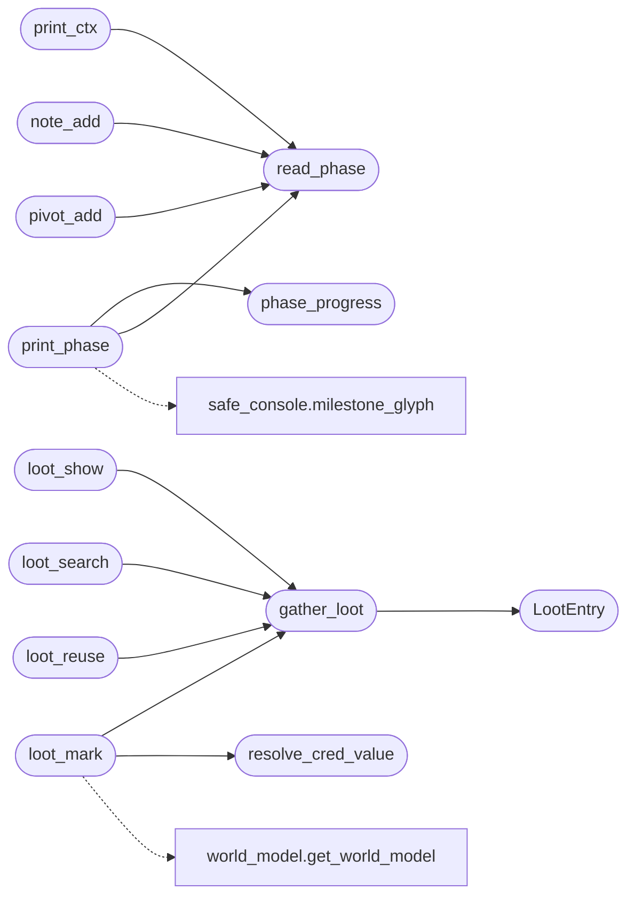

# `cli.ops_commands`

> Source: [cli/ops_commands.py:1](../../cli/ops_commands.py#L1) | language `py` | coverage 100.0% | [API index](../index.md)

Power-user operator commands: ctx, tgrep, phase, note, l00t, pivot, tasks, sitrep, scans.

All functions are pure (no side effects beyond filesystem reads/writes) and
have no imports from lazyown.py or lazyc2.py so they can be unit-tested in
isolation and reused from MCP tools.

## Contents

- **Classes:** [`LootEntry`](#lootentry)
- **Functions:** [`print_ctx`](#print_ctx), [`tgrep`](#tgrep), [`read_phase`](#read_phase), [`write_phase`](#write_phase), [`print_phase`](#print_phase), [`phase_progress`](#phase_progress), [`note_add`](#note_add), [`note_list`](#note_list), [`gather_loot`](#gather_loot), [`loot_show`](#loot_show), [`loot_search`](#loot_search), [`loot_reuse`](#loot_reuse), [`loot_graph`](#loot_graph), [`resolve_cred_value`](#resolve_cred_value), [`loot_mark`](#loot_mark), [`pivot_add`](#pivot_add), [`pivot_list`](#pivot_list), [`tasks_list`](#tasks_list), [`tasks_add`](#tasks_add), [`tasks_done`](#tasks_done), [`tasks_start`](#tasks_start), [`scans_list`](#scans_list), [`sitrep`](#sitrep)
- **Constants:** [`PHASES`](#phases)

## Call Graph

Solid arrows stay in this module, dashed arrows leave it.



## Classes

<a id="lootentry"></a>

### `LootEntry`

`class` `dataclass` | [cli/ops_commands.py:552](../../cli/ops_commands.py#L552)

Decorators: `@dataclass`

```python
class LootEntry
```

A single captured credential or hash parsed from a loot file.

**Attributes**

| Name | Type | Default | Description |
|---|---|---|---|
| [`source`](#lootentry-source) | `str` |  | Basename of the file the entry was read from. |
| [`kind`](#lootentry-kind) | `str` |  | ``clelazyt`` for credentials*.txt, ``hash`` for hash*.txt. |
| [`user`](#lootentry-user) | `str` |  | Username portion (text before the first colon), full length. |
| [`secret`](#lootentry-secret) | `str` |  | Password or hash portion (text after the first colon). |

**Members**

| Member | Kind | Summary |
|---|---|---|
| [`value`](#lootentry-value) | property | Return the canonical ``user:secret`` credential value. |

<a id="lootentry-value"></a>

#### `LootEntry.value`

`property` | [cli/ops_commands.py:568](../../cli/ops_commands.py#L568)

Decorators: `@property`

```python
def value(self) -> str
```

Return the canonical ``user:secret`` credential value.

**Returns:** `str` - ``user:secret`` when a secret is present, otherwise just `[`user`](#lootentry-user)`.
Matches the value format stored by `[`modules.world_model`](modules.world_model.py.md)`.

*Called by:* [`generate_cleanup_commands`](plugins.generate_cleanup_commands.lua.md#generate_cleanup_commands), [`generate_lateral_command`](plugins.generate_lateral_command.lua.md#generate_lateral_command), [`Ct.G.I.J.L.M.N.N.Ot.Q.R.S.S.St.T.X.Y.Z.a.b.c.c.d.et.extends.extends.extends.extends.extends.extends.extends.extends.extends.extends.extends.f.g.h.h.h.i.i.i.i.i.j.jt.k.k.m.m.n.o.o.o.o.ot.qt.rt.s.s.t.t.t.t.t.tt.u.u.w`](static.js.quill-2.0.3.js.md#ct-g-i-j-l-m-n-n-ot-q-r-s-s-st-t-x-y-z-a-b-c-c-d-et-extends-extends-extends-extends-extends-extends-extends-extends-extends-extends-extends-f-g-h-h-h-i-i-i-i-i-j-jt-k-k-m-m-n-o-o-o-o-ot-qt-rt-s-s-t-t-t-t-t-tt-u-u-w)

---

## Functions

<a id="print_ctx"></a>

### `print_ctx`

`function` | [cli/ops_commands.py:74](../../cli/ops_commands.py#L74)

```python
def print_ctx(payload: dict[str, Any], sessions_dir: str = 'sessions') -> None
```

Print a single-line operator context summary.

**Parameters**

| Name | Type | Default | Description |
|---|---|---|---|
| `payload` | `dict[str, Any]` |  | Live params dict. |
| `sessions_dir` | `str` | `'sessions'` | Path to sessions directory. |

*Calls:* [`read_phase`](#read_phase)

---

<a id="tgrep"></a>

### `tgrep`

`function` | [cli/ops_commands.py:115](../../cli/ops_commands.py#L115)

```python
def tgrep(pattern: str, *, sessions_dir: str = 'sessions', limit: int = 40, case_insensitive: bool = True) -> None
```

Search past command outputs and session logs for `[`pattern`](modules.intercept.py.md#interceptrule-pattern)`.

Searches in order:
  1. ``sessions/_cli_transcript.jsonl`` (in-memory transcript with full output)
  2. ``sessions/LazyOwn_session_report.csv`` (command column)
  3. ``sessions/logs/`` text files

**Parameters**

| Name | Type | Default | Description |
|---|---|---|---|
| `pattern` | `str` |  | Regular expression or plain string to search for. |
| `sessions_dir` | `str` | `'sessions'` | Base sessions directory. |
| `limit` | `int` | `40` | Maximum total hits to display. |
| `case_insensitive` | `bool` | `True` | Case-insensitive matching when True. |

---

<a id="read_phase"></a>

### `read_phase`

`function` | [cli/ops_commands.py:279](../../cli/ops_commands.py#L279)

```python
def read_phase() -> str
```

Return the current kill-chain phase from the unified killchain module.

**Returns:** `str`

*Called by:* [`note_add`](#note_add), [`pivot_add`](#pivot_add), [`print_ctx`](#print_ctx), [`print_phase`](#print_phase)

---

<a id="write_phase"></a>

### `write_phase`

`function` | [cli/ops_commands.py:302](../../cli/ops_commands.py#L302)

```python
def write_phase(phase: str) -> bool
```

Set the current kill-chain phase via the unified killchain module.

Delegates to `[`KillChain.advance_phase`](modules.killchain.py.md#killchain-advance_phase)` which atomically writes
``world_model.json`` and advances all WorldModel hosts.

**Parameters**

| Name | Type | Default | Description |
|---|---|---|---|
| `phase` | `str` |  | One of the PHASES values. |

**Returns:** `bool` - True on success, False if the phase name is invalid.

---

<a id="print_phase"></a>

### `print_phase`

`function` | [cli/ops_commands.py:317](../../cli/ops_commands.py#L317)

```python
def print_phase() -> None
```

Print the current phase and the full kill-chain progress bar.

Reads data from the unified killchain module and renders a rich
progress display.

*Calls:* [`phase_progress`](#phase_progress), [`read_phase`](#read_phase), [`milestone_glyph`](core.safe_console.py.md#milestone_glyph)

---

<a id="phase_progress"></a>

### `phase_progress`

`function` | [cli/ops_commands.py:393](../../cli/ops_commands.py#L393)

```python
def phase_progress(world: dict[str, Any], sessions_dir: str = 'sessions') -> dict[str, float]
```

Return per-phase completion ratios from the unified kill-chain progress.

Delegates entirely to `[`KillChain.get_progress`](modules.killchain.py.md#killchain-get_progress)` — no filesystem heuristics,
no side-channel counts. The world model IS the progress.

**Parameters**

| Name | Type | Default | Description |
|---|---|---|---|
| `world` | `dict[str, Any]` |  | Parsed world_model.json document (unused; kept for backward compat). |
| `sessions_dir` | `str` | `'sessions'` | Base sessions directory. Used to resolve the world_model path when it is a relative path under this directory. |

**Returns:** `dict[str, float]` - A mapping of each [`PHASES`](#phases) value to a completion ratio in [0, 1].

*Called by:* [`print_phase`](#print_phase)

---

<a id="note_add"></a>

### `note_add`

`function` | [cli/ops_commands.py:475](../../cli/ops_commands.py#L475)

```python
def note_add(text: str, rhost: str = '', phase: str = '') -> None
```

Append a timestamped operator note to sessions/notes.jsonl.

**Parameters**

| Name | Type | Default | Description |
|---|---|---|---|
| `text` | `str` |  | Free-form note text. |
| `rhost` | `str` | `''` | Current target IP (attached as context). |
| `phase` | `str` | `''` | Current kill-chain phase (attached as context). |

*Calls:* [`read_phase`](#read_phase)

---

<a id="note_list"></a>

### `note_list`

`function` | [cli/ops_commands.py:500](../../cli/ops_commands.py#L500)

```python
def note_list(rhost: str = '', limit: int = 20) -> None
```

Print recent operator notes, optionally filtered by rhost.

**Parameters**

| Name | Type | Default | Description |
|---|---|---|---|
| `rhost` | `str` | `''` | When non-empty, only show notes for this target. |
| `limit` | `int` | `20` | Maximum number of notes to display. |

---

<a id="gather_loot"></a>

### `gather_loot`

`function` | [cli/ops_commands.py:578](../../cli/ops_commands.py#L578)

```python
def gather_loot(sessions_dir: str = 'sessions') -> list[LootEntry]
```

Parse every credentials*.txt and hash*.txt under `[`sessions_dir`](core.defaults.py.md#sessions_dir)`.

Each file is expected to hold one ``user:secret`` entry per line; blank
lines and ``#`` comments are skipped. This is the single source of truth
for loot parsing reused by show / search / reuse / mark.

**Parameters**

| Name | Type | Default | Description |
|---|---|---|---|
| `sessions_dir` | `str` | `'sessions'` | Base sessions directory. |

**Returns:** `list[LootEntry]` - A list of [`LootEntry`](#lootentry) in file then line order.

*Calls:* [`LootEntry`](#lootentry)

*Called by:* [`loot_mark`](#loot_mark), [`loot_reuse`](#loot_reuse), [`loot_search`](#loot_search), [`loot_show`](#loot_show)

---

<a id="loot_show"></a>

### `loot_show`

`function` | [cli/ops_commands.py:621](../../cli/ops_commands.py#L621)

```python
def loot_show(sessions_dir: str = 'sessions') -> None
```

Print a unified table of all captured credentials and hashes.

**Parameters**

| Name | Type | Default | Description |
|---|---|---|---|
| `sessions_dir` | `str` | `'sessions'` | Base sessions directory. |

*Calls:* [`gather_loot`](#gather_loot)

---

<a id="loot_search"></a>

### `loot_search`

`function` | [cli/ops_commands.py:693](../../cli/ops_commands.py#L693)

```python
def loot_search(query: str, sessions_dir: str = 'sessions') -> None
```

Search captured loot for ``query`` across users and secrets.

**Parameters**

| Name | Type | Default | Description |
|---|---|---|---|
| `query` | `str` |  | Case-insensitive substring matched against user and secret. |
| `sessions_dir` | `str` | `'sessions'` | Base sessions directory. |

*Calls:* [`gather_loot`](#gather_loot)

---

<a id="loot_reuse"></a>

### `loot_reuse`

`function` | [cli/ops_commands.py:770](../../cli/ops_commands.py#L770)

```python
def loot_reuse(rhost: str, sessions_dir: str = 'sessions') -> None
```

Suggest captured credentials worth trying against ``rhost``.

Ranks credentials that have not yet been rejected by the target, favouring
clelazyt over hashes and credentials already confirmed elsewhere, and
prints ready-to-run authentication hints.

**Parameters**

| Name | Type | Default | Description |
|---|---|---|---|
| `rhost` | `str` |  | Current target IP (from payload ``rhost``). |
| `sessions_dir` | `str` | `'sessions'` | Base sessions directory. |

*Calls:* [`gather_loot`](#gather_loot)

---

<a id="loot_graph"></a>

### `loot_graph`

`function` | [cli/ops_commands.py:854](../../cli/ops_commands.py#L854)

```python
def loot_graph(sessions_dir: str = 'sessions') -> None
```

Render the credential-centric view of the network graph.

Shows, per captured credential, the hosts it was harvested from, the hosts
it authenticated to, the hosts that rejected it, and candidate hosts.

**Parameters**

| Name | Type | Default | Description |
|---|---|---|---|
| `sessions_dir` | `str` | `'sessions'` | Base sessions directory. |

---

<a id="resolve_cred_value"></a>

### `resolve_cred_value`

`function` | [cli/ops_commands.py:924](../../cli/ops_commands.py#L924)

```python
def resolve_cred_value(selector: str, entries: list[LootEntry]) -> str | None
```

Resolve a user/secret ``selector`` to a canonical credential value.

**Parameters**

| Name | Type | Default | Description |
|---|---|---|---|
| `selector` | `str` |  | Username, secret, or full ``user:secret`` string. |
| `entries` | `list[LootEntry]` |  | Loot entries to resolve against (from [`gather_loot`](#gather_loot)). |

**Returns:** `str | None` - The matching ``user:secret`` value, preferring an exact username match,
then an exact value match, then the first substring match. ``None`` when
nothing matches.

*Called by:* [`loot_mark`](#loot_mark)

---

<a id="loot_mark"></a>

### `loot_mark`

`function` | [cli/ops_commands.py:952](../../cli/ops_commands.py#L952)

```python
def loot_mark(selector: str, outcome: str, host: str, sessions_dir: str = 'sessions') -> bool
```

Record that a credential worked or was rejected against ``host``.

**Parameters**

| Name | Type | Default | Description |
|---|---|---|---|
| `selector` | `str` |  | Username/secret/value identifying the credential. |
| `outcome` | `str` |  | ``worked`` or `[`rejected`](modules.selector_manager.py.md#selection-rejected)`. |
| `host` | `str` |  | Host the credential was tried against. |
| `sessions_dir` | `str` | `'sessions'` | Base sessions directory. |

**Returns:** `bool` - True when an outcome edge was written, False on a usage/resolution error.

*Calls:* [`gather_loot`](#gather_loot), [`resolve_cred_value`](#resolve_cred_value), [`get_world_model`](modules.world_model.py.md#get_world_model)

---

<a id="pivot_add"></a>

### `pivot_add`

`function` | [cli/ops_commands.py:994](../../cli/ops_commands.py#L994)

```python
def pivot_add(new_ip: str, via_ip: str = '', note: str = '') -> None
```

Record a newly discovered pivot target.

**Parameters**

| Name | Type | Default | Description |
|---|---|---|---|
| `new_ip` | `str` |  | IP of the newly reachable host. |
| `via_ip` | `str` | `''` | IP of the compromised host that gave access (current rhost). |
| `note` | `str` | `''` | Optional context (service, port, method). |

*Calls:* [`read_phase`](#read_phase)

---

<a id="pivot_list"></a>

### `pivot_list`

`function` | [cli/ops_commands.py:1020](../../cli/ops_commands.py#L1020)

```python
def pivot_list() -> None
```

Print the pivot chain discovered so far.

---

<a id="tasks_list"></a>

### `tasks_list`

`function` | [cli/ops_commands.py:1077](../../cli/ops_commands.py#L1077)

```python
def tasks_list(status_filter: str = 'active', limit: int = 30) -> None
```

Print tasks from sessions/tasks.json.

**Parameters**

| Name | Type | Default | Description |
|---|---|---|---|
| `status_filter` | `str` | `'active'` | 'active' (New+Started), 'all', or a specific status. |
| `limit` | `int` | `30` | Maximum rows to display. |

---

<a id="tasks_add"></a>

### `tasks_add`

`function` | [cli/ops_commands.py:1132](../../cli/ops_commands.py#L1132)

```python
def tasks_add(title: str, operator: str = 'cli') -> None
```

Append a new task to sessions/tasks.json.

**Parameters**

| Name | Type | Default | Description |
|---|---|---|---|
| `title` | `str` |  | Task description. |
| `operator` | `str` | `'cli'` | Who created it (default 'cli'). |

---

<a id="tasks_done"></a>

### `tasks_done`

`function` | [cli/ops_commands.py:1153](../../cli/ops_commands.py#L1153)

```python
def tasks_done(task_id: int) -> bool
```

Mark a task as Done.

**Parameters**

| Name | Type | Default | Description |
|---|---|---|---|
| `task_id` | `int` |  | The integer id of the task. |

**Returns:** `bool` - True if found and updated, False otherwise.

---

<a id="tasks_start"></a>

### `tasks_start`

`function` | [cli/ops_commands.py:1173](../../cli/ops_commands.py#L1173)

```python
def tasks_start(task_id: int) -> bool
```

Mark a task as Started.

**Parameters**

| Name | Type | Default | Description |
|---|---|---|---|
| `task_id` | `int` |  | The integer id of the task. |

**Returns:** `bool` - True if found and updated, False otherwise.

---

<a id="scans_list"></a>

### `scans_list`

`function` | [cli/ops_commands.py:1196](../../cli/ops_commands.py#L1196)

```python
def scans_list(rhost: str = '', sessions_dir: str = 'sessions') -> None
```

List nmap scan files in sessions/, optionally filtered by rhost.

Reads the first lines of each .nmap file to extract open ports.

**Parameters**

| Name | Type | Default | Description |
|---|---|---|---|
| `rhost` | `str` | `''` | When non-empty, only show scans for this target IP. |
| `sessions_dir` | `str` | `'sessions'` | Path to sessions directory. |

---

<a id="sitrep"></a>

### `sitrep`

`function` | [cli/ops_commands.py:1249](../../cli/ops_commands.py#L1249)

```python
def sitrep(payload: dict[str, Any], sessions_dir: str = 'sessions') -> None
```

Print a unified operational situation report.

Aggregates: target info, phase/OS, scans found, loot captured, tasks
backlog, operator notes, pivot chain, world model hosts/vulns, and
the last lines of sessions/plan.txt when present.

**Parameters**

| Name | Type | Default | Description |
|---|---|---|---|
| `payload` | `dict[str, Any]` |  | Live params dict (from payload.json). |
| `sessions_dir` | `str` | `'sessions'` | Path to the sessions directory. |

---

## Constants

<a id="phases"></a>

### `PHASES`

`constant` | [cli/ops_commands.py:30](../../cli/ops_commands.py#L30)

```python
PHASES: tuple[str, ...] = _KC.phases()
```

---
