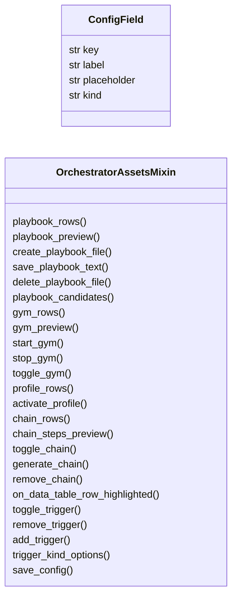
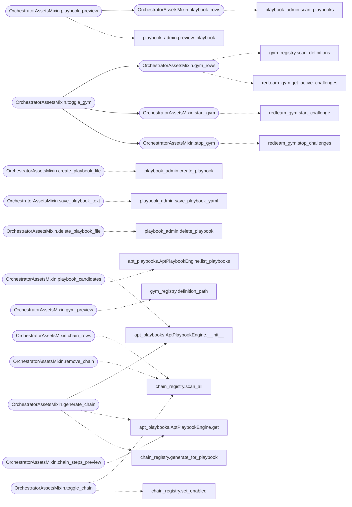

# `cli.orchestrator_assets_tabs`

> Source: [cli/orchestrator_assets_tabs.py:1](../../cli/orchestrator_assets_tabs.py#L1) | language `py` | coverage 100.0% | [API index](../index.md)

Asset administration tabs for the orchestrator console.

Mixin holding the tab controllers that edit YAML-run assets: Playbooks,
Gyms, Chains and Profiles. Split out of ``cli/lazy_orchestrator.py`` to
keep the Textual app module under the size ceiling while per-tab state
and persistence helpers stay single-responsibility here.

## Contents

- **Classes:** [`ConfigField`](#configfield), [`OrchestratorAssetsMixin`](#orchestratorassetsmixin)
- **Constants:** [`CONFIG_FIELDS`](#config_fields)

## Type Diagram



## Call Graph

Solid arrows stay in this module, dashed arrows leave it.



## Classes

<a id="configfield"></a>

### `ConfigField`

`class` `dataclass` | [cli/orchestrator_assets_tabs.py:19](../../cli/orchestrator_assets_tabs.py#L19)

Decorators: `@dataclass(frozen=True)`

```python
class ConfigField
```

One editable payload knob.

**Attributes**

| Name | Type | Default | Description |
|---|---|---|---|
| [`key`](#configfield-key) | `str` |  |  |
| [`label`](#configfield-label) | `str` |  |  |
| [`placeholder`](#configfield-placeholder) | `str` | `''` |  |
| [`kind`](#configfield-kind) | `str` | `'text'` |  |

---

<a id="orchestratorassetsmixin"></a>

### `OrchestratorAssetsMixin`

`class` | [cli/orchestrator_assets_tabs.py:58](../../cli/orchestrator_assets_tabs.py#L58)

```python
class OrchestratorAssetsMixin
```

Subclasses: [`LazyOrchestratorApp`](cli.lazy_orchestrator.py.md#lazyorchestratorapp)

Tab controllers for Playbooks, Gyms, Chains and Profiles tabs.

**Members**

| Member | Kind | Summary |
|---|---|---|
| [`playbook_rows`](#orchestratorassetsmixin-playbook_rows) | method | Return one row per playbook file, including invalid ones. |
| [`playbook_preview`](#orchestratorassetsmixin-playbook_preview) | method | Return a bounded YAML preview for one playbook file. |
| [`create_playbook_file`](#orchestratorassetsmixin-create_playbook_file) | method | Create one playbook YAML and repaint the table. |
| [`save_playbook_text`](#orchestratorassetsmixin-save_playbook_text) | method | Validate and persist raw YAML edited by the operator. |
| [`delete_playbook_file`](#orchestratorassetsmixin-delete_playbook_file) | method | Delete one playbook YAML after the operator confirms. |
| [`playbook_candidates`](#orchestratorassetsmixin-playbook_candidates) | method | Return ``(engine_key, summary)`` pairs for chain generation. |
| [`gym_rows`](#orchestratorassetsmixin-gym_rows) | method | Return one row per gym definition with its active-run count. |
| [`gym_preview`](#orchestratorassetsmixin-gym_preview) | method | Return a bounded YAML preview for one gym definition. |
| [`start_gym`](#orchestratorassetsmixin-start_gym) | method | Start one gym and repaint the table. |
| [`stop_gym`](#orchestratorassetsmixin-stop_gym) | method | Stop one gym (or every gym when selector is empty) and repaint. |
| [`toggle_gym`](#orchestratorassetsmixin-toggle_gym) | method | Start the selected gym, or stop its active runs when already active. |
| [`profile_rows`](#orchestratorassetsmixin-profile_rows) | method | Return one row per orchestrator profile with the active marker. |
| [`activate_profile`](#orchestratorassetsmixin-activate_profile) | method | Persist one profile as active and repaint the profile table. |
| [`chain_rows`](#orchestratorassetsmixin-chain_rows) | method | Return one row per chain file, including disabled ones. |
| [`chain_steps_preview`](#orchestratorassetsmixin-chain_steps_preview) | method | Return the resolved step lines of a chain for the detail pane. |
| [`toggle_chain`](#orchestratorassetsmixin-toggle_chain) | method | Flip a chain's enabled flag in its YAML file. |
| [`generate_chain`](#orchestratorassetsmixin-generate_chain) | method | Generate chains/apt_<slug>.yaml from a playbook engine key. |
| [`remove_chain`](#orchestratorassetsmixin-remove_chain) | method | Delete a chain file unless others extend it or it is the base. |
| [`on_data_table_row_highlighted`](#orchestratorassetsmixin-on_data_table_row_highlighted) | method | Refresh the detail pane when the cursor moves. |
| [`toggle_trigger`](#orchestratorassetsmixin-toggle_trigger) | method | Flip one trigger's enabled flag in the store. |
| [`remove_trigger`](#orchestratorassetsmixin-remove_trigger) | method | Delete one trigger from the store. |
| [`add_trigger`](#orchestratorassetsmixin-add_trigger) | method | Add a scheduler trigger entered from the picker form. |
| [`trigger_kind_options`](#orchestratorassetsmixin-trigger_kind_options) | method | Return selectable trigger kinds for the add form. |
| [`save_config`](#orchestratorassetsmixin-save_config) | method | Merge the given keys into the payload and persist it. |
| [`add_model_member`](#orchestratorassetsmixin-add_model_member) | method | Append one LLM chain member; returns the stored name. |
| [`remove_model_member`](#orchestratorassetsmixin-remove_model_member) | method | Drop one LLM chain member by name. |
| [`set_model_priority`](#orchestratorassetsmixin-set_model_priority) | method | Change one LLM member's failover rank and repaint the table. |
| [`add_guard_rule`](#orchestratorassetsmixin-add_guard_rule) | method | Register one guard intercept rule. |
| [`remove_guard_rule`](#orchestratorassetsmixin-remove_guard_rule) | method | Delete one guard rule by exact pattern. |

<a id="orchestratorassetsmixin-playbook_rows"></a>

#### `OrchestratorAssetsMixin.playbook_rows`

`method` | [cli/orchestrator_assets_tabs.py:69](../../cli/orchestrator_assets_tabs.py#L69)

```python
def playbook_rows(self) -> list[dict]
```

Return one row per playbook file, including invalid ones.

**Returns:** `list[dict]`

*Calls:* [`scan_playbooks`](modules.playbook_admin.py.md#scan_playbooks)

*Called by:* [`OrchestratorAssetsMixin.playbook_preview`](#orchestratorassetsmixin-playbook_preview)

<a id="orchestratorassetsmixin-playbook_preview"></a>

#### `OrchestratorAssetsMixin.playbook_preview`

`method` | [cli/orchestrator_assets_tabs.py:93](../../cli/orchestrator_assets_tabs.py#L93)

```python
def playbook_preview(self, filename: str, limit: int = 18) -> str
```

Return a bounded YAML preview for one playbook file.

**Parameters**

| Name | Type | Default | Description |
|---|---|---|---|
| `filename` | `str` |  |  |
| `limit` | `int` | `18` |  |

**Returns:** `str`

*Calls:* [`OrchestratorAssetsMixin.playbook_rows`](#orchestratorassetsmixin-playbook_rows), [`preview_playbook`](modules.playbook_admin.py.md#preview_playbook)

<a id="orchestratorassetsmixin-create_playbook_file"></a>

#### `OrchestratorAssetsMixin.create_playbook_file`

`method` | [cli/orchestrator_assets_tabs.py:102](../../cli/orchestrator_assets_tabs.py#L102)

```python
def create_playbook_file(self, filename: str, name: str = '', description: str = '', platforms: str = 'linux') -> str
```

Create one playbook YAML and repaint the table.

**Parameters**

| Name | Type | Default | Description |
|---|---|---|---|
| `filename` | `str` |  |  |
| `name` | `str` | `''` |  |
| `description` | `str` | `''` |  |
| `platforms` | `str` | `'linux'` |  |

**Returns:** `str`

*Calls:* [`create_playbook`](modules.playbook_admin.py.md#create_playbook)

*Called by:* [`LazyOrchestratorApp.action_add_item`](cli.lazy_orchestrator.py.md#lazyorchestratorapp-action_add_item)

<a id="orchestratorassetsmixin-save_playbook_text"></a>

#### `OrchestratorAssetsMixin.save_playbook_text`

`method` | [cli/orchestrator_assets_tabs.py:123](../../cli/orchestrator_assets_tabs.py#L123)

```python
def save_playbook_text(self, filename: str, text: str) -> bool
```

Validate and persist raw YAML edited by the operator.

**Parameters**

| Name | Type | Default | Description |
|---|---|---|---|
| `filename` | `str` |  |  |
| `text` | `str` |  |  |

**Returns:** `bool`

*Calls:* [`save_playbook_yaml`](modules.playbook_admin.py.md#save_playbook_yaml)

<a id="orchestratorassetsmixin-delete_playbook_file"></a>

#### `OrchestratorAssetsMixin.delete_playbook_file`

`method` | [cli/orchestrator_assets_tabs.py:135](../../cli/orchestrator_assets_tabs.py#L135)

```python
def delete_playbook_file(self, filename: str) -> bool
```

Delete one playbook YAML after the operator confirms.

**Parameters**

| Name | Type | Default | Description |
|---|---|---|---|
| `filename` | `str` |  |  |

**Returns:** `bool`

*Calls:* [`delete_playbook`](modules.playbook_admin.py.md#delete_playbook)

*Called by:* [`LazyOrchestratorApp.action_delete_item`](cli.lazy_orchestrator.py.md#lazyorchestratorapp-action_delete_item)

<a id="orchestratorassetsmixin-playbook_candidates"></a>

#### `OrchestratorAssetsMixin.playbook_candidates`

`method` | [cli/orchestrator_assets_tabs.py:143](../../cli/orchestrator_assets_tabs.py#L143)

```python
def playbook_candidates(self) -> list[tuple[str, str]]
```

Return ``(engine_key, summary)`` pairs for chain generation.

**Returns:** `list[tuple[str, str]]`

*Calls:* [`AptPlaybookEngine.__init__`](modules.apt_playbooks.py.md#aptplaybookengine-__init__), [`AptPlaybookEngine.list_playbooks`](modules.apt_playbooks.py.md#aptplaybookengine-list_playbooks)

*Called by:* [`LazyOrchestratorApp.action_add_item`](cli.lazy_orchestrator.py.md#lazyorchestratorapp-action_add_item)

<a id="orchestratorassetsmixin-gym_rows"></a>

#### `OrchestratorAssetsMixin.gym_rows`

`method` | [cli/orchestrator_assets_tabs.py:226](../../cli/orchestrator_assets_tabs.py#L226)

```python
def gym_rows(self) -> list[dict]
```

Return one row per gym definition with its active-run count.

**Returns:** `list[dict]`

*Calls:* [`scan_definitions`](modules.gym_registry.py.md#scan_definitions), [`get_active_challenges`](modules.redteam_gym.py.md#get_active_challenges)

*Called by:* [`OrchestratorAssetsMixin.toggle_gym`](#orchestratorassetsmixin-toggle_gym)

<a id="orchestratorassetsmixin-gym_preview"></a>

#### `OrchestratorAssetsMixin.gym_preview`

`method` | [cli/orchestrator_assets_tabs.py:263](../../cli/orchestrator_assets_tabs.py#L263)

```python
def gym_preview(self, gym_id: str, limit: int = 16) -> str
```

Return a bounded YAML preview for one gym definition.

**Parameters**

| Name | Type | Default | Description |
|---|---|---|---|
| `gym_id` | `str` |  |  |
| `limit` | `int` | `16` |  |

**Returns:** `str`

*Calls:* [`definition_path`](modules.gym_registry.py.md#definition_path)

<a id="orchestratorassetsmixin-start_gym"></a>

#### `OrchestratorAssetsMixin.start_gym`

`method` | [cli/orchestrator_assets_tabs.py:331](../../cli/orchestrator_assets_tabs.py#L331)

```python
def start_gym(self, gym_id: str, target: str = '') -> dict
```

Start one gym and repaint the table.

**Parameters**

| Name | Type | Default | Description |
|---|---|---|---|
| `gym_id` | `str` |  |  |
| `target` | `str` | `''` |  |

**Returns:** `dict`

*Calls:* [`start_challenge`](modules.redteam_gym.py.md#start_challenge)

*Called by:* [`OrchestratorAssetsMixin.toggle_gym`](#orchestratorassetsmixin-toggle_gym)

<a id="orchestratorassetsmixin-stop_gym"></a>

#### `OrchestratorAssetsMixin.stop_gym`

`method` | [cli/orchestrator_assets_tabs.py:339](../../cli/orchestrator_assets_tabs.py#L339)

```python
def stop_gym(self, selector: str = '') -> dict
```

Stop one gym (or every gym when selector is empty) and repaint.

**Parameters**

| Name | Type | Default | Description |
|---|---|---|---|
| `selector` | `str` | `''` |  |

**Returns:** `dict`

*Calls:* [`stop_challenges`](modules.redteam_gym.py.md#stop_challenges)

*Called by:* [`OrchestratorAssetsMixin.toggle_gym`](#orchestratorassetsmixin-toggle_gym)

<a id="orchestratorassetsmixin-toggle_gym"></a>

#### `OrchestratorAssetsMixin.toggle_gym`

`method` | [cli/orchestrator_assets_tabs.py:347](../../cli/orchestrator_assets_tabs.py#L347)

```python
def toggle_gym(self, gym_id: str) -> dict
```

Start the selected gym, or stop its active runs when already active.

**Parameters**

| Name | Type | Default | Description |
|---|---|---|---|
| `gym_id` | `str` |  |  |

**Returns:** `dict`

*Calls:* [`OrchestratorAssetsMixin.gym_rows`](#orchestratorassetsmixin-gym_rows), [`OrchestratorAssetsMixin.start_gym`](#orchestratorassetsmixin-start_gym), [`OrchestratorAssetsMixin.stop_gym`](#orchestratorassetsmixin-stop_gym)

*Called by:* [`LazyOrchestratorApp.action_toggle_item`](cli.lazy_orchestrator.py.md#lazyorchestratorapp-action_toggle_item)

<a id="orchestratorassetsmixin-profile_rows"></a>

#### `OrchestratorAssetsMixin.profile_rows`

`method` | [cli/orchestrator_assets_tabs.py:389](../../cli/orchestrator_assets_tabs.py#L389)

```python
def profile_rows(self) -> list[dict]
```

Return one row per orchestrator profile with the active marker.

**Returns:** `list[dict]`

<a id="orchestratorassetsmixin-activate_profile"></a>

#### `OrchestratorAssetsMixin.activate_profile`

`method` | [cli/orchestrator_assets_tabs.py:414](../../cli/orchestrator_assets_tabs.py#L414)

```python
def activate_profile(self, name: str) -> bool
```

Persist one profile as active and repaint the profile table.

**Parameters**

| Name | Type | Default | Description |
|---|---|---|---|
| `name` | `str` |  |  |

**Returns:** `bool`

*Called by:* [`LazyOrchestratorApp.action_toggle_item`](cli.lazy_orchestrator.py.md#lazyorchestratorapp-action_toggle_item)

<a id="orchestratorassetsmixin-chain_rows"></a>

#### `OrchestratorAssetsMixin.chain_rows`

`method` | [cli/orchestrator_assets_tabs.py:474](../../cli/orchestrator_assets_tabs.py#L474)

```python
def chain_rows(self) -> list[dict]
```

Return one row per chain file, including disabled ones.

**Returns:** `list[dict]`

*Calls:* [`scan_all`](modules.chain_registry.py.md#scan_all)

<a id="orchestratorassetsmixin-chain_steps_preview"></a>

#### `OrchestratorAssetsMixin.chain_steps_preview`

`method` | [cli/orchestrator_assets_tabs.py:483](../../cli/orchestrator_assets_tabs.py#L483)

```python
def chain_steps_preview(self, name: str, limit: int = 10) -> str
```

Return the resolved step lines of a chain for the detail pane.

**Parameters**

| Name | Type | Default | Description |
|---|---|---|---|
| `name` | `str` |  |  |
| `limit` | `int` | `10` |  |

**Returns:** `str`

*Calls:* [`AptPlaybookEngine.get`](modules.apt_playbooks.py.md#aptplaybookengine-get)

<a id="orchestratorassetsmixin-toggle_chain"></a>

#### `OrchestratorAssetsMixin.toggle_chain`

`method` | [cli/orchestrator_assets_tabs.py:500](../../cli/orchestrator_assets_tabs.py#L500)

```python
def toggle_chain(self, name: str) -> bool
```

Flip a chain's enabled flag in its YAML file.

**Parameters**

| Name | Type | Default | Description |
|---|---|---|---|
| `name` | `str` |  |  |

**Returns:** `bool`

*Calls:* [`scan_all`](modules.chain_registry.py.md#scan_all), [`set_enabled`](modules.chain_registry.py.md#set_enabled)

*Called by:* [`LazyOrchestratorApp.action_toggle_item`](cli.lazy_orchestrator.py.md#lazyorchestratorapp-action_toggle_item)

<a id="orchestratorassetsmixin-generate_chain"></a>

#### `OrchestratorAssetsMixin.generate_chain`

`method` | [cli/orchestrator_assets_tabs.py:511](../../cli/orchestrator_assets_tabs.py#L511)

```python
def generate_chain(self, playbook_key: str) -> str
```

Generate chains/apt_<slug>.yaml from a playbook engine key.

**Parameters**

| Name | Type | Default | Description |
|---|---|---|---|
| `playbook_key` | `str` |  |  |

**Returns:** `str`

*Calls:* [`AptPlaybookEngine.__init__`](modules.apt_playbooks.py.md#aptplaybookengine-__init__), [`AptPlaybookEngine.get`](modules.apt_playbooks.py.md#aptplaybookengine-get), [`generate_for_playbook`](modules.chain_registry.py.md#generate_for_playbook)

*Called by:* [`LazyOrchestratorApp.action_add_item`](cli.lazy_orchestrator.py.md#lazyorchestratorapp-action_add_item)

<a id="orchestratorassetsmixin-remove_chain"></a>

#### `OrchestratorAssetsMixin.remove_chain`

`method` | [cli/orchestrator_assets_tabs.py:525](../../cli/orchestrator_assets_tabs.py#L525)

```python
def remove_chain(self, name: str) -> bool
```

Delete a chain file unless others extend it or it is the base.

Returns False (refusing loudly) for the base ``apt_chain`` and
for any parent with children — edit or disable those instead.

**Parameters**

| Name | Type | Default | Description |
|---|---|---|---|
| `name` | `str` |  |  |

**Returns:** `bool`

*Calls:* [`scan_all`](modules.chain_registry.py.md#scan_all)

*Called by:* [`LazyOrchestratorApp.action_delete_item`](cli.lazy_orchestrator.py.md#lazyorchestratorapp-action_delete_item)

<a id="orchestratorassetsmixin-on_data_table_row_highlighted"></a>

#### `OrchestratorAssetsMixin.on_data_table_row_highlighted`

`method` | [cli/orchestrator_assets_tabs.py:581](../../cli/orchestrator_assets_tabs.py#L581)

```python
def on_data_table_row_highlighted(self, event: DataTable.RowHighlighted) -> None
```

Refresh the detail pane when the cursor moves.

**Parameters**

| Name | Type | Default | Description |
|---|---|---|---|
| `event` | `DataTable.RowHighlighted` |  |  |

<a id="orchestratorassetsmixin-toggle_trigger"></a>

#### `OrchestratorAssetsMixin.toggle_trigger`

`method` | [cli/orchestrator_assets_tabs.py:635](../../cli/orchestrator_assets_tabs.py#L635)

```python
def toggle_trigger(self, trigger_id: int) -> bool
```

Flip one trigger's enabled flag in the store.

**Parameters**

| Name | Type | Default | Description |
|---|---|---|---|
| `trigger_id` | `int` |  |  |

**Returns:** `bool`

*Calls:* [`TriggerStore.__init__`](modules.loop_triggers.py.md#triggerstore-__init__), [`TriggerStore.set_enabled`](modules.loop_triggers.py.md#triggerstore-set_enabled), [`export_store`](modules.trigger_policy.py.md#export_store)

*Called by:* [`LazyOrchestratorApp.action_toggle_item`](cli.lazy_orchestrator.py.md#lazyorchestratorapp-action_toggle_item)

<a id="orchestratorassetsmixin-remove_trigger"></a>

#### `OrchestratorAssetsMixin.remove_trigger`

`method` | [cli/orchestrator_assets_tabs.py:648](../../cli/orchestrator_assets_tabs.py#L648)

```python
def remove_trigger(self, trigger_id: int) -> bool
```

Delete one trigger from the store.

**Parameters**

| Name | Type | Default | Description |
|---|---|---|---|
| `trigger_id` | `int` |  |  |

**Returns:** `bool`

*Calls:* [`TriggerStore.__init__`](modules.loop_triggers.py.md#triggerstore-__init__), [`TriggerStore.remove`](modules.loop_triggers.py.md#triggerstore-remove)

*Called by:* [`LazyOrchestratorApp.action_delete_item`](cli.lazy_orchestrator.py.md#lazyorchestratorapp-action_delete_item)

<a id="orchestratorassetsmixin-add_trigger"></a>

#### `OrchestratorAssetsMixin.add_trigger`

`method` | [cli/orchestrator_assets_tabs.py:656](../../cli/orchestrator_assets_tabs.py#L656)

```python
def add_trigger(self, kind: str, every_sec: str = '', arg: str = '') -> dict
```

Add a scheduler trigger entered from the picker form.

**Parameters**

| Name | Type | Default | Description |
|---|---|---|---|
| `kind` | `str` |  |  |
| `every_sec` | `str` | `''` |  |
| `arg` | `str` | `''` |  |

**Returns:** `dict`

*Calls:* [`TriggerStore.__init__`](modules.loop_triggers.py.md#triggerstore-__init__), [`TriggerStore.add`](modules.loop_triggers.py.md#triggerstore-add)

*Called by:* [`LazyOrchestratorApp.action_add_item`](cli.lazy_orchestrator.py.md#lazyorchestratorapp-action_add_item)

<a id="orchestratorassetsmixin-trigger_kind_options"></a>

#### `OrchestratorAssetsMixin.trigger_kind_options`

`method` | [cli/orchestrator_assets_tabs.py:668](../../cli/orchestrator_assets_tabs.py#L668)

```python
def trigger_kind_options(self) -> list[tuple[str, str]]
```

Return selectable trigger kinds for the add form.

**Returns:** `list[tuple[str, str]]`

*Called by:* [`LazyOrchestratorApp.action_add_item`](cli.lazy_orchestrator.py.md#lazyorchestratorapp-action_add_item)

<a id="orchestratorassetsmixin-save_config"></a>

#### `OrchestratorAssetsMixin.save_config`

`method` | [cli/orchestrator_assets_tabs.py:735](../../cli/orchestrator_assets_tabs.py#L735)

```python
def save_config(self, values: dict) -> dict
```

Merge the given keys into the payload and persist it.

**Parameters**

| Name | Type | Default | Description |
|---|---|---|---|
| `values` | `dict` |  | Mapping of payload keys to new values (strings). |

**Returns:** `dict` - The updated payload mapping.

*Calls:* [`save_payload`](core.config.py.md#save_payload)

*Called by:* [`LazyOrchestratorApp.action_save_config`](cli.lazy_orchestrator.py.md#lazyorchestratorapp-action_save_config), [`LazyOrchestratorApp.on_button_pressed`](cli.lazy_orchestrator.py.md#lazyorchestratorapp-on_button_pressed)

<a id="orchestratorassetsmixin-add_model_member"></a>

#### `OrchestratorAssetsMixin.add_model_member`

`method` | [cli/orchestrator_assets_tabs.py:757](../../cli/orchestrator_assets_tabs.py#L757)

```python
def add_model_member(self, name: str, model: str, priority: str = '0') -> str
```

Append one LLM chain member; returns the stored name.

**Parameters**

| Name | Type | Default | Description |
|---|---|---|---|
| `name` | `str` |  |  |
| `model` | `str` |  |  |
| `priority` | `str` | `'0'` |  |

**Returns:** `str`

*Calls:* [`LlmPool.__init__`](modules.lazy_loop.py.md#llmpool-__init__), [`LlmPool.add_member`](modules.lazy_loop.py.md#llmpool-add_member)

*Called by:* [`LazyOrchestratorApp.action_add_item`](cli.lazy_orchestrator.py.md#lazyorchestratorapp-action_add_item)

<a id="orchestratorassetsmixin-remove_model_member"></a>

#### `OrchestratorAssetsMixin.remove_model_member`

`method` | [cli/orchestrator_assets_tabs.py:765](../../cli/orchestrator_assets_tabs.py#L765)

```python
def remove_model_member(self, name: str) -> bool
```

Drop one LLM chain member by name.

**Parameters**

| Name | Type | Default | Description |
|---|---|---|---|
| `name` | `str` |  |  |

**Returns:** `bool`

*Calls:* [`LlmPool.__init__`](modules.lazy_loop.py.md#llmpool-__init__), [`LlmPool.remove_member`](modules.lazy_loop.py.md#llmpool-remove_member)

*Called by:* [`LazyOrchestratorApp.action_delete_item`](cli.lazy_orchestrator.py.md#lazyorchestratorapp-action_delete_item)

<a id="orchestratorassetsmixin-set_model_priority"></a>

#### `OrchestratorAssetsMixin.set_model_priority`

`method` | [cli/orchestrator_assets_tabs.py:773](../../cli/orchestrator_assets_tabs.py#L773)

```python
def set_model_priority(self, name: str, priority: str = '0') -> bool
```

Change one LLM member's failover rank and repaint the table.

**Parameters**

| Name | Type | Default | Description |
|---|---|---|---|
| `name` | `str` |  |  |
| `priority` | `str` | `'0'` |  |

**Returns:** `bool`

*Calls:* [`LlmPool.__init__`](modules.lazy_loop.py.md#llmpool-__init__), [`LlmPool.set_priority`](modules.lazy_loop.py.md#llmpool-set_priority)

*Called by:* [`LazyOrchestratorApp.action_edit_item`](cli.lazy_orchestrator.py.md#lazyorchestratorapp-action_edit_item)

<a id="orchestratorassetsmixin-add_guard_rule"></a>

#### `OrchestratorAssetsMixin.add_guard_rule`

`method` | [cli/orchestrator_assets_tabs.py:785](../../cli/orchestrator_assets_tabs.py#L785)

```python
def add_guard_rule(self, pattern: str, action: str = 'ask', reason: str = '') -> bool
```

Register one guard intercept rule.

**Parameters**

| Name | Type | Default | Description |
|---|---|---|---|
| `pattern` | `str` |  |  |
| `action` | `str` | `'ask'` |  |
| `reason` | `str` | `''` |  |

**Returns:** `bool`

*Calls:* [`Guard.add_rule`](modules.lazy_loop.py.md#guard-add_rule)

*Called by:* [`LazyOrchestratorApp.action_add_item`](cli.lazy_orchestrator.py.md#lazyorchestratorapp-action_add_item)

<a id="orchestratorassetsmixin-remove_guard_rule"></a>

#### `OrchestratorAssetsMixin.remove_guard_rule`

`method` | [cli/orchestrator_assets_tabs.py:793](../../cli/orchestrator_assets_tabs.py#L793)

```python
def remove_guard_rule(self, pattern: str) -> bool
```

Delete one guard rule by exact pattern.

**Parameters**

| Name | Type | Default | Description |
|---|---|---|---|
| `pattern` | `str` |  |  |

**Returns:** `bool`

*Calls:* [`Guard.remove_rule`](modules.lazy_loop.py.md#guard-remove_rule)

*Called by:* [`LazyOrchestratorApp.action_delete_item`](cli.lazy_orchestrator.py.md#lazyorchestratorapp-action_delete_item)

---

## Constants

<a id="config_fields"></a>

### `CONFIG_FIELDS`

`constant` | [cli/orchestrator_assets_tabs.py:28](../../cli/orchestrator_assets_tabs.py#L28)

```python
CONFIG_FIELDS
```

---
