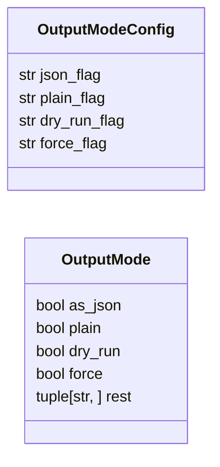
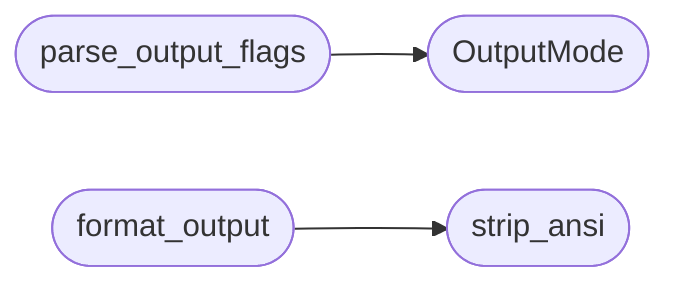

# `cli.output_mode`

> Source: [cli/output_mode.py:1](../../cli/output_mode.py#L1) | language `py` | coverage 100.0% | [API index](../index.md)

Structured output modes and dry-run rendering for CLI commands.

Piped automation needs JSON without ANSI. Operators skimming logs need
plain text. Sensitive engagements need to preview the exact shell line
before it runs. This module centralizes all three so every command
parses the same flags and formats the same way.

## Contents

- **Classes:** [`OutputModeConfig`](#outputmodeconfig), [`OutputMode`](#outputmode)
- **Functions:** [`parse_output_flags`](#parse_output_flags), [`strip_ansi`](#strip_ansi), [`format_output`](#format_output), [`dry_run_line`](#dry_run_line)
- **Constants:** [`DEFAULT_OUTPUT_CONFIG`](#default_output_config)

## Type Diagram



## Call Graph

Solid arrows stay in this module, dashed arrows leave it.



## Classes

<a id="outputmodeconfig"></a>

### `OutputModeConfig`

`class` `dataclass` | [cli/output_mode.py:20](../../cli/output_mode.py#L20)

Decorators: `@dataclass(frozen=True)`

```python
class OutputModeConfig
```

Centralized knobs for output formatting.

**Attributes**

| Name | Type | Default | Description |
|---|---|---|---|
| [`json_flag`](#outputmodeconfig-json_flag) | `str` | `'--json'` |  |
| [`plain_flag`](#outputmodeconfig-plain_flag) | `str` | `'--plain'` |  |
| [`dry_run_flag`](#outputmodeconfig-dry_run_flag) | `str` | `'--dry-run'` |  |
| [`force_flag`](#outputmodeconfig-force_flag) | `str` | `'--force'` |  |

---

<a id="outputmode"></a>

### `OutputMode`

`class` `dataclass` | [cli/output_mode.py:33](../../cli/output_mode.py#L33)

Decorators: `@dataclass(frozen=True)`

```python
class OutputMode
```

Parsed output flags for one command invocation.

**Attributes**

| Name | Type | Default | Description |
|---|---|---|---|
| [`as_json`](#outputmode-as_json) | `bool` | `False` |  |
| [`plain`](#outputmode-plain) | `bool` | `False` |  |
| [`dry_run`](#outputmode-dry_run) | `bool` | `False` |  |
| [`force`](#outputmode-force) | `bool` | `False` |  |
| [`rest`](#outputmode-rest) | `tuple[str, ...]` | `()` |  |

---

## Functions

<a id="parse_output_flags"></a>

### `parse_output_flags`

`function` | [cli/output_mode.py:43](../../cli/output_mode.py#L43)

```python
def parse_output_flags(args: list[str], config: OutputModeConfig = DEFAULT_OUTPUT_CONFIG) -> OutputMode
```

Split output control flags from positional command arguments.

**Parameters**

| Name | Type | Default | Description |
|---|---|---|---|
| `args` | `list[str]` |  | Tokenised argument list. |
| `config` | `OutputModeConfig` | `DEFAULT_OUTPUT_CONFIG` | Flag spellings. |

**Returns:** `OutputMode` - OutputMode with flags set and remaining tokens in rest.

*Calls:* [`OutputMode`](#outputmode)

*Called by:* [`UxCommandSet.do_config_diff`](cli.commands.ux.py.md#uxcommandset-do_config_diff), [`UxCommandSet.do_hud`](cli.commands.ux.py.md#uxcommandset-do_hud)

---

<a id="strip_ansi"></a>

### `strip_ansi`

`function` | [cli/output_mode.py:65](../../cli/output_mode.py#L65)

```python
def strip_ansi(text: str) -> str
```

Remove ANSI escape sequences from text.

**Parameters**

| Name | Type | Default | Description |
|---|---|---|---|
| `text` | `str` |  | Possibly coloured string. |

**Returns:** `str` - Plain string with escapes removed.

*Called by:* [`format_output`](#format_output)

---

<a id="format_output"></a>

### `format_output`

`function` | [cli/output_mode.py:77](../../cli/output_mode.py#L77)

```python
def format_output(data: Any, mode: OutputMode) -> str
```

Render data according to the parsed output mode.

**Parameters**

| Name | Type | Default | Description |
|---|---|---|---|
| `data` | `Any` |  | Mapping, sequence or preformatted string. |
| `mode` | `OutputMode` |  | Parsed flags from parse_output_flags. |

**Returns:** `str` - JSON document when as_json, ANSI-stripped text when plain,
otherwise the string form unchanged.

*Calls:* [`strip_ansi`](#strip_ansi)

*Called by:* [`UxCommandSet.do_config_diff`](cli.commands.ux.py.md#uxcommandset-do_config_diff), [`UxCommandSet.do_hud`](cli.commands.ux.py.md#uxcommandset-do_hud)

---

<a id="dry_run_line"></a>

### `dry_run_line`

`function` | [cli/output_mode.py:98](../../cli/output_mode.py#L98)

```python
def dry_run_line(command: str) -> str
```

Render the exact shell line that would run without running it.

**Parameters**

| Name | Type | Default | Description |
|---|---|---|---|
| `command` | `str` |  | Shell line preview. |

**Returns:** `str` - Single tagged line.

*Called by:* [`UxCommandSet.do_toast`](cli.commands.ux.py.md#uxcommandset-do_toast)

---

## Constants

<a id="default_output_config"></a>

### `DEFAULT_OUTPUT_CONFIG`

`constant` | [cli/output_mode.py:29](../../cli/output_mode.py#L29)

```python
DEFAULT_OUTPUT_CONFIG = OutputModeConfig()
```

---
