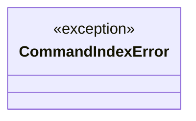
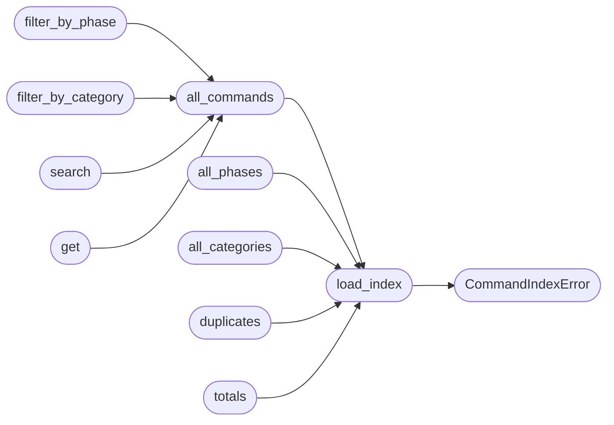

# `cli.palette`

> Source: [cli/palette.py:1](../../cli/palette.py#L1) | language `py` | coverage 100.0% | [API index](../index.md)

Read-only loader for ``cli/command_index.json``.

The CLI palette command, the C2 ``/palette`` endpoint and the MCP
``lazyown_palette`` tool all consume the same on-disk JSON document
generated by ``scripts/build_command_index.py``. This module exposes a tiny,
zero-dependency API so each surface stays in sync.

The loader is deliberately minimal: it parses the JSON once per process,
caches the result, and offers ergonomic filters. The catalogue is treated
as data — never mutated in place — so callers can safely share the cached
object across threads.

## Contents

- **Exceptions:** [`CommandIndexError`](#commandindexerror)
- **Functions:** [`load_index`](#load_index), [`all_commands`](#all_commands), [`all_phases`](#all_phases), [`all_categories`](#all_categories), [`filter_by_phase`](#filter_by_phase), [`filter_by_category`](#filter_by_category), [`search`](#search), [`get`](#get), [`duplicates`](#duplicates), [`totals`](#totals)
- **Constants:** [`DEFAULT_INDEX_PATH`](#default_index_path)

## Type Diagram



## Call Graph

Solid arrows stay in this module, dashed arrows leave it.



## Exceptions

<a id="commandindexerror"></a>

### `CommandIndexError`

`exception` | [cli/palette.py:25](../../cli/palette.py#L25)

```python
class CommandIndexError(RuntimeError)
```

Bases: `RuntimeError`

Raised when the on-disk index is missing or malformed.

---

## Functions

<a id="load_index"></a>

### `load_index`

`function` | [cli/palette.py:30](../../cli/palette.py#L30)

Decorators: `@lru_cache(maxsize=8)`

```python
def load_index(path: str | None = None) -> dict[str, Any]
```

Return the parsed catalogue as a dict.

**Parameters**

| Name | Type | Default | Description |
|---|---|---|---|
| `path` | `str \| None` | `None` | Override the default index location. ``None`` uses [`DEFAULT_INDEX_PATH`](#default_index_path). |

**Returns:** `dict[str, Any]` - The full document with keys `[`schema_version`](modules.adcs_attacks.py.md#certificatetemplate-schema_version)`, `[`totals`](#totals)`,
`[`commands`](lazyc2.state.py.md#commands)`, ``phase_to_commands`` and ``category_to_commands``.

**Raises**

- [`CommandIndexError`](#commandindexerror): when the file is missing or unparseable.

*Calls:* [`CommandIndexError`](#commandindexerror)

*Called by:* [`all_categories`](#all_categories), [`all_commands`](#all_commands), [`all_phases`](#all_phases), [`duplicates`](#duplicates), [`totals`](#totals)

---

<a id="all_commands"></a>

### `all_commands`

`function` | [cli/palette.py:55](../../cli/palette.py#L55)

```python
def all_commands(*, include_duplicates: bool = False) -> list[dict[str, Any]]
```

Return every command entry, sorted by name.

**Parameters**

| Name | Type | Default | Description |
|---|---|---|---|
| `include_duplicates` | `bool` | `False` | When ``False`` (default), shadowed duplicate definitions are filtered out — only the canonical entry remains for each name. Set to ``True`` to inspect the raw method-level list (useful for the ``/duplicates`` audit view). |

**Returns:** `list[dict[str, Any]]`

*Calls:* [`load_index`](#load_index)

*Called by:* [`filter_by_category`](#filter_by_category), [`filter_by_phase`](#filter_by_phase), [`get`](#get), [`search`](#search)

---

<a id="all_phases"></a>

### `all_phases`

`function` | [cli/palette.py:72](../../cli/palette.py#L72)

```python
def all_phases() -> list[str]
```

Return the sorted list of phase identifiers present in the index.

**Returns:** `list[str]`

*Calls:* [`load_index`](#load_index)

---

<a id="all_categories"></a>

### `all_categories`

`function` | [cli/palette.py:77](../../cli/palette.py#L77)

```python
def all_categories() -> list[str]
```

Return the sorted list of cmd2 category labels present in the index.

**Returns:** `list[str]`

*Calls:* [`load_index`](#load_index)

---

<a id="filter_by_phase"></a>

### `filter_by_phase`

`function` | [cli/palette.py:82](../../cli/palette.py#L82)

```python
def filter_by_phase(phase: str) -> list[dict[str, Any]]
```

Return command entries whose ``phase`` matches ``phase``.

Unknown phases yield an empty list instead of raising — the palette UI
is meant to be tolerant.

**Parameters**

| Name | Type | Default | Description |
|---|---|---|---|
| `phase` | `str` |  |  |

**Returns:** `list[dict[str, Any]]`

*Calls:* [`all_commands`](#all_commands)

---

<a id="filter_by_category"></a>

### `filter_by_category`

`function` | [cli/palette.py:92](../../cli/palette.py#L92)

```python
def filter_by_category(category: str) -> list[dict[str, Any]]
```

Return command entries with the given cmd2 category label.

**Parameters**

| Name | Type | Default | Description |
|---|---|---|---|
| `category` | `str` |  |  |

**Returns:** `list[dict[str, Any]]`

*Calls:* [`all_commands`](#all_commands)

---

<a id="search"></a>

### `search`

`function` | [cli/palette.py:97](../../cli/palette.py#L97)

```python
def search(query: str, *, limit: int | None = None) -> list[dict[str, Any]]
```

Substring search over ``name`` and `[`summary`](modules.metasploitable_gym.py.md#summary)` (case-insensitive).

**Parameters**

| Name | Type | Default | Description |
|---|---|---|---|
| `query` | `str` |  | Free-form search term. An empty string returns the full list (capped by ``limit`` if provided). |
| `limit` | `int \| None` | `None` | Optional cap on the result count. |

**Returns:** `list[dict[str, Any]]`

*Calls:* [`all_commands`](#all_commands)

---

<a id="get"></a>

### `get`

`function` | [cli/palette.py:114](../../cli/palette.py#L114)

```python
def get(name: str) -> dict[str, Any] | None
```

Return the canonical entry for ``name`` or ``None`` if unknown.

**Parameters**

| Name | Type | Default | Description |
|---|---|---|---|
| `name` | `str` |  |  |

**Returns:** `dict[str, Any] | None`

*Calls:* [`all_commands`](#all_commands)

---

<a id="duplicates"></a>

### `duplicates`

`function` | [cli/palette.py:125](../../cli/palette.py#L125)

```python
def duplicates() -> list[dict[str, Any]]
```

Return the duplicate-method audit list as stored in the index.

**Returns:** `list[dict[str, Any]]`

*Calls:* [`load_index`](#load_index)

---

<a id="totals"></a>

### `totals`

`function` | [cli/palette.py:130](../../cli/palette.py#L130)

```python
def totals() -> dict[str, int]
```

Return the `[`totals`](#totals)` block (counts of methods, unique names, ...).

**Returns:** `dict[str, int]`

*Calls:* [`load_index`](#load_index)

---

## Constants

<a id="default_index_path"></a>

### `DEFAULT_INDEX_PATH`

`constant` | [cli/palette.py:22](../../cli/palette.py#L22)

```python
DEFAULT_INDEX_PATH = REPO_ROOT / 'cli' / 'command_index.json'
```

---
