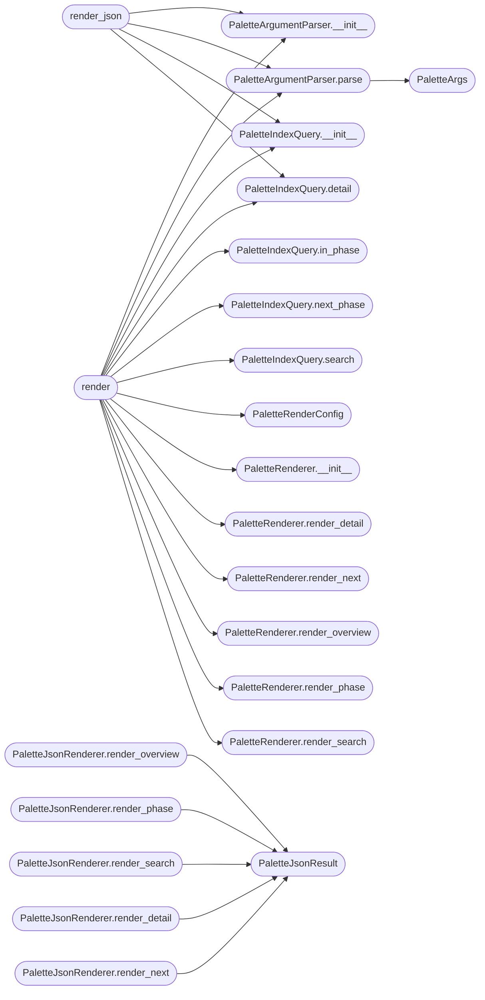

# `cli.palette_command`

> Source: [cli/palette_command.py:1](../../cli/palette_command.py#L1) | language `py` | coverage 87.8% | [API index](../index.md)

Pure logic for the operator-facing ``palette`` command.

The CLI `[`do_palette`](cli.commands.misc_migrated.py.md#miscmigratedcommandset-do_palette)` method on [`LazyOwnShell`](lazyown.py.md#lazyownshell), the C2 ``/palette``
endpoint and the MCP ``lazyown_palette`` tool all share the same parsing,
filtering and rendering pipeline implemented here. The module deliberately
exposes only deterministic, side-effect-free helpers that take a parsed
command index (a plain ``dict``) and return strings or structured rows, so
every consumer can render with its own colour scheme or transport.

Design constraints driving the shape of this module:

- Single Responsibility — three small classes split the work: argument
  parsing, query routing, output rendering.
- Open/Closed — adding a new render mode means adding a method to
  [`PaletteRenderer`](#paletterenderer); the dispatcher in [`render`](#render) does not have to
  change beyond a one-line entry.
- Dependency Inversion — every entry point accepts an `[`index`](lazyc2.py.md#index)` argument
  rather than reading the JSON from disk so callers can supply fixtures or
  alternate sources (in-memory builds, an MCP-cached snapshot, etc.).
- No magic values — every threshold, separator and label is a field of
  [`PaletteRenderConfig`](#paletterenderconfig), which the operator may override per call.

## Contents

- **Classes:** [`PaletteRenderConfig`](#paletterenderconfig), [`PaletteArgs`](#paletteargs), [`PaletteArgumentParser`](#paletteargumentparser), [`PaletteIndexQuery`](#paletteindexquery), [`PaletteRenderer`](#paletterenderer), [`PaletteJsonResult`](#palettejsonresult), [`PaletteJsonRenderer`](#palettejsonrenderer), [`PaletteViewConfig`](#paletteviewconfig), [`CompletionPosition`](#completionposition), [`PaletteCompleter`](#palettecompleter)
- **Enums:** [`PaletteMode`](#palettemode)
- **Functions:** [`render`](#render), [`render_json`](#render_json), [`build_palette_view`](#build_palette_view)

## Type Diagram

```mermaid
classDiagram
    direction LR
    class PaletteMode
    <<enum>> PaletteMode
    PaletteMode : OVERVIEW
    PaletteMode : PHASE
    PaletteMode : SEARCH
    PaletteMode : DETAIL
    PaletteMode : NEXT
    class PaletteRenderConfig
    PaletteRenderConfig : str column_separator
    PaletteRenderConfig : str overview_header
    PaletteRenderConfig : str overview_phase_header
    PaletteRenderConfig : str overview_count_header
    PaletteRenderConfig : str phase_header_prefix
    PaletteRenderConfig : str phase_empty_message
    PaletteRenderConfig : str search_header_prefix
    PaletteRenderConfig : str search_empty_message
    PaletteRenderConfig : str detail_missing_message
    PaletteRenderConfig : str detail_label_name
    PaletteRenderConfig : str detail_label_phase
    PaletteRenderConfig : str detail_label_category
    PaletteRenderConfig : str detail_label_source
    PaletteRenderConfig : str detail_label_summary
    PaletteRenderConfig : str detail_label_calls
    PaletteRenderConfig : str detail_label_related
    PaletteRenderConfig : str detail_label_runs
    PaletteRenderConfig : str detail_label_last_seen
    PaletteRenderConfig : str detail_label_runs_after
    PaletteRenderConfig : str detail_value_unset
    PaletteRenderConfig : str detail_neighbour_separator
    PaletteRenderConfig : int detail_neighbour_max
    PaletteRenderConfig : str next_header_prefix
    PaletteRenderConfig : str next_empty_message
    class PaletteArgs
    PaletteArgs : PaletteMode mode
    PaletteArgs : str  None phase
    PaletteArgs : str  None query
    PaletteArgs : str  None target_name
    class PaletteArgumentParser
    PaletteArgumentParser : __init__()
    PaletteArgumentParser : parse()
    class PaletteIndexQuery
    PaletteIndexQuery : __init__()
    PaletteIndexQuery : commands()
    PaletteIndexQuery : phases()
    PaletteIndexQuery : phase_counts()
    PaletteIndexQuery : in_phase()
    PaletteIndexQuery : search()
    PaletteIndexQuery : detail()
    PaletteIndexQuery : next_phase()
    class PaletteRenderer
    PaletteRenderer : __init__()
    PaletteRenderer : render_overview()
    PaletteRenderer : render_phase()
    PaletteRenderer : render_search()
    PaletteRenderer : render_detail()
    PaletteRenderer : render_next()
    class PaletteJsonResult
    PaletteJsonResult : str mode
    PaletteJsonResult : str  None phase
    PaletteJsonResult : str  None query
    PaletteJsonResult : str  None target
    PaletteJsonResult : tuple[Mapping[str, Any], ] results
    PaletteJsonResult : Mapping[str, int] phase_counts
    PaletteJsonResult : to_dict()
    class PaletteJsonRenderer
    PaletteJsonRenderer : __init__()
    PaletteJsonRenderer : render_overview()
    PaletteJsonRenderer : render_phase()
    PaletteJsonRenderer : render_search()
    PaletteJsonRenderer : render_detail()
    PaletteJsonRenderer : render_next()
    class PaletteViewConfig
    PaletteViewConfig : str page_title
    PaletteViewConfig : str page_subtitle
    PaletteViewConfig : str search_placeholder
    PaletteViewConfig : str phase_filter_all_label
    PaletteViewConfig : str empty_results_message
    class CompletionPosition
    CompletionPosition : int index
    CompletionPosition : tuple[str, ] tokens
    class PaletteCompleter
    PaletteCompleter : __init__()
    PaletteCompleter : complete()
```



## Call Graph

Solid arrows stay in this module, dashed arrows leave it.



## Classes

<a id="paletterenderconfig"></a>

### `PaletteRenderConfig`

`class` `dataclass` | [cli/palette_command.py:44](../../cli/palette_command.py#L44)

Decorators: `@dataclass(frozen=True)`

```python
class PaletteRenderConfig
```

Centralised constants for parser, router and renderer.

The defaults below are the only place where palette UX strings,
separators and limits live. ``frozen=True`` prevents accidental mutation
by surface-specific consumers; pass a fresh instance to override.

**Attributes**

| Name | Type | Default | Description |
|---|---|---|---|
| [`column_separator`](#paletterenderconfig-column_separator) | `str` | `' '` |  |
| [`overview_header`](#paletterenderconfig-overview_header) | `str` | `'Command palette'` |  |
| [`overview_phase_header`](#paletterenderconfig-overview_phase_header) | `str` | `'phase'` |  |
| [`overview_count_header`](#paletterenderconfig-overview_count_header) | `str` | `'commands'` |  |
| [`phase_header_prefix`](#paletterenderconfig-phase_header_prefix) | `str` | `'Phase: '` |  |
| [`phase_empty_message`](#paletterenderconfig-phase_empty_message) | `str` | `'(no commands match)'` |  |
| [`search_header_prefix`](#paletterenderconfig-search_header_prefix) | `str` | `'Search: '` |  |
| [`search_empty_message`](#paletterenderconfig-search_empty_message) | `str` | `'(no matches)'` |  |
| [`detail_missing_message`](#paletterenderconfig-detail_missing_message) | `str` | `'Command not found.'` |  |
| [`detail_label_name`](#paletterenderconfig-detail_label_name) | `str` | `'name'` |  |
| [`detail_label_phase`](#paletterenderconfig-detail_label_phase) | `str` | `'phase'` |  |
| [`detail_label_category`](#paletterenderconfig-detail_label_category) | `str` | `'category'` |  |
| [`detail_label_source`](#paletterenderconfig-detail_label_source) | `str` | `'source'` |  |
| [`detail_label_summary`](#paletterenderconfig-detail_label_summary) | `str` | `'summary'` |  |
| [`detail_label_calls`](#paletterenderconfig-detail_label_calls) | `str` | `'calls'` |  |
| [`detail_label_related`](#paletterenderconfig-detail_label_related) | `str` | `'related'` |  |
| [`detail_label_runs`](#paletterenderconfig-detail_label_runs) | `str` | `'runs'` |  |
| [`detail_label_last_seen`](#paletterenderconfig-detail_label_last_seen) | `str` | `'last seen'` |  |
| [`detail_label_runs_after`](#paletterenderconfig-detail_label_runs_after) | `str` | `'runs after'` |  |
| [`detail_value_unset`](#paletterenderconfig-detail_value_unset) | `str` | `'(none)'` |  |
| [`detail_neighbour_separator`](#paletterenderconfig-detail_neighbour_separator) | `str` | `', '` |  |
| [`detail_neighbour_max`](#paletterenderconfig-detail_neighbour_max) | `int` | `8` |  |
| [`next_header_prefix`](#paletterenderconfig-next_header_prefix) | `str` | `'Next phase: '` |  |
| [`next_empty_message`](#paletterenderconfig-next_empty_message) | `str` | `'(no next phase configured)'` |  |
| [`next_unknown_phase_message`](#paletterenderconfig-next_unknown_phase_message) | `str` | `'Unknown phase.'` |  |
| [`name_column_min_width`](#paletterenderconfig-name_column_min_width) | `int` | `4` |  |
| [`summary_max_chars`](#paletterenderconfig-summary_max_chars) | `int` | `88` |  |
| [`summary_truncation_marker`](#paletterenderconfig-summary_truncation_marker) | `str` | `'...'` |  |
| [`search_default_limit`](#paletterenderconfig-search_default_limit) | `int` | `50` |  |
| [`search_minimum_limit`](#paletterenderconfig-search_minimum_limit) | `int` | `1` |  |
| [`search_flag`](#paletterenderconfig-search_flag) | `str` | `'--search'` |  |
| [`info_flag`](#paletterenderconfig-info_flag) | `str` | `'--info'` |  |
| [`next_flag`](#paletterenderconfig-next_flag) | `str` | `'--next'` |  |
| [`overview_phase_order`](#paletterenderconfig-overview_phase_order) | `tuple[str, ...]` | `('recon', 'enum', 'exploit', 'postexp', 'persist', 'privesc', 'cred', 'lateral', 'exfil', 'c2', 'report', 'ai', 'diagnostics', 'plugin', 'addon', 'adversary', 'misc', 'uncategorized')` |  |
| [`line_separator`](#paletterenderconfig-line_separator) | `str` | `'\n'` |  |

**Members**

| Member | Kind | Summary |
|---|---|---|
| [`truncate_summary`](#paletterenderconfig-truncate_summary) | method | Trim ``summary`` to [`summary_max_chars`](#paletterenderconfig-summary_max_chars) with marker suffix. |

<a id="paletterenderconfig-truncate_summary"></a>

#### `PaletteRenderConfig.truncate_summary`

`method` | [cli/palette_command.py:107](../../cli/palette_command.py#L107)

```python
def truncate_summary(self, summary: str | None) -> str
```

Trim ``summary`` to [`summary_max_chars`](#paletterenderconfig-summary_max_chars) with marker suffix.

**Parameters**

| Name | Type | Default | Description |
|---|---|---|---|
| `summary` | `str \| None` |  | The raw summary string from the command index. |

**Returns:** `str` - A safe single-line representation; empty string when ``summary``
is falsy.

*Calls:* [`truncate_text`](core.text_utils.py.md#truncate_text)

---

<a id="paletteargs"></a>

### `PaletteArgs`

`class` `dataclass` | [cli/palette_command.py:123](../../cli/palette_command.py#L123)

Decorators: `@dataclass(frozen=True)`

```python
class PaletteArgs
```

Parsed result of a single ``palette`` invocation.

**Attributes**

| Name | Type | Default | Description |
|---|---|---|---|
| [`mode`](#paletteargs-mode) | `PaletteMode` |  |  |
| [`phase`](#paletteargs-phase) | `str \| None` | `None` |  |
| [`query`](#paletteargs-query) | `str \| None` | `None` |  |
| [`target_name`](#paletteargs-target_name) | `str \| None` | `None` |  |

---

<a id="paletteargumentparser"></a>

### `PaletteArgumentParser`

`class` | [cli/palette_command.py:132](../../cli/palette_command.py#L132)

```python
class PaletteArgumentParser
```

Translate a raw command line into [`PaletteArgs`](#paletteargs).

Routing rules (deterministic, in declaration order):

1. No tokens: [`PaletteMode.OVERVIEW`](#palettemode-overview).
2. ``--search <query>`` flag: [`PaletteMode.SEARCH`](#palettemode-search).
3. ``--info <name>`` flag: [`PaletteMode.DETAIL`](#palettemode-detail).
4. Single token that matches a known phase: [`PaletteMode.PHASE`](#palettemode-phase).
5. Single token that does not match a phase: [`PaletteMode.SEARCH`](#palettemode-search)
   with the token as `[`query`](#paletteargs-query)`.
6. Two tokens with first matching a known phase: [`PaletteMode.PHASE`](#palettemode-phase)
   with the second token as `[`query`](#paletteargs-query)`.
7. Anything else: [`PaletteMode.OVERVIEW`](#palettemode-overview) (the renderer falls back
   to a help-style listing).

**Members**

| Member | Kind | Summary |
|---|---|---|
| [`__init__`](#paletteargumentparser-__init__) | constructor |  |
| [`parse`](#paletteargumentparser-parse) | method | Return a [`PaletteArgs`](#paletteargs) for `[`line`](modules.defense_eval.py.md#evaluation-line)`. |

<a id="paletteargumentparser-__init__"></a>

#### `PaletteArgumentParser.__init__`

`constructor` | [cli/palette_command.py:149](../../cli/palette_command.py#L149)

```python
def __init__(self, config: PaletteRenderConfig) -> None
```

**Parameters**

| Name | Type | Default | Description |
|---|---|---|---|
| `config` | `PaletteRenderConfig` |  |  |

*Called by:* [`render`](#render), [`render_json`](#render_json)

<a id="paletteargumentparser-parse"></a>

#### `PaletteArgumentParser.parse`

`method` | [cli/palette_command.py:152](../../cli/palette_command.py#L152)

```python
def parse(self, line: str, *, known_phases: Iterable[str]) -> PaletteArgs
```

Return a [`PaletteArgs`](#paletteargs) for `[`line`](modules.defense_eval.py.md#evaluation-line)`.

**Parameters**

| Name | Type | Default | Description |
|---|---|---|---|
| `line` | `str` |  | The raw text passed to `[`do_palette`](cli.commands.misc_migrated.py.md#miscmigratedcommandset-do_palette)` (already stripped of the leading ``palette`` verb by cmd2). |
| `known_phases` | `Iterable[str]` |  | Iterable of phase identifiers from the command index — used to disambiguate single-token invocations. |

**Returns:** `PaletteArgs`

*Calls:* [`PaletteArgs`](#paletteargs)

*Called by:* [`render`](#render), [`render_json`](#render_json)

---

<a id="paletteindexquery"></a>

### `PaletteIndexQuery`

`class` | [cli/palette_command.py:184](../../cli/palette_command.py#L184)

```python
class PaletteIndexQuery
```

Read-only view over the command index document.

Wraps the JSON structure produced by ``scripts.build_command_index`` so
callers do not depend on its concrete keys. Every method returns plain
Python primitives (lists/dicts) — never references into the underlying
document — so consumers can safely sort or extend the results.

**Members**

| Member | Kind | Summary |
|---|---|---|
| [`__init__`](#paletteindexquery-__init__) | constructor |  |
| [`commands`](#paletteindexquery-commands) | property | Return canonical (non-duplicate) command entries. |
| [`phases`](#paletteindexquery-phases) | property | Return the sorted list of phase identifiers in the index. |
| [`phase_counts`](#paletteindexquery-phase_counts) | property | Return ``{phase: command_count}`` for every phase in the index. |
| [`in_phase`](#paletteindexquery-in_phase) | method | Return commands whose `[`phase`](#paletteargs-phase)` matches `[`phase`](#paletteargs-phase)` (case-insensitive). |
| [`search`](#paletteindexquery-search) | method | Substring search over ``name`` and ``summary`` (case-insensitive). |
| [`detail`](#paletteindexquery-detail) | method | Return the canonical entry for `[`target`](#palettejsonresult-target)` or ``None``. |
| [`next_phase`](#paletteindexquery-next_phase) | method | Return the phase that comes after `[`current`](cli.autosuggest.py.md#autosuggestengine-current)` in ``ordering``. |

<a id="paletteindexquery-__init__"></a>

#### `PaletteIndexQuery.__init__`

`constructor` | [cli/palette_command.py:193](../../cli/palette_command.py#L193)

```python
def __init__(self, index: Mapping[str, Any]) -> None
```

**Parameters**

| Name | Type | Default | Description |
|---|---|---|---|
| `index` | `Mapping[str, Any]` |  |  |

*Called by:* [`PaletteCompleter.complete`](#palettecompleter-complete), [`build_palette_view`](#build_palette_view), [`render`](#render), [`render_json`](#render_json), [`PaletteOverlayState.rows`](cli.palette_overlay.py.md#paletteoverlaystate-rows)

<a id="paletteindexquery-commands"></a>

#### `PaletteIndexQuery.commands`

`property` | [cli/palette_command.py:197](../../cli/palette_command.py#L197)

Decorators: `@property`

```python
def commands(self) -> list[dict[str, Any]]
```

Return canonical (non-duplicate) command entries.

**Returns:** `list[dict[str, Any]]`

<a id="paletteindexquery-phases"></a>

#### `PaletteIndexQuery.phases`

`property` | [cli/palette_command.py:203](../../cli/palette_command.py#L203)

Decorators: `@property`

```python
def phases(self) -> list[str]
```

Return the sorted list of phase identifiers in the index.

**Returns:** `list[str]`

<a id="paletteindexquery-phase_counts"></a>

#### `PaletteIndexQuery.phase_counts`

`property` | [cli/palette_command.py:208](../../cli/palette_command.py#L208)

Decorators: `@property`

```python
def phase_counts(self) -> dict[str, int]
```

Return ``{phase: command_count}`` for every phase in the index.

**Returns:** `dict[str, int]`

<a id="paletteindexquery-in_phase"></a>

#### `PaletteIndexQuery.in_phase`

`method` | [cli/palette_command.py:213](../../cli/palette_command.py#L213)

```python
def in_phase(self, phase: str) -> list[dict[str, Any]]
```

Return commands whose `[`phase`](#paletteargs-phase)` matches `[`phase`](#paletteargs-phase)` (case-insensitive).

**Parameters**

| Name | Type | Default | Description |
|---|---|---|---|
| `phase` | `str` |  |  |

**Returns:** `list[dict[str, Any]]`

*Called by:* [`PaletteCompleter.complete`](#palettecompleter-complete), [`render`](#render), [`render_json`](#render_json)

<a id="paletteindexquery-search"></a>

#### `PaletteIndexQuery.search`

`method` | [cli/palette_command.py:218](../../cli/palette_command.py#L218)

```python
def search(self, query: str, *, limit: int) -> list[dict[str, Any]]
```

Substring search over ``name`` and ``summary`` (case-insensitive).

**Parameters**

| Name | Type | Default | Description |
|---|---|---|---|
| `query` | `str` |  | Free-form search term. |
| `limit` | `int` |  | Maximum number of rows to return; values below 1 yield an empty list. |

**Returns:** `list[dict[str, Any]]`

*Called by:* [`render`](#render), [`render_json`](#render_json)

<a id="paletteindexquery-detail"></a>

#### `PaletteIndexQuery.detail`

`method` | [cli/palette_command.py:234](../../cli/palette_command.py#L234)

```python
def detail(self, target: str) -> dict[str, Any] | None
```

Return the canonical entry for `[`target`](#palettejsonresult-target)` or ``None``.

Accepts both `[`do_assign`](cli.commands.session_ops.py.md#sessionopscommandset-do_assign)` and ``assign`` forms.

**Parameters**

| Name | Type | Default | Description |
|---|---|---|---|
| `target` | `str` |  |  |

**Returns:** `dict[str, Any] | None`

*Called by:* [`render`](#render), [`render_json`](#render_json)

<a id="paletteindexquery-next_phase"></a>

#### `PaletteIndexQuery.next_phase`

`method` | [cli/palette_command.py:249](../../cli/palette_command.py#L249)

```python
def next_phase(self, current: str | None, *, ordering: Sequence[str]) -> str | None
```

Return the phase that comes after `[`current`](cli.autosuggest.py.md#autosuggestengine-current)` in ``ordering``.

**Parameters**

| Name | Type | Default | Description |
|---|---|---|---|
| `current` | `str \| None` |  | Reference phase. ``None`` returns the first phase that is present in both ``ordering`` and the index. |
| `ordering` | `Sequence[str]` |  | The kill-chain ordering — typically [`PaletteRenderConfig.overview_phase_order`](#paletterenderconfig-overview_phase_order). |

**Returns:** `str | None` - The next phase identifier present in the index, or ``None`` when
`[`current`](cli.autosuggest.py.md#autosuggestengine-current)` is the final configured phase.

*Called by:* [`render`](#render), [`render_json`](#render_json)

---

<a id="paletterenderer"></a>

### `PaletteRenderer`

`class` | [cli/palette_command.py:277](../../cli/palette_command.py#L277)

```python
class PaletteRenderer
```

Format query results as plain text, ready to be printed.

Each ``render_*`` method takes already-filtered data and returns a
multi-line string. The renderer never queries the index directly so the
same instance can be reused across surfaces (CLI, web, MCP).

**Members**

| Member | Kind | Summary |
|---|---|---|
| [`__init__`](#paletterenderer-__init__) | constructor |  |
| [`render_overview`](#paletterenderer-render_overview) | method | Format the multi-phase overview table. |
| [`render_phase`](#paletterenderer-render_phase) | method | Format a phase listing of ``(name, summary)`` pairs. |
| [`render_search`](#paletterenderer-render_search) | method | Format the cross-phase search result table. |
| [`render_detail`](#paletterenderer-render_detail) | method | Format the detail view for a single command entry. |
| [`render_next`](#paletterenderer-render_next) | method | Format the recommended-next-phase listing. |

<a id="paletterenderer-__init__"></a>

#### `PaletteRenderer.__init__`

`constructor` | [cli/palette_command.py:285](../../cli/palette_command.py#L285)

```python
def __init__(self, config: PaletteRenderConfig) -> None
```

**Parameters**

| Name | Type | Default | Description |
|---|---|---|---|
| `config` | `PaletteRenderConfig` |  |  |

*Called by:* [`render`](#render)

<a id="paletterenderer-render_overview"></a>

#### `PaletteRenderer.render_overview`

`method` | [cli/palette_command.py:288](../../cli/palette_command.py#L288)

```python
def render_overview(self, phase_counts: Mapping[str, int]) -> str
```

Format the multi-phase overview table.

**Parameters**

| Name | Type | Default | Description |
|---|---|---|---|
| `phase_counts` | `Mapping[str, int]` |  |  |

**Returns:** `str`

*Called by:* [`render`](#render)

<a id="paletterenderer-render_phase"></a>

#### `PaletteRenderer.render_phase`

`method` | [cli/palette_command.py:304](../../cli/palette_command.py#L304)

```python
def render_phase(self, phase: str, rows: Sequence[Mapping[str, Any]]) -> str
```

Format a phase listing of ``(name, summary)`` pairs.

**Parameters**

| Name | Type | Default | Description |
|---|---|---|---|
| `phase` | `str` |  |  |
| `rows` | `Sequence[Mapping[str, Any]]` |  |  |

**Returns:** `str`

*Called by:* [`render`](#render)

<a id="paletterenderer-render_search"></a>

#### `PaletteRenderer.render_search`

`method` | [cli/palette_command.py:312](../../cli/palette_command.py#L312)

```python
def render_search(self, query: str | None, rows: Sequence[Mapping[str, Any]]) -> str
```

Format the cross-phase search result table.

**Parameters**

| Name | Type | Default | Description |
|---|---|---|---|
| `query` | `str \| None` |  |  |
| `rows` | `Sequence[Mapping[str, Any]]` |  |  |

**Returns:** `str`

*Called by:* [`render`](#render)

<a id="paletterenderer-render_detail"></a>

#### `PaletteRenderer.render_detail`

`method` | [cli/palette_command.py:320](../../cli/palette_command.py#L320)

```python
def render_detail(self, entry: Mapping[str, Any] | None) -> str
```

Format the detail view for a single command entry.

When ``entry`` carries graph-derived ``calls`` or ``related`` keys
(attached by [`cli.palette_graph.enrich_detail`](cli.palette_graph.py.md#enrich_detail)), those lists
appear as additional rows so operators can see what the command
actually invokes and which other commands work like it.

**Parameters**

| Name | Type | Default | Description |
|---|---|---|---|
| `entry` | `Mapping[str, Any] \| None` |  |  |

**Returns:** `str`

*Called by:* [`render`](#render)

<a id="paletterenderer-render_next"></a>

#### `PaletteRenderer.render_next`

`method` | [cli/palette_command.py:360](../../cli/palette_command.py#L360)

```python
def render_next(self, phase: str | None, rows: Sequence[Mapping[str, Any]]) -> str
```

Format the recommended-next-phase listing.

**Parameters**

| Name | Type | Default | Description |
|---|---|---|---|
| `phase` | `str \| None` |  |  |
| `rows` | `Sequence[Mapping[str, Any]]` |  |  |

**Returns:** `str`

*Called by:* [`render`](#render)

---

<a id="palettejsonresult"></a>

### `PaletteJsonResult`

`class` `dataclass` | [cli/palette_command.py:487](../../cli/palette_command.py#L487)

Decorators: `@dataclass(frozen=True)`

```python
class PaletteJsonResult
```

Structured output of [`PaletteJsonRenderer`](#palettejsonrenderer) and [`render_json`](#render_json).

Consumers (the MCP tool, the C2 web client, automation scripts) read
fields directly. The shape never includes raw helper text — only data —
so each surface can localise or re-style without parsing strings.

**Attributes**

| Name | Type | Default | Description |
|---|---|---|---|
| [`mode`](#palettejsonresult-mode) | `str` |  |  |
| [`phase`](#palettejsonresult-phase) | `str \| None` | `None` |  |
| [`query`](#palettejsonresult-query) | `str \| None` | `None` |  |
| [`target`](#palettejsonresult-target) | `str \| None` | `None` |  |
| [`results`](#palettejsonresult-results) | `tuple[Mapping[str, Any], ...]` | `field(default_factory=tuple)` |  |
| [`phase_counts`](#palettejsonresult-phase_counts) | `Mapping[str, int]` | `field(default_factory=dict)` |  |

**Members**

| Member | Kind | Summary |
|---|---|---|
| [`to_dict`](#palettejsonresult-to_dict) | method | Serialise to a plain ``dict`` suitable for ``json.dumps``. |

<a id="palettejsonresult-to_dict"></a>

#### `PaletteJsonResult.to_dict`

`method` | [cli/palette_command.py:502](../../cli/palette_command.py#L502)

```python
def to_dict(self) -> dict[str, Any]
```

Serialise to a plain ``dict`` suitable for ``json.dumps``.

**Returns:** `dict[str, Any]`

---

<a id="palettejsonrenderer"></a>

### `PaletteJsonRenderer`

`class` | [cli/palette_command.py:514](../../cli/palette_command.py#L514)

```python
class PaletteJsonRenderer
```

Produce a [`PaletteJsonResult`](#palettejsonresult) from a parsed query.

Mirrors [`PaletteRenderer`](#paletterenderer) so adding a new `[`PaletteMode`](#palettemode)` requires
one method here and one method on the text renderer; the dispatcher in
[`render_json`](#render_json) does not have to change beyond a one-line entry.

**Members**

| Member | Kind | Summary |
|---|---|---|
| [`__init__`](#palettejsonrenderer-__init__) | constructor |  |
| [`render_overview`](#palettejsonrenderer-render_overview) | method | Build a result document for overview mode. |
| [`render_phase`](#palettejsonrenderer-render_phase) | method | Build a result document for phase mode. |
| [`render_search`](#palettejsonrenderer-render_search) | method | Build a result document for search mode. |
| [`render_detail`](#palettejsonrenderer-render_detail) | method | Build a result document for detail mode. |
| [`render_next`](#palettejsonrenderer-render_next) | method | Build a result document for next-phase mode. |

<a id="palettejsonrenderer-__init__"></a>

#### `PaletteJsonRenderer.__init__`

`constructor` | [cli/palette_command.py:522](../../cli/palette_command.py#L522)

```python
def __init__(self, config: PaletteRenderConfig) -> None
```

**Parameters**

| Name | Type | Default | Description |
|---|---|---|---|
| `config` | `PaletteRenderConfig` |  |  |

*Called by:* [`render_json`](#render_json)

<a id="palettejsonrenderer-render_overview"></a>

#### `PaletteJsonRenderer.render_overview`

`method` | [cli/palette_command.py:525](../../cli/palette_command.py#L525)

```python
def render_overview(self, phase_counts: Mapping[str, int]) -> PaletteJsonResult
```

Build a result document for overview mode.

**Parameters**

| Name | Type | Default | Description |
|---|---|---|---|
| `phase_counts` | `Mapping[str, int]` |  |  |

**Returns:** `PaletteJsonResult`

*Calls:* [`PaletteJsonResult`](#palettejsonresult)

*Called by:* [`render_json`](#render_json)

<a id="palettejsonrenderer-render_phase"></a>

#### `PaletteJsonRenderer.render_phase`

`method` | [cli/palette_command.py:532](../../cli/palette_command.py#L532)

```python
def render_phase(self, phase: str, query: str | None, rows: Sequence[Mapping[str, Any]]) -> PaletteJsonResult
```

Build a result document for phase mode.

**Parameters**

| Name | Type | Default | Description |
|---|---|---|---|
| `phase` | `str` |  |  |
| `query` | `str \| None` |  |  |
| `rows` | `Sequence[Mapping[str, Any]]` |  |  |

**Returns:** `PaletteJsonResult`

*Calls:* [`PaletteJsonResult`](#palettejsonresult)

*Called by:* [`render_json`](#render_json)

<a id="palettejsonrenderer-render_search"></a>

#### `PaletteJsonRenderer.render_search`

`method` | [cli/palette_command.py:541](../../cli/palette_command.py#L541)

```python
def render_search(self, query: str | None, rows: Sequence[Mapping[str, Any]]) -> PaletteJsonResult
```

Build a result document for search mode.

**Parameters**

| Name | Type | Default | Description |
|---|---|---|---|
| `query` | `str \| None` |  |  |
| `rows` | `Sequence[Mapping[str, Any]]` |  |  |

**Returns:** `PaletteJsonResult`

*Calls:* [`PaletteJsonResult`](#palettejsonresult)

*Called by:* [`render_json`](#render_json)

<a id="palettejsonrenderer-render_detail"></a>

#### `PaletteJsonRenderer.render_detail`

`method` | [cli/palette_command.py:549](../../cli/palette_command.py#L549)

```python
def render_detail(self, target: str | None, entry: Mapping[str, Any] | None) -> PaletteJsonResult
```

Build a result document for detail mode.

**Parameters**

| Name | Type | Default | Description |
|---|---|---|---|
| `target` | `str \| None` |  |  |
| `entry` | `Mapping[str, Any] \| None` |  |  |

**Returns:** `PaletteJsonResult`

*Calls:* [`PaletteJsonResult`](#palettejsonresult)

*Called by:* [`render_json`](#render_json)

<a id="palettejsonrenderer-render_next"></a>

#### `PaletteJsonRenderer.render_next`

`method` | [cli/palette_command.py:557](../../cli/palette_command.py#L557)

```python
def render_next(self, phase: str | None, rows: Sequence[Mapping[str, Any]]) -> PaletteJsonResult
```

Build a result document for next-phase mode.

**Parameters**

| Name | Type | Default | Description |
|---|---|---|---|
| `phase` | `str \| None` |  |  |
| `rows` | `Sequence[Mapping[str, Any]]` |  |  |

**Returns:** `PaletteJsonResult`

*Calls:* [`PaletteJsonResult`](#palettejsonresult)

*Called by:* [`render_json`](#render_json)

---

<a id="paletteviewconfig"></a>

### `PaletteViewConfig`

`class` `dataclass` | [cli/palette_command.py:605](../../cli/palette_command.py#L605)

Decorators: `@dataclass(frozen=True)`

```python
class PaletteViewConfig
```

Centralised constants for the C2 web view payload.

Kept separate from [`PaletteRenderConfig`](#paletterenderconfig) so a deployment may
relabel the web UI without touching the CLI rendering strings.

**Attributes**

| Name | Type | Default | Description |
|---|---|---|---|
| [`page_title`](#paletteviewconfig-page_title) | `str` | `'Command palette'` |  |
| [`page_subtitle`](#paletteviewconfig-page_subtitle) | `str` | `'Operator command catalogue'` |  |
| [`search_placeholder`](#paletteviewconfig-search_placeholder) | `str` | `'Search commands or summaries...'` |  |
| [`phase_filter_all_label`](#paletteviewconfig-phase_filter_all_label) | `str` | `'All phases'` |  |
| [`empty_results_message`](#paletteviewconfig-empty_results_message) | `str` | `'No commands match the current filter.'` |  |

---

<a id="completionposition"></a>

### `CompletionPosition`

`class` `dataclass` | [cli/palette_command.py:737](../../cli/palette_command.py#L737)

Decorators: `@dataclass(frozen=True)`

```python
class CompletionPosition
```

Tokenisation snapshot produced by [`PaletteCompleter`](#palettecompleter).

**Attributes**

| Name | Type | Default | Description |
|---|---|---|---|
| [`index`](#completionposition-index) | `int` |  |  |
| [`tokens`](#completionposition-tokens) | `tuple[str, ...]` | `field(default_factory=tuple)` |  |

---

<a id="palettecompleter"></a>

### `PaletteCompleter`

`class` | [cli/palette_command.py:744](../../cli/palette_command.py#L744)

```python
class PaletteCompleter
```

Data-driven tab completion for ``palette``.

Position rules:

- First positional: phase identifiers and the verbs ``--search`` and
  ``--info``.
- Second positional after a phase: command names belonging to that phase.
- Second positional after ``--info``: every canonical command name.

**Members**

| Member | Kind | Summary |
|---|---|---|
| [`__init__`](#palettecompleter-__init__) | constructor |  |
| [`complete`](#palettecompleter-complete) | method | Return tab-completion candidates given the editor state. |

<a id="palettecompleter-__init__"></a>

#### `PaletteCompleter.__init__`

`constructor` | [cli/palette_command.py:755](../../cli/palette_command.py#L755)

```python
def __init__(self, config: PaletteRenderConfig) -> None
```

**Parameters**

| Name | Type | Default | Description |
|---|---|---|---|
| `config` | `PaletteRenderConfig` |  |  |

<a id="palettecompleter-complete"></a>

#### `PaletteCompleter.complete`

`method` | [cli/palette_command.py:758](../../cli/palette_command.py#L758)

```python
def complete(self, text: str, line: str, endidx: int, index: Mapping[str, Any]) -> list[str]
```

Return tab-completion candidates given the editor state.

**Parameters**

| Name | Type | Default | Description |
|---|---|---|---|
| `text` | `str` |  |  |
| `line` | `str` |  |  |
| `endidx` | `int` |  |  |
| `index` | `Mapping[str, Any]` |  |  |

**Returns:** `list[str]`

*Calls:* [`PaletteIndexQuery.__init__`](#paletteindexquery-__init__), [`PaletteIndexQuery.in_phase`](#paletteindexquery-in_phase)

---

## Enums

<a id="palettemode"></a>

### `PaletteMode`

`enum` | [cli/palette_command.py:33](../../cli/palette_command.py#L33)

```python
class PaletteMode(Enum)
```

Bases: `Enum`

High-level routing modes for a parsed ``palette`` invocation.

**Attributes**

| Name | Type | Default | Description |
|---|---|---|---|
| [`OVERVIEW`](#palettemode-overview) |  | `'overview'` |  |
| [`PHASE`](#palettemode-phase) |  | `'phase'` |  |
| [`SEARCH`](#palettemode-search) |  | `'search'` |  |
| [`DETAIL`](#palettemode-detail) |  | `'detail'` |  |
| [`NEXT`](#palettemode-next) |  | `'next'` |  |

---

## Functions

<a id="render"></a>

### `render`

`function` | [cli/palette_command.py:447](../../cli/palette_command.py#L447)

```python
def render(index: Mapping[str, Any], line: str, *, config: PaletteRenderConfig | None = None) -> str
```

Top-level entry point used by `LazyOwnShell.do_palette`.

**Parameters**

| Name | Type | Default | Description |
|---|---|---|---|
| `index` | `Mapping[str, Any]` |  | The parsed command-index document (already loaded). |
| `line` | `str` |  | The raw text passed to `[`do_palette`](cli.commands.misc_migrated.py.md#miscmigratedcommandset-do_palette)`. |
| `config` | `PaletteRenderConfig \| None` | `None` | Optional rendering configuration override. ``None`` uses the module default [`PaletteRenderConfig`](#paletterenderconfig). |

**Returns:** `str` - A ready-to-print multi-line string.

*Calls:* [`PaletteArgumentParser.__init__`](#paletteargumentparser-__init__), [`PaletteArgumentParser.parse`](#paletteargumentparser-parse), [`PaletteIndexQuery.__init__`](#paletteindexquery-__init__), [`PaletteIndexQuery.detail`](#paletteindexquery-detail), [`PaletteIndexQuery.in_phase`](#paletteindexquery-in_phase), [`PaletteIndexQuery.next_phase`](#paletteindexquery-next_phase), [`PaletteIndexQuery.search`](#paletteindexquery-search), [`PaletteRenderConfig`](#paletterenderconfig), [`PaletteRenderer.__init__`](#paletterenderer-__init__), [`PaletteRenderer.render_detail`](#paletterenderer-render_detail), [`PaletteRenderer.render_next`](#paletterenderer-render_next), [`PaletteRenderer.render_overview`](#paletterenderer-render_overview) and 2 more

---

<a id="render_json"></a>

### `render_json`

`function` | [cli/palette_command.py:566](../../cli/palette_command.py#L566)

```python
def render_json(index: Mapping[str, Any], line: str, *, config: PaletteRenderConfig | None = None) -> dict[str, Any]
```

Structured-data variant of [`render`](#render).

**Parameters**

| Name | Type | Default | Description |
|---|---|---|---|
| `index` | `Mapping[str, Any]` |  | The parsed command-index document. |
| `line` | `str` |  | The raw text passed to the underlying surface. |
| `config` | `PaletteRenderConfig \| None` | `None` | Optional configuration override. |

**Returns:** `dict[str, Any]` - A serialisable ``dict`` matching [`PaletteJsonResult.to_dict`](#palettejsonresult-to_dict).

*Calls:* [`PaletteArgumentParser.__init__`](#paletteargumentparser-__init__), [`PaletteArgumentParser.parse`](#paletteargumentparser-parse), [`PaletteIndexQuery.__init__`](#paletteindexquery-__init__), [`PaletteIndexQuery.detail`](#paletteindexquery-detail), [`PaletteIndexQuery.in_phase`](#paletteindexquery-in_phase), [`PaletteIndexQuery.next_phase`](#paletteindexquery-next_phase), [`PaletteIndexQuery.search`](#paletteindexquery-search), [`PaletteJsonRenderer.__init__`](#palettejsonrenderer-__init__), [`PaletteJsonRenderer.render_detail`](#palettejsonrenderer-render_detail), [`PaletteJsonRenderer.render_next`](#palettejsonrenderer-render_next), [`PaletteJsonRenderer.render_overview`](#palettejsonrenderer-render_overview), [`PaletteJsonRenderer.render_phase`](#palettejsonrenderer-render_phase) and 2 more

---

<a id="build_palette_view"></a>

### `build_palette_view`

`function` | [cli/palette_command.py:619](../../cli/palette_command.py#L619)

```python
def build_palette_view(index: Mapping[str, Any], *, config: PaletteRenderConfig | None = None, view_config: PaletteViewConfig | None = None) -> dict[str, Any]
```

Assemble the template context consumed by the C2 ``/palette`` view.

The shape is intentionally flat and JSON-serialisable so the template can
embed the full payload as a ``<script type="application/json">`` block
and the client-side JavaScript can filter without round-tripping.

**Parameters**

| Name | Type | Default | Description |
|---|---|---|---|
| `index` | `Mapping[str, Any]` |  | The parsed command-index document. |
| `config` | `PaletteRenderConfig \| None` | `None` | Optional rendering-config override (used to expose the flag strings the UI surfaces as filter chips). |
| `view_config` | `PaletteViewConfig \| None` | `None` | Optional view-config override. |

**Returns:** `dict[str, Any]`

*Calls:* [`PaletteIndexQuery.__init__`](#paletteindexquery-__init__), [`PaletteRenderConfig`](#paletterenderconfig), [`PaletteViewConfig`](#paletteviewconfig)

---
