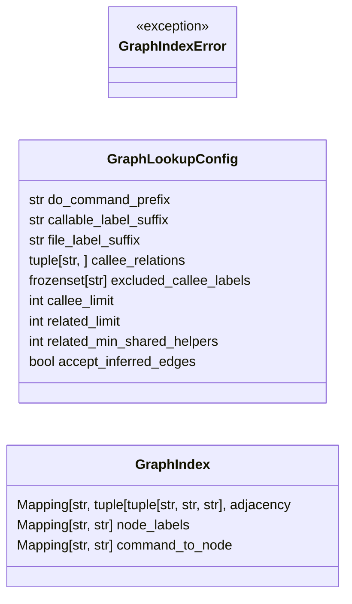
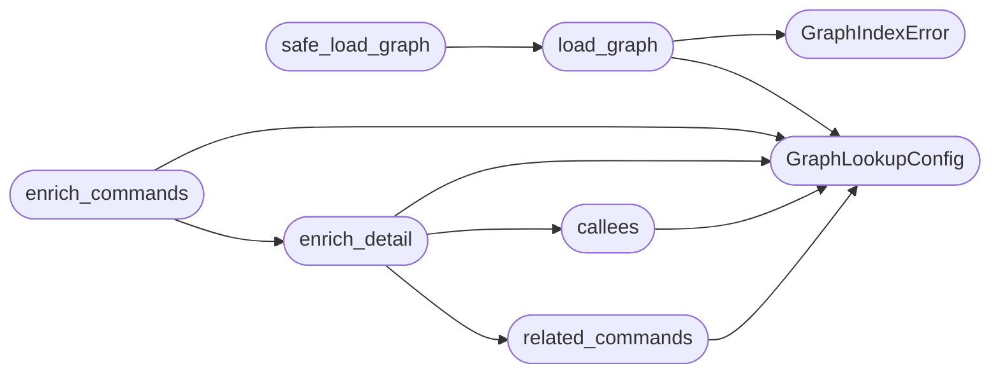

# `cli.palette_graph`

> Source: [cli/palette_graph.py:1](../../cli/palette_graph.py#L1) | language `py` | coverage 100.0% | [API index](../index.md)

Graph-aware neighbour lookups for the operator command palette.

The graphify export at :file:`graphify-out/graph_lazyown.json` captures the
call graph of every ``do_*`` command together with its helper functions and
classes. This module reads that artefact once per process and exposes a tiny
read-only API so the palette CLI, the C2 web view and the MCP tool can all
attach the same "what does this command actually do" / "what other commands
work like this one" hints to a detail view.

Design constraints driving the shape of this module:

- Single Responsibility — [`GraphIndex`](#graphindex) only loads and caches; pure
  functions like [`callees`](#callees), [`related_commands`](#related_commands) and
  [`enrich_detail`](#enrich_detail) translate it into palette-friendly shapes.
- Open/Closed — every threshold, edge label and limit lives on
  [`GraphLookupConfig`](#graphlookupconfig); new neighbour types mean adding a function, not
  editing existing call sites.
- Dependency Inversion — every public entry point accepts the parsed graph
  document, never reads it from disk on its own. Callers wire the loader
  through [`load_graph`](#load_graph) so tests can inject fixtures.
- Sad path is a no-op. A missing or malformed graph file degrades to empty
  results so the palette stays usable on hosts that never ran graphify.

## Contents

- **Classes:** [`GraphLookupConfig`](#graphlookupconfig), [`GraphIndex`](#graphindex)
- **Exceptions:** [`GraphIndexError`](#graphindexerror)
- **Functions:** [`load_graph`](#load_graph), [`safe_load_graph`](#safe_load_graph), [`callees`](#callees), [`related_commands`](#related_commands), [`enrich_detail`](#enrich_detail), [`enrich_commands`](#enrich_commands)
- **Constants:** [`DEFAULT_GRAPH_PATH`](#default_graph_path)

## Type Diagram



## Call Graph

Solid arrows stay in this module, dashed arrows leave it.



## Classes

<a id="graphlookupconfig"></a>

### `GraphLookupConfig`

`class` `dataclass` | [cli/palette_graph.py:44](../../cli/palette_graph.py#L44)

Decorators: `@dataclass(frozen=True)`

```python
class GraphLookupConfig
```

Centralised constants for graph-driven palette enrichment.

Every literal that affects neighbour selection lives here so behaviour is
tunable without touching call sites. ``frozen=True`` prevents accidental
mutation by per-surface consumers.

**Attributes**

| Name | Type | Default | Description |
|---|---|---|---|
| [`do_command_prefix`](#graphlookupconfig-do_command_prefix) | `str` | `'do_'` |  |
| [`callable_label_suffix`](#graphlookupconfig-callable_label_suffix) | `str` | `'()'` |  |
| [`file_label_suffix`](#graphlookupconfig-file_label_suffix) | `str` | `'.py'` |  |
| [`callee_relations`](#graphlookupconfig-callee_relations) | `tuple[str, ...]` | `('calls', 'uses')` |  |
| [`excluded_callee_labels`](#graphlookupconfig-excluded_callee_labels) | `frozenset[str]` | `frozenset({'.cmd()', 'run()', 'decode()'})` |  |
| [`callee_limit`](#graphlookupconfig-callee_limit) | `int` | `12` |  |
| [`related_limit`](#graphlookupconfig-related_limit) | `int` | `6` |  |
| [`related_min_shared_helpers`](#graphlookupconfig-related_min_shared_helpers) | `int` | `2` |  |
| [`accept_inferred_edges`](#graphlookupconfig-accept_inferred_edges) | `bool` | `True` |  |

---

<a id="graphindex"></a>

### `GraphIndex`

`class` `dataclass` | [cli/palette_graph.py:74](../../cli/palette_graph.py#L74)

Decorators: `@dataclass(frozen=True)`

```python
class GraphIndex
```

Read-only adjacency view derived from the graphify document.

**Attributes**

| Name | Type | Default | Description |
|---|---|---|---|
| [`adjacency`](#graphindex-adjacency) | `Mapping[str, tuple[tuple[str, str, str], ...]]` |  | ``{node_id: [(other_id, relation, confidence), ...]}`` — symmetric, deduplicated edge list. |
| [`node_labels`](#graphindex-node_labels) | `Mapping[str, str]` |  | ``{node_id: label}`` for every node in the graph. |
| [`command_to_node`](#graphindex-command_to_node) | `Mapping[str, str]` |  | ``{do_name_without_parens: node_id}`` resolver for command lookups. |

---

## Exceptions

<a id="graphindexerror"></a>

### `GraphIndexError`

`exception` | [cli/palette_graph.py:39](../../cli/palette_graph.py#L39)

```python
class GraphIndexError(RuntimeError)
```

Bases: `RuntimeError`

Raised when the graphify export is missing or malformed.

---

## Functions

<a id="load_graph"></a>

### `load_graph`

`function` | [cli/palette_graph.py:127](../../cli/palette_graph.py#L127)

Decorators: `@lru_cache(maxsize=4)`

```python
def load_graph(path: str | None = None) -> GraphIndex
```

Return the parsed graph index, cached per resolved path.

**Parameters**

| Name | Type | Default | Description |
|---|---|---|---|
| `path` | `str \| None` | `None` | Override the default graph location. ``None`` uses [`DEFAULT_GRAPH_PATH`](#default_graph_path). |

**Returns:** `GraphIndex` - A [`GraphIndex`](#graphindex). When the file is missing or invalid the
function raises [`GraphIndexError`](#graphindexerror); callers that want graceful
degradation should use [`safe_load_graph`](#safe_load_graph) instead.

**Raises**

- [`GraphIndexError`](#graphindexerror): (raised in the body, not documented)

*Calls:* [`GraphIndexError`](#graphindexerror), [`GraphLookupConfig`](#graphlookupconfig)

*Called by:* [`safe_load_graph`](#safe_load_graph)

---

<a id="safe_load_graph"></a>

### `safe_load_graph`

`function` | [cli/palette_graph.py:149](../../cli/palette_graph.py#L149)

```python
def safe_load_graph(path: str | None = None) -> GraphIndex | None
```

Best-effort variant of [`load_graph`](#load_graph).

Returns ``None`` instead of raising so the palette stays usable on hosts
that have never run graphify.

**Parameters**

| Name | Type | Default | Description |
|---|---|---|---|
| `path` | `str \| None` | `None` |  |

**Returns:** `GraphIndex | None`

*Calls:* [`load_graph`](#load_graph)

---

<a id="callees"></a>

### `callees`

`function` | [cli/palette_graph.py:179](../../cli/palette_graph.py#L179)

```python
def callees(graph: GraphIndex | None, command_name: str, *, config: GraphLookupConfig | None = None) -> list[str]
```

Return helper-function labels invoked by `[`command_name`](cli.command_form.py.md#commandformstate-command_name)`.

**Parameters**

| Name | Type | Default | Description |
|---|---|---|---|
| `graph` | `GraphIndex \| None` |  | The loaded graph index (or ``None``; in which case the result is an empty list). |
| `command_name` | `str` |  | A ``do_*`` command name with or without the ``do_`` prefix. |
| `config` | `GraphLookupConfig \| None` | `None` | Optional override for the lookup config. |

**Returns:** `list[str]` - At most [`GraphLookupConfig.callee_limit`](#graphlookupconfig-callee_limit) distinct labels,
sorted alphabetically. Internal noise such as ``.cmd()`` is excluded.

*Calls:* [`GraphLookupConfig`](#graphlookupconfig)

*Called by:* [`enrich_detail`](#enrich_detail)

---

<a id="related_commands"></a>

### `related_commands`

`function` | [cli/palette_graph.py:226](../../cli/palette_graph.py#L226)

```python
def related_commands(graph: GraphIndex | None, command_name: str, *, config: GraphLookupConfig | None = None) -> list[str]
```

Return ``do_*`` commands that share helper functions with this one.

Two commands are "related" when they call at least
[`GraphLookupConfig.related_min_shared_helpers`](#graphlookupconfig-related_min_shared_helpers) of the same helper
nodes. This surfaces structurally similar commands without requiring an
explicit `[`runs_after`](cli.palette_telemetry.py.md#runs_after)` annotation in the graph.

**Parameters**

| Name | Type | Default | Description |
|---|---|---|---|
| `graph` | `GraphIndex \| None` |  | The loaded graph index (or ``None``). |
| `command_name` | `str` |  | A ``do_*`` command name with or without the ``do_`` prefix. |
| `config` | `GraphLookupConfig \| None` | `None` | Optional override for the lookup config. |

**Returns:** `list[str]` - At most [`GraphLookupConfig.related_limit`](#graphlookupconfig-related_limit) command names,
ordered by descending overlap then alphabetical.

*Calls:* [`GraphLookupConfig`](#graphlookupconfig)

*Called by:* [`enrich_detail`](#enrich_detail)

---

<a id="enrich_detail"></a>

### `enrich_detail`

`function` | [cli/palette_graph.py:287](../../cli/palette_graph.py#L287)

```python
def enrich_detail(graph: GraphIndex | None, entry: Mapping[str, Any] | None, *, config: GraphLookupConfig | None = None) -> dict[str, Any] | None
```

Attach ``calls`` and ``related`` lists to a palette detail entry.

The returned dict is a shallow copy so the underlying command index is
never mutated. ``None`` input passes through unchanged so callers can
delegate the missing-target sad path to the renderer.

**Parameters**

| Name | Type | Default | Description |
|---|---|---|---|
| `graph` | `GraphIndex \| None` |  |  |
| `entry` | `Mapping[str, Any] \| None` |  |  |
| `config` | `GraphLookupConfig \| None` | `None` |  |

**Returns:** `dict[str, Any] | None`

*Calls:* [`GraphLookupConfig`](#graphlookupconfig), [`callees`](#callees), [`related_commands`](#related_commands)

*Called by:* [`enrich_commands`](#enrich_commands)

---

<a id="enrich_commands"></a>

### `enrich_commands`

`function` | [cli/palette_graph.py:309](../../cli/palette_graph.py#L309)

```python
def enrich_commands(graph: GraphIndex | None, rows: Sequence[Mapping[str, Any]], *, config: GraphLookupConfig | None = None) -> list[dict[str, Any]]
```

Enrich every entry of ``rows`` with neighbour data.

Used by the C2 view and the Cmd+K overlay so the client-side renderer
can show "calls" / "related" per row without round-tripping.

**Parameters**

| Name | Type | Default | Description |
|---|---|---|---|
| `graph` | `GraphIndex \| None` |  |  |
| `rows` | `Sequence[Mapping[str, Any]]` |  |  |
| `config` | `GraphLookupConfig \| None` | `None` |  |

**Returns:** `list[dict[str, Any]]`

*Calls:* [`GraphLookupConfig`](#graphlookupconfig), [`enrich_detail`](#enrich_detail)

---

## Constants

<a id="default_graph_path"></a>

### `DEFAULT_GRAPH_PATH`

`constant` | [cli/palette_graph.py:36](../../cli/palette_graph.py#L36)

```python
DEFAULT_GRAPH_PATH = REPO_ROOT / 'graphify-out' / 'graph_lazyown.json'
```

---
